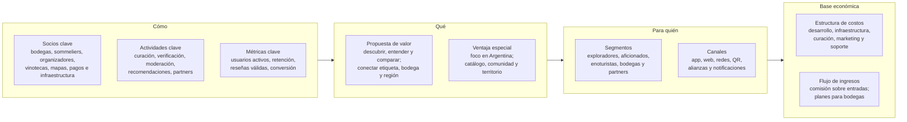
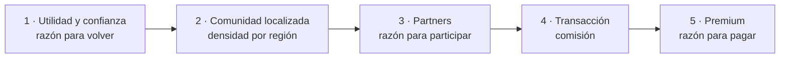

# Modelo Canvas

El modelo de negocio de Vinnot en los nueve bloques del Canvas, más su ventaja
especial. Toma los aprendizajes del [análisis competitivo](competitive-analysis.md) y
los ordena en una propuesta global que empieza por el mercado argentino, con las hipótesis que hay que
validar y la secuencia en la que conviene construir y monetizar.

## Posicionamiento: del catálogo al ecosistema

Vinnot ocupa un espacio intermedio que ninguno de los cinco competidores analizados
cubre de la misma manera: ayudar a una persona a descubrir un vino, comprenderlo,
compararlo, guardarlo, conocer su bodega y convertir ese interés en una experiencia
física, como una visita, una cata o un evento. El eje no es tener más funciones, sino
conectar mejor decisiones que hoy están fragmentadas.

## Segmentos prioritarios

| Segmento | Necesidad principal |
|---|---|
| Exploradores | Elegir mejor sin conocimientos técnicos avanzados |
| Aficionados | Calificar, comparar y guardar vinos, y profundizar |
| Viajeros y enoturistas | Encontrar bodegas, rutas, degustaciones y eventos |
| Bodegas y partners | Presencia digital, contenido verificado y generación de demanda |

**Decisión de foco.** La primera versión comercial prioriza a la persona usuaria final
y a las bodegas verificadas. Vinotecas, agencias y la monetización B2B se incorporan
después. Esta secuencia evita que la plataforma dependa al mismo tiempo de demasiados
lados del mercado.

## Propuesta de valor

> «Descubre vinos que te gustan y conéctalos con su origen: compara etiquetas, guarda
> experiencias, sigue bodegas y encuentra dónde vivir el vino.»

Casi toda la frase está implementada: el [catálogo](../modules/wines/README.md), la
[comparación con IA](../modules/ai/README.md), la [cava](../modules/cellar/README.md),
las [bodegas y regiones](../modules/wineries/README.md), las
[rutas del vino](../modules/wine-routes/README.md) y los
[eventos](../modules/events/README.md). Seguir bodegas está pendiente: hoy Vinnot no
tiene seguidores ([Comunidad](../modules/community/README.md)).

## El Canvas propuesto

### Cómo

| Bloque | Contenido |
|---|---|
| Socios clave | Bodegas y productores; sommeliers y especialistas; organizadores de eventos y experiencias; vinotecas y partners seleccionados; proveedores de mapas, pagos e infraestructura |
| Actividades clave | Curación y normalización del catálogo; verificación de bodegas y eventos; moderación de reseñas; desarrollo de recomendaciones; incorporación de partners; producto, seguridad y analítica |
| Métricas clave | Usuarios activos mensuales; porcentaje de usuarios que guardan o califican; reseñas válidas por ficha; retención a 30 y 90 días; bodegas verificadas activas; conversión a evento o reserva. El detalle está en [Métricas clave](key-metrics.md) |

### Qué

| Bloque | Contenido |
|---|---|
| Propuesta de valor única | Descubrir y comparar vinos en un solo lugar; entender el vino sin barreras técnicas; conectar cada etiqueta con su bodega, su región y sus experiencias; construir un perfil personal de gustos; encontrar eventos y rutas relevantes |
| Ventaja especial | Foco profundo en Argentina y Latinoamérica; integración de catálogo, comunidad y territorio; base de datos propia y relaciones con bodegas; experiencia visual y editorial coherente con el mundo del vino |

### Para quién

| Bloque | Contenido |
|---|---|
| Segmentos de clientes | Exploradores y consumidores ocasionales; aficionados y entusiastas; enoturistas; bodegas y partners profesionales |
| Canales | App móvil; web y SEO; redes sociales y contenido; códigos QR en bodegas y eventos; alianzas con bodegas y sommeliers; notificaciones y recomendaciones |

### Base económica

| Bloque | Contenido |
|---|---|
| Estructura de costos | Desarrollo y mantenimiento; infraestructura, mapas y almacenamiento; curación y moderación de datos; marketing y adquisición; soporte y operación de partners; servicios de pagos para las transacciones. Los montos están en [Costos actuales](costs.md) |
| Flujo de ingresos | Comisión por reservas y experiencias; suscripción Premium para personas usuarias; planes profesionales para bodegas y partners; promoción destacada claramente identificada; servicios B2B de presencia y analítica agregada. El estado de cada fuente está en la tabla siguiente |

### El Canvas como lienzo

[Ver diagrama de «El Canvas como lienzo» completo](https://images.vinnot.com/docs/diagrams/v1/es/business-business-model-canvas-8b385d8fa5fa.svg)

## Estado de las fuentes de ingreso

| Fuente del Canvas | Estado en octubre de 2026 | Detalle |
|---|---|---|
| Comisión por reservas y experiencias | Implementado para entradas de eventos | 3 % del total de cada entrada paga, cobrado con el split de Mercado Pago ([Pagos](../modules/payments/README.md)). El aumento a 8 % y a 12 % está planificado ([Monetización y planes](monetization.md)). La reserva de visitas a bodegas no existe |
| Planes profesionales para bodegas y partners | Planificado | Plan gratuito con perfil, vinos propios, eventos y métricas básicas, y plan Pro de 20 USD por mes con informes; lanzamiento objetivo el 01-03-2027 ([Monetización y planes](monetization.md)) |
| Servicios B2B de presencia y analítica agregada | Planificado dentro del plan pago | Pulso semanal e informe mensual con el interés, la opinión y la audiencia de los vinos de cada bodega; ninguna cifra se presenta como venta ([Informes para bodegas](winery-reports.md)) |
| Suscripción Premium para personas usuarias | Hipótesis | Sin planificar; depende de validar antes una capa Premium |
| Promoción destacada identificada | Hipótesis | Sin planificar; exige separar la promoción del ranking orgánico ([FODA](swot.md#cruce-estratégico)) |

## Hipótesis que el Canvas debe validar

1. La persona usuaria valora una experiencia integrada más que varias aplicaciones
   especializadas.
2. Las bodegas encuentran útil participar cuando la plataforma genera descubrimiento o
   demanda medible.

Ambas hipótesis deben probarse antes de ampliar los costos de marketplace, reservas o
planes profesionales.

## Secuencia de negocio

Qué construir y monetizar primero, y qué dejar para después.

| Etapa | Qué construir | Qué medir | Estado en octubre de 2026 |
|---|---|---|---|
| 1 · Utilidad y confianza | Catálogo, comparación, favoritos, reseñas, mapa y bodegas verificadas | Activación, retención, fichas consultadas, guardados y reseñas | Implementado: catálogo, comparación con IA, cava («Mi Bodega»), reseñas, bodegas y rutas sobre el mapa. Pendiente: la verificación de bodegas; hoy las administra el equipo |
| 2 · Comunidad localizada | Eventos, seguimiento de bodegas, recomendaciones y contenido regional | Usuarios recurrentes, participación, regiones activas | Implementado: eventos por cercanía, regiones en los filtros y sugerencias personalizadas por push ([`UC-NOT-07`](../modules/notifications/use-cases/uc-not-07-receive-suggestions.md)). Pendiente: seguir bodegas |
| 3 · Partners | Perfiles profesionales, eventos administrables, leads y analítica básica | Partners activos, leads, eventos publicados y conversión | Implementado: el rol partner publica y administra sus eventos e inscripciones ([Partners](../modules/partner/README.md)). Planificado: informes para bodegas |
| 4 · Transacción | Reservas de experiencias y, más adelante, afiliación o comercio | GMV, tasa de reserva, comisión, repetición | Implementado: entradas de eventos pagos con comisión. Pendiente: reservas de visitas y comercio |
| 5 · Premium | Funciones avanzadas de cava, personalización o asistencia | Conversión a Premium, churn y uso de funciones pagas | Planificado: suscripción para bodegas. Hipótesis: Premium para personas usuarias |

El cobro de entradas se implementó antes de completar las etapas 2 y 3: es la única
transacción activa y no depende de stock propio.

[Ver diagrama de «Secuencia de negocio» completo](https://images.vinnot.com/docs/diagrams/v1/es/business-business-model-canvas-8827bcd780a9.svg)

**Por qué esta secuencia.** Vivino demuestra el valor del efecto de red;
Wine-Searcher, el valor de la información; CellarTracker, la retención por historial;
Winedering, la monetización transaccional; y Viniou, la lógica freemium. La
propuesta de Vinnot ordena esos aprendizajes para no intentar monetizar cinco modelos
al mismo tiempo.

**Criterio de decisión.** Si una función no mejora la activación, la confianza, la
recurrencia o una ruta clara de monetización, queda fuera de la prioridad inmediata.

## Conclusión

Vinnot puede diferenciarse no por replicar cada función de sus competidores, sino por
conectar el vino con su contexto: etiqueta, gusto personal, bodega, territorio y
experiencia. Esa integración es especialmente coherente con un mercado como el
argentino, donde el producto y el turismo del vino están fuertemente relacionados.

La condición principal es mantener el foco. El Canvas prioriza descubrimiento,
confianza y comunidad; después incorpora partners y, solo cuando exista demanda
suficiente, monetización transaccional y Premium. Así el modelo crece sobre evidencia
de uso y no sobre supuestos.

**Síntesis.** Vinnot construye primero una razón clara para volver; después, una
razón clara para que bodegas y partners participen; y recién entonces, una razón
clara para pagar.
