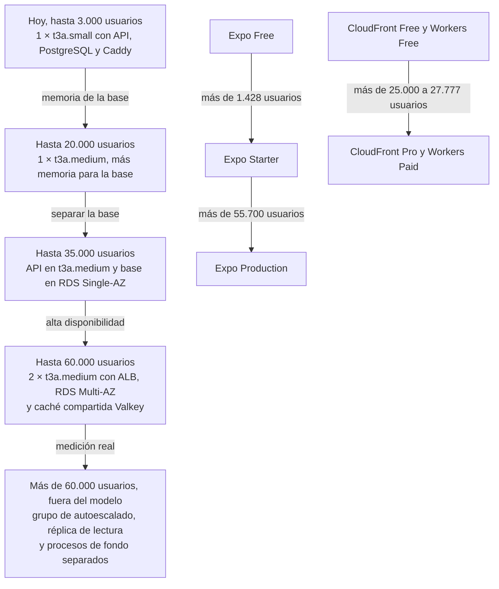

# Capacidad y proyección de costos

Cuántos usuarios soporta Vinnot con los planes que tiene hoy, qué límite se alcanza
primero y qué hay que cambiar, y a qué costo, para llegar a 1.000, 5.000, 10.000 y
50.000 usuarios. Todas las cifras de esta página son una **estimación** con precios y
costos relevados el 29-10-2026; dependen de los [supuestos](#supuestos) y no de una
prueba de carga, que todavía no existe.

Las tablas salen del mismo modelo que usa el
[simulador de costos por escala](cost-simulator.mdx)
([`projection.mjs`](../../../docs-site/src/components/CostProjection/projection.mjs)),
y una prueba automática fija sus números: si cambian, cambian aquí y en el simulador.
El punto de partida está en [Costos actuales](costs.md).

## En pocas palabras

En esta página, «usuarios» significa usuarios activos mensuales (MAU).

| Escala | ¿Alcanzan los planes de hoy? | Qué cambia | USD por mes | USD por año |
|---|---|---|---:|---:|
| Hoy | Sí | — | 83,31 (medido) | 999,74 a 1.066,94 |
| 1.000 | Sí | Nada | 80,68 | 968,16 |
| 5.000 | No | Expo Starter, host t3a.medium y subir el tope de IA | 124,71 | 1.496,52 |
| 10.000 | No | Lo mismo que en 5.000, con más uso | 153,21 | 1.838,52 |
| 50.000 | No | Dos hosts detrás de un balanceador, base RDS Multi-AZ, caché compartida, CloudFront Pro, Workers Paid y mapas web pagos | 716,89 | 8.602,68 |

- **Hoy, sin contratar nada nuevo:** unos **1.000 a 1.400 usuarios activos mensuales**,
  es decir, unos 200 a 290 usuarios por día.
- **Primer cuello de botella:** el plan Free de Expo, con 1.000 usuarios de
  actualizaciones de la app por mes. Si toda la audiencia usara la app, el límite sería
  exactamente 1.000.
- **La API no es el primer límite.** Con los supuestos, el host t3a.small atiende unos
  **3.000 usuarios activos mensuales**; lo que se agota primero es la memoria para la
  base de datos, no la CPU.

## Supuestos

| Supuesto | Valor | Por qué |
|---|---:|---|
| Usuarios activos por día sobre los mensuales | 20 % | Proporción habitual en apps de consumo de uso no diario |
| Pedidos a la API por usuario activo por día | 50 | Unas dos sesiones de navegación, ficha, reseñas y cava; las imágenes no pasan por la API |
| Parte del tráfico diario en la hora pico | 12 % | El uso se concentra a la tarde y a la noche |
| CPU por pedido a la API (backend y base) | 30 ms | Consultas JPA y SQL simples, serialización JSON y filtros de seguridad |
| Usuarios que usan la web | 30 % | El resto usa la app móvil |
| Pedidos a CloudFront por usuario web por mes | 120 | HTML, paquetes JS y CSS y fuentes, con caché del navegador |
| Imágenes que llegan al Worker por usuario activo por día | 20 | El resto sale de la caché del dispositivo |
| Cargas de mapa por usuario web por mes | 2 | Mapas de rutas y eventos en la web |
| Emails por usuario por mes | 2 | Verificación, recuperación de contraseña y avisos |
| Gasto de IA por usuario por mes | USD 0,002 | Los perfiles IA se guardan por vino e idioma, así que la mayoría de las lecturas no llama a OpenAI; pagan los vinos nuevos, las comparaciones nuevas y el escáner |
| Imágenes subidas por usuario por mes | 0,3 | Avatares, etiquetas y portadas; tamaño medio unos 300 KB (máximo 128 KiB por avatar y 512 KiB por etiqueta) |
| Datos de lectura frecuente por usuario | 50 KB | Vistas de detalle de 180 días, aperturas, reseñas, cava y puntos |
| Catálogo, índice de búsqueda y datos de referencia | 100 MB | Tamaño fijo, no depende de los usuarios |
| Duración de una sesión, solo para estimar la concurrencia | 8 minutos | — |

Fórmulas que usa el modelo:

- usuarios por día = usuarios por mes × 20 %;
- pedidos por segundo en la hora pico = usuarios por mes × 0,20 × 50 × 0,12 / 3.600
  = usuarios por mes / 3.000;
- usuarios de la app = usuarios por mes × 70 %;
- sesiones simultáneas en el pico ≈ usuarios por día × 12 % × 8 / 60.

## Límites de la plataforma hoy

Valores del código y de la configuración de producción. La infraestructura completa
está en [Despliegue en AWS](../infra/architecture/aws-deployment.md).

| Recurso | Límite actual | Fuente |
|---|---|---|
| Host de producción | Un EC2 t3a.small: 2 vCPU, 2 GiB de RAM, créditos de CPU en modo `standard` | [`production-stack.json`](../../../infra/aws-low-cost/production-stack.json) |
| CPU sostenida | 20 % por vCPU (0,4 vCPU en total); gana 24 créditos por hora y acumula hasta 576. Sin créditos, la CPU baja a ese 20 % | [AWS, instancias de rendimiento ampliable](https://docs.aws.amazon.com/AWSEC2/latest/UserGuide/burstable-credits-baseline-concepts.html) |
| Memoria de los contenedores | Backend 768 MiB (JVM con `-Xmx512m`), PostgreSQL 384 MiB, Caddy 96 MiB; 1,25 GiB de los 2 GiB del host, más 2 GiB de swap | [`docker-compose.yml`](../../../infra/aws-low-cost/docker-compose.yml), [`compose.postgres.yml`](../../../infra/aws-low-cost/compose.postgres.yml) |
| Conexiones | Hikari con 6 conexiones como máximo; Tomcat con 30 hilos; PostgreSQL con `max_connections = 20` y `shared_buffers = 96MB` | [`docker-compose.yml`](../../../infra/aws-low-cost/docker-compose.yml), [`compose.postgres.yml`](../../../infra/aws-low-cost/compose.postgres.yml) |
| Límites de pedidos | General 300 por minuto; catálogo público 180 por minuto y 1.500 por día; IA 20 por hora; escáner 30 por hora; en memoria de cada instancia | [`application.yml`](../../../backend/src/main/resources/application.yml), [Protección de recursos](../backend/architecture/resource-protection.md) |
| Imágenes | Hasta 2 conversiones a WebP a la vez, 10 segundos por conversión | [Imágenes de usuarios](../infra/operations/user-images-r2.md) |
| CloudFront | Plan Free: 1 millón de pedidos y 100 GB por mes | [`production-web-stack.json`](../../../infra/aws-low-cost/production-web-stack.json) |
| R2 | Cupo gratuito de 10 GB, 1 millón de operaciones clase A y 10 millones clase B por mes. La app agrega salvaguardas por entorno: 512 MiB reservados, 5.000 escrituras y 100.000 lecturas por mes | [`application.yml`](../../../backend/src/main/resources/application.yml) (`APP_STORAGE_R2_MAX_*`) |
| Worker de imágenes | Workers Free: 100.000 pedidos por día | [Catálogo de imágenes en R2](../infra/operations/catalog-images-r2.md) |
| Expo | Plan Free: 1.000 usuarios de actualizaciones por mes; por encima hay que pasar a un plan pago | [Expo](https://expo.dev/pricing) |
| Google Maps | SDK móvil gratis; en la web, 10.000 cargas de mapa gratis por mes | [Google Maps Platform](https://developers.google.com/maps/billing-and-pricing/pricing) |
| OpenAI | Tope de la app `AI_MONTHLY_LIMIT_USD = 15` en producción; límite de USD 15 en el proyecto de OpenAI | [Protección de recursos](../backend/architecture/resource-protection.md) |

## Cuántos usuarios soporta hoy

### CPU: no es el límite

Con los supuestos, a 3.000 usuarios por mes la hora pico trae 1 pedido por segundo,
que consume 0,03 vCPU. El host sostiene 0,4 vCPU sin gastar créditos. A 50.000 usuarios
serían 16,67 pedidos por segundo y 0,5 vCPU. Los hilos de Tomcat y las conexiones de
Hikari tampoco se agotan con ese volumen. Lo que sí consume ráfagas de CPU es la
conversión de imágenes y las tareas programadas; por eso existe una alarma cuando los
créditos bajan de 12 ([Observabilidad](../infra/operations/observability-and-incidents.md)).

### Memoria de la base: el límite de la API

PostgreSQL corre en un contenedor de 384 MiB. Descontando su propio consumo, quedan unos
250 MB para mantener en memoria los datos que se leen seguido. El catálogo ocupa unos
100 MB y cada usuario suma unos 50 KB, así que:

(250 − 100) MB / 50 KB = **3.000 usuarios**.

Por encima, la base empieza a leer del disco y la API se vuelve lenta antes de fallar.
Un t3a.medium (4 GiB, misma CPU) deja unos 1.100 MB para la base: (1.100 − 100) MB /
50 KB = **20.000 usuarios**.

### Todos los límites, en el orden en que se alcanzan

| Límite | Usuarios por mes que todavía entran | Tipo de cambio | Qué hacer |
|---|---:|---|---|
| Expo Free: 1.000 usuarios de actualizaciones por mes | 1.428 | Cambio de plan | Pasar a Expo Starter (USD 19 por mes más USD 0,005 por usuario sobre 3.000) |
| Memoria de la base en el host t3a.small | 3.000 | Cambio de plan | Pasar el host a t3a.medium |
| Tope de IA `AI_MONTHLY_LIMIT_USD = 15` | 7.500 | Cambio de configuración | Subir el tope en la app y el límite del proyecto en OpenAI; sin eso, las funciones de IA se rechazan al llegar al tope |
| Salvaguarda de 5.000 escrituras R2 por mes | 16.666 | Cambio de configuración | Subir `APP_STORAGE_R2_MAX_MONTHLY_WRITES` y las demás salvaguardas; R2 sigue gratis hasta 1 millón de escrituras |
| Cupo gratuito de Google Maps JavaScript | 16.666 | Costo variable | Pagar USD 7 cada 1.000 cargas extra o cambiar el mapa web por una alternativa sin costo por carga |
| Base de datos en el mismo host que la API | 20.000 | Cambio de plan | Separar la base en RDS |
| Workers Free: 100.000 pedidos por día | 25.000 | Cambio de plan | Pasar a Workers Paid (USD 5 por mes, 10 millones de pedidos) |
| CloudFront Free: 1 millón de pedidos por mes | 27.777 | Cambio de plan | Pasar a CloudFront Pro (USD 15 por mes, 10 millones de pedidos) |
| Una sola instancia de la API, sin alta disponibilidad | 35.000 | Cambio de plan | Dos instancias detrás de un balanceador, base Multi-AZ y caché compartida |

**Resultado para hoy:**

| Medida | Estimación |
|---|---|
| Usuarios activos mensuales sin contratar nada nuevo | 1.000 a 1.428 (el límite es Expo Free) |
| Usuarios activos por día equivalentes | 200 a 286 |
| Usuarios activos mensuales que soporta la API en el host actual | Unos 3.000 (600 por día) |
| Pedidos por segundo en la hora pico a 3.000 usuarios | 1 |
| Sesiones simultáneas en el pico a 3.000 usuarios | Unas 10 |
| Primer cuello de botella | Expo Free, a partir de 1.429 usuarios por mes |

Por encima de 1.000 usuarios de actualizaciones, Expo exige un plan pago. El límite
afecta a las actualizaciones por aire (OTA), no a la app instalada, que sigue
funcionando con la versión que ya tiene.

## Escenarios de 1.000 a 50.000 usuarios

Plan necesario por servicio y su costo en USD por mes. El modelo supone que ya se borró
la instancia RDS sobrante ([oportunidades de ahorro](costs.md#oportunidades-de-ahorro)).

| Servicio | 1.000 | 5.000 | 10.000 | 50.000 |
|---|---|---|---|---|
| Servidor de la API (EC2) | 1 × t3a.small, API y base juntas: 19,93 | 1 × t3a.medium, API y base juntas: 33,66 | 1 × t3a.medium, API y base juntas: 33,66 | 2 × t3a.medium detrás de un ALB: 94,33 |
| Base de datos | PostgreSQL en el mismo host: 0 | PostgreSQL en el mismo host: 0 | PostgreSQL en el mismo host: 0 | RDS db.t4g.medium Multi-AZ, 50 GB: 105,67 |
| Caché compartida | En memoria de la instancia: 0 | En memoria de la instancia: 0 | En memoria de la instancia: 0 | ElastiCache Valkey t4g.micro: 9,34 |
| CDN de la web (CloudFront) | Plan Free: 0 | Plan Free: 0 | Plan Free: 0 | Plan Pro: 15,00 |
| Imágenes (Worker y R2) | Workers Free: 0 | Workers Free: 0 | Workers Free: 0 | Workers Paid: 5,00 |
| Actualizaciones de la app (Expo) | Plan Free: 0 | Plan Starter: 21,50 | Plan Starter: 39,00 | Plan Starter: 179,00 |
| IA (OpenAI) | Tope actual de USD 15: 2,00 | Tope actual de USD 15: 10,00 | Tope de USD 20: 20,00 | Tope de USD 100: 100,00 |
| Email (SES) | 2.000 emails: 0,20 | 10.000 emails: 1,00 | 20.000 emails: 2,00 | 100.000 emails: 10,00 |
| Mapas en la web | 600 cargas, gratis: 0 | 3.000 cargas, gratis: 0 | 6.000 cargas, gratis: 0 | 30.000 cargas, 20.000 pagas: 140,00 |
| CI (GitHub Actions) | 33,05 | 33,05 | 33,05 | 33,05 |
| Fijos (desarrollo, otros AWS, Apple, dominio) | 25,50 | 25,50 | 25,50 | 25,50 |
| **Total por mes** | **80,68** | **124,71** | **153,21** | **716,89** |
| **Total por año** | **968,16** | **1.496,52** | **1.838,52** | **8.602,68** |

### Cómo se calcula cada costo

| Línea | Cuenta |
|---|---|
| 1 × t3a.small | 13,72 + 32 GB × 0,08 + 3,65 de IPv4 = 19,93 |
| 1 × t3a.medium | 27,45 + 32 GB × 0,08 + 3,65 = 33,66 |
| 2 × t3a.medium y ALB | 2 × 27,45 + 2 × 16 GB × 0,08 + 4 IPv4 × 3,65 (dos hosts y dos nodos del ALB) + 16,43 + 730 h × 0,008 por LCU = 94,33 |
| RDS db.t4g.medium Multi-AZ | 94,17 + 50 GB × 0,23 = 105,67 |
| Expo Starter | 19 + 0,005 × (usuarios de la app − 3.000); a 50.000 usuarios, 35.000 usan la app: 19 + 0,005 × 32.000 = 179,00 |
| Mapas en la web | (cargas − 10.000) / 1.000 × 7 |
| Fijos | Desarrollo 14,65 (t3a.small unas 517 horas: 9,72; 16 GB: 1,28; IPv4: 3,65) + otros AWS 1,67 (Secrets Manager, ECR, CloudWatch y S3) + Apple 8,25 + dominio 0,93 (USD 11,17 ÷ 12) |

A 1.000 usuarios el modelo da menos que el costo de hoy (80,68 frente a 83,31) porque
supone borrada la instancia RDS sobrante. GitHub Actions no crece con los usuarios: crece
con el trabajo de desarrollo, así que se mantiene constante.

### Qué cambia en cada escala

**1.000 usuarios.** Los planes de hoy alcanzan. Conviene contratar Expo Starter un poco
antes de llegar a 1.400 usuarios para no frenar las actualizaciones de la app.

**5.000 usuarios.** Se cruzan dos límites: Expo Free (pasar a Starter) y la memoria del
host (pasar a t3a.medium, 4 GiB, y darle más memoria al contenedor de PostgreSQL). El
tope de IA de USD 15 todavía alcanza (la IA gasta USD 10).
CloudFront, Workers, R2 y Google Maps siguen dentro de sus cupos gratuitos.

**10.000 usuarios.** La misma arquitectura que en 5.000. Crecen Expo (USD 39), la IA
(USD 20, con el tope `AI_MONTHLY_LIMIT_USD` y el límite de OpenAI subidos a USD 20) y SES. Conviene preparar el paso siguiente: medir con una prueba de carga y
planificar la separación de la base antes de 20.000 usuarios.

**50.000 usuarios.** Cambia la arquitectura:

- **Dos instancias de la API detrás de un Application Load Balancer**, para no depender
  de un solo host. Los límites de pedidos viven hoy en la memoria de cada instancia
  ([Protección de recursos](../backend/architecture/resource-protection.md)); con dos
  instancias, cada una contaría por separado. Por eso entra una **caché compartida**
  (ElastiCache Valkey) para los límites y las cachés.
- **Base de datos en RDS db.t4g.medium Multi-AZ**: 4 GiB para unos 2,6 GB de datos de
  lectura frecuente, copia en otra zona y backups gestionados con restauración a un
  momento dado. Hoy el backup es diario, con pérdida máxima de 24 horas
  ([Backups y recuperación](../infra/operations/backup-and-disaster-recovery.md)).
- **CloudFront Pro** (1,8 millones de pedidos por mes) y **Workers Paid** (200.000
  pedidos por día).
- **Mapas en la web**: 30.000 cargas por mes, de las cuales 20.000 se pagan (USD 140).
  Es la línea que más crece; conviene evaluar una alternativa sin costo por carga.
- **Expo**: Starter sigue siendo más barato que Production (USD 179 frente a 199).
  Production conviene desde unos 55.700 usuarios.

### Alternativas y opciones

| Opción | Efecto | Contrapartida |
|---|---|---|
| Graviton: t4g.medium en lugar de t3a.medium | USD 24,53 en lugar de 27,45 por host | Requiere construir la imagen del backend para arm64 |
| Créditos de CPU en modo `unlimited` | La CPU no baja al 20 % ante ráfagas largas | Se paga cada hora de CPU sobre la base (USD 0,05 por vCPU-hora en T3; la tarifa de T3a no está confirmada) |
| RDS Single-AZ en lugar de Multi-AZ a 50.000 usuarios | USD 53,20 en lugar de 105,67 | Sin copia en otra zona: una falla de zona deja sin servicio |
| Expo Production en lugar de Starter | Más usuarios incluidos y más builds | USD 199 fijos; solo conviene desde unos 55.700 usuarios |

## Ingresos para cubrir los costos

Cuántas entradas o cuántas bodegas Pro hacen falta para cubrir **los costos de
plataforma** de cada escala. No incluye sueldos, marketing ni impuestos.

Supuestos editables en el [simulador de ingresos](revenue-simulator.mdx):

- precio medio de la entrada: ARS 20.000;
- tipo de cambio: ARS 1.450 por USD (supuesto, no cotización);
- 30 entradas por evento;
- comisión por entrada: USD 0,41 al 3 %, USD 1,10 al 8 % y USD 1,66 al 12 %;
- neto por bodega Pro: USD 17 con tienda al 15 % y USD 14 con tienda al 30 %
  ([Monetización y planes](monetization.md#economía-de-las-tiendas)).

| Escala | USD por mes | Entradas al 3 % | Entradas al 8 % | Entradas al 12 % | Bodegas Pro (15 %) | Bodegas Pro (30 %) |
|---|---:|---:|---:|---:|---:|---:|
| Hoy | 83,31 | 202 (7 eventos) | 76 (3 eventos) | 51 (2 eventos) | 5 | 6 |
| 1.000 | 80,68 | 195 (7 eventos) | 74 (3 eventos) | 49 (2 eventos) | 5 | 6 |
| 5.000 | 124,71 | 302 (11 eventos) | 114 (4 eventos) | 76 (3 eventos) | 8 | 9 |
| 10.000 | 153,21 | 371 (13 eventos) | 139 (5 eventos) | 93 (4 eventos) | 10 | 11 |
| 50.000 | 716,89 | 1.733 (58 eventos) | 650 (22 eventos) | 434 (15 eventos) | 43 | 52 |

Cómo leerla:

- Pasar del 3 % al 12 % reduce a la cuarta parte las entradas necesarias para cubrir
  los costos.
- Las fuentes se suman. Por ejemplo, a 10.000 usuarios, cuatro eventos de 30 entradas
  al 8 % dejan USD 132,41; faltan USD 20,80, que cubren 2 bodegas Pro.
- La comisión se cobra en pesos y los costos se pagan en dólares: una devaluación sin
  ajuste de precios de las entradas reduce el ingreso en dólares.
- La tarifa de Mercado Pago la paga el vendedor y no reduce la comisión de Vinnot.

## Evolución de la arquitectura

[Ver diagrama de «Evolución de la arquitectura» completo](https://images.vinnot.com/docs/diagrams/v1/es/business-capacity-and-cost-projections-db4a9ef65581.svg)

## Sensibilidad

Los límites se mueven con los supuestos. Los más sensibles:

| Si cambia… | Efecto |
|---|---|
| Datos por usuario: 100 KB en lugar de 50 KB | Los límites de memoria se reducen a la mitad: 1.500 usuarios en t3a.small y 10.000 en t3a.medium |
| Uso de la web: 50 % en lugar de 30 % | Expo Free alcanza hasta 2.000 usuarios; CloudFront Free hasta 16.666 y el cupo de mapas hasta 10.000 |
| Gasto de IA: USD 0,005 por usuario en lugar de 0,002 | El tope de USD 15 alcanza para 3.000 usuarios; a 50.000 usuarios la IA cuesta USD 250 por mes |
| Pedidos a la API: el doble | La CPU sigue lejos del límite (1 vCPU a 50.000 usuarios, repartido en dos hosts) |
| Precio de la entrada o tipo de cambio | Las entradas necesarias cambian en proporción inversa |

Antes de decidir un cambio de plan por estas cifras, mide: no hay pruebas de carga en el
repositorio, y la telemetría de producción
([Observabilidad](../infra/operations/observability-and-incidents.md)) da la memoria,
la CPU y las conexiones reales.

## Fuentes

Precios públicos consultados el 29-10-2026, región us-east-1, 730 horas por mes:

- AWS EC2 bajo demanda: https://aws.amazon.com/ec2/pricing/on-demand/
- AWS, créditos de CPU de instancias ampliables: https://docs.aws.amazon.com/AWSEC2/latest/UserGuide/burstable-credits-baseline-concepts.html
- AWS EBS: https://aws.amazon.com/ebs/pricing/
- AWS VPC, IPv4 públicas: https://aws.amazon.com/vpc/pricing/
- AWS RDS para PostgreSQL: https://aws.amazon.com/rds/postgresql/pricing/
- AWS Elastic Load Balancing: https://aws.amazon.com/elasticloadbalancing/pricing/
- AWS ElastiCache: https://aws.amazon.com/elasticache/pricing/
- AWS SES: https://aws.amazon.com/ses/pricing/
- CloudFront, planes de tarifa plana: https://aws.amazon.com/cloudfront/pricing/ y https://docs.aws.amazon.com/AmazonCloudFront/latest/DeveloperGuide/flat-rate-pricing-plan.html
- Cloudflare R2: https://developers.cloudflare.com/r2/pricing/
- Cloudflare Workers: https://developers.cloudflare.com/workers/platform/pricing/
- Expo: https://expo.dev/pricing
- Google Maps Platform: https://developers.google.com/maps/billing-and-pricing/pricing
- OpenAI: https://developers.openai.com/api/docs/pricing
- Mercado Pago: https://www.mercadopago.com.ar/herramientas-para-vender/check-out
