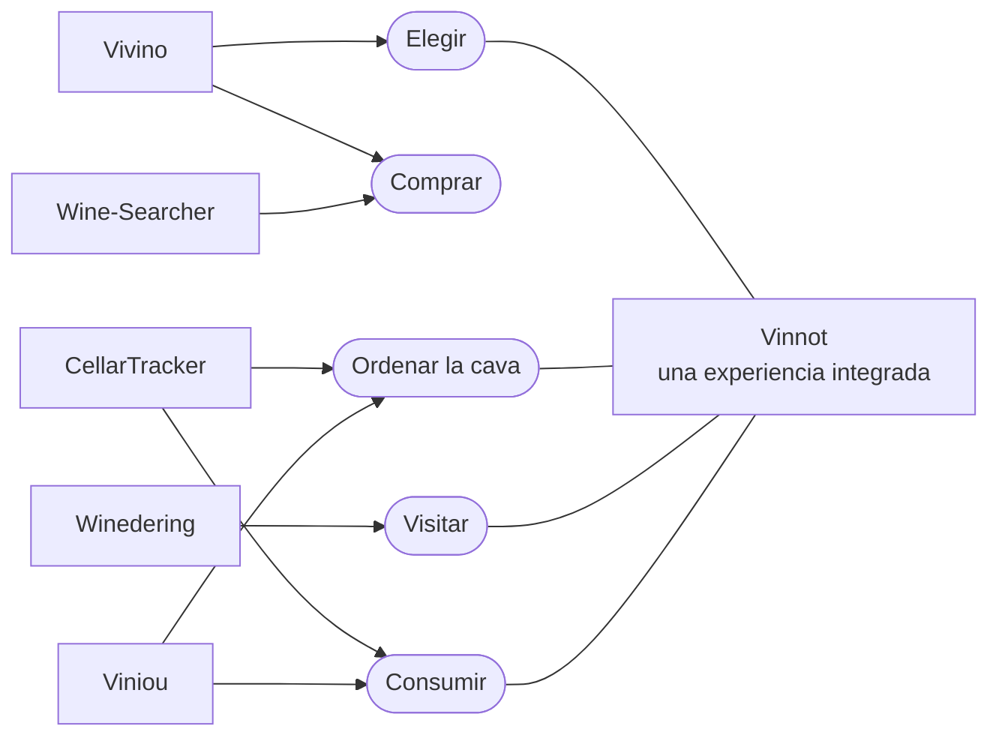

# Análisis competitivo

Cinco plataformas internacionales del ecosistema del vino, cada una de un país
distinto, analizadas con información pública consultada en octubre de 2026. El
objetivo no es copiar un modelo existente, sino detectar patrones de negocio que
ayuden a diseñar una propuesta consistente para Vinnot. La propuesta resultante está
en el [modelo Canvas de Vinnot](business-model-canvas.md).

## Casos analizados

| # | Caso | País | Núcleo de valor | Por qué sirve para Vinnot |
|---|---|---|---|---|
| 01 | Vivino | Dinamarca | Comunidad, descubrimiento y marketplace | Escala de comunidad y personalización |
| 02 | Wine-Searcher | Nueva Zelanda | Búsqueda global y comparación de precios | Datos, precios y tráfico hacia terceros |
| 03 | CellarTracker | Estados Unidos | Gestión de cava y comunidad | Retención por utilidad recurrente |
| 04 | Winedering | Italia | Marketplace de enoturismo | Reservas de experiencias y partners |
| 05 | Viniou | Francia | Gestión de cava freemium con IA | Freemium de utilidad personal |

Cada caso se describe con los bloques del modelo Canvas: socios clave, actividades
clave, propuesta de valor única, ventaja especial, segmentos de clientes, canales,
flujo de ingresos, estructura de costos y métricas clave. Los bloques se agrupan en
**Cómo** (socios, actividades, métricas), **Qué** (propuesta y ventaja) y **Para
quién** (segmentos, canales), con costos e ingresos como base económica. Ese
agrupamiento ayuda a leer cada modelo como un sistema y no como una lista de
casilleros.

## Cinco modelos para problemas distintos

La competencia de Vinnot no se limita a una sola aplicación. Una persona puede
resolver cada necesidad con un producto diferente: consultar una etiqueta, comparar
precios, registrar su cava, reservar una visita o recibir recomendaciones. Por eso
conviene observar modelos especializados antes de definir qué combinación ofrece
Vinnot.

| Caso | Problema principal | Ventaja observable | Monetización |
|---|---|---|---|
| Vivino | Descubrir, calificar y comprar vinos | Comunidad masiva, escaneo y personalización | Premium y marketplace |
| Wine-Searcher | Encontrar dónde comprar y a qué precio | Base global de ofertas y comparación | Cuenta PRO, costo por clic y datos por API |
| CellarTracker | Administrar una colección y decidir qué beber | Profundidad de inventario y notas | Suscripción |
| Winedering | Descubrir y reservar experiencias enológicas | Marketplace vertical con oferta curada | Comisión por reserva |
| Viniou | Gestionar la cava personal de forma simple | Freemium con automatización e IA | Suscripción Premium |

**Hallazgo central.** Los cinco casos muestran que la especialización funciona cuando
cada producto convierte datos del vino en una decisión concreta: elegir, comprar,
ordenar, visitar o consumir. Vinnot puede diferenciarse uniendo varias decisiones
dentro de una misma experiencia, sin perder foco.

### Qué decisión resuelve cada plataforma

Cada competidor se especializa en una o dos decisiones; Vinnot apunta a conectar
varias de ellas alrededor de un mismo vino.

[Ver diagrama de «Qué decisión resuelve cada plataforma» completo](https://images.vinnot.com/docs/diagrams/v1/es/business-competitive-analysis-a1b4571ebed8.svg)

Vinnot cubre hoy elegir (catálogo, reseñas, comparación con IA), ordenar (la cava,
«Mi Bodega») y visitar (bodegas, rutas y eventos con entradas). La compra de botellas
no forma parte del producto.

## Canvas de cada competidor

En cada caso, la propuesta, los segmentos, los canales y los ingresos se apoyan en
fuentes públicas; los socios internos, los costos y las métricas no publicados son
inferencias estratégicas razonables, no información confidencial de las empresas.

### Vivino · Dinamarca

Comunidad, escaneo, recomendaciones y marketplace. Fuentes: [1], [2], [3].

| Bloque | Contenido |
|---|---|
| Socios clave | Comercios y retailers independientes; comunidad de usuarios y creadores de reseñas; proveedores de pagos, logística y datos |
| Actividades clave | Identificación y enriquecimiento de vinos; moderación y agregación de reseñas; personalización y recomendación; operación del marketplace |
| Propuesta de valor | Identificar una botella al instante; decidir con ratings y reseñas; recibir recomendaciones según el gusto personal; comprar desde un catálogo integrado |
| Ventaja especial | Escala de comunidad y base de vinos; historial de comportamiento y preferencias; reconocimiento de etiquetas consolidado |
| Segmentos | Consumidores ocasionales; aficionados al vino; compradores frecuentes; retailers y merchants |
| Canales | App iOS y Android; web y SEO; escaneo de etiquetas y listas; notificaciones y recomendaciones |
| Estructura de costos | Producto, infraestructura y datos; reconocimiento de imágenes y personalización; soporte, moderación y adquisición; operación comercial del marketplace |
| Flujo de ingresos | Suscripción Premium; intermediación en el marketplace; promociones y acuerdos comerciales |
| Métricas clave | Usuarios activos y escaneos; ratings y reseñas por vino; conversión a compra; retención y adopción de Premium |

**Lectura estratégica.** Vivino combina utilidad inmediata y efecto de red: cada
escaneo puede terminar en información, comunidad o compra. Su mayor aprendizaje para
Vinnot es que el hábito se construye alrededor de una acción simple y repetible
(identificar y calificar una botella) y luego se amplía hacia otras funciones.

### Wine-Searcher · Nueva Zelanda

Búsqueda global y comparación de precios. Fuentes: [4], [5].

| Bloque | Contenido |
|---|---|
| Socios clave | Tiendas, brokers, subastas y productores; críticos y fuentes editoriales; proveedores de datos y clientes de la API |
| Actividades clave | Recolección y normalización de listas de precios; matching de productos y añadas; ranking y búsqueda; producción de inteligencia de mercado |
| Propuesta de valor | Encontrar disponibilidad y mejores precios; comparar ofertas globales; consultar regiones, críticos y tendencias; acceder a datos de mercado |
| Ventaja especial | Profundidad histórica de precios y disponibilidad; cobertura internacional de retailers; especialización en búsqueda y comparación |
| Segmentos | Compradores de vino; coleccionistas y entusiastas; retailers y productores; clientes profesionales de datos |
| Canales | Web; aplicaciones móviles; SEO; API y servicios B2B |
| Estructura de costos | Infraestructura de búsqueda y datos; procesamiento y limpieza de precios; equipo editorial y técnico; adquisición y soporte comercial |
| Flujo de ingresos | Cuenta PRO; costo por clic a merchants; APIs y servicios de datos; informes e inteligencia de mercado |
| Métricas clave | Búsquedas realizadas; cobertura de comerciantes y ofertas; CTR hacia merchants; suscripciones PRO y uso de la API |

**Lectura estratégica.** Wine-Searcher demuestra que no es necesario vender
directamente la botella para capturar valor: una plataforma puede monetizar la
información, el tráfico y los datos. Para Vinnot abre una posibilidad B2B:
convertirse en infraestructura de descubrimiento sin depender desde el inicio de stock
propio.

### CellarTracker · Estados Unidos

Gestión profunda de cava y conocimiento comunitario. Fuentes: [6], [7], [8].

| Bloque | Contenido |
|---|---|
| Socios clave | Comunidad de coleccionistas; publicaciones y críticos profesionales; Wine Market Journal y Wine-Searcher; servicios de pagos e integraciones |
| Actividades clave | Gestión de inventario de botellas; notas de cata y comunidad; valoraciones y ventanas de consumo; herramientas de decisión |
| Propuesta de valor | Saber exactamente qué hay en la cava; decidir qué beber y cuándo; registrar compras, consumo y notas; consultar a la comunidad y referencias profesionales |
| Ventaja especial | Profundidad del historial personal; gran volumen de notas y botellas registradas; utilidad acumulativa: el producto mejora con cada dato ingresado |
| Segmentos | Coleccionistas; aficionados avanzados; restaurantes y bodegas; usuarios que necesitan inventario |
| Canales | Web; app móvil; integraciones con críticos y Wine-Searcher; comunidad y soporte especializado |
| Estructura de costos | Infraestructura y almacenamiento; desarrollo de producto y búsqueda; licencias e integraciones de contenidos; soporte y seguridad |
| Flujo de ingresos | Suscripción anual según el tamaño de la cava; funciones Premium y herramientas avanzadas |
| Métricas clave | Botellas gestionadas; usuarios y notas activas; conversión a suscripción; retención de coleccionistas |

**Lectura estratégica.** CellarTracker muestra otra forma de retención: el costo de
abandonar crece porque la persona acumula inventario, historial, notas y decisiones.
Vinnot puede incorporar una cava personal liviana para generar recurrencia, sin la
complejidad que alejaría al usuario casual. Esa cava ya existe en el producto como
«Mi Bodega» ([Cava](../modules/cellar/README.md)).

### Winedering · Italia

Marketplace internacional de enoturismo. Fuentes: [9], [10].

| Bloque | Contenido |
|---|---|
| Socios clave | Bodegas y fincas; turoperadores y guías; agencias de viaje y afiliados; motores de reserva y destinos |
| Actividades clave | Incorporación y curación de experiencias; traducción y publicación multilingüe; reservas y soporte; marketing, SEO y distribución B2B |
| Propuesta de valor | Descubrir experiencias auténticas de vino; reservar en línea de forma simple; acceder a una oferta verificada y multilingüe; para proveedores, visibilidad y ventas sin abono fijo |
| Ventaja especial | Especialización vertical en turismo del vino; curación manual y relación directa con proveedores; catálogo internacional de experiencias |
| Segmentos | Viajeros y enoturistas; bodegas y proveedores; agencias y turoperadores; compradores profesionales |
| Canales | Marketplace web; SEO internacional; portal B2B; afiliados, Google Things to do y partners |
| Estructura de costos | Adquisición de demanda; incorporación y curación de la oferta; soporte multilingüe; pagos, producto e integraciones |
| Flujo de ingresos | Comisión por reservas completadas; distribución B2B y acuerdos asociados |
| Métricas clave | Experiencias activas; reservas confirmadas; GMV e ingresos por comisión; conversión y reseñas verificadas |

**Lectura estratégica.** Winedering confirma que las experiencias pueden ser una
unidad de negocio independiente del comercio de botellas. Para Vinnot, el mapa y la
agenda no deberían ser solo contenido: pueden evolucionar hacia un flujo de reserva
con comisión si primero se logra una oferta suficiente y confiable. Vinnot ya cobra
una comisión sobre las entradas de eventos pagos
([Pagos](../modules/payments/README.md)); la reserva de visitas a bodegas todavía no
existe.

### Viniou · Francia

Gestión de cava freemium enriquecida con IA. Fuentes: [11], [12], [13].

| Bloque | Contenido |
|---|---|
| Socios clave | Usuarios y comunidad de valoraciones; fuentes de precios y críticos; tiendas móviles y proveedores de IA e infraestructura |
| Actividades clave | Gestión de inventario y etiquetas; enriquecimiento automático de fichas; recomendaciones, maridajes y madurez; desarrollo de funciones Premium |
| Propuesta de valor | Gestionar la cava sin costo en lo esencial; agregar botellas rápidamente con escaneo; conocer valor, madurez y maridajes; recibir asistencia personalizada |
| Ventaja especial | Freemium muy claro; automatización de tareas de cava; IA integrada con datos reales del usuario |
| Segmentos | Aficionados con cava personal; coleccionistas; usuarios que quieren asistencia sencilla |
| Canales | Web; iOS y Android; SEO de contenido; conectores con asistentes de IA |
| Estructura de costos | Infraestructura y procesamiento de imágenes; enriquecimiento de datos con IA; desarrollo y soporte; distribución móvil y marketing |
| Flujo de ingresos | Suscripción Premium mensual o anual |
| Métricas clave | Usuarios registrados; conversión a Premium; botellas ingresadas o escaneadas; retención y uso de funciones avanzadas |

**Lectura estratégica.** Viniou enseña que una propuesta freemium es viable cuando la
capa gratuita resuelve el trabajo básico y Premium agrega inteligencia, no bloqueos
artificiales. Para Vinnot es una referencia si se decide monetizar recomendaciones,
organización personal o funciones avanzadas.

## Aprendizajes comparados

| Patrón | Implicancia para Vinnot |
|---|---|
| Una acción ancla | Las plataformas fuertes tienen una acción principal reconocible: escanear, buscar un precio, gestionar la cava o reservar. Vinnot necesita un gesto inicial igual de claro |
| La comunidad necesita utilidad previa | Las reseñas potencian el valor, pero no deberían ser la única razón para entrar. La persona tiene que recibir utilidad aunque todavía haya pocas opiniones |
| El dato puede ser producto | Wine-Searcher y CellarTracker muestran que normalizar información y acumular historial genera activos difíciles de replicar |
| Monetizar después de demostrar valor | El freemium y la comisión funcionan cuando la tarea principal ya está resuelta. Cobrar antes de construir recurrencia puede frenar la adopción |
| La oferta profesional importa | Bodegas, comercios y organizadores pueden aportar contenido verificable y convertirse después en clientes B2B o socios de distribución |
| No mezclar modelos sin prioridad | Marketplace, comunidad, turismo, cava y recomendaciones pueden convivir, pero cada uno agrega costos operativos. Vinnot necesita una secuencia, no simultaneidad total |

**Síntesis.** El ecosistema digital del vino admite modelos sostenibles muy
diferentes: Vivino escala comunidad y comercio; Wine-Searcher organiza información y
deriva demanda; CellarTracker monetiza profundidad y recurrencia; Winedering
transforma experiencias en transacciones; Viniou combina utilidad gratuita con una
capa Premium.

**Conclusión comparativa.** La oportunidad de Vinnot no está en ser otro Vivino. Está
en combinar descubrimiento de vinos, territorio y experiencias con una capa de
comunidad pensada desde Argentina, construyendo primero confianza y recurrencia, y
después monetización. Cómo se ordena esa secuencia está en el
[modelo Canvas](business-model-canvas.md#secuencia-de-negocio).

## Nota metodológica

- Se priorizaron las fuentes oficiales de cada plataforma para reconstruir su
  propuesta de valor, sus funciones, su monetización y su país de operación.
- Los elementos visibles del modelo (usuarios, funciones, canales y monetización) se
  apoyan en esas fuentes públicas.
- Los componentes no publicados, en especial la estructura de costos, los socios
  internos y las métricas, son inferencias estratégicas y no datos de las empresas.
- La información corresponde a octubre de 2026; precios, planes y funciones de los
  competidores pueden cambiar.

## Fuentes

1. Vivino. «Download the Vivino App»: funciones, comunidad, escaneo, cava y
   marketplace. <https://www.vivino.com/en/app>
2. Vivino. «Vivino Premium»: beneficios y lógica de suscripción.
   <https://www.vivino.com/en/premium>
3. Vivino. Legal Center: Vivino ApS, Dinamarca; términos del marketplace y de la
   suscripción. <https://www.vivino.com/en/legal>
4. Wine-Searcher. Media Kit: búsqueda, comparación, cuenta PRO y costo por clic.
   <https://www.wine-searcher.com/images/press/media-kit-booklet.pdf>
5. Wine-Searcher. API Order Form: Wine-Searcher Limited, Auckland, Nueva Zelanda;
   servicios de API. <https://www.wine-searcher.com/images/for-trade/WS-3-API-Order-3.pdf>
6. CellarTracker. Mobile: comunidad, inventario, reseñas y escala de uso.
   <https://www.cellartracker.com/m/>
7. CellarTracker. Subscription: modelo de suscripción y sede en Seattle, Estados
   Unidos. <https://support.cellartracker.com/article/80-cellartracker-subscription>
8. CellarTracker. «What you can track»: inventario, valoraciones y ventanas de
   consumo. <https://support.cellartracker.com/article/32-what-can-be-tracked>
9. Winedering. About: historia, sede italiana y catálogo de experiencias.
   <https://www.winedering.com/es/about>
10. Winedering. Partners / Wineries: comisión por reservas completadas y canales B2B.
    <https://www.winedering.com/es/partners/wineries>
11. Viniou. Aplicación de gestión de cava: funciones, usuarios y propuesta.
    <https://www.viniou.fr/>
12. Viniou. Prix et abonnement: freemium y suscripción Premium.
    <https://www.viniou.fr/prix>
13. Viniou. Politique de confidentialité: país de operación, Francia.
    <https://www.viniou.fr/politique-confidentialite>
