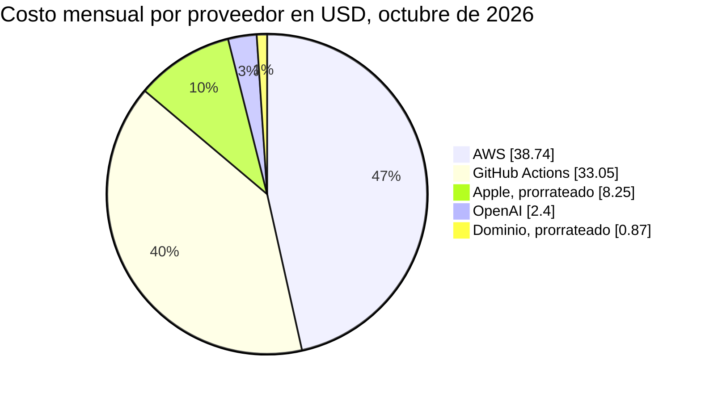
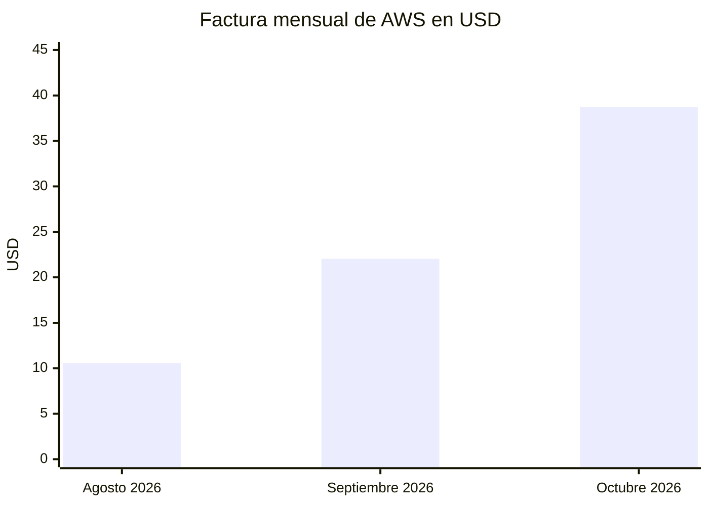

# Costos actuales

Cuánto cuesta operar Vinnot hoy, por mes y por año. Las cifras se relevaron el
29-10-2026 en las consolas de cada proveedor (AWS, GitHub, Cloudflare, OpenAI, Google
Cloud, Expo y Apple). Son una **estimación** del gasto recurrente: el mes de octubre
todavía no cerró y algunos conceptos son variables. Para la evolución a mayor escala,
consulta [Capacidad y proyección de costos](capacity-and-cost-projections.md).

## En pocas palabras

- **Por mes:** unos **USD 83 a 96** (83,31 con el gasto de IA de octubre; 95,91 si la
  IA llega a su tope).
- **Por año:** unos **USD 1.000 a 1.151**, más un pago único de USD 25 de Google Play.
- **Los dos rubros más grandes:** AWS (unos USD 39 por mes) y los minutos de GitHub
  Actions (unos USD 33 por mes).
- **Gratis por plan o por cupo:** CloudFront, Cloudflare (DNS, Workers, R2, Access),
  Google Maps, Expo y las notificaciones push.

## Costo mensual

Relevado el 29-10-2026. Apple y el dominio se pagan por año; aquí se prorratean por mes.

| Concepto | Proveedor | USD por mes | Tipo | Detalle |
|---|---|---:|---|---|
| Infraestructura | AWS | 38,74 | Fijo y variable | Proyección del mes completo: USD 36,24 del 1 al 29 de octubre × 31 / 29 ([desglose](#desglose-de-aws)) |
| Integración continua | GitHub Actions | 33,05 | Variable | USD 45,45 brutos menos USD 12,40 incluidos en el plan Free |
| Inteligencia artificial | OpenAI | 2,40 | Variable, con tope | Gasto de octubre; la app corta en USD 15 (`AI_MONTHLY_LIMIT_USD`) |
| Cuenta de desarrollador | Apple | 8,25 | Fijo | USD 99 por año ÷ 12 |
| Dominio `vinnot.com` | Cloudflare Registrar | 0,87 | Fijo | USD 10,46 por año ÷ 12 |
| DNS, Workers, R2 y Access | Cloudflare | 0,00 | — | Planes Free; R2 dentro del cupo gratuito |
| Mapas | Google Maps Platform | 0,00 | — | USD 0 en los últimos 30 días |
| Builds y actualizaciones de la app | Expo EAS | 0,00 | — | Plan Free |
| Cobros de entradas | Mercado Pago | 0,00 | — | Sin costo fijo; la tarifa se descuenta al vendedor en cada venta |
| **Total** | | **83,31** | | |

Cuenta: 38,74 + 33,05 + 2,40 + 8,25 + 0,87 = **83,31**. Si la IA usa todo su tope de
USD 15: 83,31 − 2,40 + 15,00 = **95,91**.

### Reparto del costo mensual

[Ver diagrama de «Reparto del costo mensual» completo](https://images.vinnot.com/docs/diagrams/v1/es/business-costs-49257a5ff4b4.svg)

## Desglose de AWS

Factura de octubre de 2026, todavía abierta, del 1 al 29 de octubre, región us-east-1.
La arquitectura que generan estos costos está en
[Despliegue en AWS](../infra/architecture/aws-deployment.md#persistencia-y-costo) y en
[Desarrollo de bajo costo](../infra/operations/low-cost-dev.md).

| Servicio | USD | Detalle |
|---|---:|---|
| EC2 | 24,58 | Dos hosts t3a.small a USD 0,0188 por hora (producción las 24 horas; desarrollo se apaga de noche), 1.176,6 horas: 22,12. Discos EBS gp3 a USD 0,08 por GB-mes, 43,4 GB-mes: 3,47. Crédito promocional: −1,01 |
| IPv4 públicas (VPC) | 6,78 | USD 0,005 por hora por dirección: 1.179,7 horas en uso y 176,7 sin usar |
| RDS | 3,20 | Instancia de desarrollo `db.t4g.micro` **detenida y sin uso**: almacenamiento gp3 2,09, backups 1,05 y 0,06 de horas de instancia ([oportunidad de ahorro](#oportunidades-de-ahorro)) |
| Secrets Manager | 0,73 | 1,82 secretos-mes a USD 0,40 |
| ECR | 0,47 | 4,7 GB-mes de imágenes a USD 0,10 |
| S3 | 0,41 | 15 GB-mes a USD 0,023, menos 5 GB incluidos con el plan CloudFront Free; 56.000 pedidos PUT/LIST y 36.000 GET |
| CloudWatch | 0,06 | 10 alarmas gratis y 0,57 alarmas-mes pagas |
| SES | 0,01 | 89 emails a USD 0,0001 cada uno |
| CloudFront, Lambda, SNS, SQS, KMS, Glue y transferencia de datos | 0,00 | CloudFront con el plan Free de tarifa plana; el resto dentro de los cupos gratuitos |
| **Total del 1 al 29 de octubre** | **36,24** | Proyección del mes completo: **38,74** |

La cuenta conserva USD 1,01 de un crédito promocional de AWS, que vence el 11-06-2027.
No queda ningún cupo gratuito de la capa inicial de AWS.

### Evolución de la factura de AWS

| Mes | USD | Qué cambió |
|---|---:|---|
| Abril a julio de 2026 | 0,00 | Sin gasto |
| Agosto de 2026 | 10,57 | Primer mes con gasto |
| Septiembre de 2026 | 22,03 | Incluye ECS (2,17) y un balanceador ELB (1,69), que desaparecieron al pasar a un solo host por entorno |
| Octubre de 2026 | 38,74 (proyección) | Primer mes completo con dos hosts: el de producción se lanzó el 29-09-2026 |

[Ver diagrama de «Evolución de la factura de AWS» completo](https://images.vinnot.com/docs/diagrams/v1/es/business-costs-ceb490661fac.svg)

La suba de agosto a octubre no viene del uso: viene de encender la infraestructura de
producción (un segundo host, su disco y su IPv4 pública) y de agotar los créditos.

## Costo anual

| Concepto | USD por año | Cuenta |
|---|---:|---|
| AWS | 464,88 | 38,74 × 12 |
| GitHub Actions | 396,60 | 33,05 × 12 |
| OpenAI | 28,80 a 96,00 | 2,40 × 12 con el gasto de octubre; 8,00 × 12 con el tope |
| Apple Developer Program | 99,00 | Renueva el 22-07-2027 |
| Dominio `vinnot.com` | 10,46 | Renueva el 23-04-2027; Cloudflare informa que el .com pasa a USD 11,17 desde el 01-11-2026 |
| **Total** | **999,74 a 1.066,94** | |

Cuenta: 464,88 + 396,60 + 28,80 + 99,00 + 10,46 = **999,74**; con la IA en su tope,
464,88 + 396,60 + 96,00 + 99,00 + 10,46 = **1.066,94**. Con el dominio a USD 11,17 desde
la próxima renovación, el total sube USD 0,71.

## Pagos únicos

| Concepto | USD | Cuándo |
|---|---:|---|
| Registro en Google Play Console | 25,00 | Una sola vez, al crear la cuenta de desarrollador |

## Tiendas de aplicaciones

| Tienda | Costo | Estado |
|---|---|---|
| Apple Developer Program | USD 99 por año, cuenta individual | Activa; renueva el 22-07-2027 |
| Google Play Console | USD 25, pago único | Activa |
| Paid Applications Agreement de Apple | Sin costo; es un acuerdo aparte de la membresía | Obligatorio antes de vender suscripciones dentro de la app ([Monetización y planes](monetization.md#economía-de-las-tiendas)) |

Las tiendas no cobran nada por las entradas de eventos: se venden con Mercado Pago,
fuera de la tienda.

## Costos fijos y variables

| Tipo | Conceptos | Qué los mueve |
|---|---|---|
| Fijos | Host de producción, discos EBS, IPv4 públicas, Secrets Manager, ECR, Apple y dominio | La cantidad de hosts y entornos, no la cantidad de usuarios |
| Semifijos | Host de desarrollo | Las horas encendido; se apaga de 02:00 a 09:00, hora de Argentina ([Desarrollo de bajo costo](../infra/operations/low-cost-dev.md)) |
| Variables por desarrollo | GitHub Actions | Cantidad de PR, pushes y despliegues |
| Variables por uso | OpenAI, SES, pedidos de S3 | Uso real de la plataforma; OpenAI tiene un tope en la app ([Protección de recursos](../backend/architecture/resource-protection.md)) |
| Variables por venta | Tarifa de Mercado Pago | La paga el vendedor de cada entrada, no Vinnot |
| Gratis hasta un límite | CloudFront, R2, Workers, Google Maps, Expo | Cupos mensuales; al superarlos hay que cambiar de plan ([Capacidad y proyección de costos](capacity-and-cost-projections.md)) |

## Qué es gratis y por qué

| Servicio | Por qué no cuesta | Límite que importa |
|---|---|---|
| CloudFront (web de producción y de desarrollo) | Plan Free de tarifa plana, declarado en [`production-web-stack.json`](../../../infra/aws-low-cost/production-web-stack.json) | 1 millón de pedidos y 100 GB por mes, sin cobros por exceso |
| Cloudflare R2 | El uso entra en el cupo gratuito: 0,61 GB-mes, 165.000 operaciones clase B y 39.000 clase A en octubre | 10 GB, 1 millón de clase A y 10 millones de clase B por mes |
| Cloudflare Workers, DNS y Access | Planes Free | 100.000 pedidos por día en Workers |
| Google Maps | El SDK de mapas para Android e iOS es gratis; la web usa la API de JavaScript dentro del cupo gratuito | 10.000 cargas de mapa por mes en la web |
| Expo EAS | Plan Free; los builds de Android se compilan localmente | 1.000 usuarios de actualizaciones por mes; 15 builds de iOS y 15 de Android por mes |
| Notificaciones push de Expo | Gratis | 600 notificaciones por segundo por proyecto |
| SES | Pago por uso, con volumen bajo | USD 0,10 cada 1.000 emails |

## Oportunidades de ahorro

Hallazgos del relevamiento, ordenados por ahorro. Ninguno está aplicado todavía.

| Hallazgo | Ahorro estimado | Contrapartida |
|---|---:|---|
| Borrar la instancia RDS de desarrollo detenida y sus backups | USD 3,20 por mes (USD 38,40 por año) | Ninguna: el código no usa RDS, la base corre en un contenedor en cada host ([`compose.postgres.yml`](../../../infra/aws-low-cost/compose.postgres.yml)). Conviene confirmar que no guarda datos que hagan falta |
| Reducir los minutos de GitHub Actions | Parte de USD 33 por mes | Ver la tabla siguiente |
| Apagar más horas el host de desarrollo (por ejemplo, solo de 09:00 a 21:00 en días hábiles) | Unos USD 4,76 por mes | Desarrollo no disponible de noche ni los fines de semana |
| Quitar la IPv4 pública del host de desarrollo | USD 3,65 por mes | La dirección se cobra encendida o apagada. Requiere otro acceso entrante, por ejemplo un túnel de Cloudflare, y cambiar el despliegue y el certificado TLS |
| Pasar los hosts a Graviton (t4g.small en lugar de t3a.small) | USD 1,46 por host por mes | La imagen del backend se construye solo para `linux/amd64` ([`deploy-backend-dev.yml`](../../../.github/workflows/deploy-backend-dev.yml), [`production-release.yml`](../../../.github/workflows/production-release.yml)); hace falta una imagen arm64 |

### Opciones para GitHub Actions

GitHub Actions es el rubro variable más grande. El CI ya corre solo las pruebas de los
componentes afectados ([`ci-impact.mjs`](../../../scripts/ci-impact.mjs)), ya usa caché
de dependencias de Maven y npm ([`ci.yml`](../../../.github/workflows/ci.yml)) y la
validación nativa de iOS corre solo con una etiqueta en el PR.

| Opción | Efecto | Contrapartida |
|---|---|---|
| Agrupar los cambios de un lote en un solo PR | Menos ejecuciones completas del CI; ya es la práctica del equipo | Revisiones más grandes |
| Caché de capas de Docker en el build de la imagen | Builds de imagen más cortos; hoy `deploy-backend-dev.yml` no usa `cache-from` | La caché ocupa parte de los 10 GB de caché de Actions |
| Runner propio (self-hosted) | Los minutos propios no se cobran | Hay que mantener la máquina y aislarla: ejecuta código del repositorio con acceso a secretos de despliegue |
| Hacer público el repositorio | Los runners estándar son gratis en repositorios públicos | Expone todo el código y su historia. Es una decisión de negocio, no técnica |
| Mantener macOS al mínimo | Un minuto de macOS cuesta USD 0,062 y uno de Linux USD 0,006 | Ya se aplica: iOS se valida solo a pedido |

## Fuentes

Consolas de AWS Billing y Cost Explorer, GitHub Billing, Cloudflare, OpenAI, Google
Cloud Billing, Expo y Apple Developer, leídas el 29-10-2026. Precios públicos:

- AWS, precios de EC2, EBS, VPC, RDS, S3, SES, ECR, CloudWatch y Secrets Manager: https://aws.amazon.com/ec2/pricing/on-demand/
- CloudFront, planes de tarifa plana: https://aws.amazon.com/cloudfront/pricing/
- Cloudflare R2: https://developers.cloudflare.com/r2/pricing/
- Cloudflare Workers: https://developers.cloudflare.com/workers/platform/pricing/
- Aumento del .com: https://tldes.com/pages/com-price-increase-2026
- Apple Developer Program: https://developer.apple.com/programs/enroll/
- Google Play Console, registro: https://support.google.com/googleplay/android-developer/answer/6112435
- Expo: https://expo.dev/pricing
- Google Maps Platform: https://developers.google.com/maps/billing-and-pricing/pricing
- GitHub Actions: https://docs.github.com/en/billing/reference/actions-runner-pricing
