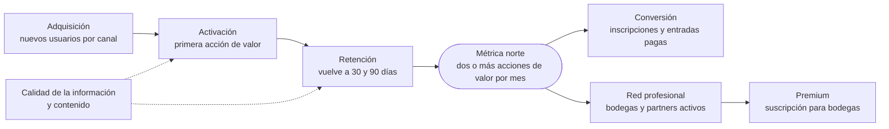

# Métricas clave

Cómo saber si el modelo de negocio funciona. Esta página reúne en un solo tablero los
indicadores del [modelo Canvas](business-model-canvas.md) y del
[análisis FODA](swot.md), y separa lo que la plataforma ya registra de lo que falta
instrumentar.

## Métrica norte

**Usuarios activos mensuales que realizan al menos dos acciones de valor vinculadas al
vino**: por ejemplo, consultar y guardar, comparar y calificar, o descubrir una bodega
y abrir un evento. Mide uso significativo, no solo visitas.

Acciones de valor que el producto ya permite:

| Acción | Dónde ocurre |
|---|---|
| Consultar el detalle de un vino, una bodega, una ruta o un evento | [Vinos](../modules/wines/README.md), [Bodegas y regiones](../modules/wineries/README.md), [Rutas del vino](../modules/wine-routes/README.md), [Eventos y entradas](../modules/events/README.md) |
| Guardar un vino en la cava | [Cava](../modules/cellar/README.md) |
| Calificar o reseñar un vino | [Reseñas](../modules/reviews/README.md) |
| Comparar dos vinos | [Perfiles y comparaciones IA](../modules/ai/README.md) |
| Escanear una etiqueta o proponer un vino | [Vinos](../modules/wines/README.md) |
| Inscribirse a un evento | [Eventos y entradas](../modules/events/README.md) |

**Estado:** pendiente de instrumentar. Las señales existen por separado (ver
[Qué mide hoy la plataforma](#qué-mide-hoy-la-plataforma)), pero ningún proceso las
cuenta por persona y por mes.

## Indicadores por dimensión

| Dimensión | Indicador | Qué indica | Hoy en el producto |
|---|---|---|---|
| Adquisición | Nuevos usuarios por canal | Compara SEO, redes, partners, eventos y códigos QR | Pendiente de instrumentar: hay un total de usuarios, sin canal de origen |
| Activación | Porcentaje que realiza una acción de valor en la primera sesión: guardar, comparar, calificar o seguir una bodega | Si la primera visita aporta utilidad | Pendiente de instrumentar: las acciones quedan registradas, pero no se define ni se mide la primera sesión |
| Retención | Usuarios que vuelven a los 30 y a los 90 días; usuarios recurrentes | Si Vinnot resuelve una necesidad recurrente | Parcial: la app registra aperturas por persona durante 180 días; la web no envía señales |
| Comunidad | Reseñas válidas y vinos guardados por usuario | Si hay valor más allá de la primera visita | Datos disponibles en reseñas y cava; sin indicador calculado |
| Contenido | Fichas verificadas, reseñas válidas por ficha, eventos vigentes | Confianza y calidad de la oferta | Parcial: totales de reseñas y eventos publicados; la verificación de fichas no existe |
| Calidad de la información | Porcentaje de fichas verificadas; correcciones por cada 1.000 fichas | Confianza en el catálogo | Pendiente: no hay fecha ni marca de verificación; las denuncias y los vinos propuestos sirven como señal indirecta |
| Red profesional | Bodegas y partners activos, perfiles verificados activos, eventos actualizados | Si la propuesta B2B genera participación real | Parcial: eventos de cada organizador; la verificación de bodegas no existe y está planificada como reclamo verificado del perfil ([Monetización y planes](monetization.md#cuenta-de-bodega)) |
| Descubrimiento | Comparaciones iniciadas y fichas consultadas por sesión | Utilidad de la exploración | Parcial: vistas de detalle por persona y día en la app; las comparaciones se guardan por par de vinos, no por persona |
| Conversión | Clics o reservas desde fichas y eventos hacia eventos y bodegas; GMV de entradas, comisión cobrada y repetición | Conecta el uso con el valor económico y lo digital con lo territorial | Parcial: inscripciones, pagos y comisión de cada entrada; los clics desde fichas no se registran |
| Premium | Conversión, churn y uso de funciones pagas | Solo cuando exista una capa paga validada | No aplica todavía; se activa con la suscripción para bodegas ([Monetización y planes](monetization.md)) |

Cada fila tiene un origen:

- **Canvas:** adquisición, activación, retención, contenido, red profesional,
  conversión y Premium, más las métricas del bloque del Canvas.
- **FODA:** calidad de la información, comunidad, descubrimiento y experiencias. En
  esta tabla, experiencias se fusionó con conversión porque miden el mismo paso.

### Del uso al ingreso

[Ver diagrama de «Del uso al ingreso» completo](https://images.vinnot.com/docs/diagrams/v1/es/business-key-metrics-66adce5727fe.svg)

## Qué mide hoy la plataforma

Señales implementadas a octubre de 2026, verificadas en el código:

| Señal | Qué registra | Límites | Fuente |
|---|---|---|---|
| Vistas de detalle | Una fila por persona, contenido (vino, ruta, evento o bodega) y día, con la cantidad de vistas | Solo la app y solo con sesión; se borran a los 180 días | [Actividad](../modules/activity/README.md), [`useDetailViewTracking.ts`](../../../frontend-mobile/src/presentation/hooks/useDetailViewTracking.ts) |
| Aperturas de la app y última actividad | Una apertura cada 30 minutos como máximo y la hora habitual de uso | Solo la app; se borran a los 180 días | [Actividad](../modules/activity/README.md) |
| Notificaciones push abiertas | Cada push abierto, una vez por referencia | Se borran a los 180 días | [Actividad](../modules/activity/README.md) |
| Totales del panel de administración | Usuarios, cuentas habilitadas, vinos, bodegas, eventos y eventos publicados, reseñas, rutas y rutas publicadas | Es una foto del momento, sin series de tiempo; «usuarios activos» cuenta cuentas habilitadas, no actividad | [`GetAdminStatsQueryHandler.java`](../../../backend/src/main/java/com/vinnot/admin/application/query/handler/GetAdminStatsQueryHandler.java), [`UC-ADM-01`](../modules/admin/use-cases/uc-adm-01-dashboard.md) |
| Reseñas, likes y comentarios | Puntaje, título, comentario y actividad sobre cada reseña | — | [Reseñas](../modules/reviews/README.md) |
| Cava | Vinos guardados por persona, con puntaje y notas privadas | — | [Cava](../modules/cellar/README.md) |
| Inscripciones y pagos | Estado de cada inscripción, cada pago y la comisión en puntos básicos | — | [Eventos y entradas](../modules/events/README.md), [Pagos](../modules/payments/README.md) |
| Movimientos de puntos | Cada acción premiada: reseñas, likes recibidos, comentarios, escaneos, altas en la cava, inscripciones y vinos aprobados | Con topes diarios y premios únicos por acción; sirve como aproximación, no como conteo exacto | [Puntos y sellos](../modules/gamification/README.md) |
| Denuncias y vinos propuestos | Contenido denunciado y vinos que las personas proponen al catálogo | — | [Comunidad](../modules/community/README.md), [Vinos](../modules/wines/README.md) |

**Pendiente de instrumentar:**

- analítica de uso en la web;
- canal de origen de cada alta (atribución);
- definición de sesión y embudo de la primera sesión;
- clics desde fichas hacia eventos y bodegas;
- verificación y fecha de actualización de fichas;
- un proceso que agregue las señales en la métrica norte y en series mensuales.

Vinnot no usa un SDK de analítica de producto: las señales anteriores se guardan en la
base propia, no se comparten con terceros y no se muestran a otras personas
([Actividad](../modules/activity/README.md)).
