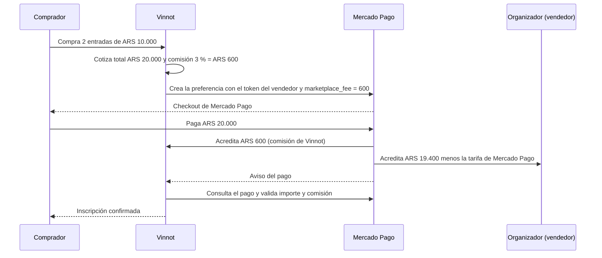
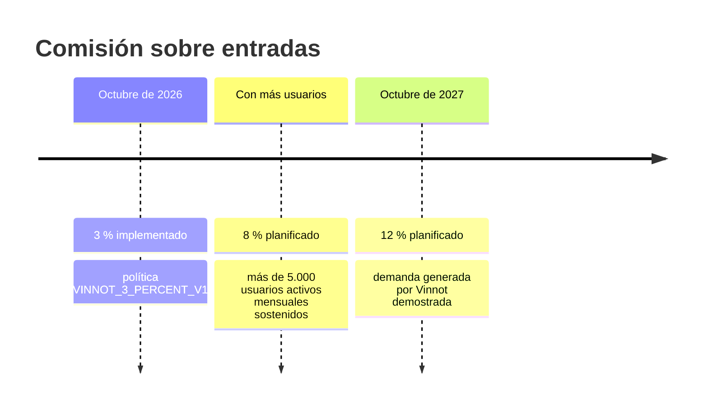
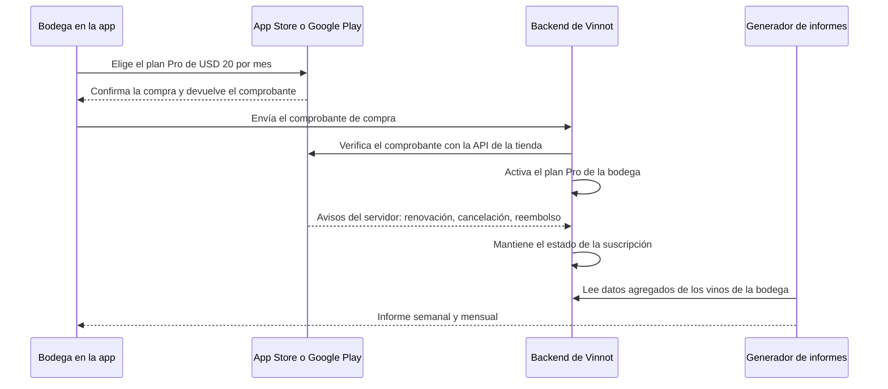

# Monetización y planes

Esta página explica cómo gana dinero Vinnot hoy y qué fuentes de ingreso están
planificadas. Separa con cuidado tres cosas: lo que el código ya hace
(**implementado**), lo que el negocio decidió pero todavía no existe
(**planificado**) y las cifras calculadas a partir de supuestos (**estimación**).
Los planes del negocio se citan como decisiones del negocio, no como hechos del código.

| Fuente de ingreso | Estado | Resumen |
|---|---|---|
| [Comisión sobre entradas de eventos](#comisión-sobre-entradas) | Implementado | 3 % del total de cada compra, cobrado con el split de Mercado Pago |
| [Aumento de la comisión](#hoja-de-ruta-de-la-comisión) | Planificado | 8 % cuando crezca la base de usuarios y 12 % hacia octubre de 2027 |
| [Suscripción para bodegas](#suscripción-para-bodegas) | Planificado | Plan Free con perfil, vinos propios, eventos y métricas básicas; plan Pro de USD 20 por mes con informes, cobrado por App Store y Google Play; lanzamiento objetivo el 01-03-2027 |
| [Otras fuentes del Canvas](#otras-fuentes-de-ingreso) | Hipótesis | Promoción identificada, Premium para personas usuarias, servicios B2B |

Para probar combinaciones de tasa, volumen y suscripciones, usa el
[simulador de ingresos](revenue-simulator.mdx). Los costos que estos ingresos deben
cubrir están en [Costos actuales](costs.md) y en
[Capacidad y proyección de costos](capacity-and-cost-projections.md).

## Comisión sobre entradas

**Estado: implementado.** Cuando una persona compra entradas de un evento pago, Vinnot
retiene el 3 % del total. El detalle técnico completo está en el módulo
[Pagos](../modules/payments/README.md) y en su
[arquitectura](../modules/payments/architecture.md#checkout); esta sección resume lo
que importa para el negocio.

### Cómo funciona con Mercado Pago

Vinnot usa el modelo marketplace de Checkout Pro de Mercado Pago
([documentación de Mercado Pago](https://www.mercadopago.com.ar/developers/es/docs/checkout-pro/how-tos/integrate-marketplace)):

1. **El organizador vincula su propia cuenta.** Un partner autoriza a Vinnot con OAuth
   y PKCE; Vinnot guarda el token del vendedor cifrado con AES-GCM
   ([vinculación de la cuenta](../modules/payments/architecture.md#vinculación-de-la-cuenta),
   [manual de partner](../manuals/partner.md#vincular-tu-cuenta-de-mercado-pago)).
2. **La preferencia se crea en nombre del vendedor.** Con el token del vendedor, el
   adaptador
   [`MercadoPagoCheckoutAdapter`](../../../backend/src/main/java/com/vinnot/payment/infrastructure/gateway/MercadoPagoCheckoutAdapter.java)
   crea la preferencia de pago e incluye el campo `marketplace_fee` con la comisión de
   Vinnot.
3. **Mercado Pago divide el dinero.** El comprador paga el total. Mercado Pago acredita
   el `marketplace_fee` en la cuenta de Vinnot y el resto en la cuenta del vendedor.
4. **La comisión de Mercado Pago la paga el vendedor.** Mercado Pago descuenta su propia
   tarifa de procesamiento de lo que recibe el vendedor, no de la comisión de Vinnot.
5. **Vinnot concilia antes de confirmar.** Un aviso de Mercado Pago no acredita nada:
   `ReconcilePaymentsService` consulta el pago y valida entorno, vendedor, moneda,
   importe exacto y comisión
   ([confirmación y conciliación](../modules/payments/architecture.md#confirmación-y-conciliación)).

### Flujo del dinero de una venta

[Ver diagrama de «Flujo del dinero de una venta» completo](https://images.vinnot.com/docs/diagrams/v1/es/business-monetization-1fe2d887e30a.svg)

### Dónde vive la tasa en el código

La tasa es una **política versionada y configurable** (estado: implementado). La
política vigente se lee al arrancar el backend y cada intento de pago guarda la suya.

| Lugar | Qué define |
|---|---|
| [`CommissionPolicy.java`](../../../backend/src/main/java/com/vinnot/payment/domain/valueobject/CommissionPolicy.java) | Puntos básicos (1 a 3000) e identificador de política, que deben coincidir (300 ↔ `VINNOT_3_PERCENT_V1`, 800 ↔ `VINNOT_8_PERCENT_V1`) |
| [`application.yml`](../../../backend/src/main/resources/application.yml) | `app.payments.commission.basis-points` y `.policy`, con las variables `EVENT_PAYMENTS_COMMISSION_BASIS_POINTS` y `EVENT_PAYMENTS_COMMISSION_POLICY`; por defecto 300 y `VINNOT_3_PERCENT_V1`. Si no coinciden, el backend no arranca |
| [`TicketPaymentQuote.java`](../../../backend/src/main/java/com/vinnot/payment/domain/valueobject/TicketPaymentQuote.java) | La comisión es `total × puntos básicos / 10000`, redondeada una vez a centavos |
| [`V74__configurable_commission_policy.sql`](../../../backend/src/main/resources/db/migration/V74__configurable_commission_policy.sql) | Reemplaza los `CHECK` de V30 que fijaban el 3 % por reglas generales: puntos básicos entre 1 y 3000, monto coherente con la política guardada |
| [`MercadoPagoCheckoutAdapter.java`](../../../backend/src/main/java/com/vinnot/payment/infrastructure/gateway/MercadoPagoCheckoutAdapter.java) | Envía `marketplace_fee` y la política del intento en los metadatos de la preferencia |

Cada intento de pago congela su cotización (`CheckoutSnapshot`) y se reconstruye con la
política que guardó, así que un cambio de tasa no altera compras ya iniciadas ni la
conciliación de pagos viejos.

### Ejemplo trabajado

Dos entradas de ARS 10.000 (el mismo ejemplo de la
[arquitectura de Pagos](../modules/payments/architecture.md#checkout)). La tarifa de
Mercado Pago es una **estimación**: depende del plazo de acreditación que elija el
vendedor. Aquí se usa el plazo de 10 días, 4,39 % más IVA del 21 % = 5,3119 %
([tarifas de Mercado Pago](https://www.mercadopago.com.ar/herramientas-para-vender/check-out)).

| Concepto | 3 % (hoy) | 8 % (planificado) | 12 % (planificado) |
|---|---:|---:|---:|
| Total que paga el comprador | ARS 20.000 | ARS 20.000 | ARS 20.000 |
| Comisión de Vinnot | ARS 600 | ARS 1.600 | ARS 2.400 |
| Vendedor antes de la tarifa de Mercado Pago | ARS 19.400 | ARS 18.400 | ARS 17.600 |
| Tarifa estimada de Mercado Pago (5,3119 % del total) | ARS 1.062,38 | ARS 1.062,38 | ARS 1.062,38 |
| Neto estimado del vendedor | ARS 18.337,62 | ARS 17.337,62 | ARS 16.537,62 |

## Hoja de ruta de la comisión

**Estado: planificado.** La decisión del negocio es: «ahora cobramos 3 % pero
eventualmente con más usuarios aumentarlo a 8 % y de acá a un año a 12 %». La tabla
ordena esa decisión en fases. Los disparadores son una propuesta para decidir cuándo
pasar de fase; usan las métricas de [Métricas clave](key-metrics.md).

| Fase | Tasa | Cuándo | Disparadores propuestos |
|---|---:|---|---|
| 1. Lanzamiento | 3 % | Hoy (implementado) | Atraer organizadores y validar que los eventos pagos funcionan de punta a punta |
| 2. Crecimiento | 8 % | «Eventualmente con más usuarios» | Usuarios activos mensuales sostenidos por encima de 5.000 durante tres meses; organizadores que repiten eventos pagos; inscripciones a eventos que llegan desde Vinnot y no solo desde canales propios del organizador |
| 3. Madurez | 12 % | «De acá a un año», alrededor de octubre de 2027 | Vinnot demuestra que genera demanda: una parte relevante de las entradas se vende a personas que descubrieron el evento en la plataforma |

[Ver diagrama de «Hoja de ruta de la comisión» completo](https://images.vinnot.com/docs/diagrams/v1/es/business-monetization-669f3fbda375.svg)

### Qué exige subir la tasa

Cada fase es un cambio de configuración, no de código:

1. **Avisar a los partners.** Los [términos de uso](../modules/legal/README.md) dicen
   que un cambio de tasa se avisa con anticipación y solo aplica a ventas nuevas.
   Comunicar la fecha de entrada en vigor y actualizar el [manual de partner](../manuals/partner.md).
2. **Cambiar las dos variables juntas** en el entorno del backend, por ejemplo
   `EVENT_PAYMENTS_COMMISSION_BASIS_POINTS=800` y
   `EVENT_PAYMENTS_COMMISSION_POLICY=VINNOT_8_PERCENT_V1`, y reiniciar el backend.
3. **Verificar.** La web y la app muestran la tasa que informa la API
   (`GET /payments/mercadopago/account`); los intentos viejos conservan su política.

El paso a paso técnico está en la [arquitectura de pagos](../modules/payments/architecture.md).

## Suscripción para bodegas

**Estado: planificado.** La oferta se acordó el 06-11-2026. Parte de la decisión
original del negocio: «el plan free donde pueden subir y modificar sus vinos, y la
suscripción paga 20 usd mensuales via playstore o appstore», con «informes
semanales/mensuales con respecto a sus vinos». El lanzamiento objetivo del plan Pro
para las bodegas fundadoras es el 01-03-2027; el calendario y sus dependencias están en
el [cronograma](../gantt/README.md).

Punto de partida en el código: hoy no existe una cuenta de bodega vinculada a sus
vinos. El catálogo lo editan administradores
([Administración](../modules/admin/README.md)) y las personas usuarias pueden
proponer vinos que el equipo revisa
([vinos propuestos](../modules/wines/submissions.md)). El rol partner solo gestiona
eventos ([manual de partner](../manuals/partner.md)). Por eso los dos planes requieren
desarrollo.

Cómo sube el precio con la audiencia y la oferta para las primeras 50 bodegas están en la
[hoja de ruta de precios para bodegas](winery-pricing-roadmap.md).

### Cuenta de bodega

| Elemento | Decisión (planificado) |
|---|---|
| Rol | Un rol `WINERY` que incluye los permisos del rol `PARTNER`: crear y gestionar eventos y vender entradas con Mercado Pago |
| Equipo | Varias personas pueden gestionar la misma bodega |
| Reclamo del perfil | La bodega reclama su ficha existente; un administrador verifica la titularidad (correo del dominio de la bodega o documentación) y recién entonces otorga el rol |
| Propiedad de los vinos | La bodega crea y edita solo sus propios vinos; el backend valida la propiedad en cada cambio y los cambios quedan auditados |

### Plan Free y plan Pro

| | Plan Free | Plan Pro |
|---|---|---|
| Precio | Gratis | USD 20 por mes; USD 20 congelados durante 24 meses para las 50 [bodegas fundadoras](winery-pricing-roadmap.md#la-oferta-de-bodega-fundadora) |
| Cobro | — | Solo compra integrada de App Store o Google Play, con validación del comprobante en el servidor y avisos del servidor de la tienda |
| Editar el perfil de la bodega | Sí | Sí |
| Crear y editar sus propios vinos | Sí | Sí |
| Crear eventos y vender entradas | Sí | Sí |
| Distintivo de bodega verificada | Sí | Sí |
| Respuesta oficial a reseñas | Sí | Sí |
| Métricas básicas | Sí | Sí |
| Pulso semanal | No | Sí |
| Informe mensual con cortes por vino, región y gusto, y comparación con vinos pares | No | Sí |
| Estado | Planificado: requiere el rol `WINERY`, el reclamo verificado y la propiedad de los vinos | Planificado: requiere el plan Free, la compra integrada y la generación de informes |

El detalle de las métricas básicas se define junto con el catálogo de informes después
de las entrevistas piloto (estado: **pendiente**). El contenido de cada informe, sus
fuentes y sus reglas de privacidad están en [Informes para bodegas](winery-reports.md).

### Por qué estas decisiones

Cada decisión responde a un objetivo del negocio. Las razones se relevaron el 06-11-2026.

| Decisión | Por qué | Evidencia |
|---|---|---|
| El plan Free muestra métricas básicas | La bodega ve parte de lo que Vinnot sabe de sus vinos y lo que se pierde sin el plan Pro, y eso le da una razón concreta para pasarse (modelo freemium: el plan gratuito lleva al pago). En palabras del dueño: «mostrar lo que se pierdan y empujar al pro» | Decisión del negocio; la conversión de Free a Pro se mide con la métrica Premium de [Métricas clave](key-metrics.md) |
| El distintivo verificado y la respuesta oficial son gratuitos | Son la razón para que una bodega reclame su perfil. Cada perfil reclamado suma una bodega que mantiene sus datos y sus vinos, lo que mejora el catálogo para las personas usuarias y es el primer paso hacia el plan Pro | Estrategia DO del [FODA](swot.md#cruce-estratégico): que las bodegas reclamen y mantengan su perfil con verificación y auditoría |
| Los eventos están en el plan Free | Cada entrada vendida deja la [comisión](#comisión-sobre-entradas) aunque la bodega no pague el plan Pro | Comisión implementada del 3 % |
| El plan Pro se cobra solo con compra integrada | Una suscripción que desbloquea funciones dentro de la app debe usar la compra integrada de cada tienda; un único camino de cobro, con el comprobante validado en el servidor y los avisos de renovación, cancelación y reembolso de la tienda, mantiene el estado del plan sin que Vinnot maneje tarjetas | Guía 3.1.1 de Apple y política de pagos de Google Play ([Economía de las tiendas](#economía-de-las-tiendas)) |
| Un pulso semanal y un informe mensual | Una cifra se publica solo con 10 personas o más, y una bodega chica rara vez reúne 10 calificaciones nuevas en una semana. El semanal es un pulso corto a nivel de bodega; los cortes por vino, región y gusto necesitan el volumen de un mes | Vivino ofrecía estadísticas semanales y Wine Australia combina un boletín semanal con informes más profundos ([Informes para bodegas](winery-reports.md#pulso-semanal)) |
| Vinnot vende demanda, no ventas | Las bodegas ya pagan los indicadores de venta dentro de sus plataformas de venta directa, como Commerce7 o WineDirect. Vinnot cubre las señales previas a la compra que no dan esas plataformas, ni el INV ni los paneles minoristas | [Informes para bodegas](winery-reports.md#vinnot-vende-demanda-no-ventas) |
| USD 20 por mes | Queda muy por debajo de las alternativas pagas relevadas y responde a la barrera principal de las bodegas chicas: el costo. A ese precio el informe debe ser automático e interpretado, no un tablero para explorar | Comparación de precios en la [hoja de ruta de precios](winery-pricing-roadmap.md#cómo-se-compara-el-precio) |

### Economía de las tiendas

Las fuentes de cada regla están enlazadas.

| Concepto | App Store | Google Play |
|---|---|---|
| Comisión sobre suscripciones | 30 % el primer año y 15 % desde el segundo ([Apple](https://developer.apple.com/app-store/subscriptions/)) | 15 % ([Google](https://support.google.com/googleplay/android-developer/answer/112622)) |
| Programa para pequeños desarrolladores | 15 % desde el primer año con menos de USD 1 millón de ingresos ([Small Business Program](https://developer.apple.com/app-store/small-business-program/)) | No hace falta: la tarifa de suscripciones ya es 15 % |
| Neto por bodega Pro (USD 20) | USD 17 con el programa; USD 14 el primer año sin él | USD 17 |
| Obligación de usar la compra integrada | Sí: en Argentina, una suscripción que desbloquea funciones en la app debe usar la compra integrada (Guía 3.1.1, [App Review Guidelines](https://developer.apple.com/app-store/review/guidelines/)) | Sí: las suscripciones y funciones de la app usan la facturación de Google Play ([política de pagos](https://support.google.com/googleplay/android-developer/answer/9858738)) |
| Entradas de eventos | Se pueden cobrar fuera de la tienda: son servicios que se consumen fuera de la app (Guía 3.1.3(e)) | Se pueden cobrar fuera de la tienda: las entradas a eventos son servicios del mundo físico |

Requisitos previos:

- **Paid Applications Agreement** de Apple: es un acuerdo separado de la membresía del
  Apple Developer Program y es obligatorio para vender suscripciones
  ([Costos actuales](costs.md#tiendas-de-aplicaciones)).
- **Perfil de pagos de Google Play** con datos fiscales y bancarios.
- **Inscripción en el Small Business Program**, para pagar 15 % desde el primer año.

### Flujo de compra de la suscripción

[Ver diagrama de «Flujo de compra de la suscripción» completo](https://images.vinnot.com/docs/diagrams/v1/es/business-monetization-74a770e0ca44.svg)

Todo el flujo está planificado. Hoy no hay compra integrada en la app.

## Otras fuentes de ingreso

El [modelo Canvas](business-model-canvas.md#estado-de-las-fuentes-de-ingreso) lista
otras fuentes que hoy son **hipótesis**: una suscripción Premium para personas
usuarias, promoción destacada claramente identificada y servicios B2B de presencia y
analítica agregada. Las dos últimas se solapan con el plan Pro para bodegas. Ninguna
está planificada; el Canvas indica qué debe validarse antes.

## Fuentes

Precios y reglas consultados el 29-10-2026.

- Mercado Pago, marketplace en Checkout Pro: https://www.mercadopago.com.ar/developers/es/docs/checkout-pro/how-tos/integrate-marketplace
- Mercado Pago, tarifas de Checkout: https://www.mercadopago.com.ar/herramientas-para-vender/check-out
- Apple, suscripciones: https://developer.apple.com/app-store/subscriptions/
- Apple, Small Business Program: https://developer.apple.com/app-store/small-business-program/
- Apple, App Review Guidelines: https://developer.apple.com/app-store/review/guidelines/
- Google Play, tarifas de servicio: https://support.google.com/googleplay/android-developer/answer/112622
- Google Play, política de pagos: https://support.google.com/googleplay/android-developer/answer/9858738
