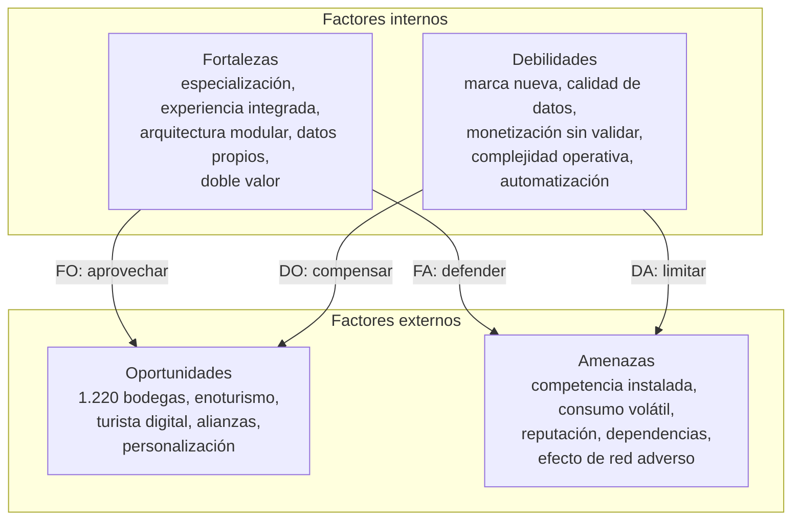

# Análisis FODA

Fortalezas, debilidades, oportunidades y amenazas de Vinnot como plataforma digital
especializada en vinos, que integra catálogo, comparación de etiquetas, reseñas,
bodegas, mapas y experiencias del mundo vitivinícola. El objetivo no es enumerar
características aisladas, sino separar los factores que dependen del proyecto de los
que vienen del entorno, para convertir el diagnóstico en decisiones.

**Criterio.** Fortalezas y debilidades son factores internos: se gestionan desde el
producto, el equipo o el modelo de negocio. Oportunidades y amenazas son factores
externos: Vinnot no los controla, pero puede prepararse para aprovecharlos o reducir
su impacto.

## Vinnot como caso de análisis

Vinnot concentra en una sola experiencia digital información que suele estar
fragmentada entre tiendas, redes sociales, sitios de bodegas y aplicaciones
generalistas. Para actores profesionales abre, además, un canal de presencia y de
vínculo con una audiencia interesada en la categoría.

| Dimensión | Qué incluye |
|---|---|
| Usuario | Catálogo, comparación, reseñas y cava |
| Contenido | Fichas de vino, varietales, bodegas y eventos |
| Territorio | Mapa y experiencias vinculadas a regiones vitivinícolas |
| Ecosistema | Usuarios, bodegas, partners, moderación y administración |

## Contexto de mercado

Datos del Instituto Nacional de Vitivinicultura (INV), fuentes [1] a [4], y de la
Secretaría de Turismo, fuentes [5] a [7], consultados en octubre de 2026.

| Indicador | Valor | Organismo |
|---|---|---|
| Bodegas inscriptas (2025) | 1.220 | INV |
| Bodegas que elaboraron vino (2025) | 895 | INV |
| Viñedos (2025) | 20.939 | INV |
| Mercado interno comercializado (2025) | 7,46 millones de hectolitros | INV |
| Exportaciones de vino (2025) | Cerca de 1,93 millones de hectolitros | INV |
| Variación del mercado interno (2025) | −2,7 % acumulado | INV |
| Variación del mercado interno (primer semestre de 2026) | +0,8 % interanual; junio, +5,8 % | INV |
| Bodegas abiertas al turismo (2026) | Más de 375, en 16 provincias | Secretaría de Turismo |

**Lectura.**

- **Oferta.** Es un ecosistema grande y diverso, con profundidad de oferta suficiente
  para una plataforma especializada.
- **Consumo.** La caída de 2025 y la recuperación moderada de 2026 obligan a pensar
  Vinnot no solo como un catálogo, sino como una herramienta que agrega valor en
  descubrimiento, educación, comunidad y experiencias.
- **Enoturismo.** Las guías oficiales destacan que el enoturista usa intensamente
  herramientas digitales antes y después de la visita [6], lo que conecta con el mapa,
  la agenda y las recomendaciones de Vinnot.

## Matriz FODA

Cada elemento se eligió por su posible impacto sobre la adopción, el crecimiento, la
confianza o la monetización.

| | Positivo | Negativo |
|---|---|---|
| **Interno** | **Fortalezas** • Propuesta vertical especializada en vino, con identidad clara. • Experiencia integrada: catálogo, comparación, reseñas, mapa y eventos. • Arquitectura moderna y escalable que evoluciona por módulos. • Datos propios sobre preferencias, reseñas e interacción. • Doble valor: personas usuarias y actores profesionales. | **Debilidades** • Marca nueva: necesita reputación, comunidad y masa crítica de reseñas. • Alta exigencia de calidad y actualización de vinos, bodegas y eventos. • Monetización por validar sin deteriorar la confianza. • Complejidad operativa creciente por roles, moderación y partners. • Riesgo de depender demasiado de la automatización para enriquecer contenido. |
| **Externo** | **Oportunidades** • Ecosistema argentino amplio: más de 1.200 bodegas inscriptas en 2025. • Crecimiento y profesionalización del enoturismo en varias provincias. • Uso intensivo de herramientas digitales por parte del turista del vino. • Alianzas con bodegas, vinotecas, sommeliers, eventos y rutas del vino. • Personalización, recomendaciones y contenido educativo como diferencial. | **Amenazas** • Competencia de plataformas globales, comercio electrónico y canales propios de las bodegas. • Volatilidad del consumo interno y del gasto discrecional. • Datos desactualizados o erróneos que dañan rápido la reputación. • Dependencia de servicios externos, tiendas de aplicaciones y cambios regulatorios. • Efecto de red adverso: sin usuarios no hay reseñas; sin contenido no llegan usuarios. |

### Mapa de factores

[Ver diagrama de «Mapa de factores» completo](https://images.vinnot.com/docs/diagrams/v1/es/business-swot-76bbb461b593.svg)

**Lectura rápida.** El mayor activo de Vinnot es su capacidad de unir contenido,
comunidad y territorio en un nicho con identidad fuerte. El principal riesgo interno
es abarcar demasiadas funciones antes de consolidar datos y usuarios; el principal
riesgo externo es competir por atención con plataformas ya instaladas y con los
canales directos de las bodegas.

## Fortalezas

**Especialización y posicionamiento.** Vinnot no parte de una propuesta genérica. Su
foco en vinos ordena la experiencia alrededor de lo que importa en el sector:
varietal, región, bodega, estilo, comparación, reseñas y experiencias. Esa
verticalidad facilita una marca reconocible y contenidos más profundos que los de un
marketplace generalista.

**Experiencia integrada.** La combinación de catálogo, mapa, comparación y agenda
reduce la fragmentación. Una persona puede descubrir una etiqueta, conocer la bodega,
comparar alternativas y encontrar una experiencia relacionada sin cambiar de
plataforma. La integración aumenta la recurrencia y permite diseñar recorridos de
descubrimiento, no solo búsquedas aisladas.

**Capacidad tecnológica para iterar.** La plataforma es un monolito modular con
arquitectura hexagonal ([Arquitectura](../architecture/README.md)), de modo que cada
función evoluciona sin reescribir el resto. Eso reduce la fricción para probar
hipótesis nuevas: recomendaciones, módulos para partners, filtros geográficos,
eventos o funciones móviles.

**Datos propios y aprendizaje.** Reseñas, cava, comparaciones y búsquedas pueden
convertirse, con políticas claras de privacidad, en señales sobre preferencias. Ese
conocimiento mejora recomendaciones y contenidos, y produce información útil para
bodegas o partners sin exponer datos personales. Qué señales se registran hoy está en
[Métricas clave](key-metrics.md#qué-mide-hoy-la-plataforma).

**Ecosistema de dos lados.** Vinnot crea valor para consumidores y para bodegas y
actores del sector. Cuanto mejor es la experiencia de la persona usuaria, más
atractivo es el canal para los partners; y cuanto más completa es la participación
profesional, más valor recibe la persona usuaria. Ese círculo puede convertirse en
una barrera competitiva si se construye con confianza.

**Implicancia.** La prioridad no es sumar funciones, sino reforzar las que conectan
mejor las fortalezas entre sí: catálogo confiable, comunidad, territorio y partners.
Esa combinación es más difícil de copiar que una función aislada.

## Debilidades

**Masa crítica y confianza.** Una plataforma basada en reseñas, eventos y
descubrimiento necesita actividad real. En la etapa inicial puede existir un catálogo
amplio con poca interacción, lo que reduce la percepción de comunidad. El desafío es
concentrar el lanzamiento en segmentos o regiones donde sea posible generar densidad
antes de expandirse.

**Calidad y mantenimiento de datos.** Los vinos cambian de añada, etiqueta,
disponibilidad y precio; los eventos vencen y las bodegas modifican horarios o
propuestas. Cuanto más rica es la base, más cuesta mantenerla confiable. Una ficha
incorrecta afecta más a una plataforma especializada, porque la persona espera
precisión.

**Monetización todavía no validada.** Publicidad, membresías, promociones de
partners, reservas o servicios B2B son alternativas posibles, pero cada una cambia
incentivos. Si una recomendación parece responder al pago de una marca y no a su
relevancia, la confianza se degrada. El modelo debe diferenciar el contenido
editorial, la opinión de la comunidad y la promoción comercial.

**Complejidad operacional.** La moderación de reseñas, el alta de bodegas y eventos,
los reclamos, los contenidos y los permisos de partners agregan trabajo que no se
resuelve solo con código. La operación tiene que crecer junto con el producto para no
depender de correcciones manuales permanentes.

**Automatización y contenido generado.** La automatización acelera fichas y
clasificación, pero una descripción incorrecta de un vino o una recomendación
inventada deteriora la credibilidad. La tecnología ayuda a estructurar y enriquecer;
no reemplaza la verificación de información sensible o factual. Los perfiles con IA
de Vinnot son editables y regenerables por el equipo
([Perfiles y comparaciones IA](../modules/ai/README.md)).

| Debilidad | Indicador temprano | Respuesta |
|---|---|---|
| Poca actividad | Reseñas por ficha y usuarios recurrentes | Lanzamiento por comunidades y regiones concretas |
| Datos desactualizados | Reportes o correcciones frecuentes | Trazabilidad, fecha de verificación y panel para partners |
| Monetización incierta | Baja conversión o rechazo a las promociones | Experimentar formatos sin mezclar publicidad con el ranking orgánico |

## Oportunidades

**Amplio universo de bodegas y etiquetas.** Las 1.220 bodegas inscriptas y 895
elaboradoras de 2025 son una oferta potencial suficientemente extensa para justificar
herramientas de búsqueda, comparación, clasificación y descubrimiento.

**Enoturismo y experiencias.** Argentina se posiciona como referente regional del
turismo del vino, con más de 375 bodegas abiertas al turismo en 16 provincias y una
expansión significativa desde 2018. El mapa y la agenda de Vinnot pueden funcionar
como puente entre el descubrimiento digital y la visita física.

**Comportamiento digital del enoturista.** La guía oficial de turismo del vino
describe un uso intensivo de herramientas digitales, desde la búsqueda previa hasta
la recomendación posterior. Eso habilita planificación, rutas guardadas, reseñas
después de la visita y recomendaciones contextualizadas.

**Alianzas B2B.** Bodegas, vinotecas, sommeliers, organizadores de degustaciones y
operadores turísticos necesitan visibilidad y herramientas para llegar a públicos
específicos. Vinnot puede ofrecer perfiles verificados, publicación de eventos y
analítica agregada sin abandonar su propuesta para la persona usuaria.

**Educación y personalización.** El vino tiene una barrera de conocimiento que
también es una oportunidad: muchas personas quieren elegir mejor sin estudiar
enología. Comparadores comprensibles, explicaciones de varietales, maridajes y
recomendaciones transparentes reducen la fricción y aumentan la confianza.

**Señal de mercado.** En el primer semestre de 2026 el mercado interno creció 0,8 %
interanual y junio avanzó 5,8 %. No garantiza una expansión sostenida, pero muestra
un escenario que combina desafíos con señales de recuperación y permite pensar
propuestas que agreguen valor alrededor del consumo, no solo de la venta.

## Amenazas

**Competencia por atención.** Vinnot compite de forma indirecta con plataformas
internacionales de vinos, tiendas en línea, Google Maps, redes sociales y los canales
propios de cada bodega. Aunque ninguna replica exactamente la propuesta, todas
resuelven una parte de la necesidad ([Análisis competitivo](competitive-analysis.md)).

**Consumo y gasto discrecional.** El mercado interno cayó 2,7 % en 2025. Una
plataforma vinculada con ocio, gastronomía y turismo debe asumir que el gasto de la
persona usuaria varía con el contexto económico y evitar depender solo de
transacciones de alto valor.

**Reputación y veracidad.** Una reseña falsa, un evento inexistente o una ficha
incorrecta se difunden rápido y dañan la confianza. La amenaza crece con la
comunidad, porque también crece el volumen de contenido que hay que moderar y
verificar.

**Dependencias tecnológicas y regulatorias.** Los servicios de mapas, la
infraestructura, las tiendas móviles y otros proveedores pueden cambiar precios o
condiciones. A la vez, el tratamiento de datos, las comunicaciones comerciales y los
contenidos de terceros exigen adaptación normativa. El producto no debe quedar atado
a una única dependencia crítica. Los proveedores actuales están en el
[catálogo de tecnologías](../architecture/technologies/README.md).

**Problema del efecto de red.** Las plataformas de comunidad enfrentan una dinámica
circular: las personas llegan si hay información y opiniones útiles, pero esas
opiniones aparecen cuando ya existen usuarios. Si el arranque es demasiado amplio, la
actividad se dispersa y da sensación de vacío.

**Amenaza más crítica.** No es un competidor específico, sino la combinación de baja
masa crítica con alternativas ya instaladas. Vinnot necesita ser claramente mejor en
un recorrido concreto (descubrir, comparar y vivir experiencias de vino en Argentina)
antes de intentar cubrir todos los usos posibles.

## Cruce estratégico

El valor del FODA aparece al cruzar factores internos y externos. Las estrategias FO
usan fortalezas para capturar oportunidades; las DO usan oportunidades para compensar
debilidades; las FA usan fortalezas para reducir amenazas; y las DA limitan a la vez
una debilidad y una amenaza.

| Tipo | Objetivo | Aplicación a Vinnot |
|---|---|---|
| FO | Especialización + enoturismo | Conectar catálogo, mapa y agenda para que una ficha de vino sea una puerta a la bodega, su región y sus experiencias. Desarrollar perfiles verificados para actores turísticos y vitivinícolas |
| FO | Datos propios + personalización | Usar cava, comparaciones y reseñas para recomendaciones explicables («te sugerimos este vino por varietal, región y preferencias»), sin cajas negras difíciles de justificar |
| DO | Baja masa crítica + alianzas | Lanzar programas con bodegas, sommeliers y comunidades locales que aporten eventos y contenido verificado, concentrando al principio la actividad en regiones o segmentos prioritarios |
| DO | Datos difíciles + participación profesional | Permitir que las bodegas reclamen y mantengan su perfil con verificación y auditoría de cambios. Reducir el trabajo manual sin ceder el control absoluto de la información pública |
| FA | Identidad especializada + competencia | Competir en profundidad y experiencia local, no en tamaño de catálogo. Priorizar información argentina, rutas, eventos y contexto cultural que las plataformas generalistas resuelven de forma fragmentada |
| FA | Arquitectura modular + dependencias | Diseñar adaptadores para mapas, autenticación y servicios externos; conservar los datos esenciales en modelos propios y definir alternativas de reemplazo |
| DA | Marca nueva + reputación | Incorporar moderación, trazabilidad y mecanismos de denuncia desde el inicio. Etiquetar el contenido promocionado y los perfiles verificados para no mezclar opinión, publicidad y dato factual |
| DA | Monetización incierta + consumo volátil | Diversificar ingresos: herramientas para partners, experiencias o servicios Premium, sin depender solo de comisiones sobre ventas de vino |

Varias de estas estrategias ya tienen base en el producto: los puertos y adaptadores
de la arquitectura hexagonal (FA), la moderación reactiva con denuncias y bloqueos
([Comunidad](../modules/community/README.md), DA) y la comisión sobre entradas como
ingreso que no depende de la venta de vino ([Pagos](../modules/payments/README.md),
DA).

## Plan de acción

La prioridad combina impacto estratégico, urgencia y capacidad de ejecución.

| # | Prioridad | Impacto | Acción inicial |
|---|---|---|---|
| 1 | Confiabilidad del catálogo | Alta | Definir fuente, fecha de actualización, reportes y proceso de corrección para vinos, bodegas y eventos |
| 2 | Masa crítica localizada | Alta | Elegir una región o comunidad inicial y concentrar partners, eventos y usuarios para generar actividad visible |
| 3 | Propuesta diferencial | Alta | Perfeccionar el recorrido descubrir → comparar → visitar o participar, antes de ampliar funciones secundarias |
| 4 | Programa de partners | Media-alta | Crear perfiles verificados y un proceso simple para que las bodegas mantengan su información y publiquen experiencias |
| 5 | Monetización transparente | Media | Probar servicios B2B o Premium y etiquetar con claridad cualquier posicionamiento patrocinado |
| 6 | Personalización responsable | Media | Usar señales de interacción para recomendaciones explicables, midiendo calidad antes que cantidad de sugerencias |

Los indicadores que siguen este plan están en [Métricas clave](key-metrics.md).

## Conclusión

Vinnot parte de una combinación atractiva: un sector con identidad fuerte, abundancia
de bodegas y experiencias, y una propuesta digital capaz de integrar información que
hoy aparece fragmentada. Su mayor riesgo es el típico de las plataformas de
comunidad: necesita contenido confiable y masa crítica antes de que la experiencia
alcance todo su valor, y expandir catálogo, eventos, partners y recomendaciones al
mismo tiempo aumenta la complejidad sin resolver ese punto. El entorno ofrece una
oportunidad concreta, que no es simplemente digitalizar el vino, sino conectar
descubrimiento, conocimiento y experiencia. Las amenazas obligan a no competir en
volumen y a buscar una posición específica: ser una referencia confiable para
entender, comparar y vivir el vino argentino.

**Síntesis.** Construir confianza antes que escala: catálogo verificable, comunidad
concentrada, partners responsables y una propuesta diferencial que conecte la
botella con la bodega y la experiencia.

## Fuentes

1. Instituto Nacional de Vitivinicultura (INV). Principales datos vitivinícolas, año
   2025. <https://www.argentina.gob.ar/inv/estadisticas-vitivinicolas/principales-datos-vitivinicolas>
2. INV. Informes anuales de mercado interno de vinos.
   <https://www.argentina.gob.ar/inv/vinos/estadisticas/mercado-interno/anuarios>
3. INV. «El consumo interno de vinos creció más de 5 % en junio», 27 de julio de
   2026. <https://www.argentina.gob.ar/node/508527>
4. INV. Informe Malbec 2026. <https://www.argentina.gob.ar/node/498136>
5. Secretaría de Turismo, Ambiente y Deportes. «Argentina dijo presente en un foro en
   Brasil dedicado al enoturismo y la gastronomía», 13 de agosto de 2026.
   <https://www.argentina.gob.ar/noticias/argentina-dijo-presente-en-un-foro-en-brasil-dedicado-al-enoturismo-y-la-gastronomia>
6. Secretaría de Turismo, Ambiente y Deportes. Guía para el desarrollo del turismo del
   vino: lineamientos para su implementación.
   <https://www.argentina.gob.ar/sites/default/files/guia_turismo_del_vino.pdf>
7. Secretaría de Turismo, Ambiente y Deportes. Mapa de bodegas de Argentina.
   <https://www.argentina.gob.ar/jefatura/turismo/viaja-por-argentina/mapa-de-bodegas-de-argentina>

Si la dirección de [3] o [4] deja de responder, consulta la página de estadísticas
del INV [1].
