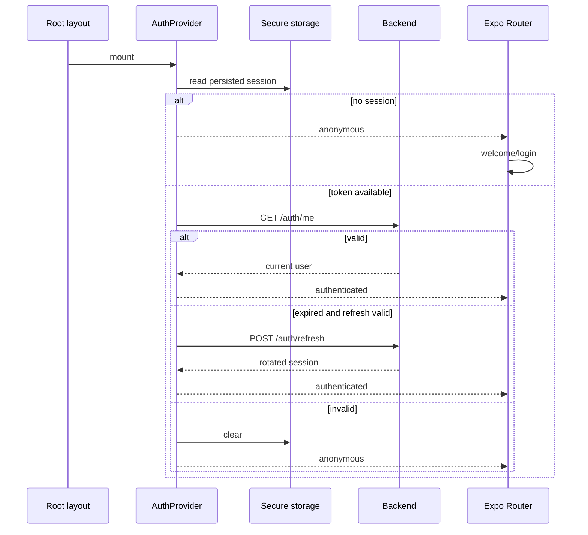

# Navegación, sesión y estado mobile

## Matriz de rutas

| Grupo | Rutas principales | Acceso |
|---|---|---|
| raíz | `/`, `/about`, `/help`, `/contact`, `/legal`, `/legal/[slug]`, `/terms`, `/privacy`, `/cookies`, `/content-policy` | público o decisión inicial |
| recuperación | `/403`, `/500`, `/503`, `/429`, `/offline`, `/timeout`, `+not-found` | público |
| regreso de pago | `/payments/return` | público; muestra el regreso del checkout y no confirma el pago |
| onboarding | `/welcome` | sesión no iniciada |
| auth | login, registro, verificación, recuperación | anónimo |
| tabs | home, catálogo/detalle de wines, listado/detalle de events, listado/detalle de routes, profile | AuthGuard del shell `(app)` |
| acciones personales | cellar, community; scan, comparación, propuestas y perfil IA dentro de wines | AuthGuard del shell y controles por pantalla |
| producto | wineries, wine-routes | AuthGuard del shell `(app)` |
| social | `/users/[id]`, `/users/[id]/followers`, `/users/[id]/following`, `/feed`, `/taste-quiz` | AuthGuard del shell `(app)` |
| entradas | `/my-tickets`, `/my-tickets/[id]`; se abren desde Perfil y no son una tab (siguen siendo cinco tabs) | AuthGuard del shell `(app)` |
| onboarding de cuenta | complete-profile | usuario autenticado con perfil incompleto |
| partner | dashboard y eventos propios | PARTNER o ADMIN según layout |
| admin | dashboard, wines, wineries, events, routes, reviews, submissions, publications, community | ADMIN o MODERATOR |
| admin/users, admin/notifications, admin/social-posts | usuarios, roles y bloqueos; notificaciones push; cola de aprobación de publicaciones sociales | sólo ADMIN |

`app/+native-intent.tsx` resuelve primero los regresos de pago mediante
`presentation/navigation/paymentReturn.ts`: `vinnot://payments/return` se
normaliza a `/payments/return` (o a `/my-tickets` si el enlace no es válido) y
`vinnot://payments/connected` vuelve a `/partner/events` o `/admin/events`, según
la pantalla que inició la vinculación. Los demás intents pasan por
`safeNativeIntent`.

Los route groups no forman parte del path. Los hooks de detalle usan `skipToken`
cuando no reciben ID; la validación de formato se define por pantalla, no por
un validador global del router.

`TermsGate` comprueba aceptación vigente en el shell `(app)`, incluso antes
de completar el perfil. Las rutas raíz de información legal, ayuda y contacto
quedan fuera de ese gate y siguen accesibles. `AuthGuard` rodea `TermsGate`
y el Stack: no monta screens funcionales mientras restaura o sin sesión.

## Barra principal, rutas y bodega

Las cinco tabs son Inicio, Vinos, Eventos, Rutas y Perfil. Rutas tiene su propio
Stack en `app/(app)/(tabs)/routes`: el listado y el detalle mantienen la tab
seleccionada. `WineRoutesScreen` y `WineRouteDetailScreen` son presentación
compartida; los archivos de `app/` sólo componen rutas/layouts.

`/wine-routes` redirige al listado de Rutas. `/wine-routes/:id` conserva el
shell de detalle fuera de tabs para accesos desde Inicio y enlaces anteriores.
Volver desde un detalle usa el historial si existe; sin historial retorna a
Rutas. La consulta de detalle comparte caché por ID entre ambos shells.

Bodega vive en `app/(app)/cellar.tsx`, fuera de tabs, conservando `/cellar`.
Inicio y la tarjeta «Vinos en bodega» del perfil abren esa misma pantalla,
incluso con conteo cero. Volver conserva el origen; sin historial va a Inicio.
El detalle de vino mantiene su acceso a Bodega. Los cambios de navegación no
alteran consultas, filtros ni operaciones de cava.

La misma regla se comparte con `goBackOr(router, fallback)` en
`presentation/navigation/discoveryNavigation.ts`: el detalle de bodega vuelve al
listado de bodegas, el perfil IA a su vino, las pantallas admin al panel admin
(el panel mismo a Perfil) y los eventos del organizador a Perfil.

## Perfiles públicos y seguimiento

`/users/[id]` es el perfil público de cualquier persona, también el propio
(`PublicProfileScreen`): avatar, nombre, sello actual, @usuario, bio, contadores
(seguidores, siguiendo, reseñas, vinos en cava), afinidad con quien mira, la
tarjeta del perfil de gustos y las secciones Reseñas y Cava. En perfiles ajenos muestra Seguir /
Siguiendo y el menú de denuncia y bloqueo; en el propio, Editar perfil (la misma
hoja que la tab Perfil, con bio y visibilidad de la cava). La tab Perfil abre el
propio desde «Mi perfil público». Sin rueda todavía (menos de 5 vinos valorados) pero con rasgos del test, la tarjeta de gustos pone en el lugar de la rueda, arriba de los rasgos, la rueda bloqueada: el emblema en un círculo punteado con un candado y el aviso, igual que la web.

La tab Perfil (`ProfileScreen`) ordena: encabezado con puntos, «Estadísticas», «Accesos rápidos» (Mi Bodega, Mis entradas, Mi perfil público, Mis vinos enviados, Comunidad y seguridad y, según el rol, los paneles de administración y de partner), «Ajustes» (foto, contraseña, cuenta y seguridad, notificaciones, idioma), «Soporte» y cerrar sesión.

- Seguir y dejar de seguir cambian el botón y el contador al instante
  (`useFollowToggle`); si el servidor falla vuelven al estado anterior con un
  aviso. La mutación invalida la etiqueta `Social`, que comparten perfil, listas,
  feed y sugerencias; bloquear, reseñar y editar el perfil propio también la
  invalidan.
- La Cava no se pide cuando el perfil dice `cellarVisible: false`, y un 403
  `CELLAR_NOT_VISIBLE` también muestra el estado bloqueado. Nunca se muestran
  notas ni precio de compra.
- La tarjeta del perfil de gustos (`TasteProfileCard`) sigue el estilo acuarela
  del perfil IA. La rueda de sabores (`TasteWheel`, `expo-image`,
  `react-native-svg` y Reanimated) es una flor de pétalos de acuarela sobre un
  escenario crema con un papel tenue y la ilustración del racimo en el centro; gira
  y crece una vez, y con Reducir movimiento se dibuja quieta. Sin rueda
  (menos de 5 vinos valorados) la tarjeta explica por qué falta.
- La rueda muestra un tipo de entrada por vez (S15). Un selector con el `Chip`
  compartido ofrece «Uvas» (por defecto), «Estilos» y «Regiones»; una vista sin
  entradas se oculta, sin uvas abre la primera con entradas y con una sola vista no
  hay selector (`tasteWheelViews`, `tasteWheelSlicesOf` en `socialRules`).
- Cada entrada es un pétalo (`tasteWheelPetals` en `tasteWheelGeometry.ts`): ángulos
  iguales de 360/n, el primero arriba y en sentido horario, con la punta hacia el
  centro y a 4 pt del disco central. La rueda mide hasta 290 pt, o el 88 % del ancho
  de contenido de la tarjeta si es menor (`tasteWheelSize`, medido con `onLayout`), y
  el escenario crece con ella (5 % de margen por lado). El disco central nunca baja
  de 48 pt de radio, así el texto conserva al menos 67 pt de ancho. El largo crece
  con el puntaje (`largoMax * (0,72 + 0,28 * puntaje/5)`, acotado); el ancho llega
  hasta 1,15 veces la proporción del arte (213x280) y nunca pasa la separación
  angular en el radio medio del pétalo menos 3 pt, así hasta 8 pétalos los vecinos
  casi se tocan y con 2 a 4 no se vuelven manchas. Las tres formas `profile-art/taste/petal-wash-{1,2,3}.webp`
  (`TASTE_PETAL_WASHES` en `shared/profileArt.ts`, grises con alfa) se alternan por
  índice, con una inclinación fija de hasta ±4°. Cada pétalo son dos `Image` de
  `expo-image` del mismo lavado: abajo con `tintColor` del color de la entrada a
  0,88 de opacidad (la silueta) y arriba, dentro de una vista con
  `mixBlendMode: "multiply"`, la textura que devuelve el pigmento y los bordes más
  oscuros. Las muestras de la leyenda son pétalos chiquitos pintados igual.
- `useTasteWheel` guarda la vista y la selección: tocar el sector de un pétalo (un
  `Path` SVG invisible con `accessible`, todo su rango de ángulo hasta el borde,
  encima del arte) o su fila de la leyenda lo selecciona con un toque háptico
  liviano; el pétalo crece un 8 % y sale 6 pt a opacidad plena, el resto baja a
  0,35 (Reanimated, `withTiming` de 220 ms) y el centro cambia el racimo por el
  nombre, el puntaje con un decimal y «N vinos» (sin vinos en payloads viejos, solo
  nombre y puntaje). El texto del centro se limita al ancho inscripto del disco: el
  nombre usa hasta 2 líneas, arranca más chico si es largo (12, 11 o 10 pt según
  `centreLabelFontSize`) y se achica hasta 0,6 para entrar, así nunca toca los
  pétalos. Tocarlo otra vez o cambiar de vista lo suelta; con Reducir movimiento la
  selección cambia sin animación. Los colores salen de
  `tasteWheelPalette.ts` con los valores de `tasteWheelPalette` en
  `shared/theme/tokens.ts`, iguales a los de la web: las uvas se agrupan por `tone`
  (tintas, rosadas, blancas, resto) y alternan tonos de su familia para que dos
  vecinas nunca se parezcan; los estilos usan `wineTypeSwatches` y se nombran con
  `wines.types.*`; las regiones toman 8 tonos distintos. El mapper lee `tone` y
  `ratedWines` con `null` y `0` por defecto, así que un payload viejo sigue
  funcionando.
- Debajo de la rueda, los `tasteTraits` del perfil agregan «Estructura», una fila
  por rasgo (Acidez, Cuerpo, Taninos, Dulzor) con su ilustración, una palabra de
  nivel y una escala marcada en el puntaje de 0 a 100, y los aromas preferidos
  (Frutado, Floral, Herbal, Especiado, Madera, Mineral) como chips ilustrados con su
  porcentaje, de mayor a menor. Un puntaje menor a 34 se lee bajo, menor a 67 medio
  y si no alto (`tasteTraitLevel`), con la concordancia de cada rasgo («Cuerpo:
  Medio»); el dulzor se lee Seco, Semiseco o Dulce. Una lista vacía oculta su
  sección, y con `tasteTraits: null` solo se muestra la rueda o su estado
  bloqueado. El mapper descarta rasgos y familias desconocidos. Las ilustraciones
  salen de `src/shared/profileArt.ts` (`TASTE_ART`, `tasteTraitArt`,
  `tasteFamilyArt`) y son decorativas; el texto lleva el significado.
- Cuando algún valor sale del test de gustos (`tasteTraits.fromQuiz`), la tarjeta
  lo aclara bajo el título: «Según tu test de gustos» en el perfil propio y «Según
  su test de gustos» en uno ajeno. Con test y menos de 5 vinos valorados hay rasgos
  pero no rueda: los rasgos encabezan la tarjeta y una pista compacta con el racimo
  explica que la rueda llega al valorar 5 vinos. En el perfil propio la tarjeta
  termina con «Hacé tu test de gustos» o, si el test está completo, «Repetir el
  test»; ambos abren `/taste-quiz`.
- En el perfil propio, «Estructura» tiene «Ajustar» en su encabezado (aunque todavía
  no haya rasgos). El editor (`useTasteStructureEditor`) lo crea el view model solo
  para el dueño, así que un visitante nunca ve los controles. Ajustar convierte las
  cuatro escalas en sliders de 0 a 100 (`TasteTraitSlider`, Gesture Handler y
  Reanimated): se arrastra el marcador o se toca la pista, la palabra de nivel
  cambia en vivo y al soltar hay un toque háptico suave. El pan solo se activa tras
  un desplazamiento horizontal (`activeOffsetX`) y cede ante uno vertical
  (`failOffsetY`), así que el `ScrollView` del perfil sigue desplazándose. Para
  lectores de pantalla cada slider es `adjustable`, con el nombre del rasgo como
  etiqueta, la palabra de nivel como valor y pasos de 5 con incrementar y
  decrementar. Un rasgo que falta empieza en 50.
- «Guardar» envía `PUT /users/me/taste-traits` solo con los rasgos tocados que
  cambiaron (`tasteStructureChanges`; un rasgo que faltaba se guarda en cuanto se
  toca) y sale del modo edición cuando el servidor responde; sin cambios sale sin
  pedir nada, y si falla sigue editando con un aviso. «Cancelar» vuelve a los
  valores anteriores. «Volver a lo calculado» (`DELETE /users/me/taste-traits`)
  aparece solo cuando algún rasgo tiene `adjusted: true`, y esos rasgos llevan la
  etiqueta «Ajustado». Las operaciones `social.tasteTraits.adjust` y
  `social.tasteTraits.reset` usan la etiqueta `Social`, que refresca el perfil.
- Los contadores de seguidores y siguiendo abren `/users/[id]/followers` y
  `/users/[id]/following`, cada fila con su botón Seguir (salvo la propia).
- Tocar el avatar o el nombre del autor de una reseña abre su perfil.
- Las filas de reseñas (reseñas del vino, el feed, las reseñas del perfil y las
  tarjetas compactas de Inicio) y los comentarios muestran el `@usuario` del autor
  debajo del nombre visible, en texto más chico y gris medio (`UserHandle`, token
  `textTertiary`); si falta el usuario no se muestra nada.

Inicio termina, sólo con sesión y después de todas sus secciones, con «De gente
que seguís» (las 3 últimas reseñas de las personas seguidas en tarjetas compactas:
miniatura del vino, autor con su sello, copas y dos líneas de texto; «Ver todo»
abre `/feed`) y «Personas para seguir» (fila horizontal con avatar, sello,
afinidad cuando la hay y un botón Seguir compacto). Sin
sesión no se piden ni se muestran. Las listas paginadas comparten
`usePagedSocialList`, que conserva las páginas cargadas y vuelve a la primera al
refrescar. Todo se entrega por OTA: no agrega módulos nativos.

## Test de gustos

`/taste-quiz` (`app/(app)/taste-quiz.tsx`, shell de `TasteQuizScreen` en
`presentation/features/tasteQuiz`) son cinco preguntas ilustradas en orden fijo:
un día de lluvia, fruta, postre, cena especial y aroma. Entra desde abajo como
pantalla completa, sin gesto de cierre (con Reducir movimiento, fundido).

- Cada pregunta muestra puntos de progreso, la pregunta grande y tarjetas con la
  acuarela sobre el escenario crema y su texto: dos tarjetas altas en la primera y
  una grilla de 2x2 en las demás. Solo se ven las opciones; cómo arman el perfil
  queda en el servidor. Cada opción es un botón con su estado seleccionado.
- Elegir resalta la tarjeta, da un toque háptico suave y pasa a la siguiente
  pregunta tras una pausa corta. Atrás conserva la respuesta elegida.
- «Saltear», en todos los pasos, registra `POST /users/me/taste-quiz/skip` y
  vuelve atrás (o a Inicio si no hay historial). Al repetir un test completo solo
  sale, sin registrar nada, y el test anterior se conserva.
- Con la quinta respuesta, `PUT /users/me/taste-quiz` envía las cinco mientras
  «Definiendo tu perfil de gustos» se muestra al menos 12,8 s, con el mismo motor de
  la animación del perfil IA y la comparación (`WineProcessJourney`) pero con cuatro
  escenas propias (`TasteProfileSceneArt`), una cada 3,2 s, a un ritmo tranquilo (cada gesto acelera y frena suave y descansa en su pose final antes de la siguiente): «Reuniendo tus
  elecciones» (una pluma dibuja cada acuarela elegida dentro de
  un cuaderno de cata abierto, entintada en la página con dos líneas de notas
  manuscritas al lado), «Llenando tu copa» (una copa vacía se llena de
  tinto y sus aromas suben en volutas; las elecciones ya no vuelan como recortes), «Mezclando tus sabores» (un pincel moja tres
  pocillos de la paleta y arremolina los colores en el centro) y «Dando forma a tu
  perfil de gustos» (el pincel pinta los seis pétalos de la rueda, uno por uno,
  alrededor de una copa de tinto vista desde arriba, y repite mientras se guarda). Las elecciones llegan como
  `picks` (`tasteQuizPicks`, en orden de pregunta), igual que los looks del vino
  parametrizan sus escenas; con Reducir movimiento cada escena se dibuja en su pose
  final. Luego reemplaza el test por el perfil público propio `/users/{id}`. Si
  falla, ofrece reintentar con las mismas respuestas o salir sin registrar nada.
- Las operaciones `social.tasteQuiz`, `social.tasteQuiz.complete` y
  `social.tasteQuiz.skip` usan la etiqueta `Social`, así que completar o saltear
  refresca el perfil propio y el estado del test. Las acuarelas salen de
  `TASTE_QUIZ_ART` en `src/shared/profileArt.ts`.

El ofrecimiento automático vive en `TasteQuizPromptHost`, montado en el layout de
`(app)` dentro de `TermsGate`, junto a `PointsHost`: solo corre con sesión, términos
aceptados y perfil completo, así que nunca interrumpe la aceptación legal, la
verificación de email (grupo `(auth)`) ni la actualización obligatoria
(`AppUpdateGate`, que envuelve toda la app). Cuando `GET /users/me/taste-quiz`
responde `shouldPrompt: true`, abre `/taste-quiz` una vez, tras una pausa breve para
que Inicio se asiente. Un registro en memoria por persona lo limita a una vez por
sesión de la app; entre sesiones decide el servidor, que deja de pedirlo al
completar o saltear el test.

## Arranque y restauración

[Ver diagrama de «Arranque y restauración» completo](https://images.vinnot.com/docs/diagrams/v1/es/frontend-mobile-architecture-navigation-and-state-0a74a15c0b07.svg)

`AppProviders` se monta desde el primer render: la restauración de sesión empieza
en paralelo con la carga de fuentes. El splash nativo espera las fuentes (o su
error, usando fuentes de respaldo). Después, `VinnotLaunchScreen` mantiene una
espera neutral hasta terminar `initSession`; `app/index.tsx` navega inmediatamente
al destino correspondiente cuando Expo Router confirma que la ruta tiene foco y el navegador está listo, sin una pausa artificial. Los guards y `TermsGate`
siguen controlando el acceso. Restaurar sesión no equivale a confiar ciegamente
en storage: el backend sigue siendo autoridad.

Las ilustraciones de Inicio (portada y cuatro tipos de vino) y bienvenida usan derivados WebP empaquetados con la
app y `expo-image` con downscaling permitido. Se conservan las dimensiones, la
transparencia y los PNG originales como fuentes de diseño. No necesitan una
descarga de R2 para la primera apertura ni cambian la política de caché de imágenes
privadas. Para regenerarlos: `cwebp -q 90 -m 6 -metadata none <original.png> -o <derivado.webp>`.

La regresión `startupRoutes.test.tsx` comprueba el inicio de providers antes de
resolver fuentes, la alternativa ante error de fuentes y la navegación sin demora
sólo después de restaurar la sesión. Esto verifica el orden de arranque; no mide
tiempos de un dispositivo real ni demuestra la resolución de un cierre nativo.

## Versión mínima soportada

`app/_layout.tsx` envuelve `RootNavigator` en `AppUpdateGate`
(`presentation/features/appUpdate/`), dentro de `AppProviders` y después de
cargar las fuentes, así el control cubre todas las rutas: públicas, de
autenticación y el shell `(app)`. `useAppUpdateRequirement` pide a
`appVersionService` la política pública `GET /app-versions/minimum` al abrir la
app y cada vez que vuelve al primer plano (`applicationLifecycleService`,
AppState `active`). El servicio compara la versión instalada
(`Constants.expoConfig?.version`, leída mediante `appBuildGateway`) con la mínima
de `Platform.OS`; las reglas puras de `major.minor.patch` están en
`domain/app/appVersion.ts` y comparan cada parte como número, así `0.10.0` es más
nueva que `0.9.9`.

Si la versión instalada es menor, `UpdateRequiredScreen` reemplaza todo el
navegador. No se puede cerrar ni navegar, el botón Atrás de Android queda
consumido y su única acción abre la ficha de la tienda de la plataforma mediante
`useExternalLink`. El control falla abierto: mientras una consulta está
pendiente, y ante un error de red, un tiempo de espera agotado, una respuesta
ilegible, una versión de app ausente o una mínima nula, la app se muestra con
normalidad. Sólo cuenta la consulta más reciente, así una consulta posterior con
una mínima menor o nula desbloquea la app.

El control es sólo JavaScript (`expo-constants`, `Platform`, `AppState`,
`Linking`) y no agrega módulos nativos, así se distribuye por actualización OTA a
las versiones que ya están en las tiendas. Como la política de versión de runtime
es `appVersion`, una actualización OTA nunca cambia la versión que compara.

## Verificación de términos y refresco del perfil

Mientras la aceptación de la cuenta se verifica en el servidor, `TermsGate`
muestra una espera neutral; no monta títulos, texto ni controles de consentimiento
hasta confirmar que falta aceptar. Una cuenta ya aceptada pasa directamente al
Stack. Un fallo mantiene el contenido bloqueado, ofrece reintento y conserva acceso
a legales/contacto y cierre de sesión. No se usa storage como prueba de aceptación.

El gesto de refresco en perfil llama `refreshUser` desde `useAuth`, que delega a
`refreshAuthenticatedUser` y al servicio de aplicación de autenticación. Actualiza
el usuario y su persistencia sin ejecutar `initSession`, cambiar la generación de
sesión, activar `isInitializing` ni desmontar guards/Stack. Por eso conserva la tab
perfil y su navegación. Las respuestas tardías tras logout/cambio de cuenta o una
edición más reciente se descartan antes de persistir. Los errores temporales dejan
el perfil visible y se notifican; la renovación de credenciales sigue en el
interceptor y su composición existente.

## Navegación de Vinos

El stack de vinos combina browse, detalle, perfil IA, comparación, escaneo y
submissions. Dos reglas evitan ciclos históricos:

- tocar la tab Vinos navega/reemplaza al índice, no reabre el último child;
- abrir scan guarda un `origin`; volver usa ese origen y no un `router.back()`
  ambiguo.

Desde un resultado de scan se puede abrir detalle. Volver desde detalle debe
regresar al resultado/scan cuando ése es el origen, mientras tocar la tab Vinos
siempre abre el catálogo.

## Propiedad del estado

| Dato | Dueño | Persistencia | Invalida |
|---|---|---|---|
| usuario y tokens | Auth + Redux | SecureStore según sensibilidad | todas las queries al cambiar identidad |
| idioma | language/UI slice | preferencia local | contenido localizado |
| listado de vinos | Query cache | memoria/cache policy | wine keys |
| filtros escritos | ViewModel/local | opcional por ruta | sólo la query derivada |
| imagen de scan | scan session/provider | temporal | al cerrar el circuito |
| formulario | reducer/local | no, salvo diseño explícito | nada hasta submit |
| reseña/comentario sin enviar | slice Redux `drafts` | memoria, solo la sesión de la app | se borra al publicar, cancelar o cerrar sesión |

## Renovación concurrente

El interceptor marca requests ya reintentadas. El primer `401` crea la promesa
de refresh; los siguientes se suscriben. Al resolver, cada request se reconstruye
con el nuevo token. Al fallar, se rechaza toda la cola, se limpia estado y se
navega a autenticación una sola vez.

## Invalidación y cambio de identidad

Al login/logout o cambio de cuenta se limpia query cache para impedir que datos
de cava, perfil o submissions de un usuario aparezcan durante la nueva sesión.
Las mutaciones invalidan tags por familia: cava invalida `Cellar` y `User`;
vinos invalida `Wines`. La matriz exacta está en
[estado remoto](remote-state-and-transport.md).

## Deep links y parámetros

Un deep link puede llegar sin historial. Por eso una screen debe poder construir
su estado desde parámetros + sesión + servidor. Nunca debe depender de que otra
screen haya precargado un objeto completo. IDs inválidos terminan en estado de
no encontrado/controlado, no en una query con `undefined`.

## Notificaciones push

`RootNavigator` monta `PushNotificationsSync`
(`presentation/navigation/PushNotificationsSync.tsx`) junto al Stack. Combina dos
hooks de presentación que delegan en `pushNotificationsService`:

- `useLaunchPushPrompt` muestra `PushPermissionSheet` en un arranque en frío: en
  el primer inicio explica las notificaciones antes del aviso del sistema; después,
  mientras estén desactivadas, lo recuerda una vez por inicio a quien tiene sesión
  (nunca al volver del segundo plano). «Activar» cierra la hoja y abre el aviso del
  sistema, o los ajustes de notificaciones cuando el sistema ya no vuelve a preguntar.
- `usePushNotificationsSync` crea los canales de Android al arrancar y registra el
  dispositivo mientras hay sesión: en cada arranque en frío, después del login, al
  cambiar el idioma o rotar el token, y al volver a la app si todavía no quedó
  registrado. Al cerrar la sesión olvida el token.
- Un toque en una notificación (también la que abrió la app) se informa como
  abierta y navega a su pantalla cuando la navegación está lista. Sin sesión no
  navega: guarda la pantalla como destino posterior al login.

`domain/notification/pushRoute.ts` trata la ruta del push como entrada no
confiable: sólo acepta listas y detalles de `my-tickets`, `events`, `wines`,
`routes`, `wine-routes` y `wineries`, además de `/partner`, `/partner/events`,
`/points` y el perfil `/users/<uuid>` (el push NEW_FOLLOWER abre el perfil de
quien empezó a seguir); cualquier otra ruta, incluidas `/users` y las listas de
un perfil, se ignora.

## Casos de error

- permiso de cámara: CTA a solicitar y acción Volver;
- sesión expirada: renovación y, si falla, login con intención preservada cuando
  sea seguro;
- acceso prohibido: `/403`, sin ocultar el rechazo como 404;
- recurso inexistente: empty/not-found del módulo;
- offline: feedback persistente y retry explícito;
- request cancelada por navegación: no mostrar error tardío.

## Reglas de prueba

La matriz de verificación distingue restauración válida/inválida, cola de refresh, logout concurrente,
redirección por onboarding, roles, tab reset, back contextual, deep links, cambio
de idioma y limpieza de cache entre identidades.

Para alcance automatizado y comandos, ver [pruebas](../testing/strategy.md).

## Intención de acceso protegida

`AuthGuard` espera la sesión antes de montar el Stack y conserva el pathname
funcional para retornar después de login/registro y completar perfil. La
validación pura `returnPath.ts` admite sólo rutas de producto (`/wines`,
`/wineries`, `/events`, `/wine-routes`, `/routes`, `/cellar`, `/profile`,
`/community`, `/home`, `/partner`, `/admin` y `/my-tickets`, incluida la entrada
`/my-tickets/<id>` que abre "ver entrada" tras el checkout) y descarta rutas
externas, escapes codificados y segmentos inválidos. Un pathname de auth, onboarding
o rechazado (por ejemplo `/login`, que el guard todavía montado ve tras la
redirección) nunca reemplaza un destino de producto ya recordado. La intención vive en memoria del
estado auth, se consume al navegar y se limpia al cerrar sesión; no se persiste
entre reinicios ni conserva query/hash. Legales/contacto siguen fuera del shell.

## Historial de bienvenida

`RootNavigator` usa `Stack.Protected` para retirar `(onboarding)` del historial
cuando hay sesión, y no lo expone mientras se restaura. Esto evita volver a
Bienvenida mediante swipe/back y aparentar un logout. Login/registro conservan
su redirección de usuarios autenticados. Verificación, recuperación y páginas
públicas siguen disponibles; `AuthGuard`, `TermsGate` y completar perfil conservan
su responsabilidad. No cambia la duración ni la renovación de tokens.

La regresión `RootNavigator.test.tsx` monta Expo Router con grupos reales: después
de Bienvenida → Login → Inicio no queda una entrada atrás; abrir un detalle y
volver conserva la sesión.
