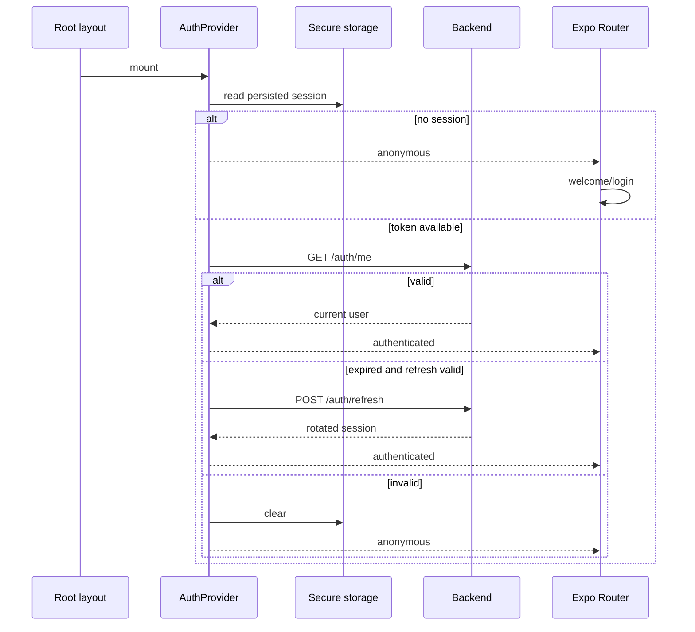

# Navegación, sesión y estado mobile

## Matriz de rutas

| Grupo | Rutas principales | Acceso |
|---|---|---|
| raíz | `/`, `/about`, `/help`, `/contact`, `/legal`, `/legal/[slug]`, `/terms`, `/privacy`, `/cookies`, `/content-policy` | público o decisión inicial |
| recuperación | `/403`, `/500`, `/503`, `/429`, `/offline`, `/timeout`, `+not-found` | público |
| regreso de pago | `/payments/return` | público; muestra el regreso del checkout y no confirma el pago |
| onboarding | `/welcome` | sesión no iniciada |
| auth | login, registro, verificación, recuperación | anónimo |
| tabs | home, catálogo/detalle de wines, listado/detalle de events, listado/detalle de routes, profile | AuthGuard del shell `(app)` |
| acciones personales | cellar, community; scan, comparación, propuestas y perfil IA dentro de wines | AuthGuard del shell y controles por pantalla |
| producto | wineries, wine-routes | AuthGuard del shell `(app)` |
| entradas | `/my-tickets`, `/my-tickets/[id]`; se abren desde Perfil y no son una tab (siguen siendo cinco tabs) | AuthGuard del shell `(app)` |
| onboarding de cuenta | complete-profile | usuario autenticado con perfil incompleto |
| partner | dashboard y eventos propios | PARTNER o ADMIN según layout |
| admin | dashboard, wines, wineries, events, routes, reviews, submissions, publications, community | ADMIN o MODERATOR |
| admin/users, admin/notifications, admin/social-posts | usuarios, roles y bloqueos; notificaciones push; cola de aprobación de publicaciones sociales | sólo ADMIN |

`app/+native-intent.tsx` resuelve primero los regresos de pago mediante
`presentation/navigation/paymentReturn.ts`: `vinnot://payments/return` se
normaliza a `/payments/return` (o a `/my-tickets` si el enlace no es válido) y
`vinnot://payments/connected` vuelve a `/partner/events` o `/admin/events`, según
la pantalla que inició la vinculación. Los demás intents pasan por
`safeNativeIntent`.

Los route groups no forman parte del path. Los hooks de detalle usan `skipToken`
cuando no reciben ID; la validación de formato se define por pantalla, no por
un validador global del router.

`TermsGate` comprueba aceptación vigente en el shell `(app)`, incluso antes
de completar el perfil. Las rutas raíz de información legal, ayuda y contacto
quedan fuera de ese gate y siguen accesibles. `AuthGuard` rodea `TermsGate`
y el Stack: no monta screens funcionales mientras restaura o sin sesión.

## Barra principal, rutas y bodega

Las cinco tabs son Inicio, Vinos, Eventos, Rutas y Perfil. Rutas tiene su propio
Stack en `app/(app)/(tabs)/routes`: el listado y el detalle mantienen la tab
seleccionada. `WineRoutesScreen` y `WineRouteDetailScreen` son presentación
compartida; los archivos de `app/` sólo componen rutas/layouts.

`/wine-routes` redirige al listado de Rutas. `/wine-routes/:id` conserva el
shell de detalle fuera de tabs para accesos desde Inicio y enlaces anteriores.
Volver desde un detalle usa el historial si existe; sin historial retorna a
Rutas. La consulta de detalle comparte caché por ID entre ambos shells.

Bodega vive en `app/(app)/cellar.tsx`, fuera de tabs, conservando `/cellar`.
Inicio y la tarjeta «Vinos en bodega» del perfil abren esa misma pantalla,
incluso con conteo cero. Volver conserva el origen; sin historial va a Inicio.
El detalle de vino mantiene su acceso a Bodega. Los cambios de navegación no
alteran consultas, filtros ni operaciones de cava.

La misma regla se comparte con `goBackOr(router, fallback)` en
`presentation/navigation/discoveryNavigation.ts`: el detalle de bodega vuelve al
listado de bodegas, el perfil IA a su vino, las pantallas admin al panel admin
(el panel mismo a Perfil) y los eventos del organizador a Perfil.

## Arranque y restauración

[Ver diagrama de «Arranque y restauración» completo](https://images.vinnot.com/docs/diagrams/v1/es/frontend-mobile-architecture-navigation-and-state-0a74a15c0b07.svg)

`AppProviders` se monta desde el primer render: la restauración de sesión empieza
en paralelo con la carga de fuentes. El splash nativo espera las fuentes (o su
error, usando fuentes de respaldo). Después, `VinnotLaunchScreen` mantiene una
espera neutral hasta terminar `initSession`; `app/index.tsx` navega inmediatamente
al destino correspondiente cuando Expo Router confirma que la ruta tiene foco y el navegador está listo, sin una pausa artificial. Los guards y `TermsGate`
siguen controlando el acceso. Restaurar sesión no equivale a confiar ciegamente
en storage: el backend sigue siendo autoridad.

Las ilustraciones de Inicio (portada y cuatro tipos de vino) y bienvenida usan derivados WebP empaquetados con la
app y `expo-image` con downscaling permitido. Se conservan las dimensiones, la
transparencia y los PNG originales como fuentes de diseño. No necesitan una
descarga de R2 para la primera apertura ni cambian la política de caché de imágenes
privadas. Para regenerarlos: `cwebp -q 90 -m 6 -metadata none <original.png> -o <derivado.webp>`.

La regresión `startupRoutes.test.tsx` comprueba el inicio de providers antes de
resolver fuentes, la alternativa ante error de fuentes y la navegación sin demora
sólo después de restaurar la sesión. Esto verifica el orden de arranque; no mide
tiempos de un dispositivo real ni demuestra la resolución de un cierre nativo.

## Versión mínima soportada

`app/_layout.tsx` envuelve `RootNavigator` en `AppUpdateGate`
(`presentation/features/appUpdate/`), dentro de `AppProviders` y después de
cargar las fuentes, así el control cubre todas las rutas: públicas, de
autenticación y el shell `(app)`. `useAppUpdateRequirement` pide a
`appVersionService` la política pública `GET /app-versions/minimum` al abrir la
app y cada vez que vuelve al primer plano (`applicationLifecycleService`,
AppState `active`). El servicio compara la versión instalada
(`Constants.expoConfig?.version`, leída mediante `appBuildGateway`) con la mínima
de `Platform.OS`; las reglas puras de `major.minor.patch` están en
`domain/app/appVersion.ts` y comparan cada parte como número, así `0.10.0` es más
nueva que `0.9.9`.

Si la versión instalada es menor, `UpdateRequiredScreen` reemplaza todo el
navegador. No se puede cerrar ni navegar, el botón Atrás de Android queda
consumido y su única acción abre la ficha de la tienda de la plataforma mediante
`useExternalLink`. El control falla abierto: mientras una consulta está
pendiente, y ante un error de red, un tiempo de espera agotado, una respuesta
ilegible, una versión de app ausente o una mínima nula, la app se muestra con
normalidad. Sólo cuenta la consulta más reciente, así una consulta posterior con
una mínima menor o nula desbloquea la app.

El control es sólo JavaScript (`expo-constants`, `Platform`, `AppState`,
`Linking`) y no agrega módulos nativos, así se distribuye por actualización OTA a
las versiones que ya están en las tiendas. Como la política de versión de runtime
es `appVersion`, una actualización OTA nunca cambia la versión que compara.

## Verificación de términos y refresco del perfil

Mientras la aceptación de la cuenta se verifica en el servidor, `TermsGate`
muestra una espera neutral; no monta títulos, texto ni controles de consentimiento
hasta confirmar que falta aceptar. Una cuenta ya aceptada pasa directamente al
Stack. Un fallo mantiene el contenido bloqueado, ofrece reintento y conserva acceso
a legales/contacto y cierre de sesión. No se usa storage como prueba de aceptación.

El gesto de refresco en perfil llama `refreshUser` desde `useAuth`, que delega a
`refreshAuthenticatedUser` y al servicio de aplicación de autenticación. Actualiza
el usuario y su persistencia sin ejecutar `initSession`, cambiar la generación de
sesión, activar `isInitializing` ni desmontar guards/Stack. Por eso conserva la tab
perfil y su navegación. Las respuestas tardías tras logout/cambio de cuenta o una
edición más reciente se descartan antes de persistir. Los errores temporales dejan
el perfil visible y se notifican; la renovación de credenciales sigue en el
interceptor y su composición existente.

## Navegación de Vinos

El stack de vinos combina browse, detalle, perfil IA, comparación, escaneo y
submissions. Dos reglas evitan ciclos históricos:

- tocar la tab Vinos navega/reemplaza al índice, no reabre el último child;
- abrir scan guarda un `origin`; volver usa ese origen y no un `router.back()`
  ambiguo.

Desde un resultado de scan se puede abrir detalle. Volver desde detalle debe
regresar al resultado/scan cuando ése es el origen, mientras tocar la tab Vinos
siempre abre el catálogo.

## Propiedad del estado

| Dato | Dueño | Persistencia | Invalida |
|---|---|---|---|
| usuario y tokens | Auth + Redux | SecureStore según sensibilidad | todas las queries al cambiar identidad |
| idioma | language/UI slice | preferencia local | contenido localizado |
| listado de vinos | Query cache | memoria/cache policy | wine keys |
| filtros escritos | ViewModel/local | opcional por ruta | sólo la query derivada |
| imagen de scan | scan session/provider | temporal | al cerrar el circuito |
| formulario | reducer/local | no, salvo diseño explícito | nada hasta submit |
| reseña/comentario sin enviar | slice Redux `drafts` | memoria, solo la sesión de la app | se borra al publicar, cancelar o cerrar sesión |

## Renovación concurrente

El interceptor marca requests ya reintentadas. El primer `401` crea la promesa
de refresh; los siguientes se suscriben. Al resolver, cada request se reconstruye
con el nuevo token. Al fallar, se rechaza toda la cola, se limpia estado y se
navega a autenticación una sola vez.

## Invalidación y cambio de identidad

Al login/logout o cambio de cuenta se limpia query cache para impedir que datos
de cava, perfil o submissions de un usuario aparezcan durante la nueva sesión.
Las mutaciones invalidan tags por familia: cava invalida `Cellar` y `User`;
vinos invalida `Wines`. La matriz exacta está en
[estado remoto](remote-state-and-transport.md).

## Deep links y parámetros

Un deep link puede llegar sin historial. Por eso una screen debe poder construir
su estado desde parámetros + sesión + servidor. Nunca debe depender de que otra
screen haya precargado un objeto completo. IDs inválidos terminan en estado de
no encontrado/controlado, no en una query con `undefined`.

## Notificaciones push

`RootNavigator` monta `PushNotificationsSync`
(`presentation/navigation/PushNotificationsSync.tsx`) junto al Stack. Combina dos
hooks de presentación que delegan en `pushNotificationsService`:

- `useLaunchPushPrompt` muestra `PushPermissionSheet` en un arranque en frío: en
  el primer inicio explica las notificaciones antes del aviso del sistema; después,
  mientras estén desactivadas, lo recuerda una vez por inicio a quien tiene sesión
  (nunca al volver del segundo plano). «Activar» cierra la hoja y abre el aviso del
  sistema, o los ajustes de notificaciones cuando el sistema ya no vuelve a preguntar.
- `usePushNotificationsSync` crea los canales de Android al arrancar y registra el
  dispositivo mientras hay sesión: en cada arranque en frío, después del login, al
  cambiar el idioma o rotar el token, y al volver a la app si todavía no quedó
  registrado. Al cerrar la sesión olvida el token.
- Un toque en una notificación (también la que abrió la app) se informa como
  abierta y navega a su pantalla cuando la navegación está lista. Sin sesión no
  navega: guarda la pantalla como destino posterior al login.

`domain/notification/pushRoute.ts` trata la ruta del push como entrada no
confiable: sólo acepta listas y detalles de `my-tickets`, `events`, `wines`,
`routes`, `wine-routes` y `wineries`, además de `/partner` y `/partner/events`;
cualquier otra ruta se ignora.

## Casos de error

- permiso de cámara: CTA a solicitar y acción Volver;
- sesión expirada: renovación y, si falla, login con intención preservada cuando
  sea seguro;
- acceso prohibido: `/403`, sin ocultar el rechazo como 404;
- recurso inexistente: empty/not-found del módulo;
- offline: feedback persistente y retry explícito;
- request cancelada por navegación: no mostrar error tardío.

## Reglas de prueba

La matriz de verificación distingue restauración válida/inválida, cola de refresh, logout concurrente,
redirección por onboarding, roles, tab reset, back contextual, deep links, cambio
de idioma y limpieza de cache entre identidades.

Para alcance automatizado y comandos, ver [pruebas](../testing/strategy.md).

## Intención de acceso protegida

`AuthGuard` espera la sesión antes de montar el Stack y conserva el pathname
funcional para retornar después de login/registro y completar perfil. La
validación pura `returnPath.ts` admite sólo rutas de producto (`/wines`,
`/wineries`, `/events`, `/wine-routes`, `/routes`, `/cellar`, `/profile`,
`/community`, `/home`, `/partner`, `/admin` y `/my-tickets`, incluida la entrada
`/my-tickets/<id>` que abre "ver entrada" tras el checkout) y descarta rutas
externas, escapes codificados y segmentos inválidos. Un pathname de auth, onboarding
o rechazado (por ejemplo `/login`, que el guard todavía montado ve tras la
redirección) nunca reemplaza un destino de producto ya recordado. La intención vive en memoria del
estado auth, se consume al navegar y se limpia al cerrar sesión; no se persiste
entre reinicios ni conserva query/hash. Legales/contacto siguen fuera del shell.

## Historial de bienvenida

`RootNavigator` usa `Stack.Protected` para retirar `(onboarding)` del historial
cuando hay sesión, y no lo expone mientras se restaura. Esto evita volver a
Bienvenida mediante swipe/back y aparentar un logout. Login/registro conservan
su redirección de usuarios autenticados. Verificación, recuperación y páginas
públicas siguen disponibles; `AuthGuard`, `TermsGate` y completar perfil conservan
su responsabilidad. No cambia la duración ni la renovación de tokens.

La regresión `RootNavigator.test.tsx` monta Expo Router con grupos reales: después
de Bienvenida → Login → Inicio no queda una entrada atrás; abrir un detalle y
volver conserva la sesión.
