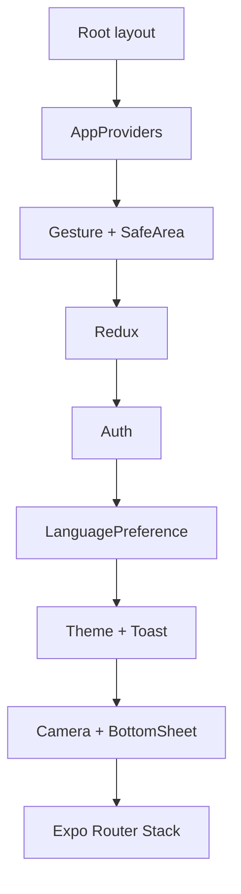

# Arquitectura de frontend mobile

## Propósito y alcance

La aplicación mobile es un cliente Expo/React Native orientado a interacción
táctil, cámara y uso en movimiento. No replica la lógica del backend: presenta
casos de uso, conserva estado de sesión y coordina capacidades nativas. La regla
de dependencia es:

```text
app route -> screen/view model -> query hook -> application service
          -> infrastructure client -> HTTP/device adapter
```

El código de `app/` es un shell de rutas de Expo Router. La implementación vive
en `src/`; por eso un helper, test o componente que no sea ruta no debe ubicarse
en `app/`.

Las rutas de detalle de evento (`app/(app)/(tabs)/events/[id].tsx`, incluido el
flujo de pago), perfil y listados de administración sólo leen parámetros de ruta
y renderizan una pantalla de `src/presentation/features`
(`event/EventDetailScreen` con `useEventDetailViewModel`, `profile/ProfileScreen`,
`admin/Admin*Screen`). `features/admin/__tests__/routeShells.test.ts` mantiene
esos archivos delgados.

**Deuda conocida:** algunos archivos de ruta todavía contienen lógica de pantalla,
por ejemplo `app/(app)/partner/index.tsx`. Las rutas nuevas no deben repetir ese
patrón.

## Capas

| Capa | Responsabilidad | No debe hacer |
|---|---|---|
| `app/` | declarar layouts, grupos y parámetros de ruta (con la deuda indicada arriba) | contener reglas de negocio o clientes HTTP |
| `src/presentation` | screens, componentes, hooks, ViewModels y feedback | manipular DTO crudo o APIs nativas directamente |
| `src/application` | servicios orientados a casos de uso y orquestación | importar React, Expo Router o componentes |
| `src/domain` | tipos, mappers, validadores y decisiones puras | depender de Axios, Expo, storage o navegación |
| `src/infrastructure` | HTTP, DTO, identidad social, cámara, storage y plataforma | decidir políticas de producto |
| `src/shared` | tokens, configuración y utilidades transversales | convertirse en un módulo de negocio genérico |

## Composición del runtime

`app/_layout.tsx` carga fuentes, controla el splash y monta `AppProviders`. El
orden de providers es deliberado: gesture/safe-area envuelven la interacción;
Redux incorpora sesión, preferencias y caché RTK Query. Auth configura el
transporte; LanguagePreference resuelve idioma; Theme, Toast, Camera y BottomSheet
completan la composición. El orden concreto está en `AppProviders`.



[Ver diagrama de «Composición del runtime» completo](https://images.vinnot.com/docs/diagrams/v1/es/frontend-mobile-architecture-overview-0733f67a2a67.svg)

## Estado: una fuente por naturaleza

- **RTK Query (`appApi`):** datos remotos, loading, error, cache e invalidación.
- **Redux:** identidad/sesión observable y preferencias globales de UI.
- **SecureStore/adapter persistente:** refresh token y material sensible; nunca
  es la fuente visual directa.
- **Estado local/reducer:** formularios, modales, animaciones y selección
  efímera.
- **Parámetros de ruta:** identidad navegable, como `wineId` u origen del scan.

La caché RTK Query forma parte del store Redux; no es un QueryClient separado.
`executeQuery` y `executeMutation` delegan en `application/operations`. Los tags
combinan familias, listas e IDs de recurso según la operación; no toda mutación
invalida una familia completa. Véase
[estado remoto y transporte](remote-state-and-transport.md).

## Sesión y transporte

El transporte Axios central agrega el access token. Los clientes IA envían
`language` explícitamente en parámetros o body; no hay una cabecera global de locale. Si dos requests
reciben `401` simultáneamente, una sola renovación se ejecuta y el resto espera
en cola. `AuthProvider` inyecta callbacks al transporte para evitar que
infraestructura importe el store. Un refresh fallido limpia la sesión y evita
loops en endpoints de autenticación.

Los errores se normalizan antes de llegar a UI. La presentación distingue al
menos validación, autorización, sesión expirada, offline, timeout, proveedor no
disponible y error inesperado. Mensajes y retry dependen de la clase de error,
no de comparar strings del backend.

## Navegación y acceso

Los grupos `(auth)`, `(onboarding)`, `(app)` y `(tabs)` organizan sin alterar la
URL. El layout `(app)` envuelve todo su Stack en `AuthGuard` y `TermsGate`, por lo
que no es público; además redirige al usuario autenticado con perfil incompleto a
`complete-profile`. Los layouts admin/partner agregan control de rol, pero la autorización definitiva
permanece en backend.

La pestaña Vinos fuerza el browse root para impedir que un detalle o escáner
quede retenido como destino de la tab. El escáner recibe origen explícito y su
back contextual no se deduce de un historial accidental.

## Capacidades nativas

La cámara, ML Kit, autenticación social, mapas, ubicación y almacenamiento
seguro están detrás de adapters/providers. Esto permite:

1. reemplazar una implementación sin cambiar screens;
2. usar fakes en tests;
3. mostrar estados de permiso denegado o no soportado;
4. impedir imports de módulos nativos en Expo Go cuando requieren dev build.

El escaneo conserva temporalmente la captura durante scan, búsqueda manual y
submission. El reset borra la URI del estado de presentación; no equivale a borrar el
archivo temporal del dispositivo. No se guarda en la galería por defecto.

## Internacionalización

El idioma de UI se resuelve desde preferencia explícita y, si falta, locale del
dispositivo. Se envía al backend para seleccionar contenido ES/EN ya persistido.
La UI no traduce semántica generada por IA; aplica fallback estructurado si una
versión todavía no existe. Agregar un idioma exige locale, contratos de contenido
y fallback, no condicionales dispersos.

## Rendimiento y resiliencia

- listas virtualizadas y componentes con identidad estable;
- imágenes dimensionadas y placeholders, sin bloquear el layout;
- debounce de 400 ms en el catálogo y argumentos de operación serializables;
- control de generación para descartar resultados tardíos del escáner;
- timeouts acordes al caso de uso, no un valor global ciego;
- respuesta tardía ignorada cuando la screen fue desmontada;
- skeleton para carga inicial, progreso semántico para operaciones largas;
- reintento de escaneo explícito con la misma imagen y texto OCR.

## Testabilidad

La lógica pura se prueba en `domain`; servicios se prueban con clients fakes;
hooks/ViewModels validan transición de estado; screens cubren interacción y
accesibilidad; capacidades nativas se prueban mediante puertos. El scan agrega
benchmark reproducible y matriz física separada de los tests unitarios.

## Reglas de evolución

1. Una nueva screen empieza por el caso de uso, no por Axios.
2. El DTO queda en infraestructura y se mapea antes de presentación.
3. Toda mutación declara qué query keys invalida.
4. Una API nativa nueva entra por adapter y documenta permisos/degradación.
5. Una ruta protegida declara política de acceso y fallback.
6. Todo flujo con navegación de retorno define origen explícito.

## Lecturas relacionadas

- [Mapa de aplicación](../diagrams/application-map.md)
- [Navegación y estado](navigation-and-state.md)
- [Flujos de producto](../use-cases/product-flows.md)
- [Escaneo de etiquetas](../../modules/wines/architecture.md)
- [Convenciones](conventions.md)

## Evidencia en código

- `frontend-mobile/app/_layout.tsx`
- `frontend-mobile/app/(app)/_layout.tsx`
- `frontend-mobile/app/(app)/(tabs)/_layout.tsx`
- `frontend-mobile/src/presentation/providers/AppProviders.tsx`
- `frontend-mobile/src/infrastructure/api/http.ts`
- `frontend-mobile/src/presentation/providers/AuthProvider.tsx`
