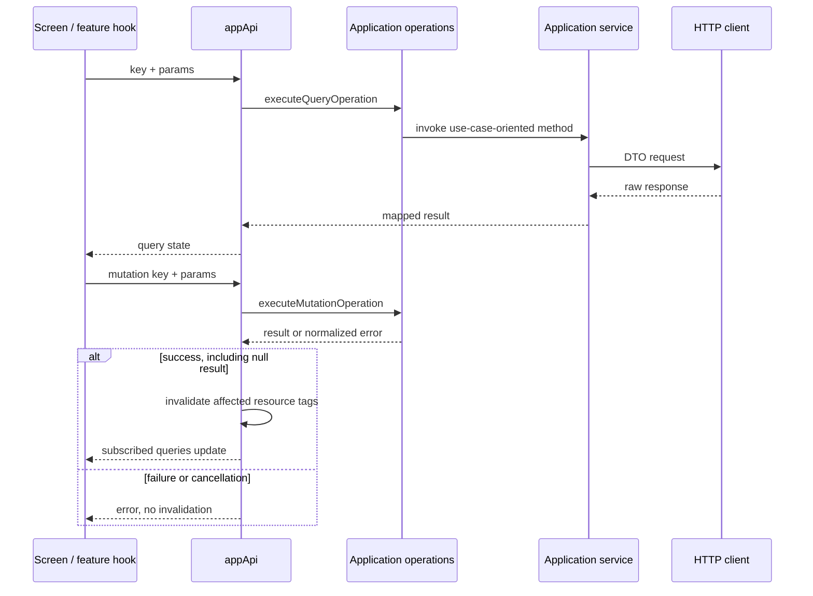

# Estado remoto, operaciones y transporte mobile

## Composición y responsabilidad

`presentation/store/api.ts` declara `appApi` con `createApi` y
`fakeBaseQuery<ApiError>`. Su reducer y middleware se integran en Redux.
No hay un QueryClient de TanStack en esta aplicación.

El hook de cada feature construye un `QueryRequest` o `MutationRequest`.
La clave identifica una operación de aplicación; no es un endpoint HTTP.
`application/operations/queryHandlers.ts` y `mutationHandlers.ts` seleccionan
el servicio. El servicio transforma la entrada, llama al cliente y devuelve
modelos mapeados. Sólo el cliente conoce método, ruta y DTO.

## Contrato de consulta

| Campo/estado | Significado |
|---|---|
| `key` | Nombre declarado en `queryOperationKeys`, por ejemplo `wine.list` |
| `params` | Argumentos serializables de la operación: filtro, página, ID o idioma |
| `skipToken` | El hook no suscribe una consulta, por ejemplo sin ID de detalle |
| `data` | Último resultado disponible del hook |
| `currentData` | Resultado correspondiente al argumento actual |
| `isLoading` | Carga inicial sin resultado |
| `isFetching` | Solicitud en curso, incluida una recarga con datos previos |
| `refetch` | Repetición explícita de la consulta suscrita |

`useTypedQuery` acepta además un `pollingInterval`; el historial de anuncios de
admin lo usa solo mientras un envío sigue saliendo. `useTypedQuery` y
`useTypedQueryList` adaptan el resultado genérico al tipo
esperado por la feature. Los tipos del hook no son validación de payload en
runtime: la normalización se realiza en servicios y mappers.

## Invalidación implementada

`queryTags` y `mutationTags` son políticas puras de aplicación. Usan la clave y
los parámetros de la operación; el adaptador RTK aplica invalidación únicamente
si la mutación termina sin error, incluidos resultados `null`/204. Un fallo o
cancelación no implica que los datos hayan cambiado.

| Recurso consultado | Alcance de tag |
|---|---|
| Listas de vinos / vinos de bodega | `Wines:LIST`; vinos de bodega también `Wineries` |
| Detalle del vino | `Wines:<id>` |
| Perfil y disponibilidad IA | `WineProfiles:<id>`, compartido entre idiomas |
| Reseñas y estado de reseña propia | `WineReviews:<id>` |
| Comentarios | `WineComments:<wineId>` |
| Envíos propios | `WineSubmissions` |
| Eventos públicos, cercanos y discovery | `Events:LIST` |
| Detalle e inscripciones de evento | `Events:<id>` |
| Administración | `Admin:<recurso>`: wines, wineries, events, routes, users, reviews, submissions, stats, countries o regions |
| Notificaciones de admin | `Admin:notifications.push`, `.metrics`, `.preview`, `.reach` y `.history`; un interruptor refresca `notifications.push` y una prueba o un envío solo `notifications.history` |
| Bodegas, rutas, cava, usuario, partner y referencias | Familias `Wineries`, `WineRoutes`, `Cellar`, `User`, `Partner`, `References` |
| Comunidad: comprobantes, bloqueos, resúmenes y colas | Familia `Community` |
| Comparación | Sin tags de invalidación automática |

Crear/editar/eliminar eventos como partner actualiza Partner, eventos públicos,
el detalle afectado cuando hay ID y la gestión/estadística administrativa de eventos.
No invalida usuarios ni vinos. Leer un evento partner no invalida nada.
Las operaciones admin conservan la actualización pública correspondiente a su
recurso; no invalidan todo el panel. Las reseñas actualizan puntuaciones y
proyecciones de cava/usuario sin releer perfiles IA. Generar un perfil actualiza
ese perfil, su disponibilidad y catálogo, sin refrescar los perfiles de otros vinos.
Cuando una operación no aporta ID se utiliza el alcance de familia del recurso
afectado, no una invalidación de toda la aplicación.

RTK Query recarga entradas invalidadas con suscriptores; las no suscritas se
descartan para una lectura posterior. La política no reemplaza objetos de dominio
directamente. Escanear y comparar no invalidan el catálogo. La comparación tampoco
se repite al recuperar foco: sus solicitudes responden a selección/reintento del usuario.

## Secuencia de lectura y escritura

[Ver diagrama de «Secuencia de lectura y escritura» completo](https://images.vinnot.com/docs/diagrams/v1/es/frontend-mobile-architecture-remote-state-and-transport-62231e761192.svg)

## Errores, reintento y cancelación

`toApiError` conserva `message`, `status`, `code` y `details` disponibles.
El transporte normaliza Axios; el escáner aplica además su clasificador de
errores para seleccionar mensajes. La recuperación concreta pertenece a cada
flujo, no a una promesa de retry uniforme.

`useOperationMutation` expone cancelación de la promesa RTK. El dispatcher pasa
`AbortSignal` al handler y la operación de escaneo lo propaga al servicio/cliente.
El ViewModel del escáner también descarta captura/OCR/respuestas de intentos
abandonados. Cancelar el transporte no garantiza detener trabajo ya iniciado en
el servidor; véase [ciclo del escáner](../diagrams/scan-lifecycle.md).

## Identidad y ciclo de aplicación

Los thunks de login y autenticación social reinician `appApi` al establecer una
sesión. `clearSession` limpia persistencia y reinicia la caché; el reducer borra
la identidad al comenzar esa operación. `AuthProvider` inyecta callbacks de
tokens y refresh en Axios para evitar una dependencia de infraestructura al store.

`refetchOnFocus` está configurado en `appApi`. Los listeners y el lifecycle
nativo del store determinan la entrega de eventos de foco; la configuración no
equivale a persistencia offline ni sincronización en segundo plano.

`GET /app-versions/minimum` usa la instancia compartida `http` sin requerir
sesión: un token vencido en esa ruta pública llega al backend como llamada
anónima, así no inicia un ciclo de renovación. Su cliente usa un tiempo de espera
más corto y `useAppUpdateRequirement` trata cualquier error como "sin mínima"
(ver [navegación y estado](./navigation-and-state.md)).

## Evidencia y lectura relacionada

- [API Redux](../../../../frontend-mobile/src/presentation/store/api.ts)
- [Claves y tags](../../../../frontend-mobile/src/application/operations/types.ts)
- [Handlers](../../../../frontend-mobile/src/application/operations/queryHandlers.ts)
- [Adaptador de mutaciones](../../../../frontend-mobile/src/presentation/store/mutationAdapter.ts)
- [Sesión y cuenta](../../modules/users/architecture.md)
