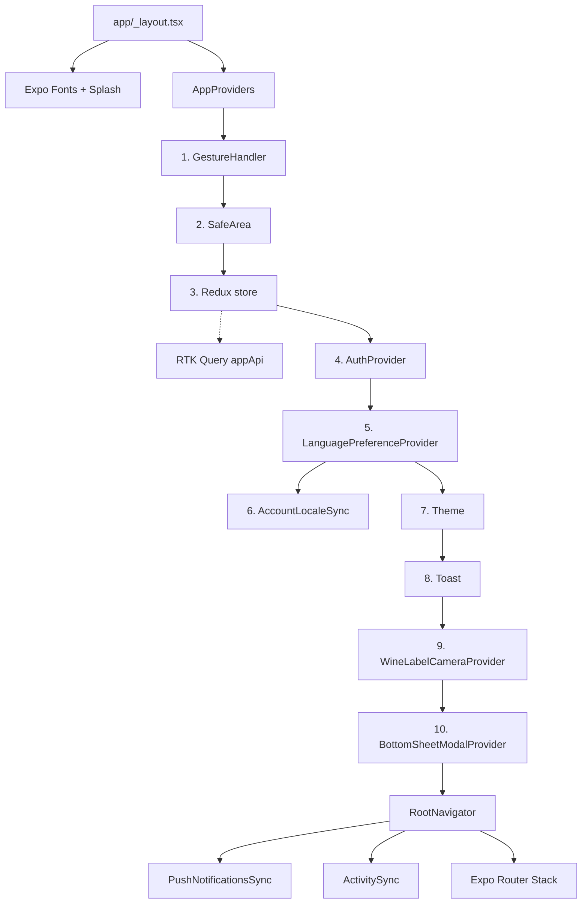
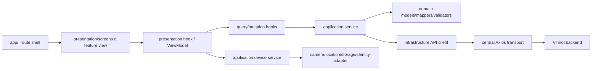
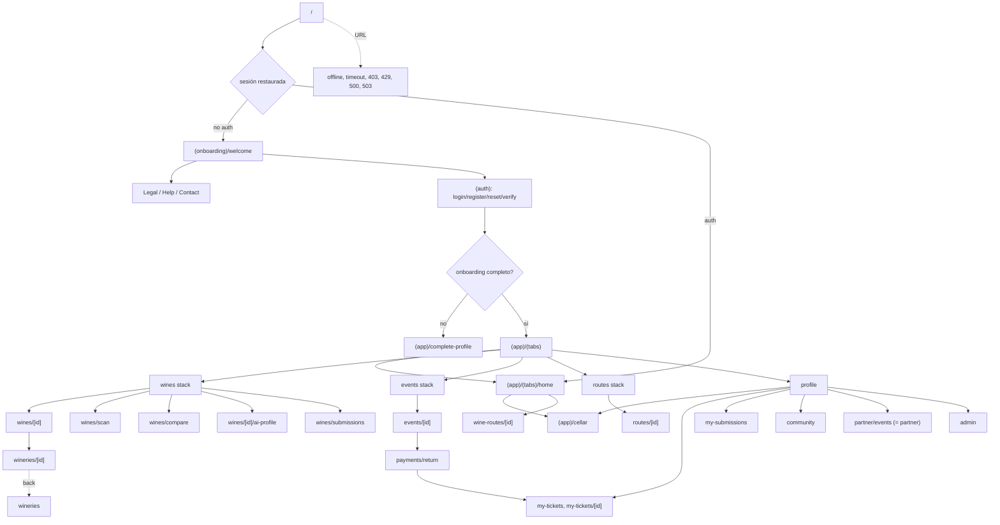
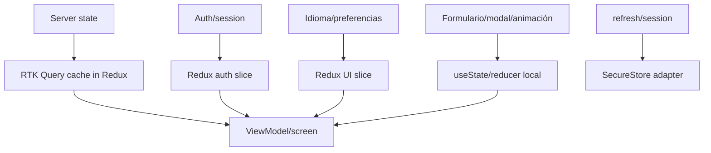
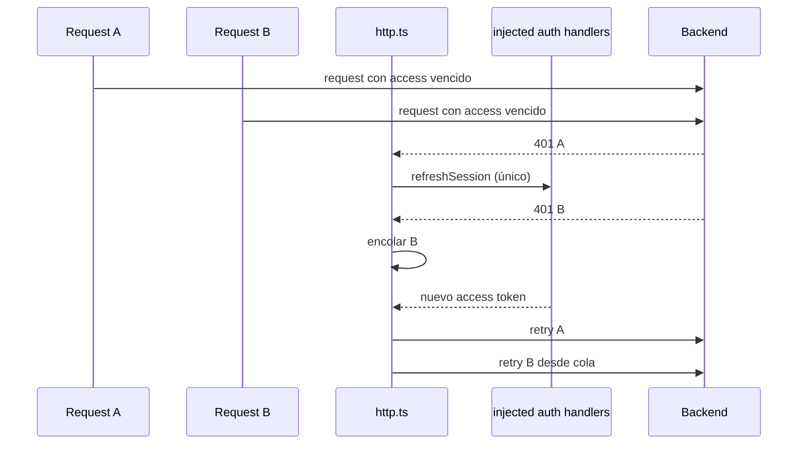
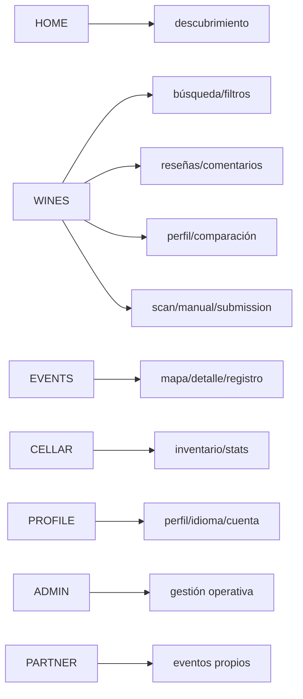

# Mapas de la aplicación mobile

## Composición del runtime

[Ver diagrama de «Composición del runtime» completo](https://images.vinnot.com/docs/diagrams/v1/es/frontend-mobile-diagrams-application-map-805e8a462fbb.svg)

El orden de providers es parte del wiring y va de afuera hacia adentro:
`GestureHandler`, `SafeArea`, Redux, `AuthProvider`, `LanguagePreferenceProvider`
(con `AccountLocaleSync` adentro), `Theme`, `Toast`, `WineLabelCameraProvider` y
`BottomSheetModalProvider`. `AuthProvider` necesita el store y configura el
transporte; el idioma se monta debajo de la sesión para sincronizar la preferencia
de la cuenta. `RootNavigator` monta `PushNotificationsSync` y `ActivitySync` junto
al stack de Expo Router; las screens necesitan safe area, query, idioma y sesión.

## Capas y dirección de dependencia

[Ver diagrama de «Capas y dirección de dependencia» completo](https://images.vinnot.com/docs/diagrams/v1/es/frontend-mobile-diagrams-application-map-4920df8a6055.svg)

`app/` sólo contiene archivos que Expo Router debe interpretar como rutas o
layouts. Tests, estilos y helpers viven en `src/`.

## Árbol de navegación

[Ver diagrama de «Árbol de navegación» completo](https://images.vinnot.com/docs/diagrams/v1/es/frontend-mobile-diagrams-application-map-991e7500dfa6.svg)

Las cinco tabs interceptan `tabPress` en `(tabs)/_layout.tsx` y ejecutan
`openTabRoot`, que reinicia sólo el stack anidado de la tab elegida y conserva su
lista raíz y filtros en lugar de un detalle/scan viejo. El back contextual
del scan conserva el origen de navegación.

La ficha de bodega se abre desde el nombre de la bodega en la ficha del vino o
desde un enlace compartido; la lista `wineries` no tiene acceso en la interfaz y
sólo se alcanza con back desde una bodega abierta por enlace. `partner` y
`partner/events` muestran la misma pantalla. Las pantallas de estado del servicio
(sin conexión, tiempo agotado, 403, 429, 500 y 503) son rutas raíz que muestran
`ServiceStateScreen` cuando se abren por URL; dentro de una pantalla, los errores
de carga se muestran en línea con `QueryErrorState`.

## Estado y datos

[Ver diagrama de «Estado y datos» completo](https://images.vinnot.com/docs/diagrams/v1/es/frontend-mobile-diagrams-application-map-9c87488b178e.svg)

El store contiene la caché RTK Query. Sólo las mutaciones exitosas invalidan
tags por recurso/entidad mediante `mutationTags`; las comparaciones quedan fuera
de esta recarga automática. Ver [contrato de caché](../architecture/remote-state-and-transport.md).

## Refresh concurrente

[Ver diagrama de «Refresh concurrente» completo](https://images.vinnot.com/docs/diagrams/v1/es/frontend-mobile-diagrams-application-map-4de524c07204.svg)

Los endpoints `/auth/*` y requests ya reintentadas no entran de nuevo al refresh,
evitando loops. Los handlers se inyectan desde `AuthProvider` para que
infraestructura no importe stores.

## Flujos por módulo

[Ver diagrama de «Flujos por módulo» completo](https://images.vinnot.com/docs/diagrams/v1/es/frontend-mobile-diagrams-application-map-fb0e33418bc0.svg)

## Más diagramas

- [Navegación, sesión y acceso](navigation-and-session.md)
- [Pipeline visual de escaneo](wine-label-scan.md)
- [Arquitectura mobile](../architecture/overview.md)
- [Escaneo de etiquetas](../../modules/wines/architecture.md)
