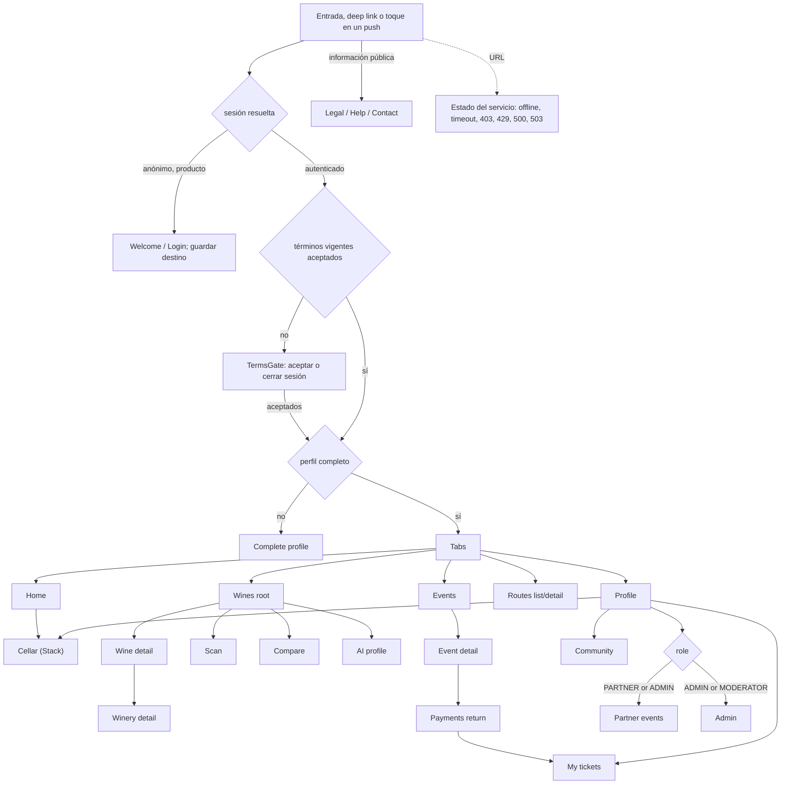
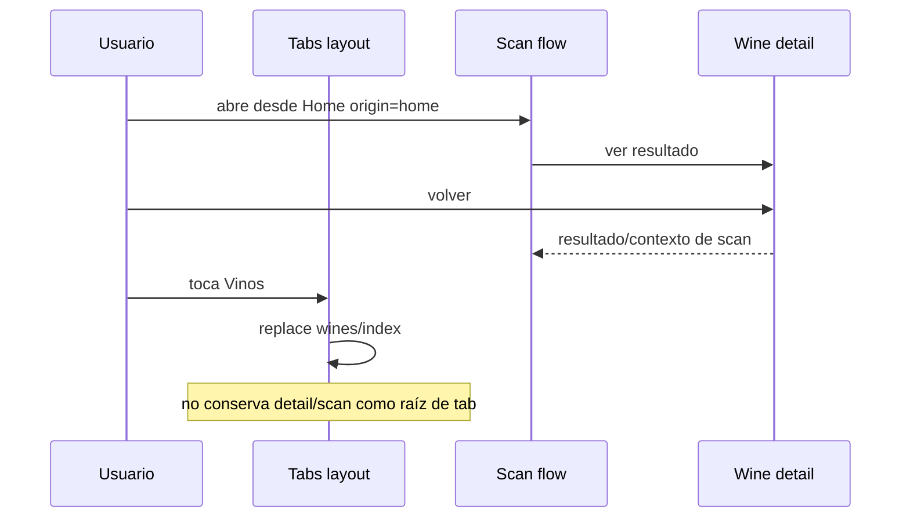
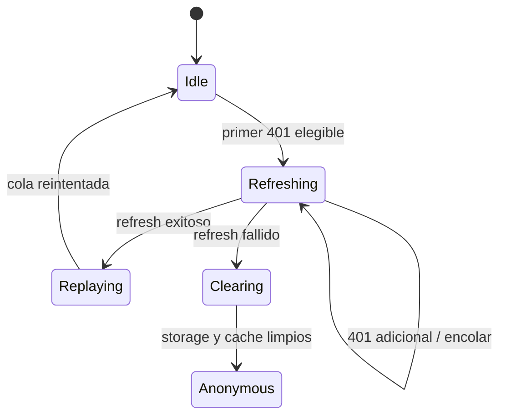

# Diagramas de navegación y sesión mobile

## Árbol de acceso

[Ver diagrama de «Árbol de acceso» completo](https://images.vinnot.com/docs/diagrams/v1/es/frontend-mobile-diagrams-navigation-and-session-850d066cfa2b.svg)

Un toque en una notificación push es otra entrada: si no hay sesión, la
pantalla destino queda guardada y se abre después del login.

## Reset de tab versus back contextual

[Ver diagrama de «Reset de tab versus back contextual» completo](https://images.vinnot.com/docs/diagrams/v1/es/frontend-mobile-diagrams-navigation-and-session-06fdc453d428.svg)

## Cola de renovación

[Ver diagrama de «Cola de renovación» completo](https://images.vinnot.com/docs/diagrams/v1/es/frontend-mobile-diagrams-navigation-and-session-adaad8f4cb64.svg)
