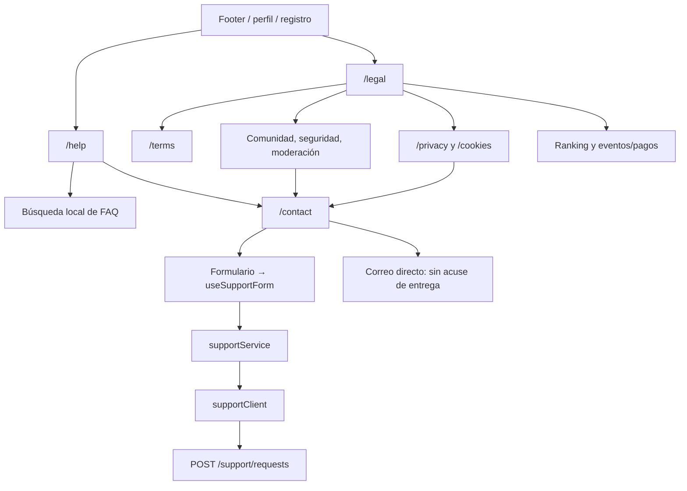
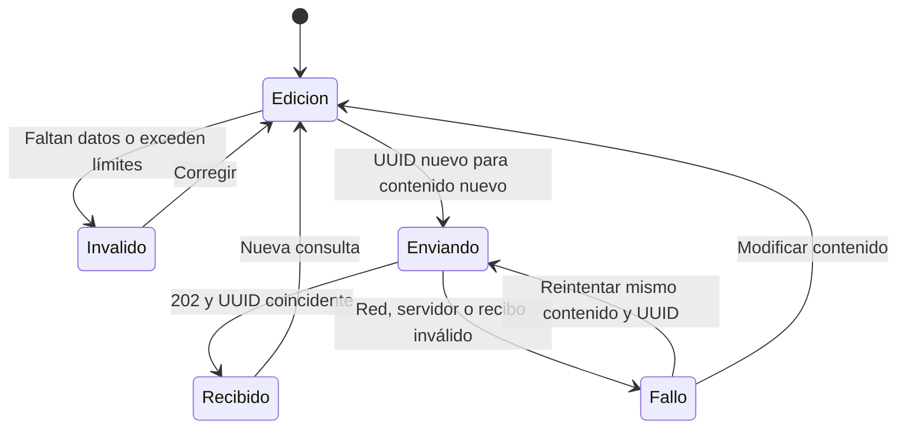
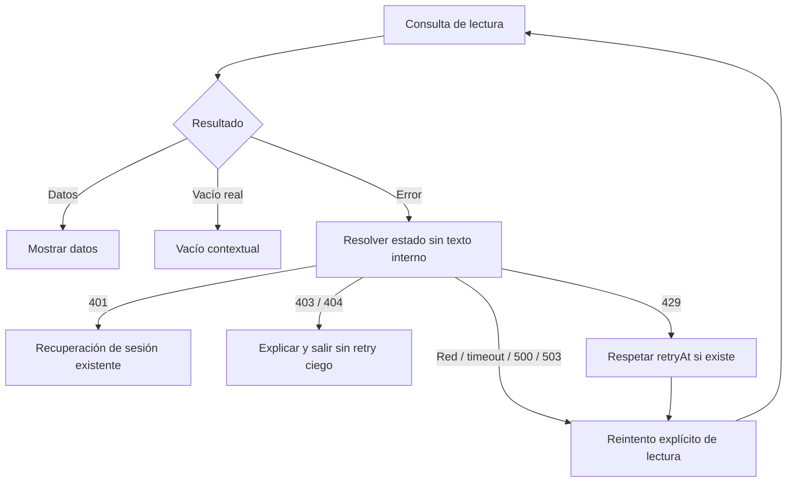
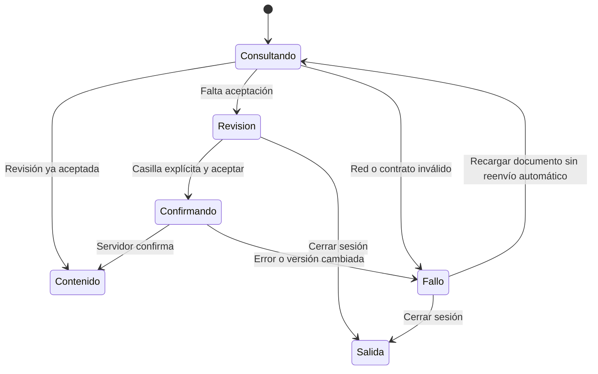

# Navegación pública y recuperación

## Rutas y canales

[Ver diagrama de «Rutas y canales» completo](https://images.vinnot.com/docs/diagrams/v1/es/frontend-mobile-diagrams-public-information-6a0dfc734bfe.svg)

Los documentos son públicos. Los términos vigentes se consultan al backend;
las otras políticas y FAQs se incluyen en el frontend. No hay llamadas IA. El mapa no cambia la autorización de catálogo privado o admin.

## Contacto: máquina de estados

[Ver diagrama de «Contacto: máquina de estados» completo](https://images.vinnot.com/docs/diagrams/v1/es/frontend-mobile-diagrams-public-information-79a5a934e064.svg)

Durante Enviando no se admite otro submit. Fallo conserva el formulario.
Recibido significa aceptación durable; el envío externo ocurre después.

## Lecturas y estados visuales

[Ver diagrama de «Lecturas y estados visuales» completo](https://images.vinnot.com/docs/diagrams/v1/es/frontend-mobile-diagrams-public-information-8b0f1107c940.svg)

La clasificación no limpia credenciales ni borra contenido cacheado. Mutaciones
de inscripción, pago y generación conservan su recuperación específica.

## Límites de render

Un error de render utiliza un límite independiente del resultado HTTP.
Reintentar reinicia esa superficie, no ejecuta una mutación de negocio desde
el componente de error. Ningún mensaje expone el stack o las credenciales.

Ver [contrato funcional](../../modules/support/architecture.md).

## Revisión contractual

[Ver diagrama de «Revisión contractual» completo](https://images.vinnot.com/docs/diagrams/v1/es/frontend-mobile-diagrams-public-information-4972ec009120.svg)

Legal, privacidad, ayuda y contacto quedan fuera de la barrera de aceptación.
Registro usa el mismo documento y envía la selección con el alta.
