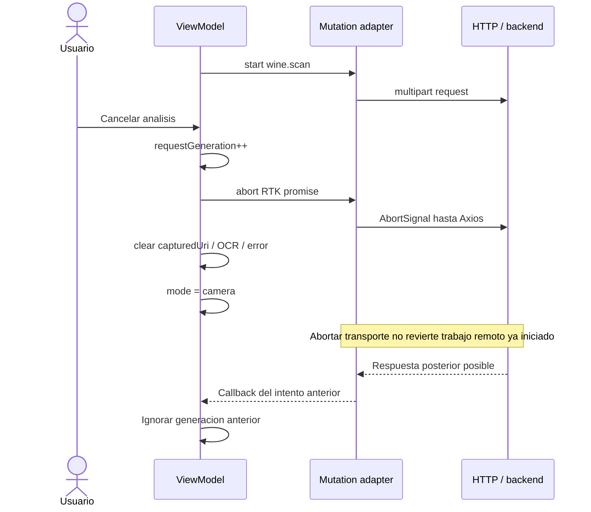
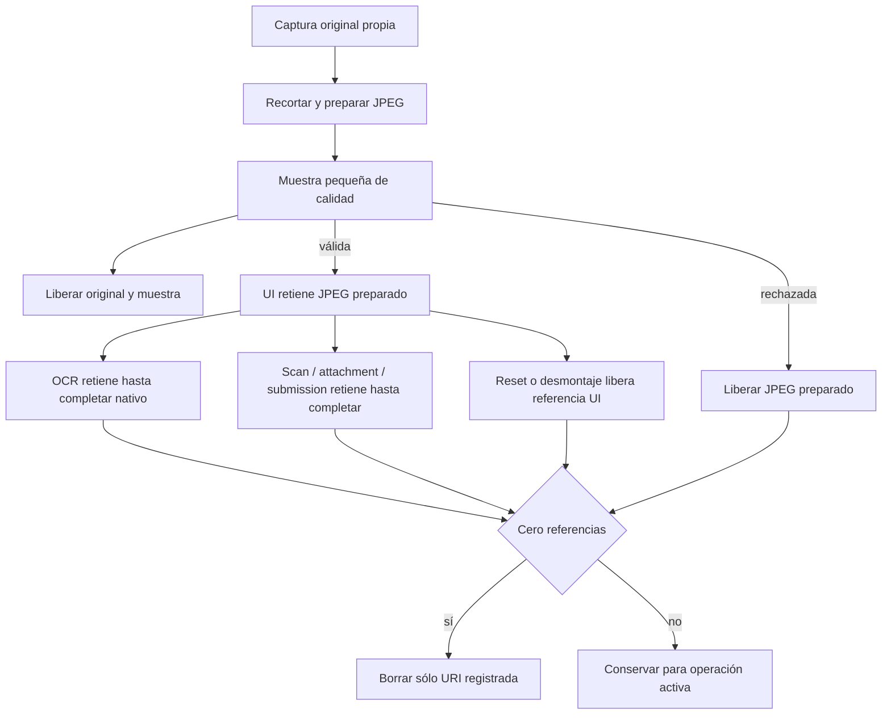

# Captura, cancelación y recuperación del escáner

## Recursos y propietarios

| Recurso | Propietario | Duración |
|---|---|---|
| Preview | Camera adapter | Cámara montada y con permiso |
| Original y muestra de calidad | Adaptador de cámara | Hasta finalizar procesamiento/validación |
| URI JPEG preparada | Registro de temporales de cámara | Hasta liberar UI y todas las operaciones que la retienen |
| capturedUri / observedText | Scan ViewModel | Hasta reset o desmontaje |
| requestGeneration | Scan ViewModel ref | Incrementa para invalidar intentos |
| Promesa RTK | Mutation adapter | Operación o abort |
| Imagen publicada | Backend storage | Contrato de submission/attachment |

## Secuencia de cancelación

[Ver diagrama de «Secuencia de cancelación» completo](https://images.vinnot.com/docs/diagrams/v1/es/frontend-mobile-diagrams-scan-lifecycle-0883c78890e8.svg)

Esta secuencia describe cancelación de interacción y protección frente a
resultados tardíos. No asegura cancelar costos o trabajo ya iniciado en servidor.
El reset libera la referencia de la interacción. El archivo se elimina sólo al
liberar también las referencias de OCR/uploads; el adapter registra únicamente
URIs propias dentro de cacheDirectory. El OCR conserva su referencia hasta que
finaliza la operación nativa, aunque la espera de UI haya agotado su segundo.

[Ver diagrama de «Secuencia de cancelación» completo](https://images.vinnot.com/docs/diagrams/v1/es/frontend-mobile-diagrams-scan-lifecycle-8c162f74fbb9.svg)

Una captura que llega después de cancelar se libera antes de iniciar OCR. La
generación también se verifica después de OCR y del request. Un guard impide
capturas/reintentos simultáneos mientras termina el intento anterior.

## Reintento y continuidad

`retryAnalysis` reutiliza URI y OCR, limpia el error y crea una generación nueva.
No obliga a fotografiar otra vez. `reset` vuelve a cámara. Búsqueda manual y
formulario mantienen la captura en el mismo circuito; adjuntar imagen a vino
existente es una mutación separada. La navegación de salida cancela el intento
observable y evita tratar una respuesta antigua como resultado de una toma nueva.

## Evidencia

- [ViewModel](../../../../frontend-mobile/src/presentation/features/wine/scan/useWineLabelScanViewModel.ts)
- [Mutation adapter](../../../../frontend-mobile/src/presentation/store/mutationAdapter.ts)
- [Camera adapter](../../../../frontend-mobile/src/infrastructure/device/camera/WineLabelCamera.tsx)
- [HTTP client](../../../../frontend-mobile/src/infrastructure/api/clients/wines.client.ts)
- [Caso de uso](../../modules/wines/architecture.md)
