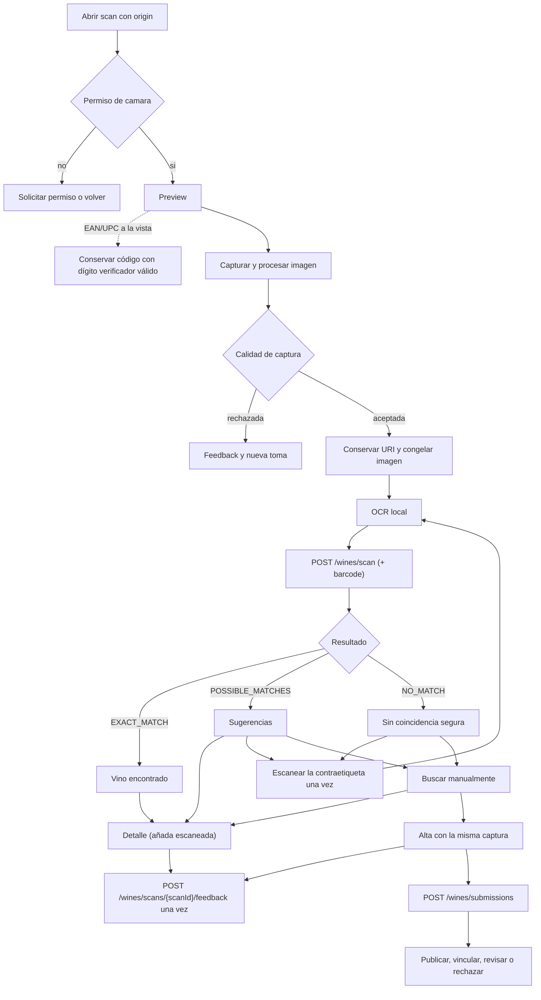
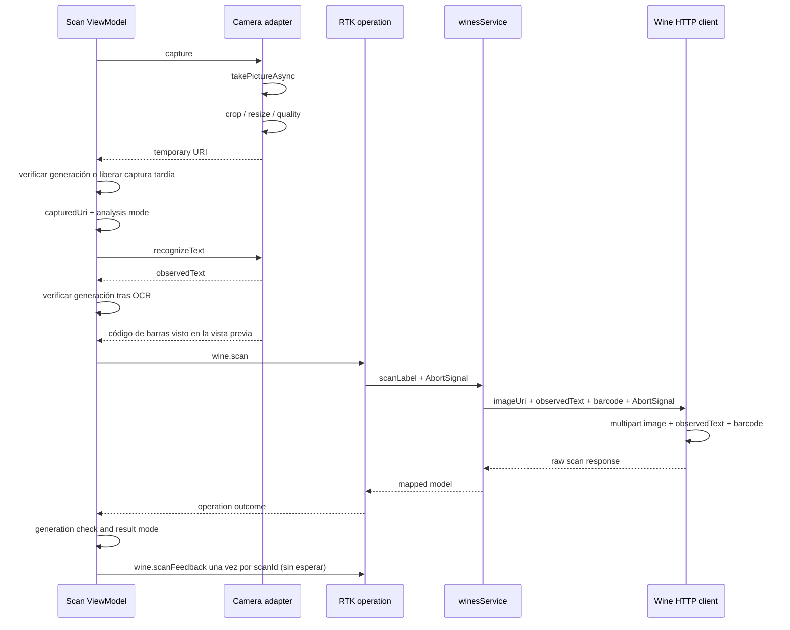
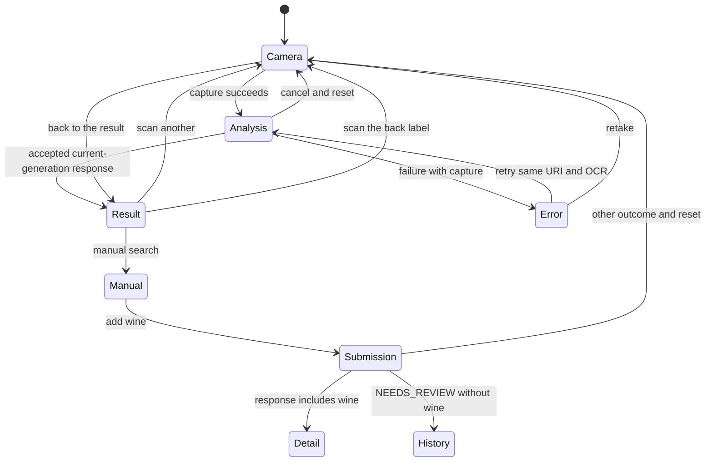

# Diagramas del escaneo exclusivo mobile

## Circuito de producto

[Ver diagrama de «Circuito de producto» completo](https://images.vinnot.com/docs/diagrams/v1/es/frontend-mobile-diagrams-wine-label-scan-eca05854d5d7.svg)

El resultado exacto se presenta antes de abrir el detalle; no es navegación
automática obligatoria. La invitación web a descargar la app no participa en
este pipeline.

## Interaccion tecnica

[Ver diagrama de «Interaccion tecnica» completo](https://images.vinnot.com/docs/diagrams/v1/es/frontend-mobile-diagrams-wine-label-scan-7d215c56b5f8.svg)

El multipart no contiene un campo locale. El request de escaneo transmite la
imagen; transmisión no equivale a persistirla como imagen del catálogo. Una
captura de la contraetiqueta se lee y se libera: el escaneo vuelve a enviar la
foto del frente con ambas lecturas combinadas. El veredicto sobre el resultado se
envía como máximo una vez por `scanId` y su falla nunca se muestra.

## Estados de recuperacion

[Ver diagrama de «Estados de recuperacion» completo](https://images.vinnot.com/docs/diagrams/v1/es/frontend-mobile-diagrams-wine-label-scan-55e2f66e34c2.svg)

Los nombres visuales found/suggestions/no-match son ramas del resultado;
`mode` del ViewModel agrupa su presentación. El circuito conserva captura para
reintentar o enviar un vino. Véase [lifecycle](scan-lifecycle.md).
