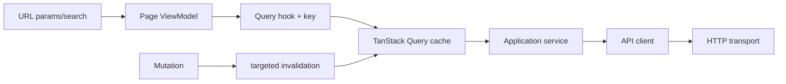

# Routing, acceso y estado web

## Matriz de acceso

| Nivel | Rutas | Guard |
|---|---|---|
| público sin shell | login, register, register/success, forgot-password, reset-password, verify-email, confirm-email-change | ninguno |
| retorno de checkout | payments/return | ninguno; fuera de AppShell, estado por recibo opaco |
| onboarding | complete-profile | ProtectedRoute + TermsGate, fuera de AppShell |
| público | home, about, contact, help, legal y legal/:slug, legal/ranking, terms, privacy, cookies, content-policy | ninguno; la información legal no redirige por onboarding incompleto |
| estados de servicio | 403, 404, 500, 503, 429, offline, timeout, wildcard | ninguno; dentro de AppShell |
| catálogo | wines, detail, events, wineries, routes | AppShell + ProtectedLayout |
| autenticado | compare, scan, AI profile, profile, cellar, community, my-tickets, my-tickets/:id | ProtectedLayout |
| partner | partner/events | PartnerLayout (`PARTNER` o `ADMIN`) |
| cuenta de cobro | partner/payments, partner/payments/callback | sin guard de ruta, fuera de AppShell; sólo existen con flag de pagos |
| administrativo | dashboard, wines, wines/:id/ai-profile, wineries, events, routes, reviews, wine-submissions, publications, community | AdminLayout (`ADMIN` o `MODERATOR`) |
| admin estricto | users | AdminOnlyLayout (`ADMIN`) |

Las rutas pesadas usan imports lazy y `PageLoadingFallback`. El wildcard termina
en NotFound dentro del shell.

## Providers y restauración

Auth se monta después de router/store/query para poder restaurar identidad,
configurar handlers de transporte, limpiar cache y navegar. Mientras restaura,
un guard muestra un estado neutral; no redirige prematuramente.

## Modelo de cache

[Ver diagrama de «Modelo de cache» completo](https://images.vinnot.com/docs/diagrams/v1/es/frontend-web-architecture-navigation-and-state-8e3ca861e35c.svg)

La key incluye todos los parámetros capaces de cambiar el resultado. `enabled`
evita requests con IDs inválidos. `keepPreviousData` puede conservar una página
durante paginación sin presentar esos datos como respuesta de los filtros nuevos.

## Refresh y cierre

El interceptor no importa Redux. Auth registra funciones para leer access token,
renovar y manejar fallo. Un mutex/promesa compartida evita varios refresh. Logout
invalida la sesión backend cuando es posible y siempre limpia tokens/cache local.

## Roles y ownership

Los guards filtran experiencia, pero una respuesta `403` sigue siendo normal.
Partner puede editar sólo eventos propios; ese ownership no puede deducirse del
objeto mostrado. Cada ruta administrativa declara las authorities exigidas por
su endpoint backend.

## URL como contrato

El catálogo lee filtros iniciales desde URL; sus actualizaciones escriben `q`,
`page`, `country` y `region`. Tipo y uva también tienen estado local; no hay
restauración completa de todos los filtros al cambiar únicamente la URL. Ver [catálogo](../../modules/wines/architecture.md).
Modales y drafts no enviados permanecen locales.

## Estados obligatorios

Cada page trata carga, vacío, error recuperable, forbidden, not-found y éxito.
Una request cancelada por navegación no dispara toast. Errores de validación se
asocian a campos; conflicto muestra decisión requerida; offline/timeout ofrecen
retry seguro.

## Casos de prueba

Se prueban redirect anónimo, retorno post-login seguro, roles, sesión restaurada,
refresh concurrente, limpieza por logout, navegación back/forward con filtros,
lazy fallback, 403/404 y ausencia de request con params inválidos.

## Scroll y retorno de acceso

`RouteScroll` coordina el viewport en el límite del router. PUSH a otra página
comienza arriba; un hash espera hasta dos segundos a su sección lazy y usa
`scroll-margin-top` para despejar la cabecera. Cambiar sólo querystring no
reinicia scroll. POP restaura la posición en memoria por key del historial;
observa altura durante hasta dos segundos, y la interacción del usuario cancela
una restauración tardía. Desmontar retira observers/listeners/timers y restaura
la política de scroll del navegador.

`ProtectedRoute` conserva pathname + query + hash en `returnUrl`, sin montar
contenido protegido durante la inicialización. `useAuthReturnPath` valida el
retorno interno y evita volver a rutas de autenticación. Login, registro,
confirmación de registro y completar perfil conservan esa intención en URL;
perfil completo retorna al destino, con los gates de términos vigentes.

## Arranque anónimo y verificación de términos

`AuthProvider` espera `initSession`. Sin access token, la aplicación usa
`authService.restoreSession`: 204 del adapter web significa sesión ausente,
no error de validación ni sesión vencida; no consulta `/auth/me` en ese caso.
Un arranque concurrente de la misma generación comparte restauración y perfil.
Logout/login cambian generación y descartan respuestas tardías. La renovación
para una operación protegida sigue siendo estricta: ausencia no equivale a
credenciales válidas. La cookie HttpOnly, Origin, header CSRF y rotación se
conservan; no se usa un indicador local como prueba de sesión o aceptación.

`TermsGate` bloquea contenido con un estado neutral mientras espera el estado
del servidor. Sólo muestra texto/checkbox/botones de consentimiento después de
confirmar que es necesario. Si el acuerdo ya está aceptado, pasa directamente
al contenido; un error conserva bloqueo y recuperación, y legales/contacto
siguen exentos. Registro mantiene su revisión y consentimiento explícitos.
