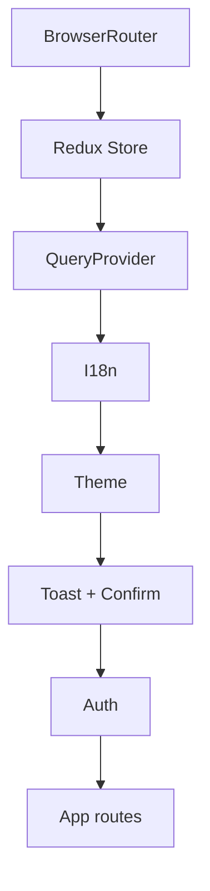

# Arquitectura de frontend web

## Rol del cliente

La web React presenta casos de uso y administra estado de interacción; el
backend conserva reglas, autorización e integridad. La dependencia admitida es:

```text
Page -> ViewModel/presentation hook -> query hook -> application service
     -> infrastructure client -> central HTTP transport -> API
```

Una page no importa Axios ni un client. Un client no decide qué mensaje mostrar.
Un DTO no cruza hasta presentación: application/domain lo mapea a modelos
estables.

## Capas

| Área | Responsabilidad |
|---|---|
| `src/app` | composición, providers, router y layouts |
| `src/presentation/pages` | entrada visual de cada caso de uso |
| `src/presentation/hooks` | server-state, mutations y coordinación de UI |
| `src/application/services` | operaciones orientadas a producto y mapping |
| `src/domain` | tipos, mappers y validadores puros por módulo |
| `src/infrastructure/api` | DTO, paths, params y contratos HTTP |
| `src/infrastructure/http` | Axios, base URL, token, refresh y errores |
| `src/shared` | i18n, config, utilidades y componentes transversales |

## Composición

`AppProviders` establece BrowserRouter, Redux, TanStack Query, i18n, theme,
toast, confirmación y auth en un orden estable. La instancia de QueryClient es
única: `staleTime` 5 minutos, `gcTime` 30 minutos, un retry de queries, sin
refetch automático al enfocar ventana y mutations sin retry global.



[Ver diagrama de «Composición» completo](https://images.vinnot.com/docs/diagrams/v1/es/frontend-web-architecture-overview-e2df8e1474e1.svg)

## Routing y carga

Las páginas funcionales se cargan con `lazy` + `Suspense`; el shell público se
mantiene estable. Hay cuatro niveles:

- público: auth, home, información/legal, estados de servicio y retorno de checkout;
- autenticado: catálogo, eventos, bodegas, rutas del vino, comparación, scan, perfil IA, comunidad, perfiles públicos y seguimiento (perfil, seguidores, siguiendo y feed), cuenta, cava y entradas;
- partner: gestión de eventos propios;
- admin/moderador: catálogo, perfiles, reseñas y submissions; usuarios quedan bajo admin-only.

Los guards son UX y navegación, no sustituyen seguridad del backend. Las rutas
administrativas consumen principalmente `/admin/**`, con excepciones: `GET /users`, `PATCH /wines/{id}/ai-profile` y `/regions/*`; catálogo/moderación admiten `ROLE_ADMIN` o
`ROLE_MODERATOR`; usuarios y eliminación de catálogo exigen `ROLE_ADMIN`.

## Estado

- TanStack Query es dueño de datos remotos y su estado de carga/error.
- Redux conserva auth y preferencias globales; no duplica catálogos.
- ViewModels poseen filtros, formularios y coordinación de page.
- URL conserva recursos y filtros que deben ser compartibles/navegables.
- storage persiste sólo la porción explícitamente diseñada.

Las query keys se organizan por recurso e identidad. Mutations invalidan el
conjunto mínimo necesario. Login, logout o cambio de identidad limpian cache
privada.

## HTTP y sesión

El transporte agrega el token y normaliza errores. Los clientes IA envían
`language` explícitamente, sin cabecera global de locale. Ejecuta un
refresh single-flight. Requests concurrentes esperan la misma promesa; una
respuesta `401` reintentada no vuelve a entrar al ciclo. Si refresh falla, se
limpia sesión y se rechaza la cola.

Assets devueltos por API se resuelven con el helper de URL para soportar paths
relativos. Ningún secreto privado se incorpora al bundle; variables `VITE_*` son
públicas por definición.

## i18n y contenido bilingüe

La web mantiene recursos `es-AR` y `en-US`. El locale selecciona UI y se envía a
API. Perfiles/comparaciones IA se recuperan ya localizados desde backend; la web
no traduce el contenido semántico. Fallback debe ser visible y determinista.

## Seguridad de presentación

- no renderizar HTML remoto sin sanitización;
- no usar guards como única autorización;
- evitar datos sensibles en query params/logs;
- validar archivos antes de enviar, sin confiar sólo en cliente;
- manejar `403`, `404`, `409`, `422`, timeout y offline por categoría;
- confirmar acciones destructivas.

## Rendimiento

Lazy routes reducen bundle inicial. La búsqueda usa debounce de 400 ms y claves que separan argumentos de consulta.
El aislamiento de caché no equivale a abortar una solicitud HTTP en curso. Listados mantienen paginación del servidor; imágenes tienen fallback
y dimensiones; derivaciones costosas se memoizan sólo con evidencia. No se
prefetchea información privada sin intención del usuario.

## Pruebas

Domain/application usan Vitest; services mockean clients, no Axios interno.
Hooks/pages usan Testing Library y MSW para contratos. Playwright cubre las specs de `tests/e2e`: `auth-errors`, `brand-animation`, `brand-parity`, `browser-session-startup`, `discovery-access`, `homepage`, `navigation`, `public-information`, `release-retention`, `session-security`, `smoke` y `wines`; ninguna cubre inscripción a eventos, checkout, entradas ni pagos;
su alcance y entorno se detallan en [pruebas](../testing/strategy.md). La arquitectura de tests y cobertura se valida en CI junto a lint y
build.

## Regla de cambio

Todo endpoint nuevo requiere DTO/client, mapping/servicio, query hook, ViewModel
y page sólo en las capas necesarias. Si una page necesita llamar directamente a
HTTP, falta una abstracción; no es un atajo aceptado.

## Más información

- [Navegación y estado](navigation-and-state.md)
- [Mapas de la aplicación](../diagrams/application-map.md)
- [Flujos de producto](../use-cases/product-flows.md)
- [Catálogo de vinos](../../modules/wines/architecture.md)
