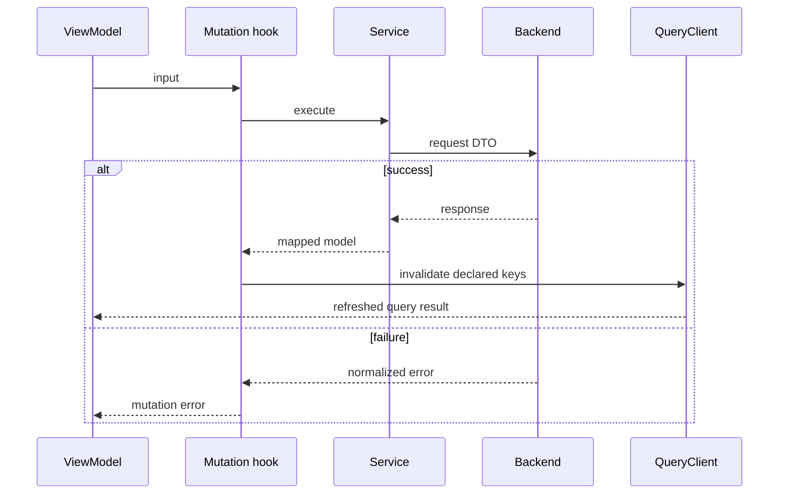

# Estado remoto y transporte web

## Propietarios y composición

TanStack Query conserva respuestas y estados remotos. Redux conserva identidad
y preferencias. Los formularios y modales son estado de presentación.
`QueryProvider` instancia el QueryClient con staleTime de cinco minutos,
gcTime de treinta, un retry de queries y sin refetch automático por foco.
Las mutations no tienen retry global.

El grafo es page → ViewModel/hook → servicio → cliente DTO → Axios. Un mapper
normaliza la respuesta antes de que llegue a la vista. Este cliente usa servicios
de aplicación con dependencias concretas de infraestructura; no debe describirse
como un contenedor de inyección de puertos que no existe.

## Identidad de caché

`queryKeys.ts` centraliza claves jerárquicas:

| Familia | Argumentos significativos |
|---|---|
| wines | filtros/página; ID para detalle |
| reviews | vino, página y filtro; ID de reseña para comentarios |
| AI profile/status | ID del vino e idioma |
| compare | ID A, ID B e idioma; raíz independiente de wines |
| events | filtros o posición/radio; evento para inscripción propia |
| wineries / wineRoutes | filtros, ID, jerarquía geográfica |
| cellar / users | filtros de cava y estadísticas propias |
| admin / partner | recurso, filtros/página e ID de detalle |

Excepciones con claves ad hoc fuera de `queryKeys.ts`: `useCommunity.ts` (`["community", userId, …]` para denuncias, bloqueos, moderación y publicaciones), `useMyTickets.ts` (`myTickets` y `paymentReceipt`), `usePaymentAccountStatus.ts` (`paymentAccount`), `useOrganizerPayments.ts` (`["events", eventId, "organizerPayments", ids]`) y ubicación (`device-location`, `location-country`).

Las claves se construyen con los argumentos del hook, no con la URL HTTP.
Una clave distinta separa respuestas en memoria; no garantiza cancelar la
solicitud anterior ni conservar todos los filtros en la URL del navegador.

## Mutaciones e invalidación

Los hooks de cada módulo declaran `onSuccess` e invalidan familias o detalles.
Las reseñas se relacionan con claves de detalle del vino; la edición/eliminación de cava utiliza su
familia; los módulos admin y partner tienen namespaces propios.
El alcance exacto se consulta en los hooks de mutación, no se infiere por
similitud entre endpoints públicos y administrativos.

Crear/editar/eliminar un evento partner invalida listas partner, listas públicas,
cercanos, discovery, administración de eventos y estadísticas. Editar/eliminar
también invalida el detalle público de ese evento, incluidas sus inscripciones;
no afecta detalles de otros eventos ni catálogo de vinos. Sólo se ejecuta tras
éxito, nunca en `onError`. La mutación espera la actualización de las consultas
activas invalidadas antes de completar su callback de éxito.

[Ver diagrama de «Mutaciones e invalidación» completo](https://images.vinnot.com/docs/diagrams/v1/es/frontend-web-architecture-remote-state-and-transport-af293e1bd60d.svg)

## Transporte y sesión

`infrastructure/http/http.ts` configura base URL, timeout y Bearer.
Auth inyecta getter de access token, renovación y callback de expiración.
Un primer 401 elegible inicia refresh; los concurrentes esperan y se reintentan
con el token nuevo. `/auth/*` y requests ya reintentadas quedan excluidos.

La inicialización de sesión es una operación distinta al interceptor: el store
obtiene access mediante cookie en `/auth/web/refresh` y consulta `/auth/me`. Véase
[autenticación](../../modules/users/architecture.md).
No se agrega un locale global; los métodos IA envían `language`.

## Caché, red y recuperación

`keepPreviousData` permite conservar datos durante cambios de argumentos.
`isLoading`, `isFetching`, resultado anterior y resultado actual no expresan
lo mismo. Los consumidores seleccionan qué estado mostrar.
`enabled` controla consultas condicionadas, como un detalle sin ID.

Una comparación es una query desde la perspectiva de caché, aunque su transporte
es POST. Su hook desactiva retry automático y refetch por foco, reconexión o
remontaje; su raíz `compare` la aísla de invalidaciones del catálogo `wines`.
Una selección nueva/idioma sin entrada de caché inicia la solicitud. Ante un
fallo, la página conserva ambos vinos y ofrece reintento explícito con indicador
de carga. Las pantallas presentan el resultado; el backend decide reutilización
de IA, permisos y consistencia persistente.

AuthProvider limpia QueryClient al cambiar identidad o finalizar sesión.
La caché y el access son de memoria; localStorage no almacena tokens ni consultas.
Las mutaciones de cookies usan Web Locks entre pestañas y una cola por pestaña.
Si la política de privacidad deniega Web Locks con `SecurityError` antes de iniciar
la operación, se conserva únicamente la cola local. Una operación ya iniciada
nunca se repite mediante esta alternativa. Bloquear cookies impide restaurar la
sesión tras recargar; los tokens no se trasladan a otro almacenamiento para eludir esa decisión.

## Evidencia

- [Claves](../../../../frontend-react/src/presentation/hooks/queries/queryKeys.ts)
- [Transporte](../../../../frontend-react/src/infrastructure/http/http.ts)
- [Provider de sesión](../../../../frontend-react/src/app/providers/AuthProvider.tsx)
- [Comparación](../../../../frontend-react/src/presentation/hooks/queries/wine/useWineComparison.ts)
- [Diagramas HTTP](../diagrams/server-state-and-http.md)
