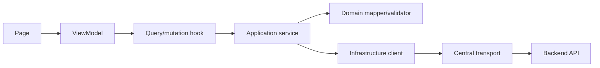
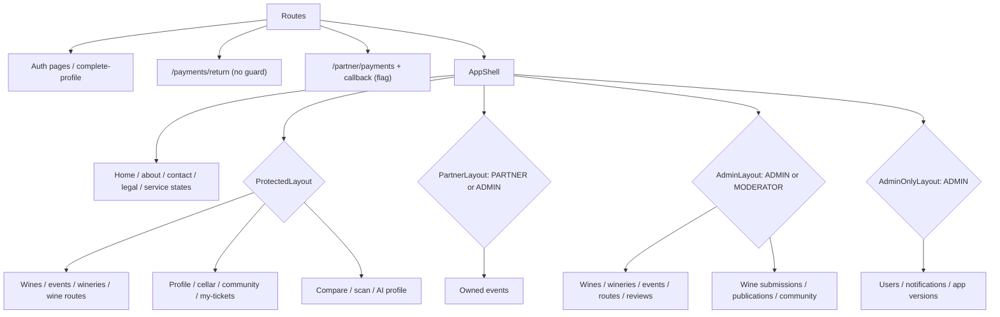
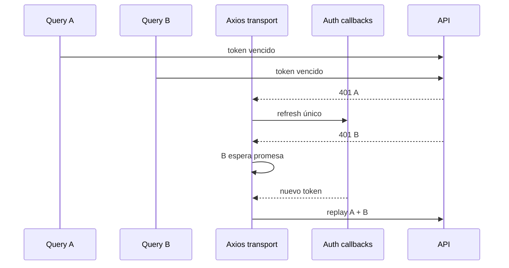
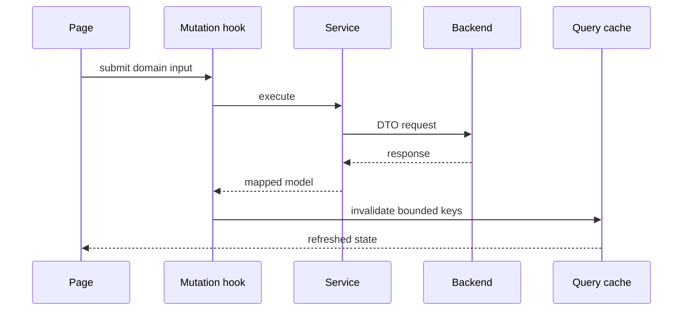

# Mapas de la aplicación web

## Capas y dependencias

[Ver diagrama de «Capas y dependencias» completo](https://images.vinnot.com/docs/diagrams/v1/es/frontend-web-diagrams-application-map-f802780c6735.svg)

## Árbol de rutas

[Ver diagrama de «Árbol de rutas» completo](https://images.vinnot.com/docs/diagrams/v1/es/frontend-web-diagrams-application-map-592dc41f587f.svg)

## Sesión concurrente

[Ver diagrama de «Sesión concurrente» completo](https://images.vinnot.com/docs/diagrams/v1/es/frontend-web-diagrams-application-map-6e638f01f7ca.svg)

## Mutación e invalidación

[Ver diagrama de «Mutación e invalidación» completo](https://images.vinnot.com/docs/diagrams/v1/es/frontend-web-diagrams-application-map-841e265e2930.svg)

- [Routing y acceso](routing-and-access.md)
- [Server state y HTTP](server-state-and-http.md)

