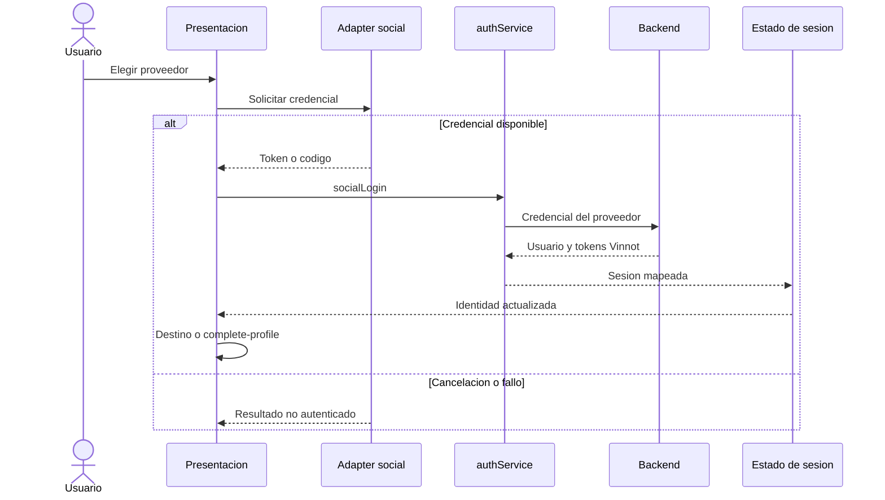
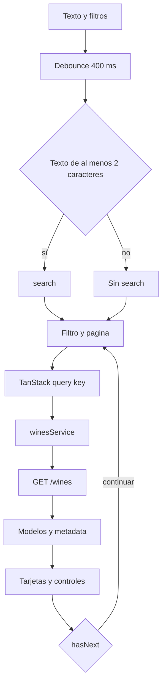
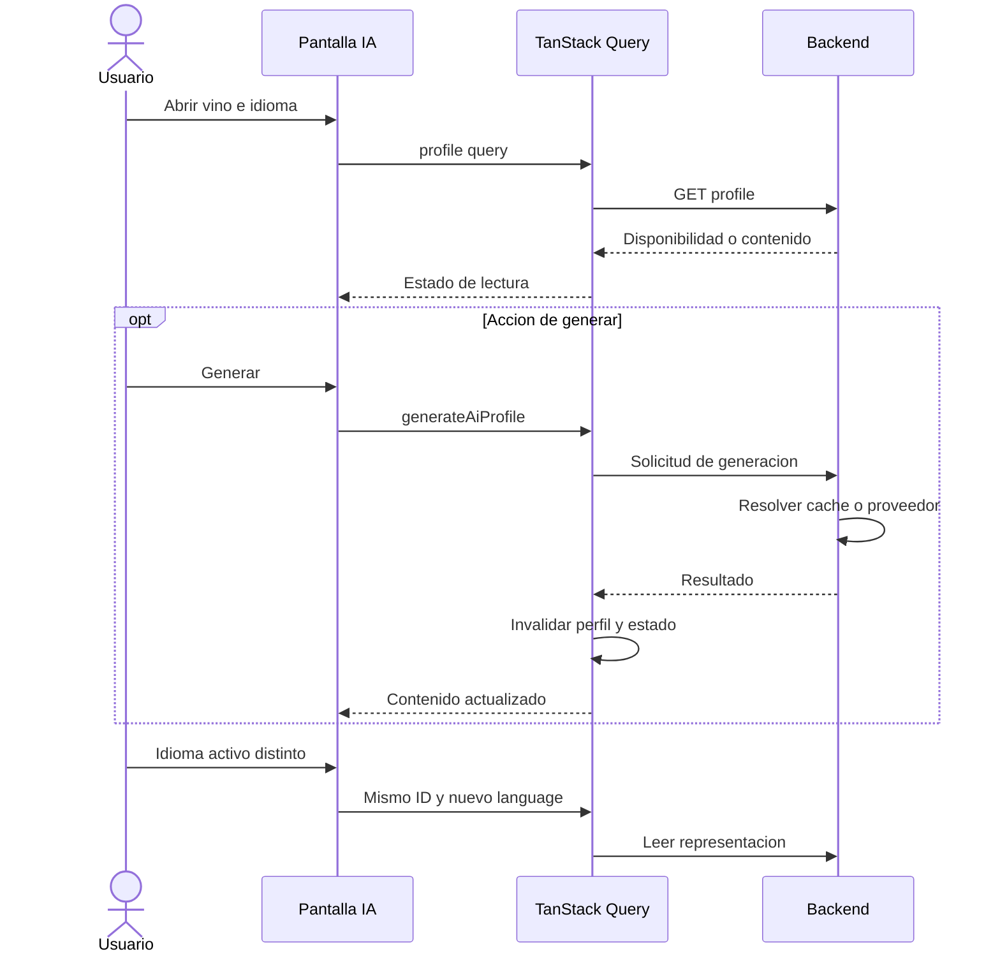
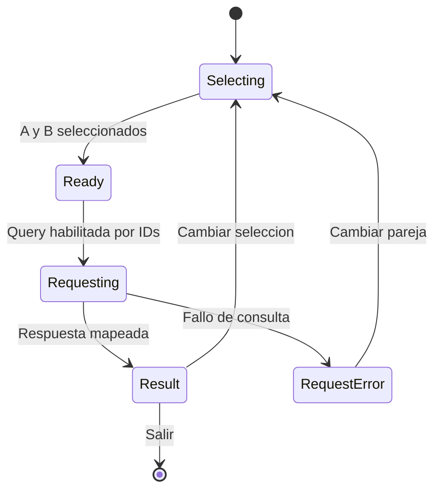
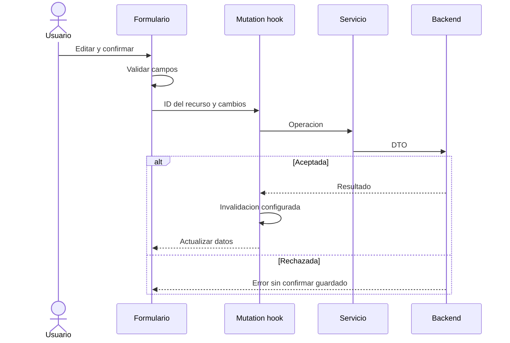
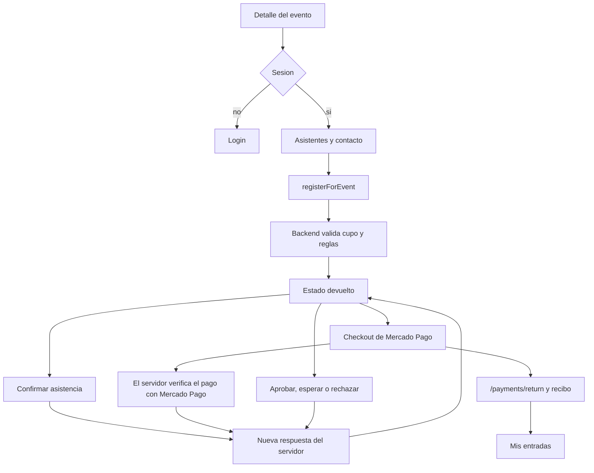
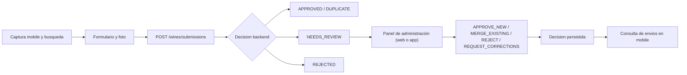

# Secuencias y estados de producto web

## Alcance de los diagramas

Estas vistas describen responsabilidades frontend. El servidor valida permisos,
transiciones y persistencia; los gráficos no definen nuevas reglas de negocio.
Las respuestas de error terminan en el estado de la operación, no en éxito implícito.

## Login social

[Ver diagrama de «Login social» completo](https://images.vinnot.com/docs/diagrams/v1/es/frontend-web-diagrams-product-processes-c7d4796f26cd.svg)

La restauración de una sesión guardada es distinta de este intercambio.
Véase [autenticación](../../modules/users/architecture.md).

## Busqueda y paginacion

[Ver diagrama de «Busqueda y paginacion» completo](https://images.vinnot.com/docs/diagrams/v1/es/frontend-web-diagrams-product-processes-5e947512f8a8.svg)

La página comienza en cero. La acumulación mobile y la navegación de páginas
web son presentaciones distintas del mismo contrato paginado.

## Perfil IA y representacion localizada

[Ver diagrama de «Perfil IA y representacion localizada» completo](https://images.vinnot.com/docs/diagrams/v1/es/frontend-web-diagrams-product-processes-6a161f4c84f5.svg)

El gráfico no atribuye cada request al proveedor. La secuencia exacta y el
journey visual difieren por plataforma; ver [IA](../../modules/ai/architecture.md).

## Comparacion

[Ver diagrama de «Comparacion» completo](https://images.vinnot.com/docs/diagrams/v1/es/frontend-web-diagrams-product-processes-bd4f139fe56a.svg)

Los estados representan la operación; no afirman que todas las pantallas
tengan el mismo componente de error ni el mismo botón de reintento.

## Cava o reseña: escritura y cache

[Ver diagrama de «Cava o reseña: escritura y cache» completo](https://images.vinnot.com/docs/diagrams/v1/es/frontend-web-diagrams-product-processes-0ee996948d8d.svg)

## Inscripcion a eventos

[Ver diagrama de «Inscripcion a eventos» completo](https://images.vinnot.com/docs/diagrams/v1/es/frontend-web-diagrams-product-processes-8eb0ae9b57b8.svg)

Inscripción y pago mantienen estados separados. Las acciones disponibles se
derivan del estado actual, no de una secuencia universal de pago.

## Envío desde la app y revisión

[Ver diagrama de «Envío desde la app y revisión» completo](https://images.vinnot.com/docs/diagrams/v1/es/frontend-web-diagrams-product-processes-69e8116b2ce9.svg)

La web no escanea. Su participación en este circuito es moderar envíos ya
recibidos; la app ofrece la misma revisión en su panel de administración.
Pueden revisar los roles ADMIN y MODERATOR. Las decisiones y los timestamps
pertenecen al backend.

## Referencias funcionales

- [Catálogo](../../modules/wines/architecture.md)
- [Cava](../../modules/cellar/architecture.md#web) y [reseñas](../../modules/reviews/architecture.md#web)
- [Eventos](../../modules/events/architecture.md#web), [bodegas](../../modules/wineries/architecture.md#web) y [rutas](../../modules/wine-routes/architecture.md#web)
- [Administración](../../modules/admin/architecture.md)
