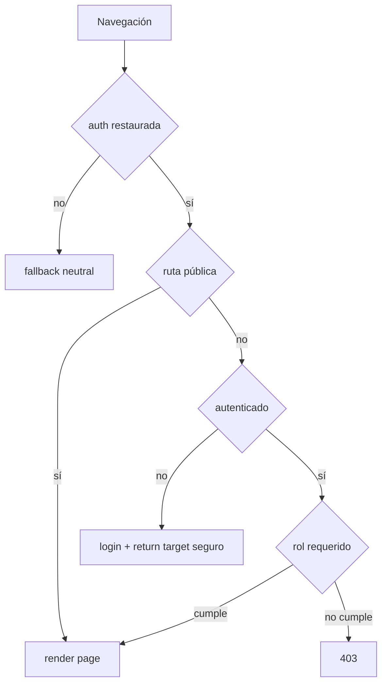
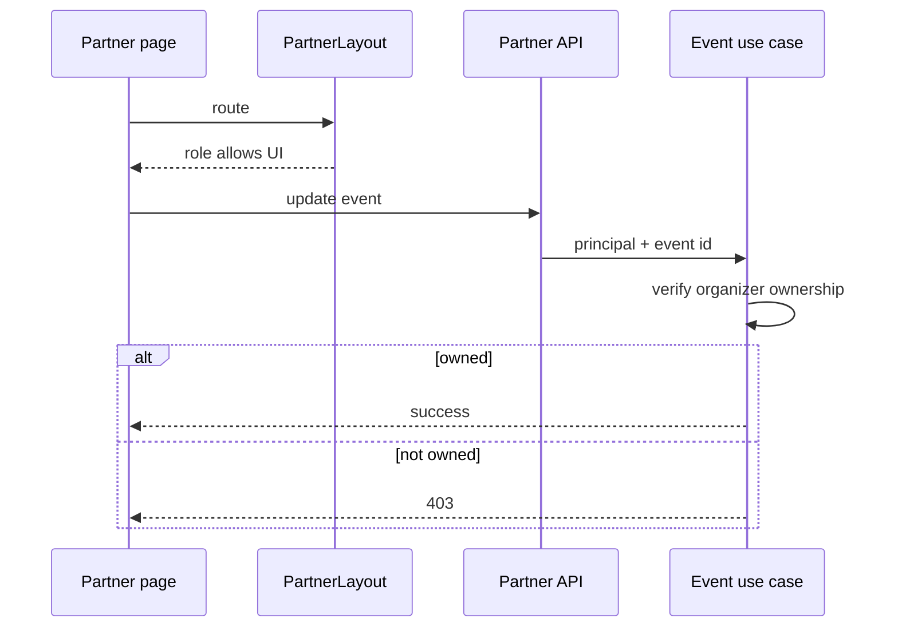

# Diagramas de routing y acceso web

## Decisión de guard

[Ver diagrama de «Decisión de guard» completo](https://images.vinnot.com/docs/diagrams/v1/es/frontend-web-diagrams-routing-and-access-063f41121df0.svg)

## Ownership partner

[Ver diagrama de «Ownership partner» completo](https://images.vinnot.com/docs/diagrams/v1/es/frontend-web-diagrams-routing-and-access-aa928fe309b9.svg)

