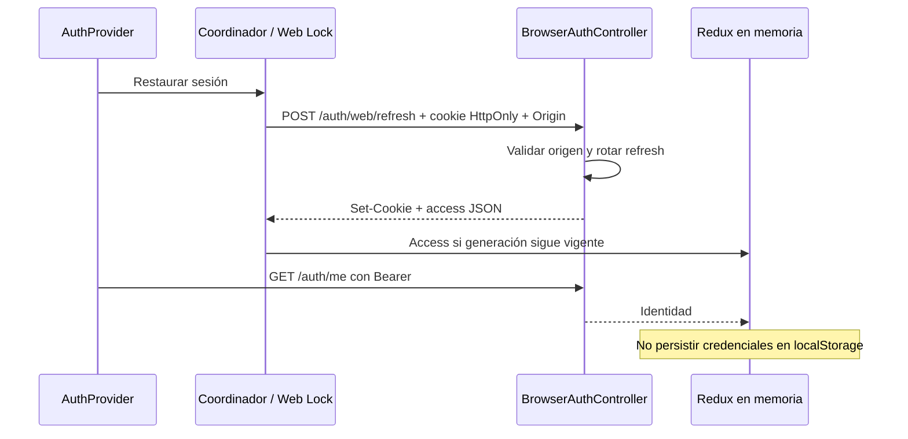
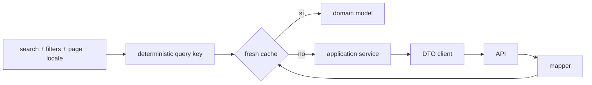
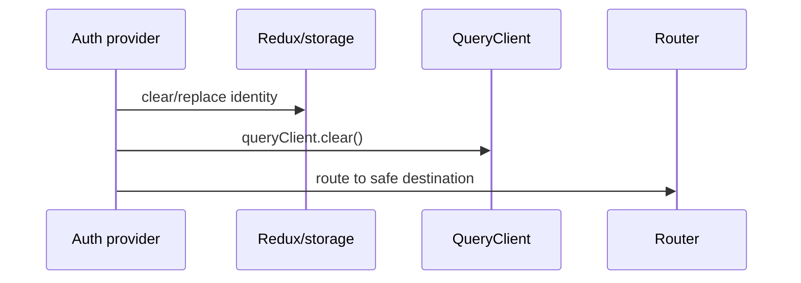
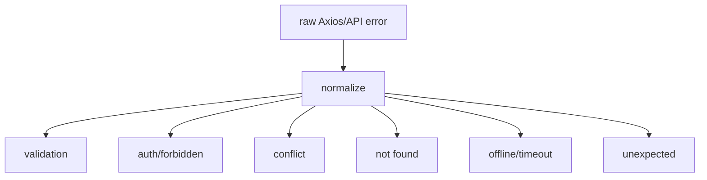

# Diagramas de server state y HTTP web

## Restauración con cookie y aislamiento de pestañas

[Ver diagrama de «Restauración con cookie y aislamiento de pestañas» completo](https://images.vinnot.com/docs/diagrams/v1/es/frontend-web-diagrams-server-state-and-http-335011a13cec.svg)

La cookie se envía con credentials y la cabecera X-Vinnot-Web-Session.
Un evento no secreto entre pestañas limpia identidad/caché ante logout y restaura
la identidad nueva ante login. Las operaciones pendientes de otra generación
se descartan. Para reautenticación administrativa, ver la
[secuencia de backend](../../backend/architecture/authentication-and-identity.md).

## Identidad de query

[Ver diagrama de «Identidad de query» completo](https://images.vinnot.com/docs/diagrams/v1/es/frontend-web-diagrams-server-state-and-http-481f3e3544c9.svg)

## Cambio de identidad

[Ver diagrama de «Cambio de identidad» completo](https://images.vinnot.com/docs/diagrams/v1/es/frontend-web-diagrams-server-state-and-http-73622d631157.svg)

## Taxonomía de error

[Ver diagrama de «Taxonomía de error» completo](https://images.vinnot.com/docs/diagrams/v1/es/frontend-web-diagrams-server-state-and-http-34952bc170bc.svg)
