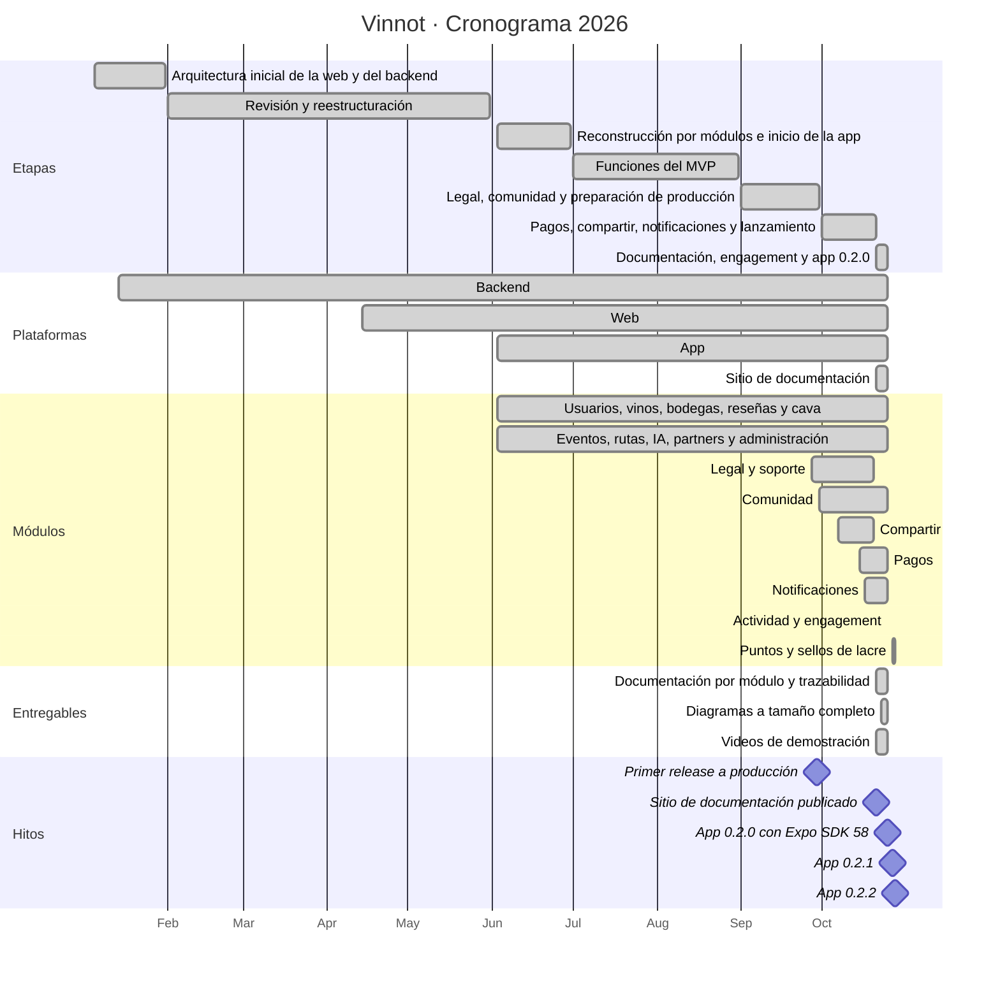
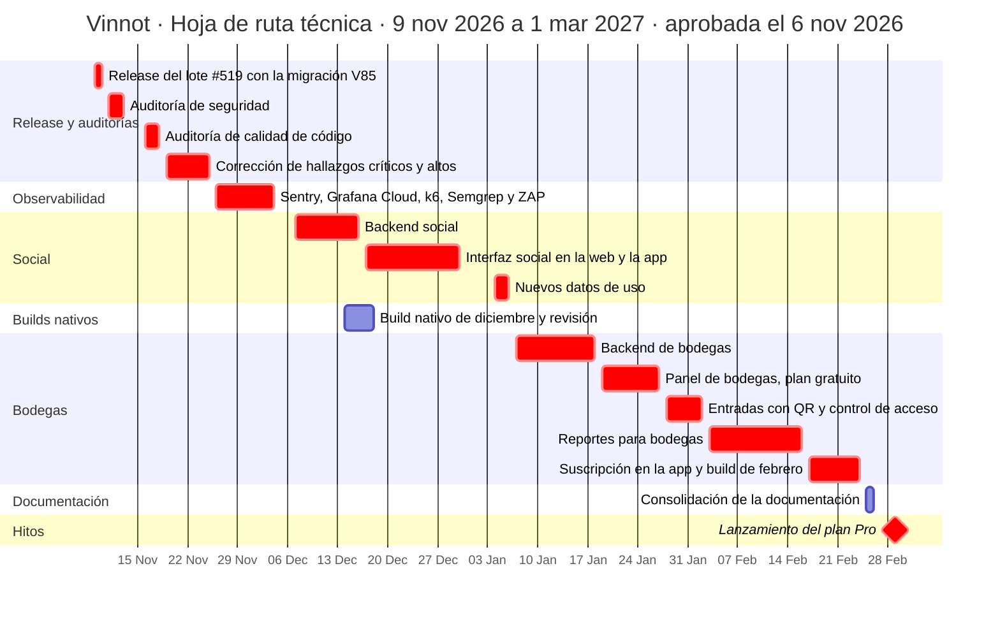
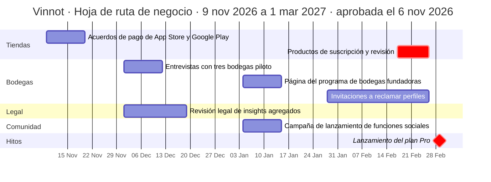

# Cronograma

Este capítulo reúne el cronograma realizado y la hoja de ruta aprobada:

- el cronograma de enero a octubre de 2026, reconstruido a partir del historial del
  repositorio: las fechas son las del primer y el último cambio de cada etapa y de cada
  módulo;
- la [hoja de ruta técnica](#hoja-de-ruta-técnica) y la
  [hoja de ruta de negocio](#hoja-de-ruta-de-negocio) del 9 de noviembre de 2026 al 1 de
  marzo de 2027, aprobadas el 6 de noviembre de 2026;
- el [camino crítico](#camino-crítico) de esa hoja de ruta.

[Ver diagrama de «Cronograma» completo](https://images.vinnot.com/docs/diagrams/v1/es/gantt-readme-3f06e413402e.svg)

## Etapas

| Etapa | Fechas | Qué se hizo |
|---|---|---|
| Arquitectura inicial | enero 2026 | Estructura de la web, rutas por rol, sesión y contratos de la API; esqueleto del backend con controles de estilo y cobertura |
| Revisión y reestructuración | febrero a mayo 2026 | Revisión del backend y alineación de la web |
| Reconstrucción por módulos | junio 2026 | Backend organizado por módulos, inicio de la app, integración con AWS y primeros workflows de CI |
| Funciones del MVP | julio y agosto 2026 | Ingreso, eventos, escaneo de etiquetas y cobertura de pruebas |
| Legal, comunidad y producción | septiembre 2026 | Términos y soporte, comunidad, scripts de release y CI |
| Pagos, compartir y notificaciones | octubre 2026 | Enlaces públicos, cobro con Mercado Pago, notificaciones push y por correo, y lanzamiento |
| Documentación, engagement y app 0.2.0 | octubre 2026 | Un capítulo por módulo con casos de uso, requisitos, pruebas y trazabilidad; diagramas a tamaño completo; videos de demostración; push personalizadas con el módulo de engagement; app 0.2.0 sobre Expo SDK 58 |

## Hitos

| Hito | Fecha |
|---|---|
| Primer release a producción | 29 de septiembre de 2026 |
| Sitio de documentación publicado | 21 de octubre de 2026 |
| App 0.2.0 con Expo SDK 58 enviada a las tiendas | 25 de octubre de 2026 |
| App 0.2.1: parches nativos de Expo SDK 58 (`expo` 58.0.20 y sus módulos) y Skia preinstalado para que los sellos de lacre animados lleguen por OTA | 27 de octubre de 2026 |
| App 0.2.2: siguientes parches nativos de Expo SDK 58 (`expo` 58.0.21 y 15 módulos) | 28 de octubre de 2026 |

Cada versión nativa nueva tiene su propio runtime de OTA: los binarios de una versión
anterior no reciben bundles de la siguiente. El detalle está en
[Distribución de la app](../frontend-mobile/guides/distribution.md). Entre 0.2.1 y 0.2.2 se
sumaron, en la web y como cambios de JavaScript de la app, el sistema de puntos con sellos
de lacre animados, la calificación con una botella que sirve la copa y el atajo para
escribir una reseña desde el detalle del vino.

Las historias de usuario del MVP están agrupadas en tres hitos de GitHub: base de acceso y
gestión inicial; catálogo, reseñas y cava; y experiencias, partners e inteligencia
artificial.

## Hoja de ruta técnica

Horizonte: 9 de noviembre de 2026 a 1 de marzo de 2027. Plan aprobado el 6 de noviembre de
2026. Todas las tareas están planificadas; las marcadas como camino crítico tienen holgura
cero. El calendario es de lunes a viernes, sin los feriados del 24, 25 y 31 de diciembre de
2026 y del 1 de enero de 2027.

[Ver diagrama de «Hoja de ruta técnica» completo](https://images.vinnot.com/docs/diagrams/v1/es/gantt-readme-67411cfe290c.svg)

| Entregable | Fechas | Depende de | Estado |
|---|---|---|---|
| Release del lote #519 a development y producción, con la migración V85 en horario de bajo tráfico | 9 y 10 de noviembre | — | Planificado |
| Auditoría de seguridad: análisis de código, OWASP ASVS nivel 1 y OWASP ZAP contra development | 11 al 13 de noviembre | Release del lote #519 | Planificado |
| Auditoría de calidad de código por módulo: arquitectura, SOLID, patrones, pruebas y deuda técnica | 16 al 18 de noviembre | Auditoría de seguridad | Planificado |
| Corrección de los hallazgos críticos y altos de ambas auditorías | 19 al 25 de noviembre | Auditoría de calidad de código | Planificado |
| Observabilidad: Sentry en el backend y la web, Grafana Cloud con Alloy y tableros, línea base de carga con k6, Semgrep y OWASP ZAP en CI | 26 de noviembre al 4 de diciembre | Corrección de hallazgos | Planificado |
| Backend social: seguidores, perfil público, visibilidad de la cava (pública por defecto, solo seguidores o privada), puntos por seguidores con controles antiabuso, porcentaje de afinidad de gustos, personas para seguir, notificación de nuevo seguidor y feed de seguidos | 7 al 16 de diciembre | Observabilidad | Planificado |
| Build nativo de diciembre: Sentry en la app, React Native 0.88.1 (#484) y revisión de las tiendas | 14 al 18 de diciembre | Observabilidad | Planificado |
| Interfaz social en la web y la app: perfil público, rueda de gustos animada, listas de seguidores y feed | 17 al 30 de diciembre | Backend social | Planificado |
| Nuevos datos de uso: rango de edad opcional, precio pagado y lugar opcionales al calificar, registro agregado de búsquedas internas, política de privacidad y etiquetas de privacidad de las tiendas | 4 al 6 de enero | Interfaz social | Planificado |
| Backend de bodegas: rol WINERY (incluye PARTNER), miembros de la bodega, reclamo verificado del perfil, control de propiedad sobre los vinos propios, auditoría, insignia de bodega verificada y respuesta oficial a reseñas | 7 al 18 de enero | Nuevos datos de uso | Planificado |
| Panel de bodegas en la web y la app, plan gratuito: perfil, vinos propios, eventos y métricas básicas | 19 al 27 de enero | Backend de bodegas | Planificado |
| Entradas de eventos con QR y control de acceso del organizador desde la app | 28 de enero al 2 de febrero | Panel de bodegas | Planificado |
| Reportes para bodegas: catálogo semanal y mensual | 3 al 16 de febrero | Entradas con QR; entrevistas con bodegas piloto | Planificado |
| Suscripción en la app (App Store y Google Play, validación de comprobantes en el servidor y notificaciones de servidor de las tiendas) y build nativo de febrero | 17 al 24 de febrero | Reportes; acuerdos de pago de las tiendas | Planificado |
| Consolidación de la documentación (Mermaid y Excalidraw, en español e inglés) | 25 y 26 de febrero | Suscripción en la app | Planificado |
| Hito: lanzamiento del plan Pro para las bodegas fundadoras | 1 de marzo de 2027 | Revisión de los productos de suscripción; revisión legal | Planificado |

## Hoja de ruta de negocio

Horizonte: 9 de noviembre de 2026 a 1 de marzo de 2027. Plan aprobado el 6 de noviembre de
2026. Todas las tareas están planificadas.

[Ver diagrama de «Hoja de ruta de negocio» completo](https://images.vinnot.com/docs/diagrams/v1/es/gantt-readme-08f694195afd.svg)

| Entregable | Fechas | Depende de | Estado |
|---|---|---|---|
| Acuerdo de aplicaciones pagas de App Store con datos fiscales y bancarios; perfil de pagos de Google Play | 9 al 20 de noviembre | — | Planificado |
| Entrevistas con tres bodegas piloto para validar el catálogo de reportes | 1 al 12 de diciembre | — | Planificado |
| Revisión legal de la venta de insights agregados (pauta 5.1.2 de Apple, política de datos del usuario de Google Play y Ley 25.326 de Argentina) y actualización de la política de privacidad | 1 al 19 de diciembre | — | Planificado |
| Página del programa de bodegas fundadoras | 4 al 15 de enero | — | Planificado |
| Campaña de lanzamiento de las funciones sociales | 4 al 15 de enero | Interfaz social | Planificado |
| Invitaciones a las bodegas para reclamar sus perfiles | 28 de enero al 26 de febrero | Panel de bodegas | Planificado |
| Productos de suscripción en ambas tiendas y su revisión | 17 al 26 de febrero | Suscripción en la app; acuerdos de pago de las tiendas | Planificado |
| Hito: lanzamiento del plan Pro | 1 de marzo de 2027 | Revisión de los productos de suscripción; revisión legal | Planificado |

## Camino crítico

La holgura de una tarea es la cantidad de días hábiles que puede atrasarse sin mover el
lanzamiento del plan Pro. El desarrollo lo realiza una sola persona a tiempo completo, de
modo que la cadena de desarrollo es secuencial: cada tarea empieza el día hábil siguiente al
fin de la anterior. Las tareas de esa cadena tienen holgura cero y llevan la marca `crit` en
los diagramas; un atraso en cualquiera de ellas mueve el lanzamiento la misma cantidad de
días hábiles.

| Orden | Tarea | Fechas | Días hábiles | Depende de | Holgura |
|---|---|---|---|---|---|
| 1 | Release del lote #519 | 9 y 10 de noviembre | 2 | — | 0 |
| 2 | Auditoría de seguridad | 11 al 13 de noviembre | 3 | 1 | 0 |
| 3 | Auditoría de calidad de código | 16 al 18 de noviembre | 3 | 2 | 0 |
| 4 | Corrección de hallazgos críticos y altos | 19 al 25 de noviembre | 5 | 3 | 0 |
| 5 | Observabilidad | 26 de noviembre al 4 de diciembre | 7 | 4 | 0 |
| 6 | Backend social | 7 al 16 de diciembre | 8 | 5 | 0 |
| 7 | Interfaz social en la web y la app | 17 al 30 de diciembre | 8 | 6 | 0 |
| 8 | Nuevos datos de uso | 4 al 6 de enero | 3 | 7 | 0 |
| 9 | Backend de bodegas | 7 al 18 de enero | 8 | 8 | 0 |
| 10 | Panel de bodegas | 19 al 27 de enero | 7 | 9 | 0 |
| 11 | Entradas con QR y control de acceso | 28 de enero al 2 de febrero | 4 | 10 | 0 |
| 12 | Reportes para bodegas | 3 al 16 de febrero | 10 | 11 | 0 |
| 13 | Suscripción en la app y build nativo de febrero | 17 al 24 de febrero | 6 | 12 | 0 |
| 14 | Revisión de los productos de suscripción en las tiendas | 25 y 26 de febrero | 2 | 13 | 0 |
| 15 | Lanzamiento del plan Pro | 1 de marzo de 2027 | — | 14 | 0 |

Los productos de suscripción se cargan en las tiendas desde el 17 de febrero, en paralelo con
la tarea 13; su revisión queda en el camino crítico porque solo puede completarse con el
build nativo de febrero aprobado.

### Restricciones externas

Estas tareas dependen de terceros y no pueden comprimirse, pero no están en el camino
crítico: su holgura es la cantidad de días hábiles entre su fin y el último día en que
pueden terminar sin atrasar la tarea que las necesita.

| Restricción | Fechas | Debe terminar antes de | Holgura |
|---|---|---|---|
| Acuerdos de pago de App Store y Google Play | 9 al 20 de noviembre | Suscripción en la app (17 de febrero) | 58 días hábiles |
| Entrevistas con las bodegas piloto | 1 al 12 de diciembre | Reportes para bodegas (3 de febrero) | 33 días hábiles |
| Revisión legal de insights agregados | 1 al 19 de diciembre | Lanzamiento del plan Pro (1 de marzo) | 46 días hábiles |
| Build nativo de diciembre y revisión de las tiendas | 14 al 18 de diciembre | Build nativo de febrero (17 de febrero) | 38 días hábiles |

El build nativo de diciembre corre en paralelo con el desarrollo social: el tiempo de
compilación y de revisión de las tiendas no ocupa a la persona que desarrolla. La
consolidación de la documentación no es requisito del lanzamiento y también queda fuera del
camino crítico.
