# Proceso de desarrollo

Vinnot se desarrolla con un modelo **DevOps** y gestiona el flujo de trabajo con **Kanban**.
DevOps aporta las prácticas técnicas que sostienen la calidad: pruebas, seguridad,
despliegue y monitoreo automatizados. Kanban aporta la gestión del flujo que necesita un
equipo reducido con prioridades cambiantes y urgencias de producción. Del modelo en espiral
se toma el análisis de riesgos, aplicado en las [pruebas basadas en riesgos](../quality/risk-based-testing.md).

Esta página resume el proceso y enlaza el detalle; no lo repite.

## Por qué este modelo

| Alternativa | Por qué no se usa sola |
|---|---|
| Cascada | Los requisitos cambiaron durante el desarrollo (pagos, notificaciones, escaneo) y las tiendas exigen publicar por incrementos |
| Scrum | Sus roles y eventos están pensados para equipos de 3 a 10 personas, y una corrección urgente de pagos no puede esperar al próximo sprint |
| Kanban solo | No define prácticas técnicas de calidad ni de despliegue |
| DevOps solo | Automatiza, pero no gestiona prioridades ni trabajo en curso |

## CALMS aplicado

| Principio | En Vinnot |
|---|---|
| Cultura | La misma persona responsable de un cambio responde por él en producción; no se separa quien desarrolla de quien opera |
| Automatización | Compilación, pruebas, cobertura, seguridad, despliegue a desarrollo y release a producción en workflows de GitHub Actions |
| Lean | Cambios chicos, una rama por issue y un issue terminado antes de empezar otro |
| Medición | [Métricas de calidad](../quality/metrics.md), alarmas de producción y costo de IA |
| Compartir | Documentación viva en español e inglés, validada en cada CI |

## Etapas y workflows

| Etapa | Cómo se aplica | Dónde |
|---|---|---|
| Planificar | Cada trabajo empieza con un issue (`feature`, `bugfix`, `hotfix` o `task`) con criterios de aceptación y fechas en el roadmap de GitHub Projects | [`create-work-branch.yml`](../../../.github/workflows/create-work-branch.yml); [Flujo de issues, ramas y pull requests](github-work-items.md) |
| Codificar | Rama vinculada al issue con nombre normalizado, commits convencionales y arquitectura hexagonal | [Tipos de trabajo](github-work-items.md#tipos-de-trabajo) |
| Construir | Maven para el backend, Vite para la web, export de la app; imágenes Docker fijadas por digest | [`ci.yml`](../../../.github/workflows/ci.yml) |
| Probar | CI en cada pull request: pruebas, cobertura, análisis estático, arquitectura, documentación y un quality gate que rechaza verificaciones fallidas u omitidas | [CI/CD](../infra/guides/ci-cd.md) |
| Liberar | Pull request de `development` a `main`; producción sale solo del commit exacto de `main` ya validado | [Release paso a paso](../infra/guides/release-step-by-step.md) |
| Desplegar | Desarrollo se despliega solo tras el quality gate; producción con un workflow manual de preparación, publicación y reversión; la app con build nativo o actualización OTA | [`deploy-backend-dev.yml`](../../../.github/workflows/deploy-backend-dev.yml), [`deploy-frontend-dev.yml`](../../../.github/workflows/deploy-frontend-dev.yml), [`production-release.yml`](../../../.github/workflows/production-release.yml) |
| Operar | Contenedores con control de salud, copias diarias y apagado del entorno de desarrollo fuera de horario | [Despliegue en AWS](../infra/architecture/aws-deployment.md), [desarrollo de bajo costo](../infra/operations/low-cost-dev.md) |
| Monitorear | Sonda y colector cada 5 minutos con alarmas de salud, recursos, copias, IA y correos rebotados; respuesta a incidentes | [Observabilidad e incidentes](../infra/operations/observability-and-incidents.md) |

Los controles de seguridad de dependencias corren cuando cambian las entradas de
dependencias, en cada pull request hacia `main` y cada semana con
[`security-checks.yml`](../../../.github/workflows/security-checks.yml).

## Flujo de un cambio

```mermaid
flowchart LR
    I["Issue<br/>Create Work Branch"] --> B["Rama vinculada<br/>feature/bugfix/task"]
    B --> L["Trabajo local<br/>+ preflight"]
    L --> P["Pull request<br/>a development"]
    P --> CI{"CI quality gate"}
    CI -- "falla" --> L
    CI -- "pasa" --> M["Merge a development"]
    M --> DD["Despliegue automático<br/>a desarrollo"]
    DD --> R["Pull request de release<br/>development → main"]
    R --> CI2{"Quality gate<br/>sobre el commit"}
    CI2 -- "pasa" --> PR["Release de producción<br/>aprobación del SHA"]
    PR --> MON["Monitoreo"]
    MON -- "incidente" --> H["Issue hotfix<br/>desde main"]
    H --> P2["Pull request a main"]
    P2 --> CI2
```

[Ver diagrama de «Flujo de un cambio» completo](https://images.vinnot.com/docs/diagrams/v1/es/governance-development-process-cdf00cae7a6e.svg)

Un hotfix sale de `main` y vuelve a `development` con un pull request posterior, como
explica [Retorno de un hotfix](github-work-items.md#retorno-de-un-hotfix-a-development).

## Kanban

- **Visualizar el flujo:** cada issue es una tarjeta del Project de GitHub y su rama queda
  vinculada en la sección **Development** del issue.
- **Limitar el trabajo en curso:** un issue se termina antes de empezar otro.
- **Gestionar el flujo:** las fechas de inicio y fin planificadas viven en el Project y
  alimentan el roadmap.
- **Políticas explícitas:** plantillas de issue en [`.github/ISSUE_TEMPLATE`](../../../.github/ISSUE_TEMPLATE),
  plantilla de pull request en [`pull_request_template.md`](../../../.github/pull_request_template.md)
  y el [checklist previo al merge](github-work-items.md#checklist-previo-al-merge).
- **Mejorar con retroalimentación:** cada falla del pipeline o de producción se analiza y
  puede convertirse en una regla del proceso.

## Mejora continua

El análisis de las 72 ejecuciones fallidas de GitHub Actions entre el 2026-06-20 y el
2026-10-21 dio origen al checklist obligatorio antes de cada push y de cada merge: correr
localmente el mismo preflight que el CI, repetir las pruebas propensas a fallar de forma
intermitente, revisar los pins de Actions y no mergear pull requests en rojo. El repositorio
no tiene protección de ramas, así que ese checklist es el control. Las brechas de calidad
abiertas se siguen en el [backlog de mejoras](../quality/improvement-backlog.md).

## Planificación

Las etapas y los hitos del proyecto están en el [cronograma](../gantt/README.md).
