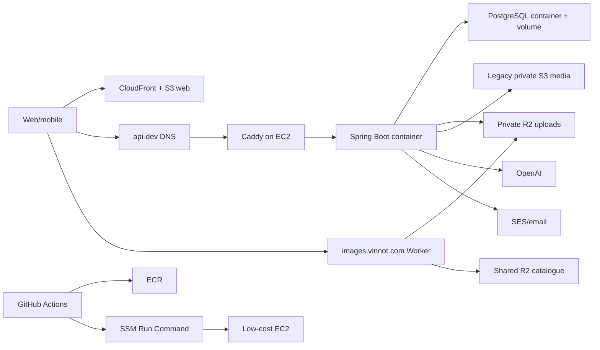
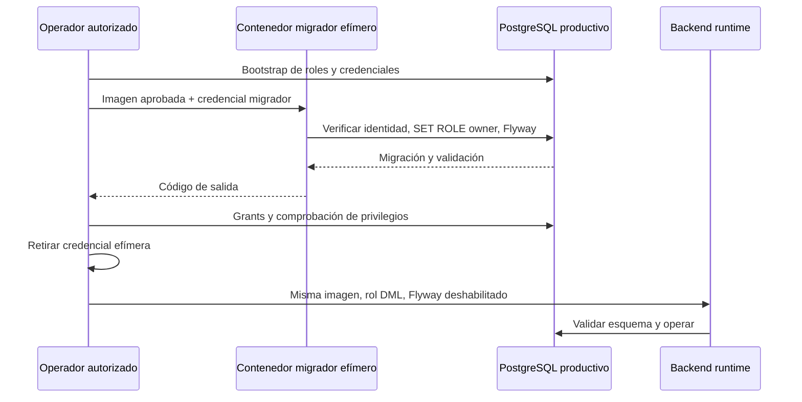

# Arquitectura de despliegue AWS

## Objetivo del entorno development

El entorno actual prioriza costo bajo y recuperación reproducible. No es una
topología de alta disponibilidad: una única EC2 ejecuta PostgreSQL, backend y
Caddy mediante Docker Compose. Web está desacoplada en S3 + CloudFront; los nuevos uploads de usuarios usan R2
privado y WebP. S3 conserva web, backups y lectura/borrado de medios históricos.
DNS/TLS público se integra con Cloudflare/Caddy.



[Ver diagrama de «Objetivo del entorno development» completo](https://images.vinnot.com/docs/diagrams/v1/es/infra-architecture-aws-deployment-00f221458187.svg)

## Componentes y ownership

| Componente | Responsabilidad | Estado persistente |
|---|---|---|
| CloudFront/S3 web | bundle estático y cache edge | artefactos reemplazables |
| EC2 | host de runtime | configuración y volúmenes locales |
| Caddy | TLS/reverse proxy | certificados/config |
| backend | API y Flyway | sin estado de negocio local |
| PostgreSQL | catálogo/transacciones | volumen EBS crítico |
| ECR | imágenes backend versionadas | imágenes regenerables |
| R2 uploads | buckets dev/prod privados; portadas/cuarentena vía API y avatar/etiqueta pública vía Worker | medios de usuarios |
| R2 catálogo + Worker | una copia compartida, URLs iguales entre entornos | imágenes de catálogo |
| S3 media | lectura/borrado de originales históricos | compatibilidad y reversión |
| SSM Run Command | ejecución administrativa remota | registro operativo |
| Secrets Manager | secretos runtime por entorno | configuración sensible |
| EventBridge Scheduler | ventanas start/stop | reglas operativas |

## Red y acceso público

Sólo proxy/API pública debe ser accesible. PostgreSQL escucha dentro de la red de
Compose; no se publica a Internet. SSM reemplaza SSH como canal de despliegue.
Security groups limitan entrada. El backend sirve `/api`; Caddy publica health y
rutas API. Los buckets de media permanecen privados. El Worker sólo sirve avatares y
etiquetas públicos; el backend comprueba ownership y visibilidad en portadas y
cuarentena. [Storage WebP/R2](../operations/user-images-r2.md).

**Estado en la cuenta (verificado en la consola de AWS el 29-10-2026):** el security group de
producción acepta 80 y 443 desde cualquier origen y no abre el puerto 22. Queda además una
regla 443 heredada para la IP de un operador.

`production-stack.json` describe el estado con Cloudflare delante: abre 80 (ACME y
redirección) y 443 sólo a los 15 rangos IPv4 publicados por Cloudflare, una regla por rango y
puerto. No hay reglas IPv6 porque la VPC no tiene IPv6. No tiene parámetro de operador ni
abre 22 o 5432. Aplicar el stack quita la regla heredada y la apertura a todo IPv4, así que
sólo se aplica después de activar el proxy: ver
[Poner Cloudflare delante de la API](#poner-cloudflare-delante-de-la-api).

## Persistencia y costo

Mover PostgreSQL a EC2 reduce costo fijo de RDS, pero cambia garantías:

- detener EC2 detiene API y base;
- falla de host afecta ambos;
- backups y restore dejan de ser administrados por RDS;
- hay un solo host: no hay escalado horizontal ni alta disponibilidad.

El volumen no se elimina al detener la instancia. Docker volume/EBS y backups
son datos críticos; la imagen de contenedor no lo es. El scheduler puede apagar
fuera de horario, entendiendo que no hay servicio durante esa ventana.

## Despliegue backend

GitHub construye una imagen linux/amd64, publica tags `dev-<sha>` y `dev-latest`,
enciende la instancia, sincroniza scripts versionados por SSM con base64 + SHA256,
y ejecuta `/opt/vinnot/deploy.sh`. El host refresca runtime env, autentica ECR con
un Docker config temporal, pull, levanta postgres/backend, espera health durante
migraciones y recién después levanta proxy. En fallo imprime `ps` y logs acotados.
Las imágenes de terceros (`postgres`, `caddy`) están fijadas a versión exacta y
digest de índice multi-arquitectura, para que ese pull nunca las cambie; se
actualizan de forma deliberada.

El despliegue no usa ECS ni target groups, y el boundary del deployer de
development solo concede lectura sobre ECS y RDS.

## Configuración aislada de producción

`compose.production.yml` es una superposición explícita del Compose compartido,
no un reemplazo del despliegue dev. Se resuelve con ambos archivos, en ese orden,
desde `/opt/vinnot-prod`. Usa el proyecto `vinnot-production`, red propia y
volúmenes propios; no monta datos de development. PostgreSQL y backend siguen
sin publicar sus puertos. El proxy reutiliza el Caddyfile con
`VINNOT_API_HOST=api.vinnot.com`; sin esa variable conserva el dominio dev.

La configuración requiere `PROD_BACKEND_IMAGE`, audiencias Google,
equipo/clave Apple y cuota mensual IA explícitos. Las credenciales Facebook quedan
vacías deliberadamente en el overlay productivo; development permanece independiente. La imagen debe ser el
digest verificado del artefacto aprobado (`repositorio@sha256:...`), no un tag
mutable. La suma de cuotas dev/prod debe respetar el presupuesto conjunto;
Compose no consulta el consumo de otro entorno ni sustituye esa conciliación.

El runtime recibe únicamente `runtime.env` del secreto productivo. La contraseña
bootstrap de PostgreSQL se monta como archivo en `/run/secrets`, no como la
contraseña DML de la aplicación. `migration.env` contiene sólo
`VINNOT_MIGRATION_DB_PASSWORD` para el servicio efímero `migrate`; se copia al servidor con
modo 0600 durante la operación y se retira después. Ninguno de esos archivos se
versiona. La ausencia de `migration.env` permite operar el runtime, pero el
migrador rechaza arrancar sin su contraseña.

Para provisionamiento o recuperación exclusivamente de datos, usar
`compose.production-data.yml`. Reutiliza el motor de `compose.postgres.yml` sin
requerir credenciales de aplicación/OAuth y utiliza el mismo volumen y red
productivos que el overlay completo. Nunca usar Compose de development para
provisionar producción.

El feedback de rebotes y quejas de SES vive en su propio stack,
`email-feedback-stack.json`, desplegado una vez por entorno; agrega su política IAM
al rol existente del host y deja `production-stack.json` sin cambios. Ver
[observabilidad e incidentes](../operations/observability-and-incidents.md#rebotes-y-quejas-de-correo).

### Migraciones fuera del runtime

`ProductionMigrationRunner` pertenece al adaptador de persistencia y utiliza
Flyway ya incluido en el backend. `PropertiesLauncher` ejecuta esa clase desde
el mismo JAR, sin arrancar Spring, HTTP, consumidores ni tareas programadas. El
`mainClass` habitual sigue siendo `VinnotApplication`.

1. Preparar `vinnot_prod`, roles y contraseñas mediante un canal administrativo
   protegido; ejecutar `production-roles.sql`.
2. Con una imagen de la revisión validada, referenciada por digest en
   `PROD_BACKEND_IMAGE`, ejecutar el servicio `migrate` con el perfil Compose `migration` y `run --rm`. Su URL fija apunta a
   `postgres:5432/vinnot_prod` y el usuario es `vinnot_prod_migrator`.
3. Flyway valida la identidad de sesión, adopta `vinnot_prod_owner`, valida
   checksums y aplica migraciones. No admite clean, baseline automático,
   ejecución fuera de orden ni opciones JDBC suministradas en la URL.
4. Si termina correctamente, aplicar `production-runtime-grants.sql` como
   administrador y comprobar los permisos. Si falla cualquiera de estos pasos,
   no iniciar ni promover el nuevo backend.
5. Retirar las credenciales efímeras y dejar el migrador en `NOLOGIN PASSWORD NULL`
   hasta la próxima migración autorizada. Iniciar backend con
   `SPRING_FLYWAY_ENABLED=false`, `vinnot_prod_runtime` y validación JPA del esquema.

`deploy-production.sh` no migra y rechaza publicar si el historial Flyway o el
journal de release no coinciden con el candidato. El orden completo (`prepare` y
su plan de preparación del host, un primer `publish` que sube la imagen y se
detiene antes del host, instalación de archivos, `migrate-production.sh` con
backup, migración, grants y actualización del journal, y un segundo `publish` con
`host_prepared=true`) y el contenido de `release-state/` están en
[Release productivo con migraciones](../guides/deployment.md#release-productivo-con-migraciones).



[Ver diagrama de «Migraciones fuera del runtime» completo](https://images.vinnot.com/docs/diagrams/v1/es/infra-architecture-aws-deployment-2d2eb3dbe803.svg)

Estos archivos definen el contrato de despliegue; su presencia en el repositorio
no demuestra que el destino AWS esté aprovisionado. DNS/TLS, IAM, cifrado del
volumen, configuración de proveedores y restauración se verifican en el destino
antes de habilitar acceso público.

## Despliegue web

CI valida, compila y verifica el artefacto. `dist/assets` usa cache anual
immutable por hash; imágenes y fuentes (`png`, `jpg`, `webp`, `svg`, `ico`, `woff2`)
usan un día de caché (`public,max-age=86400,stale-while-revalidate=604800`) para
que correos y enlaces compartidos las tomen de CloudFront sin ir a S3; el resto de
los archivos de entrada usa `no-cache,no-store`. Luego invalida
CloudFront y espera finalización. Variables `VITE_*` quedan en bundle y no deben
contener secretos privados.

### DNS y distribución web productivos

Cloudflare conserva la autoridad DNS de `vinnot.com`. Los registros productivos
son independientes de `dev.vinnot.com` y `api-dev.vinnot.com`; agregar producción
no debe reemplazar sus destinos ni cambiar los nameservers del dominio.
`api.vinnot.com` usa un registro A a la IP elástica productiva. Hoy es DNS-only, con TLS
terminado por Caddy; el destino es pasarlo por el proxy de Cloudflare, que termina el TLS del
cliente y vuelve a cifrar hacia Caddy
([Poner Cloudflare delante de la API](#poner-cloudflare-delante-de-la-api)). El registro web raíz apunta al hostname CloudFront propio
mediante CNAME flattening de Cloudflare. Los CNAME de validación ACM se mantienen
DNS-only para permitir renovación.

`production-web-stack.json` define Origin Access Control S3, distribución, WAF y
suscripción plana CloudFront Free propios. Su único origen es el bucket web
productivo privado; exige solicitudes firmadas al origen, redirección HTTPS,
TLS mínimo 1.2 y cabeceras administradas de seguridad. Los grupos WAF administrados
cubren reputación IP, ataques comunes y entradas maliciosas conocidas; el muestreo
de solicitudes está desactivado. La suscripción referencia sólo esa distribución y
su WAF, nunca recursos dev. Comprobar estados `ACTIVE` y `FREE`: provisionar los
recursos no demuestra por sí solo que aplique facturación plana. Ver
[documentación AWS de suscripciones](https://docs.aws.amazon.com/AWSCloudFormation/latest/TemplateReference/aws-resource-pricingplanmanager-subscription.html).

Un stack nuevo crea la distribución **deshabilitada** (`AcceptanceEnabled=false`).
Antes de habilitarla, limitar la lectura del bucket al ARN exacto de su
distribución, instalar y probar la función compartida SPA/seguridad y subir un
artefacto productivo verificado. Configurar DNS no habilita nada por sí solo.

La política del bucket web tiene un único propietario: el stack de fundación.
Después de crear la distribución, pasar su ID verificado en `WebDistributionId`
de `production-stack.json`. El valor vacío predeterminado no concede acceso al
CDN. Con un ID configurado, sólo `cloudfront.amazonaws.com` obtiene `s3:GetObject`
sobre los objetos web, condicionado al ARN exacto de esa distribución en la misma
cuenta. No concede escritura ni acceso a medios o backups; conserva bloqueo de
acceso público y denegación de transporte inseguro. No reemplazar esta política
desde otro stack ni desde un script de despliegue del frontend.

La distribución se habilita con `AcceptanceEnabled=true` y el ARN de la función
publicada en `SecurityFunctionArn`. La plantilla rechaza habilitar el CDN sin esa
función y conserva sus asociaciones viewer-request y viewer-response. Producción
está lanzada y su stack corre con `AcceptanceEnabled=true`. Al actualizarlo,
`aws cloudformation deploy` conserva el valor anterior de un parámetro que no
pases; nunca pases `AcceptanceEnabled=false`, porque deshabilita el sitio.

El sitio es público. El WAF permite por defecto y aplica tres grupos administrados
de AWS, en este orden: reputación IP (prioridad 10), reglas comunes (20) y entradas
maliciosas conocidas (30). La plantilla ya no tiene la regla previa al lanzamiento
que sólo dejaba pasar la IP del operador, ni su IP set.

## Aplicar la alineación de lanzamiento público

Ningún workflow despliega estos stacks: el rol de release no tiene permisos de
CloudFormation, security groups ni WAF. El dueño los aplica a mano, con una sesión
AWS de administración, desde la raíz del repositorio y en un commit que ya contenga
las plantillas alineadas. No despliegues estos stacks desde un commit anterior: volvería
a cerrar producción al público. Cada paso crea primero un change set, para ver el
diff, y sólo después lo ejecuta.

| Qué se aplica | Qué cambia en la cuenta |
|---|---|
| Fundación (`production-stack.json`) | Revoca la regla 443 heredada de la IP del operador y la apertura a todo IPv4; 80 y 443 quedan abiertos sólo a los rangos IPv4 de Cloudflare (30 reglas). El parámetro `OperatorCidr` desaparece. El security group se modifica, no se reemplaza: su descripción conserva a propósito el texto anterior, porque cambiarla obliga a CloudFormation a reemplazarlo. |
| Web (`production-web-stack.json`) | Quita la regla WAF previa al lanzamiento si sigue activa y borra el IP set del operador. Quedan los tres grupos administrados. |
| Monitoreo (`scripts/build-monitoring-stack.mjs`) | La sonda pasa a `AcceptanceMode=public`. |
| Desarrollo (`docker-compose.yml`) | CORS deja de aceptar el origen `vinnot-dev-web.pages.dev`. |

1. **Ubicar los stacks.** Sus nombres no están en el repositorio; se obtienen desde
   recursos con nombre fijo:

   ```bash
   export AWS_REGION=us-east-1
   FOUNDATION_STACK=$(aws cloudformation describe-stack-resources \
     --physical-resource-id vinnot-prod-low-cost-host-role \
     --query 'StackResources[0].StackName' --output text)
   WEB_DISTRIBUTION_ID=$(aws cloudformation describe-stacks --stack-name "$FOUNDATION_STACK" \
     --query "Stacks[0].Parameters[?ParameterKey=='WebDistributionId'].ParameterValue" --output text)
   WEB_STACK=$(aws cloudformation describe-stack-resources \
     --physical-resource-id "$WEB_DISTRIBUTION_ID" \
     --query 'StackResources[0].StackName' --output text)
   MONITORING_STACK=$(aws cloudformation describe-stack-resources \
     --physical-resource-id vinnot-prod-edge-probe \
     --query 'StackResources[0].StackName' --output text)
   echo "$FOUNDATION_STACK | $WEB_STACK | $MONITORING_STACK"
   ```

   Si alguno sale vacío o `None`, detente y revisa ese stack en la consola.

2. **Fundación: ver las reglas actuales y preparar el change set.** Este paso deja el
   origen abierto sólo a Cloudflare. Hazlo después de los pasos 0 a 2 de
   [Poner Cloudflare delante de la API](#poner-cloudflare-delante-de-la-api), con los dos
   registros ya en Proxied; si no, la API deja de responder. Los pasos 3 a 5 no dependen
   de Cloudflare.

   ```bash
   SG_ID=$(aws cloudformation describe-stack-resource --stack-name "$FOUNDATION_STACK" \
     --logical-resource-id SecurityGroup \
     --query 'StackResourceDetail.PhysicalResourceId' --output text)
   aws ec2 describe-security-group-rules --filters Name=group-id,Values="$SG_ID" \
     --query 'SecurityGroupRules[?!IsEgress].[SecurityGroupRuleId,FromPort,CidrIpv4,Description]' \
     --output table
   aws cloudformation deploy --stack-name "$FOUNDATION_STACK" \
     --template-file infra/aws-low-cost/production-stack.json \
     --capabilities CAPABILITY_NAMED_IAM --no-execute-changeset
   ```

   `deploy` conserva los valores anteriores de `ImageId` y `WebDistributionId` e
   imprime un comando `describe-change-set` con el ARN del change set. Revisa el diff:

   ```bash
   aws cloudformation describe-change-set --change-set-name "<ARN impreso>" \
     --query 'Changes[].ResourceChange.[Action,LogicalResourceId,Replacement]' --output table
   ```

   Lo esperado es una sola fila: `Modify`, `SecurityGroup`, `False`. Si aparece otro
   recurso o un reemplazo, no ejecutes: borra el change set con
   `aws cloudformation delete-change-set --change-set-name "<ARN impreso>"` y revisa la
   diferencia. Si todo coincide:

   ```bash
   aws cloudformation execute-change-set --change-set-name "<ARN impreso>"
   aws cloudformation wait stack-update-complete --stack-name "$FOUNDATION_STACK"
   aws ec2 describe-security-group-rules --filters Name=group-id,Values="$SG_ID" \
     --query 'SecurityGroupRules[?!IsEgress].[SecurityGroupRuleId,FromPort,CidrIpv4,Description]' \
     --output table
   ```

   Lo esperado: 30 reglas, 80 y 443 desde cada rango de Cloudflare, ninguna desde
   `0.0.0.0/0` y ninguna `/32`.

   La regla 443 abierta a todo IPv4 se agregó a mano en el lanzamiento. CloudFormation no
   la creó, así que puede quedar después de la actualización. Si sigue en la tabla,
   revócala por su ID. No corta nada: el tráfico ya llega por Cloudflare.

   ```bash
   aws ec2 revoke-security-group-ingress --group-id "$SG_ID" \
     --security-group-rule-ids <id-de-la-regla-443-abierta>
   ```

3. **Web.** El stack de CloudFront y WAF vive en us-east-1.

   ```bash
   aws cloudformation deploy --stack-name "$WEB_STACK" \
     --template-file infra/aws-low-cost/production-web-stack.json --no-execute-changeset
   aws cloudformation describe-change-set --change-set-name "<ARN impreso>" \
     --query 'Changes[].ResourceChange.[Action,LogicalResourceId,Replacement]' --output table
   ```

   Lo esperado: `Modify WebAcl False`, `Remove AcceptanceOperator` y
   `Modify Distribution False` (sólo cambia el comentario). `CertificateArn`,
   `AcceptanceEnabled` y `SecurityFunctionArn` conservan su valor anterior; no los
   pases. Si coincide:

   ```bash
   aws cloudformation execute-change-set --change-set-name "<ARN impreso>"
   aws cloudformation wait stack-update-complete --stack-name "$WEB_STACK"
   curl -sI https://vinnot.com/ | head -1
   ```

   Comprueba el `curl` desde una red distinta de la del operador: lo esperado es `200`.

4. **Monitoreo.**

   ```bash
   node scripts/build-monitoring-stack.mjs /tmp/vinnot-monitoring-stack.json
   aws cloudformation deploy --stack-name "$MONITORING_STACK" \
     --template-file /tmp/vinnot-monitoring-stack.json --capabilities CAPABILITY_IAM \
     --parameter-overrides AcceptanceMode=public --no-execute-changeset
   aws cloudformation describe-change-set --change-set-name "<ARN impreso>" \
     --query 'Changes[].ResourceChange.[Action,LogicalResourceId,Replacement]' --output table
   ```

   Pasa `AcceptanceMode=public` explícito: al actualizar, un parámetro omitido conserva
   su valor anterior (`private`) aunque el predeterminado haya cambiado. Lo esperado es
   `Modify Probe False`. Si coincide:

   ```bash
   aws cloudformation execute-change-set --change-set-name "<ARN impreso>"
   aws cloudformation wait stack-update-complete --stack-name "$MONITORING_STACK"
   aws lambda invoke --function-name vinnot-prod-edge-probe /tmp/vinnot-probe.json
   cat /tmp/vinnot-probe.json
   ```

   Lo esperado: `"healthy": true` y `"scope": "public-web-and-api"`.

5. **CORS de desarrollo.** No requiere un paso manual. Un cambio en
   `infra/aws-low-cost/docker-compose.yml` dispara el despliegue del backend de
   desarrollo ([`ci-impact.mjs`](../../../../scripts/ci-impact.mjs)). Al llegar a
   `development`, el workflow copia el compose al servidor y `deploy.sh` recrea el
   backend con la lista nueva. Para comprobarlo con el servidor de desarrollo encendido:

   ```bash
   curl -s -o /dev/null -w '%{http_code}\n' -X OPTIONS \
     -H 'Origin: https://vinnot-dev-web.pages.dev' -H 'Access-Control-Request-Method: GET' \
     https://api-dev.vinnot.com/api/actuator/health
   ```

   Lo esperado es `403`: el backend rechaza el origen.

Al terminar, marca la alineación como aplicada en
[Hosting y runtime](hosting-and-runtime.md#alineación-con-el-lanzamiento-público).

## Poner Cloudflare delante de la API

`api.vinnot.com` (producción) y `api-dev.vinnot.com` (desarrollo) pasan a usar el proxy de
Cloudflare. Cloudflare termina el TLS del cliente, aplica su WAF y su límite de pedidos y
vuelve a cifrar hacia Caddy, que conserva su certificado ACME. El repositorio ya trae las dos
piezas del origen:

- [`Caddyfile`](../../../../infra/aws-low-cost/Caddyfile) confía sólo en los rangos de
  Cloudflare (`trusted_proxies`) y toma la IP del cliente de `CF-Connecting-IP`. A Spring le
  envía un `X-Forwarded-For` con un único valor, `{client_ip}`, que es lo que lee el límite
  de pedidos del backend. Una conexión directa que no viene de Cloudflare no puede falsificar
  su IP: Caddy ignora `CF-Connecting-IP` de pares no confiables y usa la IP de la conexión.
  También fija `X-Forwarded-Host` y `X-Forwarded-Proto` desde la propia petición, para que
  Cloudflare no pase los valores que mande el cliente.
- [`production-stack.json`](../../../../infra/aws-low-cost/production-stack.json) abre 80 y
  443 sólo a los 15 rangos IPv4 de Cloudflare: 30 reglas, la mitad de la cuota de 60 reglas
  de entrada IPv4 por security group. No hay reglas IPv6 porque la VPC no tiene IPv6;
  Cloudflare llega al origen por IPv4 mientras el registro sea A.

[`proxy-trust-policy.test.mjs`](../../../../scripts/test/proxy-trust-policy.test.mjs) y
[`production-infrastructure.test.mjs`](../../../../scripts/test/production-infrastructure.test.mjs)
fijan las dos piezas.

El orden importa. Si el security group se restringe antes de activar el proxy, la API deja de
responder. Si el proxy se activa antes del Caddyfile nuevo, el backend ve la IP del nodo de
Cloudflare en lugar de la del cliente, y el límite de pedidos agrupa a todos los usuarios que
entran por ese nodo. El Caddyfile nuevo funciona igual sin el proxy: sin Cloudflare delante,
`{client_ip}` es la IP de la conexión. Por eso va primero.

Los límites del plan Free no afectan a la API: acepta cuerpos de hasta 100 MB (las subidas
llegan a 15 MB) y espera la respuesta del origen hasta 100 s (las llamadas de IA tardan hasta
60 s). La API no usa websockets.

### 0. Desplegar el Caddyfile

- **Desarrollo:** al llegar a `development`, un cambio en el Caddyfile dispara
  [`deploy-backend-dev.yml`](../../../../.github/workflows/deploy-backend-dev.yml).
  [`deploy.sh`](../../../../infra/aws-low-cost/deploy.sh) valida el archivo con la imagen
  fijada de Caddy antes de activarlo y conserva el anterior si falla.
- **Producción:** el Caddyfile viaja en el manifiesto del release
  ([`prepare-production-manifest.mjs`](../../../../scripts/prepare-production-manifest.mjs)).
  Sigue la [guía de release](../guides/release-step-by-step.md).

Comprueba que `curl -sI https://api.vinnot.com/api/actuator/health` (y su par de desarrollo)
sigue respondiendo `200`.

### 1. Configurar Cloudflare

En el panel de la zona `vinnot.com`. Prueba primero con `api-dev` y repite con `api`; el
servidor de desarrollo se apaga de 02:00 a 09:00.

1. **SSL/TLS en Full (strict).** Si el modo de la zona ya es Full (strict), no cambies nada.
   Si no, crea una Configuration Rule (Rules › Configuration Rules) con `Hostname` igual a
   `api.vinnot.com` o `api-dev.vinnot.com` y el ajuste SSL en Full (strict). Nunca uses
   Flexible: Cloudflare hablaría HTTP con Caddy y la redirección a HTTPS entraría en bucle.
   En la misma regla, apaga Browser Integrity Check: desafía clientes con cabeceras poco
   comunes, como apps y webhooks.
2. **Always Use HTTPS apagado** (SSL/TLS › Edge Certificates). Caddy ya redirige HTTP a
   HTTPS. En modo Full, Cloudflare se conecta al origen con el mismo esquema que el cliente
   ([documentación](https://developers.cloudflare.com/ssl/origin-configuration/ssl-modes/full/)),
   así que el reto ACME `/.well-known/acme-challenge/*` llega por HTTP al puerto 80 de Caddy
   y la renovación HTTP-01 sigue funcionando. Esta opción no admite excepciones por ruta. Si
   otro hostname de la zona la necesita, apágala y crea una Single Redirect a HTTPS que
   excluya `/.well-known/acme-challenge/`.
3. **Bot Fight Mode apagado** (Security › Bots). En el plan Free no se puede saltar con
   reglas y puede desafiar tráfico de API y de apps móviles
   ([documentación](https://developers.cloudflare.com/bots/get-started/bot-fight-mode/)):
   bloquearía los webhooks de Mercado Pago y la app.
4. **WAF administrado encendido:** Cloudflare Free Managed Ruleset, en Security › WAF ›
   Managed rules.
5. **Una regla de rate limiting** (Security › WAF › Rate limiting rules). El plan Free
   admite una sola regla, contada por IP, con período de 10 s, bloqueo de 10 s y sólo el
   campo de ruta ([documentación](https://developers.cloudflare.com/waf/rate-limiting-rules/)):

   | Campo | Valor |
   |---|---|
   | Si la petición coincide | `URI Path` starts with `/api/auth/` |
   | Características | IP |
   | Pedidos | 20 |
   | Período | 10 segundos |
   | Acción | Block |
   | Duración | 10 segundos |

   Frena ráfagas antes de que lleguen al servidor; el límite del backend sigue igual
   (10 intentos de credenciales por minuto por cliente, `RATE_LIMIT_CREDENTIAL_*` en
   [`application.yml`](../../../../backend/src/main/resources/application.yml)). Como el plan
   Free no filtra por hostname, la regla vale para toda la zona; sólo la API tiene rutas
   `/api/auth/`.
6. **Sin caché para la API.** Crea una Cache Rule con `Hostname` igual a `api.vinnot.com` o
   `api-dev.vinnot.com` y la acción Bypass cache. Cloudflare cachea por extensión de archivo,
   y ninguna respuesta de la API debe quedar en el borde.
7. **Activar el proxy.** En DNS › Records, cambia el registro (`api-dev` y luego `api`) de
   DNS only a Proxied.

### 2. Verificar

Con cada registro en Proxied:

1. `curl -sI https://api.vinnot.com/api/actuator/health` responde `200` con
   `server: cloudflare` y una cabecera `cf-ray`.
2. La app y la web funcionan: inicio de sesión, catálogo y subida de una imagen.
3. Un webhook de Mercado Pago llega: envía la notificación de prueba desde el panel de
   Mercado Pago (Tus integraciones › Webhooks) y comprueba que responde `200`.
4. El log de accesos de Caddy muestra IPs reales. Por SSM, en el servidor:

   ```bash
   docker logs --tail 20 vinnot-prod-proxy 2>&1 | grep -o '"remote_ip":"[^"]*","remote_port":"[^"]*","client_ip":"[^"]*"'
   ```

   `remote_ip` debe ser de Cloudflare y `client_ip` la IP pública de quien hizo la prueba.
   En desarrollo, el contenedor es `vinnot-dev-proxy`.

Si algo falla, vuelve el registro a DNS only (paso 4) y revisa antes de seguir.

### 3. Restringir el origen a Cloudflare

Sólo con los dos registros en Proxied y verificados:

- **Producción:** aplica el paso 2 de
  [Aplicar la alineación de lanzamiento público](#aplicar-la-alineación-de-lanzamiento-público).
  El change set debe mostrar sólo `Modify SecurityGroup False`.
- **Desarrollo:** su security group no está en ninguna plantilla del repositorio; se crea y
  se cambia a mano. Con una sesión AWS de administración, desde la raíz del repositorio:

  ```bash
  export AWS_REGION=us-east-1
  DEV_SG_ID=$(aws ec2 describe-instances \
    --filters Name=tag:Name,Values=vinnot-dev-low-cost-host \
    --query 'Reservations[0].Instances[0].SecurityGroups[0].GroupId' --output text)
  aws ec2 describe-security-group-rules --filters Name=group-id,Values="$DEV_SG_ID" \
    --query 'SecurityGroupRules[?!IsEgress].[SecurityGroupRuleId,FromPort,CidrIpv4,CidrIpv6]' \
    --output table
  for cidr in $(jq -r '[.Resources.SecurityGroup.Properties.SecurityGroupIngress[].CidrIp] | unique[]' \
      infra/aws-low-cost/production-stack.json); do
    for port in 80 443; do
      aws ec2 authorize-security-group-ingress --group-id "$DEV_SG_ID" --ip-permissions \
        "IpProtocol=tcp,FromPort=$port,ToPort=$port,IpRanges=[{CidrIp=$cidr,Description=Cloudflare edge}]"
    done
  done
  ```

  Después revoca, por su ID, las reglas 80 y 443 desde `0.0.0.0/0` (y `::/0`, si las hay):

  ```bash
  aws ec2 revoke-security-group-ingress --group-id "$DEV_SG_ID" \
    --security-group-rule-ids <id-80-abierta> <id-443-abierta>
  ```

En los dos casos, comprueba que el origen ya no responde directo. Desde una red cualquiera,
este pedido debe agotar el tiempo, mientras `curl -sI https://api.vinnot.com/...` sigue en
`200`:

```bash
curl -sk --connect-timeout 5 --resolve api.vinnot.com:443:<IP elástica> \
  https://api.vinnot.com/api/actuator/health
```

### 4. Volver atrás

1. **Reabrir el origen primero.** Con el registro en DNS only y el security group restringido,
   la API no responde.
   - Producción: despliega con change set la plantilla anterior, desde el commit previo a
     este cambio (`git show <commit>:infra/aws-low-cost/production-stack.json`). Mientras
     tanto, el tráfico sigue entrando por Cloudflare.
   - Desarrollo: vuelve a autorizar 80 y 443 desde `0.0.0.0/0`.
2. **Registro en DNS only.** En DNS › Records, cambia `api` o `api-dev` a DNS only. Los
   clientes pueden seguir usando las IPs de Cloudflare durante el TTL del registro.
3. **El Caddyfile se queda.** Sin Cloudflare delante, `{client_ip}` vuelve a ser la IP de la
   conexión y nadie de afuera puede usar `CF-Connecting-IP`.

### Mantener los rangos al día

Los rangos de Cloudflare viven en cuatro lugares, que cambian juntos: `trusted_proxies` en el
[`Caddyfile`](../../../../infra/aws-low-cost/Caddyfile), el security group en
[`production-stack.json`](../../../../infra/aws-low-cost/production-stack.json), las listas
de [`proxy-trust-policy.test.mjs`](../../../../scripts/test/proxy-trust-policy.test.mjs) y
[`production-infrastructure.test.mjs`](../../../../scripts/test/production-infrastructure.test.mjs),
y el security group de desarrollo, a mano. Si Cloudflare agrega un rango y el security group
no lo tiene, los pedidos que entran por esos nodos fallan. Revisa cada trimestre y antes de
cada release de infraestructura. Desde la raíz del repositorio, los dos `diff` deben salir
vacíos:

```bash
diff <({ curl -s https://www.cloudflare.com/ips-v4; echo; curl -s https://www.cloudflare.com/ips-v6; echo; } | grep . | sort) \
  <(grep -o 'trusted_proxies static .*' infra/aws-low-cost/Caddyfile | cut -d' ' -f3- | tr ' ' '\n' | sort)
diff <({ curl -s https://www.cloudflare.com/ips-v4; echo; } | grep . | sort) \
  <(jq -r '.Resources.SecurityGroup.Properties.SecurityGroupIngress[].CidrIp' infra/aws-low-cost/production-stack.json | sort -u)
```

Si hay diferencias, actualiza los cuatro lugares y la fecha del comentario del Caddyfile, y
aplica el Caddyfile antes que los security groups.

## Disponibilidad y escalado

La topología tiene puntos únicos de fallo. La disponibilidad requerida, RTO/RPO
y presupuesto determinan si hacen falta base administrada, réplicas, múltiples
instancias o balanceador; no son requisitos automáticos por llamar a un entorno
«producción». Separar hosts de dev/prod aísla reinicios y presión de recursos entre
ellos, pero no vuelve altamente disponible a cada host. La arquitectura actual
no debe describirse como HA.

## Seguridad

- IAM least privilege para workflow, instancia y scheduler;
- secretos runtime en Secrets Manager y credenciales del workflow en GitHub secrets, nunca en Compose versionado;
- ECR login temporal y logout/cleanup por trap;
- S3 con cifrado y políticas acotadas;
- TLS externo, puertos DB cerrados;
- backups cifrados, prueba de restore y retención definida;
- logs sin tokens, passwords ni payloads de imágenes.

## Evidencia

- `infra/aws-low-cost/docker-compose.yml`
- `infra/aws-low-cost/Caddyfile`
- `infra/aws-low-cost/deploy.sh`
- `infra/aws-low-cost/provision-host.sh`
- `.github/workflows/deploy-backend-dev.yml`
- `.github/workflows/deploy-frontend-dev.yml`
- `infra/aws-low-cost/deploy-production.sh`
- `infra/aws-low-cost/compose.production.yml`
- `infra/aws-low-cost/compose.production-data.yml`
- `infra/aws-low-cost/production-stack.json`
- `infra/aws-low-cost/production-web-stack.json`
- `infra/aws-low-cost/iam/production-release-stack.json`
- `.github/workflows/production-release.yml`
- `scripts/prepare-production-manifest.mjs`
