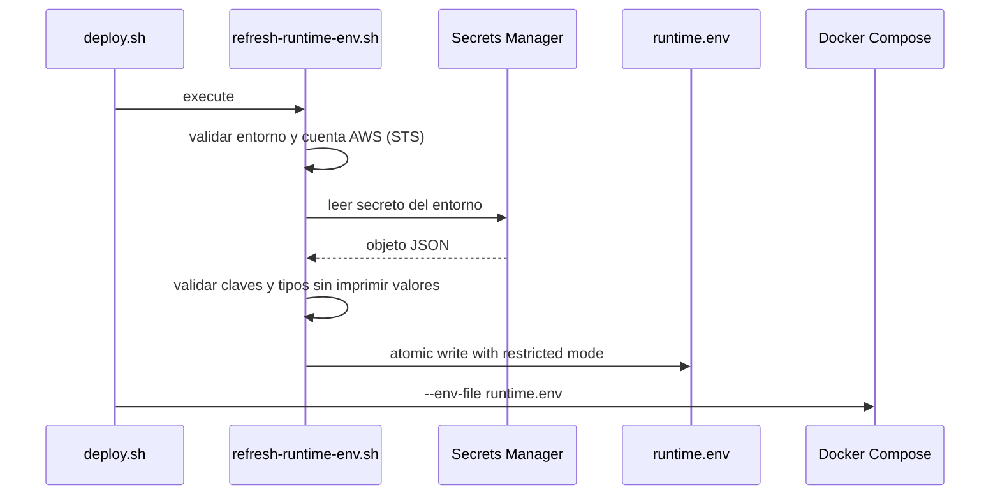
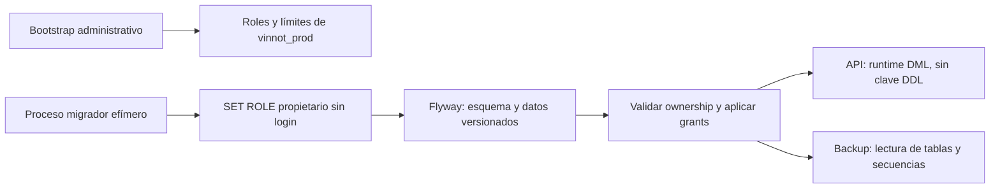

# Entornos, configuración y secretos

## Separación de configuración

El repositorio conserva ejemplos y nombres de variables, nunca valores reales.
Hay cuatro momentos distintos:

1. **build backend:** código e imagen, sin secretos runtime;
2. **build web/mobile:** variables públicas incorporadas al artefacto;
3. **runtime backend:** secretos obtenidos en host por `refresh-runtime-env.sh`;
4. **operación:** IDs no secretos de recursos y policies IAM.

## Clasificación

| Clase | Ejemplos | Ubicación |
|---|---|---|
| público de cliente | API URL, OAuth client ID, feature flag | GitHub vars/EAS env |
| secreto backend | DB password, JWT, OpenAI, mail credentials | Secrets Manager; GitHub secrets para credenciales del workflow |
| identificador infra | region, bucket, distribution, instance ID | workflow/config |
| dato local | `.env.local`, runtime env generado | ignorado por Git |

OAuth client IDs identifican aplicaciones y pueden ser públicos; client secrets,
tokens y claves privadas no. Una variable `VITE_` o `EXPO_PUBLIC_` es pública.

## Flujo runtime

Este flujo automático corresponde a `deploy.sh` de development. El publicador
productivo `deploy-production.sh` no refresca secretos: el operador materializa
`runtime.env` con `refresh-runtime-env.sh prod`, reconcilia su huella/journal y
publica el candidato compatible por el procedimiento de [despliegue](../guides/deployment.md).
Rotar un secreto en AWS por sí solo no cambia el contenedor productivo activo.

[Ver diagrama de «Flujo runtime» completo](https://images.vinnot.com/docs/diagrams/v1/es/infra-architecture-environments-and-secrets-5473bdb766e6.svg)

El archivo se reescribe antes de pull/up para permitir rotación sin reconstruir
imagen. `refresh-runtime-env.sh` admite `dev` o `prod`; sin argumento conserva
`dev` por compatibilidad. Rechaza valores desconocidos y cuentas AWS distintas
de la configurada antes de recuperar credenciales.

| Selector | Secreto | Destino |
|---|---|---|
| `dev` | `vinnot/dev/backend` | `/opt/vinnot/runtime.env` |
| `prod` | `vinnot/prod/backend` | `/opt/vinnot-prod/runtime.env` |

El directorio debe estar previamente provisionado. El selector no crea recursos
AWS ni aprovisiona un entorno. Se exigen las credenciales obligatorias del entorno
indicadas por el validador, con ejemplos en `runtime.env.example`; Facebook no es
obligatorio en producción. Las entradas adicionales deben tener nombres de variable
válidos y valores escalares. Se serializan para Compose conservando dólares,
comillas y claves multilínea. Este archivo es dotenv para Compose, no un script
que deba ejecutarse con `source`.

La escritura usa un temporal con modo 0600 en el mismo directorio y rename
atómico. Ante error de lectura/validación se conserva la configuración anterior
y se elimina el temporal; nunca se imprimen valores en diagnóstico. El workflow
de development sincroniza el script con checksum antes de desplegar, junto con
Compose y el ejecutor de despliegue.

## Roles de base productiva

Los scripts administrativos de `infra/postgres/` tienen como único destino
`vinnot_prod`; rechazan otra base antes de modificar roles o permisos. No son
migraciones Flyway y no se ejecutan automáticamente por el deploy de development.

| Rol | Responsabilidad | Límites |
|---|---|---|
| `vinnot_prod_owner` | propietario de esquema/objetos | sin login |
| `vinnot_prod_migrator` | ejecutar Flyway con `SET ROLE vinnot_prod_owner` | sin superusuario, creación de bases o administración de roles |
| `vinnot_prod_runtime` | DML de aplicación, secuencias y funciones | sin DDL, TRUNCATE ni acceso al historial Flyway; documentos legales sólo lectura |
| `vinnot_prod_backup` | lectura de tablas/secuencias para dump | sin escritura ni elevación al propietario |

`production-roles.sql` prepara roles y restringe permisos públicos; no instala
contraseñas ni toma posesión de tablas preexistentes. Las credenciales se asignan
por un canal administrativo protegido, no en Git ni en argumentos. Flyway ejecuta
las migraciones versionadas como propietario. Después se aplica
`production-runtime-grants.sql` con privilegios administrativos: valida ownership,
reconcilia grants y habilita las nuevas tablas. Este paso se repite después de cada
migración, antes de habilitar el runtime. El proceso de aplicación utiliza sólo
su credencial runtime con `SPRING_FLYWAY_ENABLED=false`; no debe recibir la clave
del migrador ni del bootstrap. No se aplica esta configuración a una base dev
existente sin una transición explícita.

[Ver diagrama de «Roles de base productiva» completo](https://images.vinnot.com/docs/diagrams/v1/es/infra-architecture-environments-and-secrets-8d63ca563d77.svg)

Los privilegios efectivos son acumulativos, incluidas membresías y permisos de
PUBLIC. Por eso el bootstrap rechaza roles elevados o membresías inesperadas.
Referencia: [privilegios y membresías de PostgreSQL](https://www.postgresql.org/docs/18/sql-grant.html).

## Acceso visual a PostgreSQL (TablePlus)

Las bases remotas corren dentro de Docker y no publican `5432` en EC2. TablePlus
se conecta a `127.0.0.1` mediante un túnel AWS Session Manager al contenedor del
entorno elegido; no se conecta al dominio de la API ni a un RDS histórico.
El túnel requiere AWS CLI, Session Manager Plugin y un principal autorizado para
`ssm:StartSession` sobre la instancia y el documento de port forwarding remoto.
El rol OIDC del release y el rol del host no son credenciales personales de TablePlus.

| Campo | Development | Producción |
|---|---|---|
| Host local | `127.0.0.1` | `127.0.0.1` |
| Puerto local sugerido | `15432` | `25432` |
| Base | `vinnot` | `vinnot_prod` |
| Contenedor remoto | `vinnot-dev-postgres-local` | `vinnot-prod-postgres-local` |
| Usuario runtime existente | `vinnot_admin` | `vinnot_prod_runtime` |

Obtener la IP interna vigente del contenedor mediante una sesión operadora autorizada
(`docker inspect`); puede cambiar tras recrearlo. Iniciar el túnel con
`AWS-StartPortForwardingSessionToRemoteHost`, `host=<IP interna>`, `portNumber=5432`
y `localPortNumber=<puerto elegido>`, manteniendo la sesión abierta mientras se usa
TablePlus. Seleccionar PostgreSQL, los campos locales y la contraseña del entorno
recuperada por el canal privado autorizado. El túnel protege el transporte; no cambia
los privilegios SQL. No guardar contraseñas reales en documentación, Git ni comandos.

El rol runtime productivo admite escritura: no es una cuenta de auditoría de sólo
lectura. El rol de backup no tiene una contraseña de escritorio provisionada por
estos scripts; no inventar ni reutilizar credenciales bootstrap/migrador. Para
inspección, usar transacciones `BEGIN READ ONLY` y comprobar `current_database()`
y `current_user` antes de consultar. Una cuenta permanente de sólo lectura exige
provisionamiento y permisos explícitos; no se declara existente por esta guía.
Cerrar el túnel al terminar. La pausa diaria de development interrumpe su conexión.

Referencia: [port forwarding remoto de Session Manager](https://docs.aws.amazon.com/systems-manager/latest/userguide/session-manager-working-with-sessions-start.html#sessions-remote-port-forwarding).

## Local

Desarrollo usa `.env.local`/variables shell y la documentación enumera nombres.
Copiar secretos productivos a una laptop no es el flujo recomendado: deben
existir credenciales de desarrollo acotadas. Los ejemplos contienen placeholders
y defaults seguros.

## Disponibilidad de Facebook por entorno

Facebook permanece deshabilitado en producción: el overlay productivo establece
`FACEBOOK_APP_ID` y `FACEBOOK_APP_SECRET` vacíos, incluso si el archivo de runtime
contiene valores heredados. El verificador de identidad rechaza ese proveedor
sin credenciales. `refresh-runtime-env.sh prod` no exige el secreto de Facebook;
las demás credenciales obligatorias siguen siendo requeridas. Development conserva
su configuración y validación independiente.

Web usa `VITE_APP_ENV=production`; mobile usa `EXPO_ENV=production`. Ambos ocultan
Facebook y bloquean su gateway antes de inicializar el SDK. El build nativo de
producción también omite el plugin de Facebook. Los flags
`VITE_FEATURE_FACEBOOK_LOGIN=false` y `EXPO_PUBLIC_FACEBOOK_LOGIN_ENABLED=false`
permiten desactivarlo adicionalmente en entornos no productivos. Activar el flag
no habilita Facebook en producción: su incorporación requiere un cambio revisado
de esta política y la configuración aprobada del proveedor.

## Google Maps: credenciales y consumo

Compartir un proyecto de Google Cloud no implica compartir una clave entre
clientes y servidor. `GOOGLE_MAPS_API_KEY` es la credencial del backend, restringida
a Directions API y a la IP pública fija de su entorno. No se incorpora a builds
web o mobile. La web recibe una clave diferente mediante
`VITE_GOOGLE_MAPS_API_KEY`, limitada al dominio HTTPS de la aplicación y a Maps
JavaScript, Geocoding y Embed. El campo operativo `GOOGLE_MAPS_WEB_API_KEY` permite
custodiar ese valor separado; no lo convierte en secreto una vez compilada la web.

Las restricciones de aplicación deben corresponder al consumidor: dominio para
web, IP para servidor y aplicación/firma para SDKs nativos. Antes de conectar una
clave nativa a un servicio REST se comprueba tanto el caso permitido como el
rechazo de una identidad de aplicación incorrecta. Una clave restringida a IP
del servidor no debe utilizarse desde un teléfono.

Las cuotas se comparten por proyecto y la facturación agrega el consumo por
cuenta. Las franquicias gratuitas dependen del SKU; un presupuesto de alertas no
detiene solicitudes. Los límites diarios deben dimensionarse considerando ambos
entornos, los días del mes y otros proyectos de la cuenta. Agotar una cuota puede
interrumpir temporalmente la función de mapas correspondiente; no debe resolverse
retirando restricciones ni cambiando a una clave de otro entorno.

Referencias: [seguridad de Google Maps](https://developers.google.com/maps/api-security-best-practices)
y [precios y franquicias por SKU](https://developers.google.com/maps/billing-and-pricing/pricing).

## Relay de correo privado de Apple

El ingreso con Apple y la entrega a direcciones de correo ocultas se configuran
por separado. Registrar la dirección exacta de `EMAIL_FROM` del backend en las
fuentes de correo de Apple Developer cuando sólo se necesita ese remitente; no
habilitar innecesariamente todas las direcciones del dominio. El relay exige
autenticación SPF y/o DKIM además de una fuente registrada. Con el remitente de
envolvente predeterminado de SES, utilizar la firma DKIM del dominio verificado,
alineada con la dirección From visible. Un aviso SPF en la interfaz de registro
no comprueba por sí solo esa vía DKIM. Verificar por separado la entrega a una
dirección relay real autorizada y a una casilla común; mantener habilitadas las
notificaciones de fallos del relay.

Referencia: [configuración y autenticación del relay privado de Apple](https://developer.apple.com/help/account/capabilities/configure-private-email-relay-service/).

## OpenAI: identidad de servicio y permisos

Cada entorno utiliza su propio proyecto y cuenta de servicio del backend. Los
adaptadores actuales sólo necesitan permiso Request para `/v1/chat/completions`
(texto y visión de etiquetas) y `/v1/moderations`, más `/v1/images/edits` en el
entorno que active `AI_IMAGES_ENABLED` (ilustraciones de redes). No requieren gestión de
archivos, fine-tuning, administración del proyecto ni
administración de claves API. Un rol personalizado del proyecto debe reemplazar
al rol member más amplio, no complementarlo: los roles heredados podrían
conservar ese acceso adicional. La clave se guarda en el secreto del backend de
su entorno, nunca en un bundle frontend.

Los permisos y el control de gasto son independientes. Restringir endpoints no
impone un número de solicitudes por usuario ni reduce la calidad del contenido generado.
`AI_MONTHLY_LIMIT_USD` gobierna el presupuesto configurado de la aplicación;
las llamadas ajenas a su registro de gasto también consumen crédito del proveedor.
Por eso las pruebas de aceptación requieren un número de llamadas autorizado
por separado y registrar consumo sin persistir sus respuestas sintéticas en el
catálogo.

Después de cambiar un rol, verificar una solicitud permitida y una operación
ajena denegada, sin registrar la clave ni contenido privado de las respuestas.
Una capacidad nueva del proveedor requiere revisar su adaptador y agregar sólo
el permiso necesario. Referencia: [cuentas de servicio y roles de mínimo privilegio de OpenAI](https://developers.openai.com/api/docs/guides/terraform/service-accounts).

## Agente de redes sociales

La publicación en redes (#510) se configura sólo con variables del backend. Los secretos van en
`vinnot/<entorno>/backend` de Secrets Manager y llegan al contenedor por `runtime.env`; nunca a Git,
`VITE_*` ni `EXPO_PUBLIC_*`. Todas las variables tienen valor por defecto, así que un entorno sin
ellas arranca con todo apagado y el panel muestra cada red sin configurar. Paso a paso por red:
[Configuración de las redes sociales](../guides/social-networks-setup.md).

| Variable | Por defecto | Secreto | Para qué |
|---|---|---|---|
| `MARKETING_ACCOUNTS_ENCRYPTION_KEY` | vacío | Sí | Clave AES-256-GCM de los tokens de Threads y TikTok: base64 de 32 bytes aleatorios; una por entorno, nunca compartida |
| `MARKETING_META_ACCESS_TOKEN` | vacío | Sí | Token del usuario del sistema de Meta (Instagram y página de Facebook), sin vencimiento |
| `MARKETING_META_PAGE_ACCESS_TOKEN` | vacío | Sí | Opcional: token de la página; vacío lo lee de la Graph API con el token anterior |
| `MARKETING_META_INSTAGRAM_USER_ID` | vacío | No | Id de la cuenta profesional de Instagram |
| `MARKETING_META_PAGE_ID` | vacío | No | Id de la página de Facebook |
| `MARKETING_THREADS_CLIENT_ID` | vacío | No | Id de la app de Threads |
| `MARKETING_THREADS_CLIENT_SECRET` | vacío | Sí | Secreto de la app de Threads |
| `MARKETING_THREADS_REDIRECT_URI` | vacío | No | `https://<host de la API>/api/public/social-accounts/threads/callback` |
| `MARKETING_TIKTOK_CLIENT_KEY` | vacío | No | Client key de la app de TikTok |
| `MARKETING_TIKTOK_CLIENT_SECRET` | vacío | Sí | Secreto de la app de TikTok |
| `MARKETING_TIKTOK_REDIRECT_URI` | vacío | No | `https://<host de la API>/api/public/social-accounts/tiktok/callback` |
| `MARKETING_THREADS_AUTHORIZE_URL`, `MARKETING_THREADS_API_BASE_URL` | `https://threads.com/oauth/authorize`, `https://graph.threads.com` | No | OAuth de Threads |
| `MARKETING_TIKTOK_AUTHORIZE_URL`, `MARKETING_TIKTOK_API_BASE_URL` | `https://www.tiktok.com/v2/auth/authorize/`, `https://open.tiktokapis.com` | No | OAuth de TikTok |
| `MARKETING_ACCOUNTS_CONNECT_TIMEOUT`, `MARKETING_ACCOUNTS_READ_TIMEOUT` | `5s`, `15s` | No | Timeouts de OAuth y del token de la página |
| `MARKETING_ACCOUNTS_REFRESH_INITIAL_DELAY_MS`, `MARKETING_ACCOUNTS_REFRESH_DELAY_MS` | `120000`, `3600000` | No | Cadencia de la renovación de tokens |
| `MARKETING_PUBLISHING_ENABLED` | `false` | No | Enciende la publicación |
| `MARKETING_PUBLISHING_INSTAGRAM_ENABLED`, `MARKETING_PUBLISHING_FACEBOOK_ENABLED`, `MARKETING_PUBLISHING_THREADS_ENABLED`, `MARKETING_PUBLISHING_TIKTOK_ENABLED` | `false` | No | Enciende cada red |
| `MARKETING_PUBLISHING_TIKTOK_MODE` | `MEDIA_UPLOAD` | No | `MEDIA_UPLOAD` (borrador) o `DIRECT_POST` (después de la auditoría de TikTok) |
| `MARKETING_PUBLISHING_INITIAL_DELAY_MS`, `MARKETING_PUBLISHING_DELAY_MS` | `60000`, `300000` | No | Cadencia del barrido |
| `MARKETING_PUBLISHING_DRAFT_SYNC_INITIAL_DELAY_MS`, `MARKETING_PUBLISHING_DRAFT_SYNC_DELAY_MS` | `120000`, `900000` | No | Cadencia del barrido que marca `PUBLISHED` los borradores de TikTok que el creador publicó (#516) |
| `MARKETING_PUBLISHING_DRAFT_SYNC_WINDOW_DAYS`, `MARKETING_PUBLISHING_DRAFT_SYNC_MAX_PER_SWEEP` | `14`, `20` | No | Días que un borrador se sigue consultando y borradores consultados por pasada (TikTok permite 30 consultas de estado por minuto) |
| `MARKETING_PUBLISHING_MEDIA_GRACE` | `PT6H` | No | Espera de las placas; la ventana de publicación es el doble |
| `MARKETING_METRICS_ENABLED` | `false` | No | Enciende la lectura diaria de métricas |
| `MARKETING_METRICS_CRON`, `MARKETING_METRICS_WINDOW_DAYS` | `0 0 6 * * *`, `30` | No | Hora (zona del planificador) y días medidos |
| `MARKETING_WEIGHTING_WINDOW_DAYS` | `90` | No | Días de métricas que pondera el planificador |
| `MARKETING_AUTO_APPROVE_ENABLED` | `false` | No | Enciende la aprobación automática |
| `MARKETING_AUTO_APPROVE_LEAD`, `MARKETING_AUTO_APPROVE_DELAY_MS` | `24h`, `900000` | No | Anticipación y cadencia |
| `MARKETING_NETWORKS_CONNECT_TIMEOUT`, `MARKETING_NETWORKS_REQUEST_TIMEOUT` | `10s`, `30s` | No | Timeouts de los adaptadores |
| `MARKETING_NETWORKS_POLL_INTERVAL`, `MARKETING_NETWORKS_POLL_TIMEOUT` | `15s`, `5m` | No | Espera del procesamiento de las imágenes |
| `MARKETING_META_BASE_URL`, `MARKETING_META_GRAPH_VERSION` | `https://graph.facebook.com`, `v27.0` | No | Graph API de Meta |
| `MARKETING_THREADS_BASE_URL`, `MARKETING_THREADS_VERSION` | `https://graph.threads.com`, `v1.0` | No | API de Threads |
| `MARKETING_TIKTOK_BASE_URL` | `https://open.tiktokapis.com` | No | API de TikTok |
| `MARKETING_INSTAGRAM_METRICS` | `views,reach,likes,comments,saved,shares` | No | Métricas que se piden a Instagram |
| `MARKETING_INSTAGRAM_ALT_TEXT` | `true` | No | Envía el texto alternativo en cada imagen de Instagram |

Rotar `MARKETING_ACCOUNTS_ENCRYPTION_KEY` deja ilegibles los tokens guardados: la renovación marca
Threads y TikTok `REFRESH_FAILED` con `TOKEN_UNREADABLE`, avisa a los administradores y hay que
volver a conectarlas. Una clave mal formada detiene el arranque. Los tokens de Threads y TikTok no
se copian entre entornos. El `state` de OAuth vive en la memoria del backend: funciona con una sola
instancia.

## Rotación

Rotar implica actualizar la fuente, desplegar/reiniciar consumidores, verificar
health y revocar el valor anterior. JWT/refresh puede requerir ventana de
compatibilidad; DB exige coordinar password de servidor y cliente. Registrar la
fecha/owner fuera del valor secreto.

## Controles

- secret scanning y revisión de diffs;
- IAM por path/recurso, no wildcard global;
- no pasar secretos en argumentos visibles o URL;
- no incluir `.env`, dumps ni runtime files en imágenes/artefactos;
- invalidar credenciales ante exposición, no sólo borrarlas de Git;
- separar development y production.

## Credenciales de imágenes R2

`APP_STORAGE_R2_ACCESS_KEY_ID` y `APP_STORAGE_R2_SECRET_ACCESS_KEY` sólo llegan
al backend desde el secreto runtime del entorno. Cada credencial limita objetos
a su bucket dev/prod; el catálogo usa acceso de migración separado. Account ID,
bucket y dominio público identifican recursos. Nunca incluir claves privadas
en `VITE_*`, `EXPO_PUBLIC_*`, Wrangler, scripts o manifiestos de ejecución.
El Worker lee mediante bindings de R2, sin incorporar esas claves backend.
[Variables, rotación y límites](../operations/user-images-r2.md).

## Preparación de pagos y webhooks de eventos

Los secretos `vinnot/dev/backend` y `vinnot/prod/backend` conservan la configuración de su propio backend. La firma de webhook se comparte únicamente porque ambos destinos pertenecen a la misma aplicación de Mercado Pago. Las claves de cifrado de credenciales y los tokens de organizadores no se copian entre entornos.

| Destino | Development | Producción |
|---|---|---|
| Webhook general | `https://api-dev.vinnot.com/api/payments/mercadopago/webhooks` | `https://api.vinnot.com/api/payments/mercadopago/webhooks` |
| Retorno público del pago | `https://dev.vinnot.com/payments/return` | `https://vinnot.com/payments/return` |
| Retorno OAuth del organizador | `https://dev.vinnot.com/partner/payments/callback` | `https://vinnot.com/partner/payments/callback` |

El overlay `compose.production.yml` fija las tres URLs productivas para impedir que un valor de development en el archivo runtime desvíe a usuarios o notificaciones. Estado vigente: producción opera pagos con `EVENT_PAYMENTS_ENVIRONMENT=LIVE`, definido en su configuración privada y no en `compose.production.yml`; development conserva su propia configuración.

Mercado Pago admite una URL general por modo de una aplicación. Al publicar producción, el destino general del modo productivo pasa a la API productiva; cada checkout de development conserva su `notification_url` específica por intento, que tiene prioridad. No usar “Modo de prueba” para redirigir un piloto con dinero real. Sólo se selecciona el evento `payment`, que el adaptador sabe verificar; no activar tópicos sin su correspondiente receptor.

Secuencia de publicación conjunta:

1. Integrar y validar el lote; publicar imágenes versionadas y escaneadas por el circuito existente. Aplicar sus migraciones con el proceso productivo, sin saltar la validación de revisión.
2. Completar las credenciales OAuth del entorno y su clave de cifrado independiente mediante el flujo autorizado. Registrar el callback productivo exacto en Mercado Pago conservando PKCE y el callback de development. La URL guardada en AWS no registra por sí sola el destino en el proveedor.
3. Materializar `runtime.env` de producción y reconciliar su journal/huella antes del despliegue. Publicar también el frontend con `/payments/return` y `/my-tickets`.
4. Activar sólo la política y los componentes operativos aprobados, comprobar salud y firma del receptor; luego cambiar la URL general en Mercado Pago y simular una notificación. Confirmar firma válida/alterada, persistencia de conciliación y ausencia de datos privados en el retorno público.
5. Registrar la evidencia pública y de correos antes de dar por aceptado el circuito. Mantener conciliación y reintentos para avisos tardíos. Preparar secretos o desplegar código no equivale a habilitar ventas.

El código ofrece `SANDBOX`, `LIVE_PILOT` y `LIVE`. `LIVE_PILOT` limita el organizador a uno permitido y el total a ARS 50. `LIVE` admite organizadores reales verificados, distintos de la cuenta de la plataforma, con importes positivos en ARS. La política se selecciona con `EVENT_PAYMENTS_ENVIRONMENT`; un despliegue de código no la cambia. Ver [Descubrimiento e inscripción a eventos](../../modules/payments/architecture.md#backend).

### Historial: preparación y piloto del despliegue conjunto (2026-10-15)

Registro histórico, reemplazado por la política `LIVE` vigente. La configuración
productiva se preparó primero con las tres banderas `EVENT_PAYMENTS_ENABLED`,
`EVENT_PAYMENTS_CHECKOUT_ENABLED` y `EVENT_PAYMENTS_SETTLEMENT_ENABLED` en `false`.
Tras la autorización de publicación, ambos secretos incluyen OAuth de plataforma,
claves de cifrado independientes y las tres banderas de pagos habilitadas bajo
`LIVE_PILOT`: sólo el vendedor autorizado y hasta ARS 50. Su materialización y
aceptación pública siguen siendo parte del despliegue; guardar el secreto no
cambia el contenedor en ejecución. No se copian tokens de vendedores entre
ambientes. El callback productivo debe quedar guardado también en Mercado Pago.

Los builds web declaran `VITE_EVENT_PAYMENTS_ENABLED=true`; esto habilita sólo
la interfaz. La autorización, destinatario e importes siempre se verifican en el
backend. El flag heredado sandbox nunca habilita por sí solo la UI productiva.
