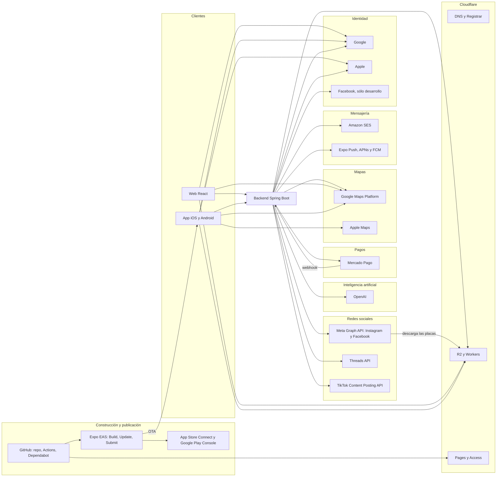

# Servicios externos

Todos los servicios de terceros de los que depende Vinnot: para qué se usan, cómo se
integran, qué claves de configuración los activan, qué pasa cuando fallan y en qué plan
están. Sólo se nombran las **claves**; los valores viven en Secrets Manager, en los secretos
de GitHub o en EAS, nunca en el repositorio ([Entornos y secretos](environments-and-secrets.md)).
Los montos de cada plan están en [Costos](../../business/costs.md).

## Mapa de dependencias

[Ver diagrama de «Mapa de dependencias» completo](https://images.vinnot.com/docs/diagrams/v1/es/infra-architecture-external-services-9c20229172d7.svg)

## Resumen

| Servicio | Para qué | Integración | Plan | Si falla |
|---|---|---|---|---|
| OpenAI | Perfiles y comparaciones de vinos, lectura de etiquetas, moderación | HTTP propio, sin SDK | API de pago con tope mensual del proyecto | 503 sin margen de presupuesto; la función deja de estar disponible |
| Mercado Pago | Cobro de entradas, cuenta del organizador, devoluciones | HTTP propio, sin SDK | sin costo fijo; comisión por venta | el aviso se recupera por conciliación programada |
| Google Maps Platform | Distancias de las rutas y mapas | HTTP en el backend; JavaScript API en la web; SDK nativo en Android | cuenta de facturación de Google Cloud | sin clave, la ruta queda sin distancia |
| Apple Maps | Mapas en iOS | SDK nativo vía `react-native-maps` | incluido en iOS | — |
| Amazon SES | Correo transaccional y de novedades | AWS SDK v2 | pago por uso | el envío pasa por la outbox y se reintenta |
| Expo Push | Notificaciones push | HTTP a la Expo Push API | gratuito | reintentos y outbox |
| Expo EAS | Compilación, OTA y envío a tiendas | CLI y `expo-updates` | Free | — |
| App Store Connect | Distribución en iOS | consola y EAS Submit | Apple Developer Program, individual | — |
| Google Play Console | Distribución en Android | consola | registro único | — |
| Cloudflare | DNS, dominio, proxy y WAF de la API, imágenes, documentación | consola, Wrangler y API S3 de R2 | Free, R2 de pago por uso | — |
| GitHub | Repositorio, CI/CD y actualizaciones | Actions y Dependabot | Free, repositorio privado | — |
| Meta Graph API | Publicar y medir en Instagram y en la página de Facebook | HTTP propio, sin SDK | gratuito | la publicación se reintenta hasta 5 intentos y después queda fallida |
| Threads API | Publicar y medir en Threads; OAuth de la cuenta | HTTP propio, sin SDK | gratuito | igual que Meta; la cuenta se reconecta si la renovación falla |
| TikTok Content Posting API | Enviar el carrusel como borrador o publicarlo; OAuth de la cuenta | HTTP propio, sin SDK | gratuito; publicación directa tras la auditoría de TikTok | igual que Meta |
| Google, Apple y Facebook | Ingreso con cuentas externas | SDK en web y app; verificación de tokens en el backend | gratuito | el ingreso con esa cuenta no está disponible; queda correo y contraseña |

## OpenAI

- **Para qué:** perfiles de vino y comparaciones, lectura de etiquetas por imagen y moderación
  de imágenes ([IA](../../modules/ai/README.md)); texto e ilustraciones de las publicaciones
  sociales ([Marketing en redes](../../modules/marketing/README.md)).
- **Integración:** llamadas HTTP propias a `/v1/chat/completions` y `/v1/moderations`, sin
  SDK ([`OpenAiClient.java`](../../../../backend/src/main/java/com/vinnot/shared/infrastructure/ai/OpenAiClient.java)).
- **Modelos:** `gpt-6-luna` para texto, `gpt-4o-mini` para visión y `omni-moderation-latest`
  para moderación, con nivel de servicio `priority` ([`application.yml`](../../../../backend/src/main/resources/application.yml)).
- **Claves:** `OPENAI_API_KEY`, `OPENAI_MODEL`, `OPENAI_VISION_MODEL`, `OPENAI_VISION_REASONING_EFFORT`, `OPENAI_MODERATION_MODEL`,
  `OPENAI_SERVICE_TIER`, `OPENAI_INPUT_PER_MILLION_USD`, `OPENAI_OUTPUT_PER_MILLION_USD`,
  `AI_PROVIDER`, `AI_ENABLED`, `AI_MONTHLY_LIMIT_USD`, `AI_DAILY_LIMIT_USD`,
  `AI_MAXIMUM_CONCURRENT_REQUESTS`, `AI_INTERACTIVE_WAIT`, `AI_PROFILE_REFRESH_ENABLED`, `AI_PROFILE_REFRESH_INTERVAL`,
  `AI_PROFILE_REFRESH_PROFILES_PER_RUN`, `AI_PROFILE_REFRESH_BUDGET_SHARE`.
- **Ilustraciones:** `/v1/images/edits` con `gpt-image-1`, apagado por defecto
  ([`OpenAiImageClient.java`](../../../../backend/src/main/java/com/vinnot/shared/infrastructure/ai/OpenAiImageClient.java)); claves `AI_IMAGES_ENABLED`, `AI_IMAGES_MODEL`,
  `AI_IMAGES_QUALITY`, `AI_IMAGES_SIZE`, `AI_IMAGES_MAX_COST_USD`, `AI_IMAGES_TIMEOUT`,
  `AI_IMAGES_MAX_ATTEMPTS`, `AI_IMAGES_INITIAL_BACKOFF_MS` y `OPENAI_IMAGES_URL`. Cada imagen
  reserva un costo fijo contra el mismo tope mensual; sin IA se usa la viñeta del pilar.
- **Límites:** 3 llamadas simultáneas (la última reservada para los escaneos de etiquetas, que
  esperan hasta 4 s un cupo) y un tope mensual en USD que se reserva antes de cada
  llamada; cada persona puede generar 20 por hora.
- **Si falla:** conexión de 10 s, lectura de 30 s y hasta 2 intentos. Sin margen de capacidad
  o presupuesto, la API responde 503. Con otro proveedor configurado, la lectura de etiquetas
  y la moderación usan adaptadores «no disponible»
  ([`UnavailableWineLabelRecognitionAdapter.java`](../../../../backend/src/main/java/com/vinnot/wine/infrastructure/ai/UnavailableWineLabelRecognitionAdapter.java)).
  La app lee el texto de la etiqueta en el dispositivo con ML Kit, sin llamar a OpenAI
  ([`wineLabelTextRecognizer.ts`](../../../../frontend-mobile/src/infrastructure/device/camera/wineLabelTextRecognizer.ts)).
- **Más:** identidad de servicio y permisos en
  [Entornos y secretos](environments-and-secrets.md#openai-identidad-de-servicio-y-permisos).

## Mercado Pago

- **Para qué:** cobrar entradas de eventos, vincular la cuenta del organizador y devolver
  pagos ([Pagos](../../modules/payments/README.md)).
- **Integración:** HTTP propio a `api.mercadopago.com`, sin SDK: checkout, consulta y búsqueda
  de pagos y devoluciones
  ([`MercadoPagoPaymentAdapter.java`](../../../../backend/src/main/java/com/vinnot/payment/infrastructure/gateway/MercadoPagoPaymentAdapter.java)).
- **Claves:** `EVENT_PAYMENTS_ENABLED`, `EVENT_PAYMENTS_CHECKOUT_ENABLED`,
  `EVENT_PAYMENTS_ENVIRONMENT`, `EVENT_PAYMENTS_CLIENT_ID`, `EVENT_PAYMENTS_CLIENT_SECRET`,
  `EVENT_PAYMENTS_WEBHOOK_SECRET`, `EVENT_PAYMENTS_ENCRYPTION_KEY`,
  `EVENT_PAYMENTS_NOTIFICATION_URI`, `EVENT_PAYMENTS_REDIRECT_URI`, y sus pares
  `EVENT_PAYMENTS_SANDBOX_*`. En la app, `EXPO_PUBLIC_EVENT_PAYMENTS_ENABLED`.
- **Webhook:** el backend verifica la firma HMAC-SHA256 y responde 401 si no coincide. No
  confía en el cuerpo del aviso: busca el pago por la referencia del checkout
  ([`PaymentWebhookController.java`](../../../../backend/src/main/java/com/vinnot/payment/infrastructure/web/PaymentWebhookController.java)).
- **Si falla:** si un aviso no llega, la conciliación programada recupera el pago.
- **Plan:** sin costo fijo. Mercado Pago descuenta su comisión al vendedor y Vinnot retiene
  la comisión de la política vigente, hoy 3 % por venta ([`TicketPaymentQuote.java`](../../../../backend/src/main/java/com/vinnot/payment/domain/valueobject/TicketPaymentQuote.java)).
- **Más:** [Preparación de pagos y webhooks](environments-and-secrets.md#preparación-de-pagos-y-webhooks-de-eventos).

## Mapas: Google Maps y Apple Maps

- **Backend:** Directions API por HTTP para la distancia total de una ruta del vino. Clave
  `GOOGLE_MAPS_API_KEY`, conexión de 3 s y lectura de 5 s. Sin clave, registra un aviso y la
  ruta queda sin distancia
  ([`GoogleMapsDistanceService.java`](../../../../backend/src/main/java/com/vinnot/shared/infrastructure/maps/GoogleMapsDistanceService.java)).
- **Web:** Maps JavaScript API con `VITE_GOOGLE_MAPS_API_KEY`
  ([`MapView.tsx`](../../../../frontend-react/src/presentation/components/ui/MapView.tsx)).
- **App:** `react-native-maps` sin proveedor fijo, así que usa Apple Maps en iOS y Google Maps
  en Android ([`RouteMap.tsx`](../../../../frontend-mobile/src/presentation/features/wineRoute/RouteMap.tsx)).
  Claves `EXPO_PUBLIC_GOOGLE_MAPS_API_KEY`, `EXPO_PUBLIC_GOOGLE_MAPS_ANDROID_API_KEY` y
  `EXPO_PUBLIC_GOOGLE_MAPS_IOS_API_KEY`; en producción la clave de iOS queda vacía
  ([`app.config.ts`](../../../../frontend-mobile/app.config.ts)).
- **Más:** [Google Maps: credenciales y consumo](environments-and-secrets.md#google-maps-credenciales-y-consumo).

## Google Gemini

- **Para qué:** embeddings de imagen para la búsqueda visual de etiquetas: el backend compara
  una foto escaneada con las imágenes de etiquetas del catálogo que aloja Vinnot
  ([Vinos](../../modules/wines/architecture.md#precisión-del-escaneo-de-etiquetas)).
- **Integración:** llamadas HTTP propias a la API de Gemini (`generativelanguage.googleapis.com/v1beta`),
  sin SDK y con el encabezado `x-goog-api-key`
  ([`GeminiImageEmbeddingAdapter.java`](../../../../backend/src/main/java/com/vinnot/wine/infrastructure/visual/GeminiImageEmbeddingAdapter.java)).
- **Modelo:** `gemini-embedding-2` con 768 dimensiones; los vectores se guardan como int8 en
  `wine_image_embeddings` y se mantienen en memoria.
- **Claves:** `GEMINI_API_KEY` (opcional), `GEMINI_BASE_URL`, `GEMINI_EMBEDDING_MODEL`,
  `GEMINI_EMBEDDING_DIMENSIONS`, `GEMINI_CONNECT_TIMEOUT`, `GEMINI_TIMEOUT` y los ajustes
  `WINE_LABEL_VISUAL_INDEX_*`.
- **Cuando falla:** 3 s para conectar y 8 s por pedido. Sin clave, o si una llamada falla, los
  escaneos usan solo la búsqueda por texto y nunca informan un error por eso.

## Amazon SES

- **Para qué:** verificación de correo, recuperación de contraseña, avisos de cuenta, eventos,
  pagos y novedades.
- **Integración:** AWS SDK v2 (SES v2), con el rol del servidor; sin claves de acceso
  ([`SesNotificationDeliveryAdapter.java`](../../../../backend/src/main/java/com/vinnot/notification/infrastructure/delivery/SesNotificationDeliveryAdapter.java)).
- **Claves:** `EMAIL_PROVIDER` (`ses` en los servidores; `log` por defecto sólo registra),
  `EMAIL_FROM`, `EMAIL_SES_REGION`, `EMAIL_SES_CONFIGURATION_SET`, `EMAIL_FEEDBACK_QUEUE_URL`.
- **Si falla:** el envío sale por la outbox y se reintenta. Los rebotes y las quejas llegan
  por SNS y SQS ([Rebotes y quejas de correo](../operations/observability-and-incidents.md#rebotes-y-quejas-de-correo)).

## Expo

- **Push:** HTTP a la Expo Push API, que reenvía a APNs y FCM
  ([`ExpoPushSenderAdapter.java`](../../../../backend/src/main/java/com/vinnot/notification/infrastructure/push/ExpoPushSenderAdapter.java)).
  Claves `PUSH_PROVIDER` (`expo` en los servidores; `log` por defecto), `EXPO_ACCESS_TOKEN`,
  `PUSH_DAILY_CAP` y `PUSH_RATE_PER_SECOND`. Envía como máximo 500 mensajes por segundo y 3
  notificaciones no transaccionales por persona y día. Ante 429 o 5xx reintenta 3 veces
  respetando `Retry-After`; después, la outbox reintenta el trabajo.
- **EAS Build:** perfiles `development`, `preview` y `production`; el número de compilación
  vive en EAS y aumenta solo en producción ([`eas.json`](../../../../frontend-mobile/eas.json)).
  Plan Free; las compilaciones de Android se hacen en local.
- **EAS Update:** actualizaciones OTA por canal, con runtime version igual a la versión de la
  app ([`app.config.ts`](../../../../frontend-mobile/app.config.ts)). Un cambio nativo exige
  una compilación nueva.
- **EAS Submit:** envío de los binarios a las tiendas
  ([Distribución](../../frontend-mobile/guides/distribution.md)).

## Tiendas: App Store Connect y Google Play Console

- **App Store Connect:** distribución en iOS y TestFlight, con una cuenta individual del
  Apple Developer Program. Las suscripciones dentro de la app requieren además el acuerdo de
  aplicaciones pagas (verificado en la consola de Apple el 29-10-2026).
- **Google Play Console:** distribución en Android, con prueba cerrada.
- **Más:** [Distribución](../../frontend-mobile/guides/distribution.md).

## Cloudflare

| Producto | Para qué | Plan | Fuente |
|---|---|---|---|
| DNS | Zona `vinnot.com`; la raíz apunta a CloudFront | Free | [Arquitectura de despliegue AWS](aws-deployment.md#dns-y-distribución-web-productivos) |
| Proxy y WAF | `api.vinnot.com` y `api-dev.vinnot.com` pasan por el proxy: WAF administrado Free y una regla de rate limiting sobre `/api/auth/`; el origen sólo acepta rangos de Cloudflare. Hasta aplicarlo, los registros siguen sólo DNS | Free | [Poner Cloudflare delante de la API](aws-deployment.md#poner-cloudflare-delante-de-la-api) |
| Registrar | Registro y renovación de `vinnot.com` | renovación anual automática | verificado en la consola de Cloudflare el 29-10-2026 |
| R2 | Imágenes del catálogo y subidas de usuarios, privadas | pago por uso, hoy dentro del nivel gratuito | [Imágenes del catálogo en R2](../operations/catalog-images-r2.md) |
| Workers | `vinnot-catalog-images` en `images.vinnot.com` | Free | [`worker.mjs`](../../../../infra/cloudflare/catalog-images/worker.mjs) |
| Pages | Sitio de documentación `vinnot-docs` | Free | [Sitio de documentación](../../governance/documentation-site.md) |
| Access | Acceso privado a la documentación | Zero Trust Free | [Sitio de documentación](../../governance/documentation-site.md) |

El backend escribe en R2 con la API compatible con S3 del AWS SDK. Claves `APP_STORAGE_PROVIDER`
(`r2`, `s3` o `local`) y `APP_STORAGE_R2_*`, con topes mensuales de espacio, escrituras y
lecturas por entorno ([`docker-compose.yml`](../../../../infra/aws-low-cost/docker-compose.yml)).

## GitHub

- **Repositorio:** privado, plan Free.
- **Actions:** CI, despliegues de desarrollo, release de producción y escaneos de seguridad,
  en runners `ubuntu-24.04` y `macos-26`. Todas las acciones están fijadas por SHA
  ([`actions-policy.json`](../../../../infra/security/actions-policy.json), [CI/CD](../guides/ci-cd.md)).
- **Dependabot:** acciones cada semana; npm, Maven y Docker cada mes, agrupados por patch y
  minor ([`dependabot.yml`](../../../../.github/dependabot.yml),
  [Actualización de dependencias](../guides/dependency-updates.md)).
- **Si falla:** sin GitHub no hay CI ni despliegue; producción sigue sirviendo la última
  versión publicada.

## Redes sociales: Meta, Threads y TikTok

- **Para qué:** el agente de redes publica las publicaciones aprobadas y lee sus métricas
  ([Marketing en redes](../../modules/marketing/README.md)). Todo está apagado por defecto.
- **Integración:** HTTP propio sin SDK ([`infrastructure/social`](../../../../backend/src/main/java/com/vinnot/marketing/infrastructure/social/)
  y [`infrastructure/accounts`](../../../../backend/src/main/java/com/vinnot/marketing/infrastructure/accounts/)).
  Las redes descargan las placas desde sus URLs públicas https de R2 (`images.vinnot.com`).
  - **Meta Graph API** (`graph.facebook.com`, `v27.0`): contenedores y `media_publish` de Instagram,
    fotos y post de la página de Facebook, `content_publishing_limit` e insights. Token de usuario del
    sistema de un portfolio comercial, sin vencimiento.
  - **Threads API** (`graph.threads.com`, `v1.0`): contenedores, `threads_publish` e insights; OAuth en
    `threads.com/oauth/authorize` con `threads_basic`, `threads_content_publish` y
    `threads_manage_insights`; token de 60 días renovado solo.
  - **TikTok Content Posting API** (`open.tiktokapis.com`): `creator_info`, `content/init` y
    `status/fetch` de posts de fotos; OAuth (Login Kit) en `www.tiktok.com/v2/auth/authorize/` con
    `user.info.basic`, `video.upload`, `video.publish` y `video.list`. Sin la auditoría de TikTok sólo se
    envían borradores a la bandeja (`MEDIA_UPLOAD`); `status/fetch` se consulta cada 15 minutos, hasta
    20 borradores por pasada (límite: 30 por minuto), para marcar publicados los que el creador publicó.
- **Claves:** `MARKETING_PUBLISHING_*`, `MARKETING_METRICS_*`, `MARKETING_AUTO_APPROVE_*`,
  `MARKETING_NETWORKS_*`, `MARKETING_META_*`, `MARKETING_THREADS_*`, `MARKETING_TIKTOK_*`,
  `MARKETING_INSTAGRAM_*` y `MARKETING_ACCOUNTS_*`
  ([Entornos y secretos](environments-and-secrets.md#agente-de-redes-sociales)).
- **Límites:** cupo diario de publicaciones de Instagram (se consulta antes de publicar); carruseles de
  2 a 20 imágenes en Instagram y Threads, hasta 50 fotos en Facebook y hasta 35 en TikTok.
- **Si falla:** conexión de 10 s y pedido de 30 s; la espera del procesamiento se corta a los 5 minutos.
  Los límites, caídas y demoras se reintentan hasta 5 intentos por el outbox; los rechazos y un token
  inválido dejan la red fallida, avisan a los administradores y se reintentan a mano desde el panel.
- **Más:** [Configuración de las redes sociales](../guides/social-networks-setup.md).

## Identidad: Google, Apple y Facebook

| Proveedor | Web | App | Backend | Producción |
|---|---|---|---|---|
| Google | `@react-oauth/google`, `VITE_GOOGLE_OAUTH_CLIENT_ID` | Google Sign-In, `EXPO_PUBLIC_GOOGLE_*_CLIENT_ID` | verifica el token contra `GOOGLE_OAUTH_AUDIENCES` | activo |
| Apple | `VITE_APPLE_CLIENT_ID`, `VITE_APPLE_REDIRECT_URI` | `expo-apple-authentication` | verifica el token con `APPLE_OAUTH_AUDIENCES`, `APPLE_TEAM_ID`, `APPLE_KEY_ID`, `APPLE_PRIVATE_KEY` | activo |
| Facebook | `VITE_FACEBOOK_APP_ID` | Facebook SDK, `EXPO_PUBLIC_FACEBOOK_LOGIN_ENABLED` | Graph API `v23.0` con `FACEBOOK_APP_ID` y `FACEBOOK_APP_SECRET` | apagado: credenciales vacías en el overlay de producción |

El backend verifica los tokens en
[`SocialIdentityVerifierAdapter.java`](../../../../backend/src/main/java/com/vinnot/user/infrastructure/identity/SocialIdentityVerifierAdapter.java),
con conexión de 3 s y lectura de 5 s. Luego emite su propio JWT con JJWT
([`JwtTokenService.java`](../../../../backend/src/main/java/com/vinnot/shared/infrastructure/security/JwtTokenService.java)).
Más detalle en [Usuarios](../../modules/users/README.md) y
[Disponibilidad de Facebook por entorno](environments-and-secrets.md#disponibilidad-de-facebook-por-entorno).

## Sin servicio externo

No hay servicios de monitoreo de errores, APM, analítica de producto ni búsqueda externa:
las métricas van a CloudWatch, la búsqueda usa PostgreSQL y la documentación usa búsqueda
local ([Hosting y runtime](hosting-and-runtime.md#backups-monitoreo-y-logs)).
