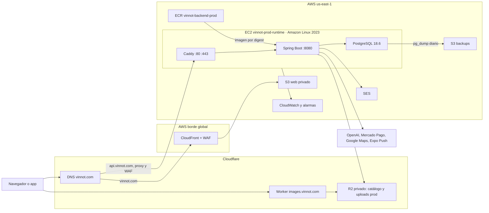
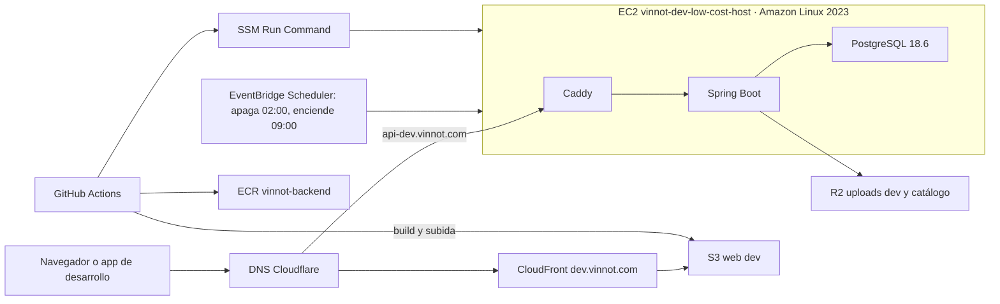

# Hosting y runtime

Esta página reúne el núcleo de la plataforma: dónde corre cada parte, sobre qué máquinas
y sistema operativo, con qué versiones y límites, y qué servicios de AWS, Cloudflare y
Expo intervienen. Cada fila cita su fuente en el repositorio. Los datos que sólo existen
en la consola se marcan como **verificado en la consola de AWS el 29-10-2026**; son una
foto de ese día, no una garantía del código.

El detalle operativo de cada tema sigue en su página: [Arquitectura de despliegue AWS](aws-deployment.md),
[Entornos y secretos](environments-and-secrets.md), [Operación low-cost](../operations/low-cost-dev.md)
y [Observabilidad e incidentes](../operations/observability-and-incidents.md). Los proveedores
externos están en [Servicios externos](external-services.md) y el recorrido animado de un pedido,
en [Recorrido de un pedido](../diagrams/request-journey.mdx).

## En pocas palabras

- **API:** un servidor EC2 `t3a.small` por entorno, con Amazon Linux 2023, que corre Caddy,
  Spring Boot y PostgreSQL en Docker Compose. No hay balanceador, NAT, RDS ni Kubernetes.
  El proxy de Cloudflare, con su WAF, queda delante de la API
  ([pendiente de aplicar](aws-deployment.md#poner-cloudflare-delante-de-la-api)).
- **Web:** archivos estáticos en un bucket S3 privado, servidos por CloudFront; producción
  agrega AWS WAF.
- **Imágenes:** un Worker de Cloudflare las sirve desde buckets R2 privados en `images.vinnot.com`.
- **App móvil:** binarios en App Store y Google Play; los cambios de JavaScript llegan por EAS Update.
- **Documentación:** Cloudflare Pages, privada detrás de Cloudflare Access.
- **Región:** todo lo de AWS está en `us-east-1`.

## Mapa de hosting

| Componente | Dónde corre | Proveedor y servicio | Región | Dominio | Entorno | Fuente |
|---|---|---|---|---|---|---|
| API | EC2 `vinnot-prod-runtime`: Caddy, Spring Boot y PostgreSQL en Docker Compose, detrás del proxy de Cloudflare | AWS EC2; Cloudflare proxy y WAF | us-east-1 | `api.vinnot.com` | producción | [`production-stack.json`](../../../../infra/aws-low-cost/production-stack.json), [`compose.production.yml`](../../../../infra/aws-low-cost/compose.production.yml) |
| API | EC2 `vinnot-dev-low-cost-host`, con el mismo Compose, detrás del proxy de Cloudflare | AWS EC2; Cloudflare proxy y WAF | us-east-1 | `api-dev.vinnot.com` | desarrollo | [`docker-compose.yml`](../../../../infra/aws-low-cost/docker-compose.yml), [`Caddyfile`](../../../../infra/aws-low-cost/Caddyfile) |
| Web | Bucket S3 privado detrás de CloudFront y AWS WAF | AWS S3, CloudFront, WAF | us-east-1 y borde global | `vinnot.com` | producción | [`production-web-stack.json`](../../../../infra/aws-low-cost/production-web-stack.json) |
| Web | Bucket S3 detrás de CloudFront | AWS S3, CloudFront | us-east-1 y borde global | `dev.vinnot.com` | desarrollo | [`deploy-frontend-dev.yml`](../../../../.github/workflows/deploy-frontend-dev.yml) |
| Documentación | Proyecto `vinnot-docs`, compilado por Cloudflare desde Git, con Cloudflare Access | Cloudflare Pages, Zero Trust Free | global | `vinnot-docs.pages.dev` | compartido | [Sitio de documentación](../../governance/documentation-site.md) |
| Imágenes del catálogo | Worker `vinnot-catalog-images` y bucket R2 `vinnot-catalog-images` | Cloudflare Workers, R2 | global | `images.vinnot.com` | compartido | [`wrangler.uploads.jsonc`](../../../../infra/cloudflare/catalog-images/wrangler.uploads.jsonc) |
| Imágenes subidas por usuarios | Buckets R2 `vinnot-user-uploads-dev` y `vinnot-user-uploads-prod`, servidos por el mismo Worker | Cloudflare R2 | global | `images.vinnot.com` | uno por entorno | [Imágenes de usuarios](../operations/user-images-r2.md) |
| Medios históricos | Buckets S3 privados, sólo lectura y borrado | AWS S3 | us-east-1 | — | uno por entorno | [`production-stack.json`](../../../../infra/aws-low-cost/production-stack.json) |
| Base de datos | Contenedor PostgreSQL 18.6 en la EC2 de su entorno, con volumen en EBS | AWS EC2 y EBS | us-east-1 | sin acceso público | uno por entorno | [`compose.postgres.yml`](../../../../infra/aws-low-cost/compose.postgres.yml) |
| Copias de la base | Bucket S3 de backups | AWS S3 | us-east-1 | — | uno por entorno | [Backup y recuperación](../operations/backup-and-disaster-recovery.md) |
| Imágenes de contenedor | ECR `vinnot-backend-prod` y `vinnot-backend` | AWS ECR | us-east-1 | — | uno por entorno | [`production-stack.json`](../../../../infra/aws-low-cost/production-stack.json) |
| App móvil | Binarios publicados en las tiendas, más TestFlight y prueba cerrada | App Store Connect, Google Play Console | global | — | producción | [Distribución](../../frontend-mobile/guides/distribution.md) |
| Actualizaciones OTA | Canales `development`, `preview` y `production` | Expo EAS Update | global | `u.expo.dev` | uno por canal | [`eas.json`](../../../../frontend-mobile/eas.json), [`app.config.ts`](../../../../frontend-mobile/app.config.ts) |
| DNS | Zona `vinnot.com`, plan Free | Cloudflare DNS | global | `vinnot.com` | compartido | [Arquitectura de despliegue AWS](aws-deployment.md#dns-y-distribución-web-productivos) |
| Registro del dominio | `vinnot.com`, renovación automática el 23-04-2027 | Cloudflare Registrar | — | `vinnot.com` | compartido | verificado en la consola de Cloudflare el 29-10-2026 |
| Correo | Envío transaccional y de novedades | Amazon SES v2 | us-east-1 | remitente `no-reply` del dominio | compartido | [`application.yml`](../../../../backend/src/main/resources/application.yml) |
| Notificaciones push | Expo Push API, que reenvía a APNs y FCM | Expo | global | — | compartido | [`PushConfiguration.java`](../../../../backend/src/main/java/com/vinnot/notification/infrastructure/push/PushConfiguration.java) |
| CI/CD | Workflows en runners alojados por GitHub | GitHub Actions | — | — | compartido | [CI/CD](../guides/ci-cd.md) |

### Producción de punta a punta

[Ver diagrama de «Producción de punta a punta» completo](https://images.vinnot.com/docs/diagrams/v1/es/infra-architecture-hosting-and-runtime-3ab56d1b7984.svg)

### Desarrollo de punta a punta

[Ver diagrama de «Desarrollo de punta a punta» completo](https://images.vinnot.com/docs/diagrams/v1/es/infra-architecture-hosting-and-runtime-363798df03c5.svg)

## Inventario de servidores

Los dos servidores comparten tipo de instancia y sistema operativo. El código fija el tipo y
exige una AMI de Amazon Linux 2023 x86_64; la AMI exacta, el kernel y la fecha de arranque
son datos de la consola.

| Dato | Producción `vinnot-prod-runtime` | Desarrollo `vinnot-dev-low-cost-host` | Fuente |
|---|---|---|---|
| Tipo de instancia | `t3a.small`: 2 vCPU AMD EPYC, 2 GiB de RAM, rendimiento ampliable | igual | [`production-stack.json`](../../../../infra/aws-low-cost/production-stack.json), [Operación low-cost](../operations/low-cost-dev.md) |
| Créditos de CPU | `standard`: al agotar los créditos baja a la línea base, sin cargos extra | sin configurar en el repositorio | [`production-stack.json`](../../../../infra/aws-low-cost/production-stack.json) |
| Sistema operativo | Amazon Linux 2023 | Amazon Linux 2023 (`dnf`, usuario `ec2-user`) | [`provision-host.sh`](../../../../infra/aws-low-cost/provision-host.sh) |
| AMI | `al2023-ami-2023.12.20260928.0-kernel-6.18-x86_64` | — | verificado en la consola de AWS el 29-10-2026 |
| Kernel | Linux 6.18 | — | verificado en la consola de AWS el 29-10-2026 |
| Arquitectura | x86_64 (`linux/amd64`) | x86_64 | [`provision-host.sh`](../../../../infra/aws-low-cost/provision-host.sh), [`deploy-backend-dev.yml`](../../../../.github/workflows/deploy-backend-dev.yml) |
| Arranque | 29-09-2026 | — | verificado en la consola de AWS el 29-10-2026 |
| Disco | EBS gp3 de 32 GiB, cifrado, se conserva al terminar la instancia | EBS gp3 de 16 GiB | [`production-stack.json`](../../../../infra/aws-low-cost/production-stack.json), [Operación low-cost](../operations/low-cost-dev.md) |
| Swap | archivo de 2 GiB | archivo de 2 GiB | [`provision-host.sh`](../../../../infra/aws-low-cost/provision-host.sh) |
| Metadatos | IMDSv2 obligatorio, límite de 2 saltos | — | [`production-stack.json`](../../../../infra/aws-low-cost/production-stack.json) |
| Protección | protección contra terminación activa; la instancia y la IP se conservan si se borra el stack | — | [`production-stack.json`](../../../../infra/aws-low-cost/production-stack.json) |
| IP pública | IP elástica | IP elástica | [`production-stack.json`](../../../../infra/aws-low-cost/production-stack.json), [Operación low-cost](../operations/low-cost-dev.md) |
| Horario | 24 × 7 | encendido de 09:00 a 02:00, hora de Argentina | [`ec2-start-schedule-target.json`](../../../../infra/aws-low-cost/ec2-start-schedule-target.json), [`ec2-stop-schedule-target.json`](../../../../infra/aws-low-cost/ec2-stop-schedule-target.json) |
| Directorio de trabajo | `/opt/vinnot-prod`, de `root` | `/opt/vinnot`, de `ec2-user` | [`provision-host.sh`](../../../../infra/aws-low-cost/provision-host.sh) |
| Administración | SSM, sin SSH | SSM, sin SSH | [`production-stack.json`](../../../../infra/aws-low-cost/production-stack.json) |

### Rol IAM del servidor de producción

`vinnot-prod-low-cost-host-role` sólo concede lo que el runtime usa
([`production-stack.json`](../../../../infra/aws-low-cost/production-stack.json)):

- `AmazonSSMManagedInstanceCore`, para administrar por SSM sin SSH;
- descarga de imágenes sólo del repositorio ECR de producción;
- lectura sólo del secreto `vinnot/prod/backend-*`;
- lectura, escritura y borrado en el bucket de medios de producción;
- escritura y lectura de `database-backups/` en el bucket de backups, sin permiso de borrado;
- `ses:SendEmail` sólo para la identidad `vinnot.com` y sólo desde la dirección `no-reply`.

El stack de correo agrega su propia política para leer la cola de rebotes
([`email-feedback-stack.json`](../../../../infra/aws-low-cost/email-feedback-stack.json)).

## Contenedores

Producción resuelve `docker-compose.yml` más `compose.production.yml`
([`deploy-production.sh`](../../../../infra/aws-low-cost/deploy-production.sh)), así que hereda
los límites, las opciones de la JVM y el pool de conexiones del Compose base.

| Contenedor | Imagen | Fijación | Memoria | CPU | Puertos | Usuario | Fuente |
|---|---|---|---|---|---|---|---|
| `caddy` | `caddy:2.11.6-alpine` | versión exacta y digest | 96 MiB | 0,20 | 80 y 443 publicados | el de la imagen | [`docker-compose.yml`](../../../../infra/aws-low-cost/docker-compose.yml) |
| `backend` | `eclipse-temurin:25-jre` (Ubuntu) con el JAR de Spring Boot | digest de ECR; la base, por digest | 768 MiB | 1,05 | 8080 sólo en la red de Compose | `vinnot`, sin privilegios | [`Dockerfile`](../../../../backend/Dockerfile), [`docker-compose.yml`](../../../../infra/aws-low-cost/docker-compose.yml) |
| `postgres` | `postgres:18.6-alpine` | versión exacta y digest | 384 MiB | 0,65 | sin publicar | el de la imagen | [`compose.postgres.yml`](../../../../infra/aws-low-cost/compose.postgres.yml) |
| `migrate` (efímero) | la misma imagen del backend | digest aprobado | 384 MiB | 0,65 | ninguno | `vinnot` | [`compose.production.yml`](../../../../infra/aws-low-cost/compose.production.yml) |

La imagen de compilación es `maven:3.9-eclipse-temurin-25`, también fijada por digest. Los
logs de cada contenedor usan el driver `local` con 3 archivos de 10 MB.

### JVM, Tomcat y pool de conexiones

| Ajuste | Valor | Para qué | Fuente |
|---|---|---|---|
| Heap | `-Xms128m -Xmx512m` | deja margen dentro de los 768 MiB del contenedor | [`docker-compose.yml`](../../../../infra/aws-low-cost/docker-compose.yml) |
| Recolector | `-XX:+UseSerialGC` | el más liviano para 1 vCPU asignada | [`docker-compose.yml`](../../../../infra/aws-low-cost/docker-compose.yml) |
| Metaspace | `-XX:MaxMetaspaceSize=192m` | acota la memoria fuera del heap | [`docker-compose.yml`](../../../../infra/aws-low-cost/docker-compose.yml) |
| Sin memoria | `-XX:+ExitOnOutOfMemoryError` | el contenedor termina y Docker lo reinicia en lugar de quedar degradado | [`docker-compose.yml`](../../../../infra/aws-low-cost/docker-compose.yml) |
| Contenedor | `-XX:+UseContainerSupport` | la JVM lee los límites del contenedor | [`docker-compose.yml`](../../../../infra/aws-low-cost/docker-compose.yml) |
| Migrador | `-Xmx256m` | Flyway corre aparte con menos memoria | [`compose.production.yml`](../../../../infra/aws-low-cost/compose.production.yml) |
| Hikari | mínimo 1, máximo 6 conexiones (el valor por defecto de la aplicación es 5 y 20) | no superar las 20 conexiones de PostgreSQL | [`docker-compose.yml`](../../../../infra/aws-low-cost/docker-compose.yml), [`application.yml`](../../../../backend/src/main/resources/application.yml) |
| Tomcat | 2 hilos de reserva, 30 como máximo | acota la concurrencia HTTP a la memoria disponible | [`docker-compose.yml`](../../../../infra/aws-low-cost/docker-compose.yml) |

### PostgreSQL

| Ajuste | Valor | Fuente |
|---|---|---|
| Versión | 18.6 (Alpine) | [`compose.postgres.yml`](../../../../infra/aws-low-cost/compose.postgres.yml) |
| `shared_buffers` | 96MB | [`compose.postgres.yml`](../../../../infra/aws-low-cost/compose.postgres.yml) |
| `effective_cache_size` | 768MB | [`compose.postgres.yml`](../../../../infra/aws-low-cost/compose.postgres.yml) |
| `maintenance_work_mem` | 64MB | [`compose.postgres.yml`](../../../../infra/aws-low-cost/compose.postgres.yml) |
| `work_mem` | 2MB | [`compose.postgres.yml`](../../../../infra/aws-low-cost/compose.postgres.yml) |
| `max_connections` | 20 | [`compose.postgres.yml`](../../../../infra/aws-low-cost/compose.postgres.yml) |
| Extensiones | `unaccent` y `pg_trgm` para la búsqueda; no usa PostGIS | [`db/migration`](../../../../backend/src/main/resources/db/migration/) |

Los roles separados de propietario, migrador y runtime están en
[Entornos y secretos](environments-and-secrets.md#roles-de-base-productiva).

### Caddy

Caddy termina TLS con certificados ACME automáticos, redirige HTTP a HTTPS, comprime con
zstd y gzip, agrega HSTS de un año con subdominios, `nosniff` y `Referrer-Policy`, quita la
cabecera `Server`, descarta la cabecera `Forwarded` del cliente, comprueba
`/api/actuator/health` cada 30 segundos y escribe el log de accesos en JSON
([`Caddyfile`](../../../../infra/aws-low-cost/Caddyfile)). La API de administración de Caddy
está apagada.

Caddy confía sólo en los rangos publicados de Cloudflare (`trusted_proxies`) y toma la IP del
cliente de `CF-Connecting-IP`; de cualquier otro par usa la IP de la conexión. Envía al
backend un `X-Forwarded-For` con esa única IP y fija `X-Forwarded-Host` y
`X-Forwarded-Proto` desde la propia petición. Así el límite de pedidos del backend cuenta por
cliente real y nadie puede falsificar su IP conectándose directo.

## Red y acceso público

- **VPC:** una VPC propia de producción con una sola subred pública y una ruta a Internet.
  No hay NAT Gateway ni balanceador
  ([`production-stack.json`](../../../../infra/aws-low-cost/production-stack.json)).
- **Puertos:** sólo Caddy publica 80 y 443. PostgreSQL y el backend escuchan dentro de la red
  de Compose. La plantilla abre 80 y 443 sólo a los 15 rangos IPv4 de Cloudflare (30 reglas
  de las 60 que admite un security group).
- **Administración:** SSM Run Command. El security group no abre el puerto 22.
- **Security group en vivo:** verificado en la consola de AWS el 29-10-2026, producción acepta
  80/tcp y 443/tcp desde cualquier origen. Queda además una regla 443 heredada para una IP
  de operador. Las dos desaparecen al aplicar el stack, después de activar el proxy de
  Cloudflare. El security group de desarrollo no está en ninguna plantilla y se cambia a mano
  ([pasos](aws-deployment.md#3-restringir-el-origen-a-cloudflare)).

### Alineación con el lanzamiento público

El código ya describe el estado lanzado:

- [`production-stack.json`](../../../../infra/aws-low-cost/production-stack.json) abre 80 y 443
  sólo a los rangos IPv4 de Cloudflare, sin parámetro de operador ni puertos 22 o 5432. No hay
  reglas IPv6 porque la VPC no tiene IPv6. Se aplica después de activar el proxy
  ([Poner Cloudflare delante de la API](aws-deployment.md#poner-cloudflare-delante-de-la-api)).
- [`production-web-stack.json`](../../../../infra/aws-low-cost/production-web-stack.json) deja
  sólo los tres grupos WAF administrados, sin la regla previa al lanzamiento ni su IP set.
- La sonda externa usa `AcceptanceMode=public` por defecto
  ([`build-monitoring-stack.mjs`](../../../../scripts/build-monitoring-stack.mjs)).
- CORS de desarrollo ya no acepta `vinnot-dev-web.pages.dev`
  ([`docker-compose.yml`](../../../../infra/aws-low-cost/docker-compose.yml)).

Las pruebas
[`production-infrastructure.test.mjs`](../../../../scripts/test/production-infrastructure.test.mjs),
[`production-web-infrastructure.test.mjs`](../../../../scripts/test/production-web-infrastructure.test.mjs),
[`production-monitoring.test.mjs`](../../../../scripts/test/production-monitoring.test.mjs) y
[`production-compose.test.mjs`](../../../../scripts/test/production-compose.test.mjs) fijan ese
estado.

- **Estado:** pendiente de que el dueño aplique los stacks a mano.
- **Acción:** seguir
  [Aplicar la alineación de lanzamiento público](aws-deployment.md#aplicar-la-alineación-de-lanzamiento-público).

## Servicios de AWS en uso

El costo de cada uno está en [Costos](../../business/costs.md); esta tabla sólo dice qué lo
hace crecer.

| Servicio | Para qué | Entorno | Qué determina el costo | Fuente |
|---|---|---|---|---|
| EC2 | Los dos servidores `t3a.small` | prod y dev | horas encendidas; dev se apaga 7 horas por noche | [`production-stack.json`](../../../../infra/aws-low-cost/production-stack.json) |
| EBS | Discos gp3 de 32 y 16 GiB | prod y dev | GiB por mes | [`production-stack.json`](../../../../infra/aws-low-cost/production-stack.json) |
| VPC (IPv4 pública) | Las IP elásticas | prod y dev | horas por dirección, también con la instancia apagada | [`production-stack.json`](../../../../infra/aws-low-cost/production-stack.json) |
| ECR | Imágenes del backend, inmutables y escaneadas al subir | prod y dev | GiB almacenados | [`production-stack.json`](../../../../infra/aws-low-cost/production-stack.json) |
| S3 | Web, medios históricos y backups, cifrados y versionados | prod y dev | GiB y pedidos | [`production-stack.json`](../../../../infra/aws-low-cost/production-stack.json) |
| CloudFront | Distribución de la web | prod y dev | plan plano Free: sin cargo por tráfico dentro del plan | [`production-web-stack.json`](../../../../infra/aws-low-cost/production-web-stack.json) |
| WAF | Grupos administrados de la web | prod | incluido en el plan plano Free | [`production-web-stack.json`](../../../../infra/aws-low-cost/production-web-stack.json) |
| ACM | Certificado de `vinnot.com` en us-east-1 | prod | sin cargo | [`production-web-stack.json`](../../../../infra/aws-low-cost/production-web-stack.json) |
| SES | Correo saliente | compartido | por correo enviado | [`application.yml`](../../../../backend/src/main/resources/application.yml) |
| SNS y SQS | Rebotes y quejas de correo, con cola de mensajes fallidos, y avisos de alarmas | prod y dev | por mensaje; hoy dentro del nivel gratuito | [`email-feedback-stack.json`](../../../../infra/aws-low-cost/email-feedback-stack.json) |
| CloudWatch | Métricas `Vinnot/Production` y alarmas | prod | alarmas y métricas propias | [`collector.py`](../../../../infra/aws-low-cost/monitoring/collector.py) |
| Lambda y EventBridge | Sonda externa `vinnot-prod-edge-probe` (python3.13) cada 5 minutos | prod | invocaciones; hoy dentro del nivel gratuito | [`build-monitoring-stack.mjs`](../../../../scripts/build-monitoring-stack.mjs) |
| EventBridge Scheduler | Apagar y encender el servidor de desarrollo | dev | sin cargo a este volumen | [`ec2-start-schedule-target.json`](../../../../infra/aws-low-cost/ec2-start-schedule-target.json) |
| Systems Manager | Despliegues y release por SSM, documento `Vinnot-ProductionRelease` | prod y dev | sin cargo | [`production-release-stack.json`](../../../../infra/aws-low-cost/iam/production-release-stack.json) |
| Secrets Manager | Un secreto de runtime por entorno | prod y dev | por secreto y mes | [`refresh-runtime-env.sh`](../../../../infra/aws-low-cost/refresh-runtime-env.sh) |
| IAM y STS | Rol del servidor, rol OIDC `vinnot-production-release` y límite del deployer de desarrollo | prod y dev | sin cargo | [`production-release-stack.json`](../../../../infra/aws-low-cost/iam/production-release-stack.json) |
| CloudFormation | Stacks de producción, web, correo, release y monitoreo | prod | sin cargo | [`production-stack.json`](../../../../infra/aws-low-cost/production-stack.json) |
| RDS | **Sin uso.** Queda la instancia detenida `vinnot-dev-postgres` (db.t4g.micro) de una topología anterior | dev | almacenamiento y copias, aunque esté detenida | verificado en la consola de AWS el 29-10-2026 |

### Hallazgo: RDS sobrante

El código no usa RDS: la base de cada entorno es el contenedor de
[`compose.postgres.yml`](../../../../infra/aws-low-cost/compose.postgres.yml). La instancia
detenida `vinnot-dev-postgres` sigue cobrando almacenamiento y copias.

- **Estado:** programada para eliminación; la borra el dueño a mano.
- **Acción:** confirmar que no guarda datos necesarios, tomar un snapshot final si hace falta
  y eliminar la instancia y sus copias automáticas. Ten en cuenta que AWS vuelve a encender
  una instancia RDS detenida a los 7 días.

## Decisiones de plataforma

Son decisiones tomadas a conciencia, no deudas pendientes.

- **Contadores de rate limit por instancia.**
  [`RateLimitingFilter`](../../../../backend/src/main/java/com/vinnot/shared/infrastructure/security/RateLimitingFilter.java)
  guarda los contadores en la memoria de cada backend. Con un solo backend por entorno, el
  contador de la instancia es el contador global. Reiniciar el backend los pone en cero, y se
  acepta. **Cuándo revisarla:** al correr un segundo backend en el mismo entorno (escalado
  horizontal, balanceador o un despliegue con dos versiones a la vez). En ese momento, los
  contadores pasan a un almacén compartido o el límite se aplica en el borde. Detalle en
  [Protección de recursos](../../backend/architecture/resource-protection.md).
- **IDs de AWS en el repositorio.**
  [`monitoring/config.example.json`](../../../../infra/aws-low-cost/monitoring/config.example.json)
  y otros archivos de infra contienen el ID de la cuenta y el de la instancia de producción.
  Se quedan: un ID de cuenta de AWS no es un secreto ni da acceso por sí solo, y el repositorio
  es privado. Además, el collector los valida al arrancar para asegurarse de que corre en el
  host correcto ([`collector.py`](../../../../infra/aws-low-cost/monitoring/collector.py)). Las
  credenciales nunca van al repositorio.
- **RDS sobrante.** La instancia detenida `vinnot-dev-postgres` está programada para que el
  dueño la elimine; ver [Hallazgo: RDS sobrante](#hallazgo-rds-sobrante).

## Borde y TLS

| Tráfico | Quién termina TLS | Protección en el borde | Fuente |
|---|---|---|---|
| Web `vinnot.com` | CloudFront, certificado ACM, mínimo `TLSv1.2_2021`, HTTP/2 y HTTP/3, IPv6 | AWS WAF con los grupos administrados de reputación IP, reglas comunes y entradas maliciosas conocidas; CloudFront Function con cabeceras de seguridad y rutas de la SPA; Origin Access Control hacia S3 | [`production-web-stack.json`](../../../../infra/aws-low-cost/production-web-stack.json), [`configure-web-security-function.mjs`](../../../../scripts/configure-web-security-function.mjs) |
| API `api.vinnot.com` y `api-dev.vinnot.com` | Cloudflare frente al cliente; Caddy en la EC2, con ACME, frente a Cloudflare (Full strict). Hasta aplicar el cambio, el registro sigue DNS-only y Caddy termina todo | WAF administrado Free de Cloudflare, una regla de rate limiting sobre `/api/auth/`, origen abierto sólo a Cloudflare, límites de pedidos del backend y cabeceras de Caddy | [`Caddyfile`](../../../../infra/aws-low-cost/Caddyfile), [Poner Cloudflare delante de la API](aws-deployment.md#poner-cloudflare-delante-de-la-api), [Protección de recursos](../../backend/architecture/resource-protection.md) |
| Imágenes `images.vinnot.com` | Cloudflare | El Worker acepta sólo GET, HEAD y OPTIONS y claves con formato exacto; caché del borde; R2 sin acceso público | [`worker.mjs`](../../../../infra/cloudflare/catalog-images/worker.mjs) |
| Documentación | Cloudflare | Cloudflare Access con lista de personas autorizadas | [Sitio de documentación](../../governance/documentation-site.md) |

La web de producción usa el plan plano **CloudFront Free** mediante una suscripción
`AWS::PricingPlanManager::Subscription` ligada a esa distribución y su WAF. Desarrollo también
usa el plan Free (verificado en la consola de AWS el 29-10-2026).

## Backups, monitoreo y logs

- **Backups:** un timer de systemd corre cada día a las 04:00 UTC `pg_dump -Fc`, verifica la
  copia con `pg_restore --list` y la sube a S3. Retiene 2 días en el servidor y 30 días en S3
  en producción (8 en desarrollo). RPO de 24 horas y RTO de 4 horas. No hay snapshots de EBS
  ni AWS Backup. Detalle en [Backup y recuperación](../operations/backup-and-disaster-recovery.md).
- **Monitoreo:** en producción, un recolector publica métricas cada 5 minutos y una sonda
  externa en Lambda comprueba el borde. Las alarmas avisan por correo vía SNS: memoria, disco,
  memoria de contenedores, conexiones, edad del backup, errores 5xx, lentitud, presupuesto de
  IA, estado de la EC2, créditos de CPU y rebotes de correo. Desarrollo no tiene alarmas.
  Detalle en [Observabilidad e incidentes](../operations/observability-and-incidents.md).
- **Logs:** cada contenedor guarda hasta 3 archivos de 10 MB con el driver `local`; Caddy
  escribe accesos en JSON. No hay un almacén central de logs ni un servicio APM o de errores
  como Sentry.

## Capacidad por servidor

Cada servidor tiene 2 GiB de RAM más 2 GiB de swap. Los límites de los contenedores suman
cerca de 1,25 GiB (768 + 384 + 96 MiB); el resto queda para el sistema, Docker, el agente de
SSM y la caché de disco que PostgreSQL aprovecha.

- **Lo primero que se satura:** la memoria del backend y los créditos de CPU. Un pico
  sostenido consume los créditos de la `t3a.small` y la CPU baja a la línea base; por eso
  existe la alarma de créditos por debajo de 12.
- **Concurrencia:** 30 hilos de Tomcat comparten 6 conexiones de base. Los pedidos que esperan
  una conexión más de 3 segundos fallan en lugar de acumularse
  ([`application.yml`](../../../../backend/src/main/resources/application.yml)).
- **Protección:** los límites de pedidos por cliente están en
  [Protección de recursos](../../backend/architecture/resource-protection.md); son en memoria,
  válidos para una sola instancia.
- **Alta disponibilidad:** no la hay. Una falla del servidor detiene API y base a la vez.

Las cifras de usuarios que soporta cada etapa y qué plan conviene subir están en
[Capacidad y proyección de costos](../../business/capacity-and-cost-projections.md).

## Versiones de todo

Resumen del runtime. La lista completa, con cada dependencia, está en el
[catálogo de tecnologías](../../architecture/technologies/README.md).

| Capa | Versión | Fuente |
|---|---|---|
| Sistema operativo | Amazon Linux 2023, kernel 6.18, x86_64 | verificado en la consola de AWS el 29-10-2026 |
| Docker Engine | paquete `docker` de Amazon Linux 2023, sin versión fijada | [`provision-host.sh`](../../../../infra/aws-low-cost/provision-host.sh) |
| Docker Compose | v2.39.1, verificado por checksum al instalar | [`provision-host.sh`](../../../../infra/aws-low-cost/provision-host.sh) |
| Caddy | 2.11.6 | [`docker-compose.yml`](../../../../infra/aws-low-cost/docker-compose.yml) |
| PostgreSQL | 18.6 | [`compose.postgres.yml`](../../../../infra/aws-low-cost/compose.postgres.yml) |
| Java | 25 (Eclipse Temurin JRE) | [`pom.xml`](../../../../backend/pom.xml), [`Dockerfile`](../../../../backend/Dockerfile) |
| Spring Boot | 4.1.2, con Tomcat 11.0.27 | [`pom.xml`](../../../../backend/pom.xml) |
| Sonda externa | Lambda python3.13 | [`build-monitoring-stack.mjs`](../../../../scripts/build-monitoring-stack.mjs) |
| Web | React 19.3.1 y Vite 8.3.5 | [`package.json`](../../../../frontend-react/package.json) |
| App | Expo SDK 58, React Native 0.88.0, versión 0.2.2, iOS 16.4 o superior | [`package.json`](../../../../frontend-mobile/package.json), [`app.config.ts`](../../../../frontend-mobile/app.config.ts) |
