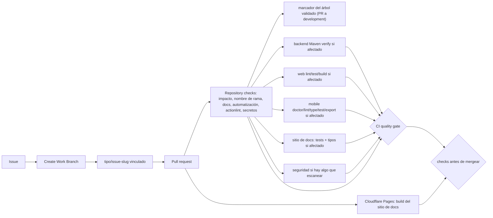
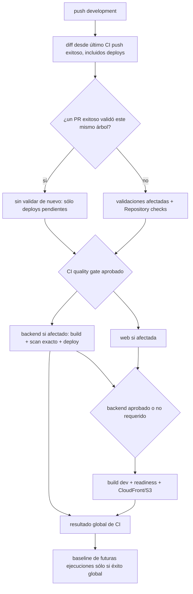
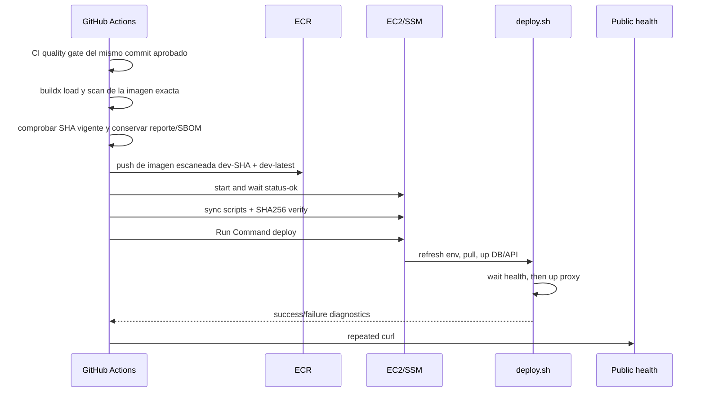
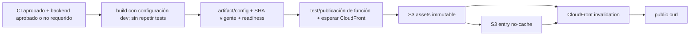
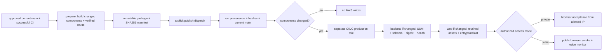

# Diagramas de CI/CD

## Pull request

[Ver diagrama de «Pull request» completo](https://images.vinnot.com/docs/diagrams/v1/es/infra-diagrams-ci-cd-pipeline-ef962cad78b4.svg)

## Coordinación después del merge

[Ver diagrama de «Coordinación después del merge» completo](https://images.vinnot.com/docs/diagrams/v1/es/infra-diagrams-ci-cd-pipeline-267b98187c02.svg)

Los adaptadores verifican la punta remota de development antes de usar credenciales.
Un run reemplazado por uno más nuevo omite sus pasos restantes y termina en verde;
las colas por recurso no interrumpen un deploy activo.

## Backend development deploy

[Ver diagrama de «Backend development deploy» completo](https://images.vinnot.com/docs/diagrams/v1/es/infra-diagrams-ci-cd-pipeline-50abbfcd7c43.svg)

## Web development deploy

[Ver diagrama de «Web development deploy» completo](https://images.vinnot.com/docs/diagrams/v1/es/infra-diagrams-ci-cd-pipeline-b7686f644563.svg)

## Production release

[Ver diagrama de «Production release» completo](https://images.vinnot.com/docs/diagrams/v1/es/infra-diagrams-ci-cd-pipeline-eb4cef1ebc58.svg)
