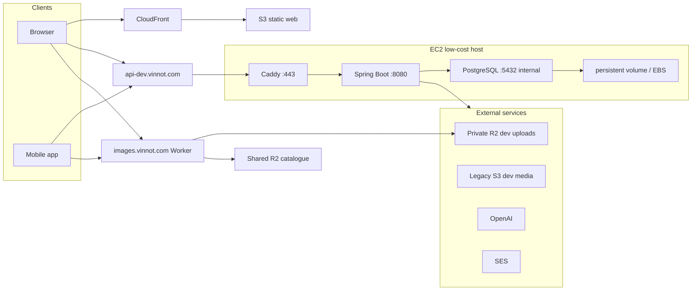
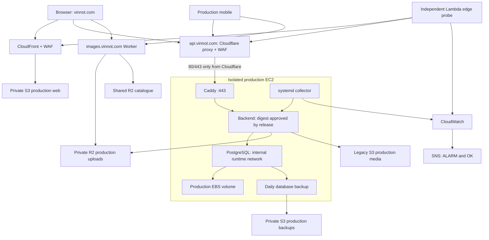
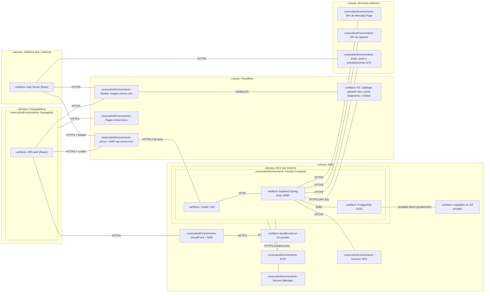
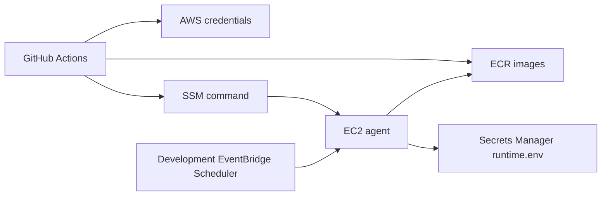
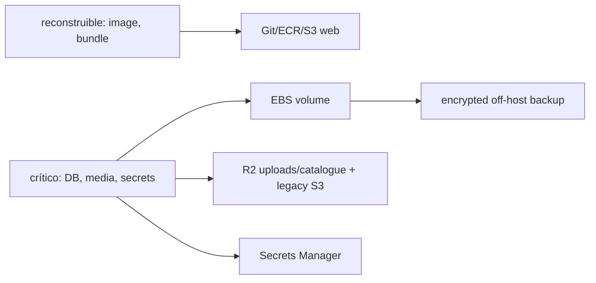

# Mapas de despliegue

## Runtime development

[Ver diagrama de «Runtime development» completo](https://images.vinnot.com/docs/diagrams/v1/es/infra-diagrams-deployment-map-d3b0ca9f359d.svg)

## Runtime productivo aislado

La topología definida en las plantillas productivas tiene host, red, volúmenes,
secretos y almacenamiento separados de development. Desde el 2026-10-30 las
plantillas describen el lanzamiento público: la API pasa por el proxy y el WAF de
Cloudflare, y el security group abre 80 y 443 solo a los rangos de Cloudflare.
Hasta que el responsable aplique el
[runbook](../architecture/aws-deployment.md#poner-cloudflare-delante-de-la-api),
los clientes llegan directo a Caddy. El scheduler de development no detiene este
host. El diagrama describe la configuración, no certifica una
publicación ni una prueba operativa concreta.

[Ver diagrama de «Runtime productivo aislado» completo](https://images.vinnot.com/docs/diagrams/v1/es/infra-diagrams-deployment-map-b2f942e9253e.svg)

## Diagrama de despliegue UML

Muestra en notación de despliegue UML los nodos físicos y de ejecución, los artefactos que corren en cada uno y los protocolos que los comunican. Development y producción repiten el nodo EC2 en hosts separados; se omiten el monitoreo y el plano de control.

[Ver diagrama de «Diagrama de despliegue UML» completo](https://images.vinnot.com/docs/diagrams/v1/es/infra-diagrams-deployment-map-82939a16bbdf.svg)

## Plano de control

[Ver diagrama de «Plano de control» completo](https://images.vinnot.com/docs/diagrams/v1/es/infra-diagrams-deployment-map-5e97f7a29005.svg)

## Frontera de datos

[Ver diagrama de «Frontera de datos» completo](https://images.vinnot.com/docs/diagrams/v1/es/infra-diagrams-deployment-map-5ac92d9ec8c0.svg)

