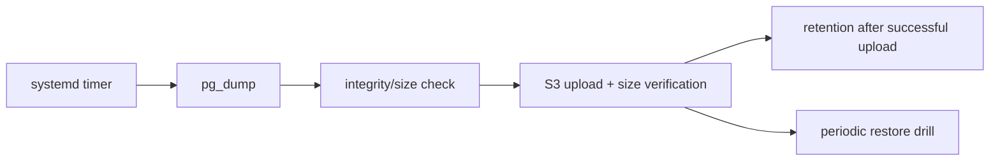

# Backup y recuperación ante desastre

## Activos críticos

| Activo | Fuente | Recuperación |
|---|---|---|
| PostgreSQL | volumen EC2 | dump verificado + recreación Flyway |
| uploads | R2 privado y originales S3 históricos | inventario + copia privada verificada + referencias DB |
| runtime config | Secrets Manager + archivos versionados | regenerar, no copiar secretos en claro |
| backend/web | ECR/Git commit/build | redeploy reproducible |
| DNS/certificados | proveedor + Caddy | runbook de recreación |

Una imagen Docker no es backup de la base. Un dump que nunca se restauró tampoco
es evidencia suficiente.

El dump PostgreSQL guarda referencias e inventarios V27, no los bytes R2. El
timer de base sólo respalda PostgreSQL; no crea un backup automático de objetos
R2. Para recuperar medios, conciliar DB, objetos e inventario usando los
[runbooks de catálogo](catalog-images-r2.md) y [uploads](user-images-r2.md).
Conservar originales/manifiestos privados de una migración y no borrar S3 mientras
sostenga compatibilidad o reversión. Un bucket no sustituye una copia de respaldo.

## Pipeline de backup local

El timer versionado ejecuta `backup-local-db.sh` a las 04:00 UTC (01:00 en
Argentina), con hasta 15 minutos de dispersión. Este horario precede al apagado
programado a las 02:00 de Argentina. `Persistent=true` recupera una ejecución
perdida al arrancar el host; no garantiza que el host permanezca encendido.

En development, el servicio corre como `ec2-user`, con acceso a Docker y a la carpeta de backups,
sin leer `runtime.env`. El script ejecuta `pg_dump` directamente dentro de
`vinnot-dev-postgres-local`; no necesita los secretos de toda la aplicación.
Requiere Bash, Docker, AWS CLI, jq y las utilidades Linux `flock`, `stat` y `date`.
El rol de instancia necesita permisos S3 para subir, consultar metadata, listar
y eliminar objetos del prefijo `database-backups/` según retención.

Un bloqueo no bloqueante evita dos backups simultáneos. El dump custom se escribe
con permisos restrictivos en un archivo parcial; sólo después de comprobar tamaño
no nulo y leer su índice con `pg_restore --list` se publica como `local-*.dump`.
Se sube a S3 y se comprueba ContentLength antes de aplicar retención. Un error
produce salida non-zero. El trap elimina únicamente el parcial de esa ejecución;
un dump final se conserva si falla la subida o su verificación. La comprobación
de tamaño/índice no sustituye una restauración ni un checksum de extremo a extremo.

La política conserva archivos locales según `find -mtime +2` (días completos)
y, en development, elimina objetos remotos anteriores a ocho días. `VINNOT_BACKUP_SKIP_RETENTION=true`
permite un drill sin eliminar copias existentes. El cifrado del bucket y la
alerta de fallos deben verificarse en la configuración del entorno.
Los backups deben salir del mismo host para cubrir pérdida de instancia/volumen.

### Aislamiento productivo

`backup-local-db.sh prod` selecciona explícitamente `/opt/vinnot-prod`, el contenedor
PostgreSQL productivo, la base `vinnot_prod`, el rol de lectura `vinnot_prod_backup`
y el bucket exclusivo de respaldos productivos. Omitir el argumento conserva el
contrato dev; argumentos desconocidos o adicionales se rechazan antes de operar.
`install-systemd-units.sh prod` instala `vinnot-prod-backup.timer` y su servicio,
reutilizando el horario común mediante drop-ins systemd exclusivos. El servicio
productivo corre como root porque el directorio de runtime está restringido a root;
el acceso a la base sigue usando el rol de lectura, no credenciales de la aplicación
ni del propietario.

El lifecycle S3 productivo vence las copias actuales a los 30 días y conserva
versiones reemplazadas durante 30 días desde su reemplazo. Por el versionado, los
datos físicos pueden permanecer más tiempo que la ventana de copias actuales.
El host puede subir y consultar metadata, pero no listar ni borrar respaldos
remotos; únicamente S3 aplica su retención. La retención local sigue siendo de dos
días completos. Omitir retención sólo evita la limpieza local en producción, no
el lifecycle configurado independientemente en el bucket.

El objetivo es una copia diaria externa (RPO nominal de 24 horas) y recuperación
en hasta cuatro horas. La dispersión del timer, fallos y tiempo desde la última
subida correcta pueden aumentar la pérdida real de datos. Son objetivos operativos,
no garantías: supervisar las subidas exitosas y medir la recuperación completa con
un conjunto representativo antes de aceptar el entorno.



[Ver diagrama de «Aislamiento productivo» completo](https://images.vinnot.com/docs/diagrams/v1/es/infra-operations-backup-and-disaster-recovery-e536bdaa4709.svg)

## Procedimiento de restore

1. declarar incidente y congelar writes si aún existe servicio parcial;
2. identificar backup por timestamp/checksum;
3. provisionar PostgreSQL compatible en red aislada;
4. restaurar y ejecutar Flyway/validación de esquema;
5. verificar conteos, constraints, usuario de prueba y flujos críticos;
6. conectar backend, health y smoke tests;
7. cambiar tráfico sólo después de decisión explícita;
8. documentar pérdida temporal real y causa.

Para un drill, usar una base y volumen aislados, sin apuntar una aplicación con
credenciales reales de correo, S3 o proveedores al dump restaurado. Una copia de
`external_effects` puede contener trabajos pendientes: arrancar sus workers puede
reenviar correos o borrar archivos reales. Primero inspeccionar el esquema y
los estados de la cola con SQL de solo lectura; probar reinicios con trabajos
sintéticos y adaptadores sin efectos externos. No reejecutar automáticamente
filas completadas ni vaciar la cola para simular un resultado satisfactorio.

## Recuperación de un despliegue fallido

1. Conservar el digest de la imagen previa, configuración y copia anterior al cambio.
2. Leer `flyway_schema_history` y logs de arranque antes de decidir una acción.
   V17–V19 son migraciones aditivas de sesiones/revisiones y journal durable;
   Flyway no debe ejecutarse manualmente si ya figuran exitosas.
3. Preferir roll-forward para un fallo de aplicación. Restaurar un binario previo
   requiere comprobar su compatibilidad con el esquema y los contratos actuales.
   Una versión que ignore `session_version` o `external_effects` no es un rollback
   seguro aunque pueda arrancar.
4. No borrar filas de Flyway, ejecutar repair ni quitar columnas en una base con
   tráfico como mecanismo de rollback.
5. Restaurar una base sólo con autorización, ventana de mantenimiento y pérdida
   temporal de datos aceptada. Validar la copia antes de cambiar conexiones.

El runbook define el procedimiento; la evidencia de cada drill, versiones,
duraciones y aceptación se conserva fuera de la documentación canónica.

## RPO/RTO

La arquitectura no puede prometer números sin medición. El RPO queda limitado
por frecuencia + copia off-host. El RTO incluye host, imagen, restore, migración,
validación, DNS y cache. Cada drill debe registrar duración fuera de docs
canónicas y actualizar el runbook si revela pasos faltantes.

## Migración desde/hacia RDS

Scripts de migración verifican conectividad, versión, dump/restore y conteos. No
se destruye fuente hasta completar verificación y período de observación. Volver
a RDS es una opción de escalado/HA, no un restore improvisado.

## Criterios de aceptación

- backup automatizado con alerta de fallo;
- copia cifrada fuera del host;
- retención documentada y probada;
- restore trimestral o según riesgo;
- credenciales restauradas desde gestor, no desde dump;
- evidencia de integridad y smoke test;
- owner y escalamiento conocidos.

## Drill local verificable y límite de evidencia

`infra/postgres/restore-inventory.sql` produce únicamente conteos por tabla,
constraints, proyección de búsqueda e historial/checksums Flyway. Capturar ese
inventario dentro de una ventana sin escrituras del backup aprobado; un inventario
posterior con tráfico no representa necesariamente el mismo snapshot.

El siguiente comando requiere dump local, checksum conocido, inventario aprobado
y un ID inmutable de imagen PostgreSQL ya disponible localmente:

```bash
node scripts/verify-isolated-restore.mjs "$DUMP" "$SHA256" "$BASELINE_JSON" "$POSTGRES_IMAGE_ID"
```

El script verifica checksum antes de crear un contenedor, usa `--network none`,
sin puertos, memoria/CPU limitados y credenciales sintéticas. Ejecuta un restore
real con salida ante errores, compara el inventario completo y elimina su propio
contenedor/volumen incluso ante fallo. Nunca arranca backend, outbox, correo o IA.
El reporte contiene tiempos y hashes, no datos de filas. Mantener dump/inventario
fuera de Git y borrar las copias de trabajo según la autorización del ensayo.

Este drill mide base de datos. Para aceptar el RTO integral de cuatro horas,
registrar además recuperación de host/volumen, runtime/secretos, imágenes y objetos
S3 necesarios, Caddy/certificados, health, navegador y eventual conmutación de
tráfico. Validar cuentas controladas y relaciones sin usar cuentas reales como
fixtures. Confirmar destino, permisos, ventana, costo y limpieza antes de ese ensayo.
El RPO nominal sigue siendo 24 horas con copia diaria y retención remota de 30 días.

## Compatibilidad para publicar o recuperar

### Ensayo de aplicación sobre una copia en AWS

El destino temporal debe tener un identificador comprobado antes de enviar comandos
y una segunda guardia dentro del host. Usar disco cifrado con eliminación al terminar,
sin ingress, SSM y un rol limitado a las imágenes y copias elegidas. Programar la
terminación fuera del host antes de restaurar y verificar después la eliminación
de instancia, volumen, reglas, perfil, rol y programación propios.

Esperar PostgreSQL por TCP en loopback: el servidor temporal de inicialización puede
aceptar conexiones Unix antes de apagarse para iniciar el servidor definitivo.
Restaurar bajo el owner sin login, comparar el inventario y ejecutar el runner de
migración separado. Cuando el candidato no agrega migraciones, registrar la
validación sin cambios y medir la espera/liberación de locks; no inventar una
migración ni editar el historial para simularla.

Para arrancar la aplicación sobre datos copiados, usar credenciales sintéticas,
un rol SQL de sólo lectura y una red Docker interna sin puertos publicados.
Desactivar llamadas IA y configurar proveedores locales; diferir los workers de
efectos y eventos más allá de la ventana y desactivar el cron de retención.
La limpieza de soporte puede ejecutarse al iniciar: el rol de sólo lectura impide
que modifique la copia. No basta con desactivar Flyway para impedir efectos externos.
No iniciar sesión con cuentas reales ni reutilizar sus tokens como fixtures.

Comprobar referencias a objetos administrados contra el bucket, además de los
conteos SQL. Si no existen objetos de usuario en la copia, registrar ese alcance;
no presentar archivos operativos como una recuperación de adjuntos. Medir por
separado aprovisionamiento, descarga, restore, migración y health. El ensayo aislado
no certifica DNS, TLS público, conmutación de tráfico ni aceptación física mobile.

### Matriz de contratos

| Contrato | Versión anterior compatible y candidata | Criterio de recuperación |
|---|---|---|
| Web/sesión | Access token en memoria, refresh HttpOnly con origen y header explícitos | Restaurar sesión y logout; no volver a persistir refresh en JavaScript |
| Native/sesión | Bearer y snapshot SecureStore v2 con lectura de claves legacy | Refresh, identidad y logout sin resucitar tokens anteriores |
| Legal | Selección explícita por versión/hash y backend configurado | Plegar el texto no marca aceptación; comprobar flag servidor, no inferirlo de la UI |
| Cava | Lista compatible de 1.000 entradas, consultas internas de hasta 200 | Leer/escribir y comprobar ownership; no recuperar el binario previo al arreglo de esa ventana |
| Esquema | Inventario SQL/checksums exacto; cambios de esquema separados | Sin downgrade, repair ni edición de migraciones aplicadas |
| Efectos externos | Session version, ledger IA y outbox durable preservados | No usar binarios que ignoren esos controles ni arrancar workers sobre copias con proveedores reales |
| Mobile distribuido | Registrar build/canal/runtime instalados y candidato antes de afirmar compatibilidad | Configuración/módulos nativos requieren binario; JS/recursos sólo admiten OTA compatible y expresamente autorizada |

Los ajustes de divulgación legal y presentación no fuerzan un nuevo esquema ni
modifican el contrato de aceptación. No equivalen a una validación nativa física.
