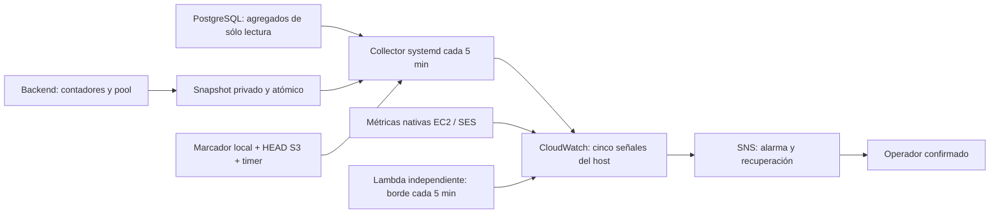

# Observabilidad e incidentes de infraestructura

## Arquitectura y alcance

El monitoreo de bajo costo combina señales agregadas del host con alarmas de
CloudWatch independientes del proceso observado. No consulta cuentas de usuarios,
no genera contenido IA, no ejecuta escrituras de negocio y no envía correos de
prueba por SES. Su canal de aviso es SNS.



[Ver diagrama de «Arquitectura y alcance» completo](https://images.vinnot.com/docs/diagrams/v1/es/infra-operations-observability-and-incidents-def31fb91723.svg)

El código vive en `infra/aws-low-cost/monitoring/`, las unidades en `systemd/`
y la plantilla se genera con `scripts/build-monitoring-stack.mjs`. El collector
sólo admite la cuenta, región e instancia productivas declaradas; comprueba el ID
físico del host y la cuenta STS antes de publicar. El servicio requiere acceso
Docker y ejecuta como root con configuración/estado privados, filesystem de sólo
lectura salvo su directorio de estado, memoria de 128 MiB y cuota de CPU de 10 %.
No debe concederse acceso Docker a usuarios nuevos para usar este procedimiento.

## Señales y umbrales

Las cinco señales del host y `EdgeHealthy` son booleanos: 1 significa que las
comprobaciones de ese grupo pasaron. Los motivos concretos, valores y deltas quedan
en `/var/lib/vinnot-monitor/latest.json`, modo 0600. No se exportan dimensiones por
usuario, ruta, vino, request o excepción a CloudWatch.

| Señal | Condiciones que requieren atención | Diagnóstico inicial |
|---|---|---|
| ServiceHealthy | API/containers no saludables; snapshot mayor a 180 s; al menos 3 errores 5xx y 5 % de requests; 20 % de requests mayores a 5 s con muestra mínima de 10 | health, release, deltas HTTP, proxy |
| ResourcesHealthy | memoria disponible menor a 256 MiB; disco libre menor a 3 GiB; container sobre 90 %; conexiones PostgreSQL sobre 80 %; pool sin métricas, espera o timeout | memoria, disco, conexiones y pool |
| BackupHealthy | copia no comprobable/cifrada, antigüedad mayor a 30 h, fallo de servicio o timer inactivo | timer, servicio, marcador y HEAD S3 |
| EffectsHealthy | tarea con 10 intentos agotados; siguiente intento vencido hace más de 30 min; fallo transaccional de email | metadatos del outbox y SES |
| AiHealthy | error/timeout/429/cuota del proveedor; fallo de admisión; gasto reservado más consumido sobre 80 % de USD 8; reserva pendiente/desconocida mayor a 1 h | contador por causa y ledger |
| EdgeHealthy | fallo de sondeo independiente, ausencia de publicación o respuesta incompatible con el modo | DNS, certificado y acceso externo |
| EC2 StatusCheckFailed | fallo de sistema/instancia | estado EC2 y eventos del host |
| EC2 CPUCreditBalance | menos de 12 créditos durante tres períodos | carga sostenida y créditos en modo Standard |
| SES delivery | Bounce, Reject o Complaint mayor a cero | reputación/supresión y rechazo de entrega de toda la cuenta |

Estos valores están en `config.example.json` y en el generador de alarmas. El
margen de disco permite conservar copias locales y preparar artefactos sin esperar
al llenado; el margen de RAM reserva capacidad para host/proxy y operaciones. Los
12 créditos representan aproximadamente seis minutos a dos vCPU completamente
ocupadas, antes de considerar créditos nuevos. Ajustar umbrales requiere medición
y revisión; no habilitar Unlimited ni aumentar instancias como reacción automática.

CloudWatch evalúa períodos de 300 s, normalmente dos incumplimientos de tres;
créditos exige tres de tres. IA, efectos y SES notifican con un período. Una señal
custom o EC2 ausente se considera incumplimiento: un host, collector o sondeo
muerto no conserva artificialmente el estado saludable. SES sin eventos se trata
como normal. El canal envía tanto ALARM como OK; el tiempo de aviso depende del
muestreo y evaluación, no es instantáneo.

Los contadores de HTTP/proveedor son acumulados por proceso. El collector calcula
deltas entre snapshots consecutivos del mismo proceso separados por hasta 900 s;
un reinicio o primer muestreo establece una nueva base.
La frescura del snapshot se evalúa con la hora de finalización de la colección:
el backend puede actualizarlo mientras se leen las otras señales. La edad del
backup incluye ese tiempo de colección; los snapshots futuros o vencidos siguen
rechazándose.

La latencia es una tasa de requests mayores a 5 s y una suma de duración, no un p95
inventado. Los checks de
health, OPTIONS y documentación omitidos por el filtro no inflan los contadores.
Los timeouts se distinguen de respuestas válidas sin coincidencias funcionales.

## Modos de la sonda y disponibilidad externa

La sonda tiene dos modos, elegidos con el parámetro `AcceptanceMode` del stack:

| Modo | Cuándo se usa | Qué exige |
|---|---|---|
| `public` (predeterminado) | El sitio está lanzado | Web 200 y API `/api/actuator/health` 200 con `status=UP`. Verifica TLS, limita la respuesta y rechaza redirecciones. |
| `private` | Sólo si el sitio se cierra al público a propósito | Rechazo 403 del borde web y resolución DNS de la API. **No certifica el recorrido externo de la API ni el contenido detrás de la restricción.** |

Producción está lanzada, así que el modo correcto es `public`. Al actualizar un stack
existente, `aws cloudformation deploy` conserva el valor anterior de un parámetro que no
pases: pasa `AcceptanceMode=public` explícito, como indica
[Aplicar la alineación de lanzamiento público](../architecture/aws-deployment.md#aplicar-la-alineación-de-lanzamiento-público).
El modo cambia siempre junto con el acceso; no abras security groups ni WAF para que pase
el monitor. La salud interna se comprueba en el host y la pérdida del host se detecta
desde CloudWatch. Un health UP no prueba precisión del escáner.

El sondeo tiene una única programación cada cinco minutos, timeout de 20 segundos
y eventos con edad máxima de 60 segundos, sin reintentos de EventBridge ni Lambda.
Usa la concurrencia no reservada disponible de la cuenta: no exige aumentar cuotas
ni reservar capacidad en cuentas con límites reducidos. No tiene URL de función
ni permiso de invocación público.

## Instalación y permisos

1. Inventariar alarmas, métricas, SNS, presupuesto y recursos existentes. Revisar
   los destinatarios y el costo marginal antes de crear el stack.
2. Generar y validar la plantilla:

   ```bash
   node scripts/build-monitoring-stack.mjs /tmp/vinnot-monitoring-stack.json
   aws cloudformation validate-template --template-body file:///tmp/vinnot-monitoring-stack.json
   ```

3. Aplicar el stack revisado con `OperatorEmail` confirmado; el modo predeterminado es `public`.
   Requiere `CAPABILITY_IAM`: añade al rol existente del host únicamente
   `cloudwatch:PutMetricData` para `Vinnot/Production`; crea un rol de Lambda para
   esa misma publicación y escritura en su log group concreto. No concede secretos,
   backups, SSM remoto ni administración IAM al monitor. SNS sólo acepta avisos de
   alarmas `vinnot-prod-*` de esta cuenta. El destinatario debe confirmar la
   suscripción recibida por correo.
4. Publicar por el flujo productivo el backend con `OperationalSnapshotWriter` y
   comprobar `/tmp/vinnot-operations.json` dentro del container. El archivo es
   agregado y privado; no contiene claves ni payloads.
5. Transferir los archivos revisados con checksum, conservando la estructura de
   `infra/aws-low-cost/`, y ejecutar como operador en el host:

   ```bash
   bash install-production-monitoring.sh --activate
   systemctl status vinnot-prod-monitor.timer --no-pager
   systemctl show vinnot-prod-monitor.service -p Result -p ExecMainStatus
   cat /var/lib/vinnot-monitor/latest.json
   ```

El instalador conserva una configuración operadora existente. El collector no lee
`runtime.env` ni Secrets Manager. Consulta PostgreSQL por el rol de backup existente
y usa HEAD del objeto concreto; no lista ni elimina copias. `backup-local-db.sh`
actualiza `backups/last-success.json` sólo después de validar archivo y tamaño remoto.
En la primera instalación, `adopt-production-backup-marker.sh` valida el archivo
local más reciente con `pg_restore --list`, HEAD, tamaño y cifrado, antes de crear
el marcador. El collector toma la fecha más antigua entre el timestamp del archivo y S3;
volver a subir una copia vieja no rejuvenece su punto de recuperación. La adopción
no crea otra copia ni sustituye
un marcador existente. Sin copia verificable no se activa el monitor; no fabricar
un timestamp para conseguir verde.

## Respuesta y recuperación

1. Confirmar grupo, inicio y alcance; registrar responsable e identificador de
   incidente en el registro privado. Leer el snapshot y el estado de alarmas.
2. Correlacionar último deploy, request IDs opacos y logs acotados. No copiar
   credenciales, payloads, direcciones de correo o imágenes a un incidente.
3. Para caída: comprobar estado EC2, containers, proxy, API y DB; usar el
   [procedimiento de publicación](../guides/deployment.md) y la
   [recuperación](backup-and-disaster-recovery.md). Un aviso no autoriza reinicio,
   rollback, restore ni conmutación de tráfico sin diagnóstico y alcance acordado.
4. Para recursos: identificar consumidores, consultas y conexiones antes de
   cambiar límites; preservar volúmenes/copias. No borrar datos para liberar espacio.
5. Para backup: revisar Result/ExecMainStatus/timer y el objeto cifrado; diferenciar
   dump fallido de upload fallido. Confirmar si la operación sigue activa antes de
   reintentar. Registrar aparte fecha, revisión, destino y alcance del último
   restore realmente probado; edad de copia no demuestra restaurabilidad.
6. Para IA: conservar ledger y cachés, revisar causa y reservas. El corte
   `AI_PAID_CALLS_ENABLED=false` y los límites de recursos existentes frenan nuevas llamadas;
   aplicarlo mediante el procedimiento controlado de configuración. No borrar
   reservas ni aumentar USD 8 productivos para apagar una alerta. El ledger no mide
   llamadas hechas fuera de la aplicación con la misma clave.
7. Para correo: distinguir las solicitudes rechazadas por SES de los rebotes,
   las quejas y las entregas ambiguas.
   Inspeccionar SES y supresión; SNS sigue independiente de SES. No reenviar a
   destinatarios reales para probar la reparación.
8. Verificar recuperación: muestras saludables, aviso OK y flujo afectado real en
   el alcance autorizado. Registrar causa, medida y prevención.

## Outbox y reintento seguro

`python3 /opt/vinnot-monitor/effects.py` muestra hasta 100 filas de metadatos,
sin payload ni deduplication key. Un reintento explícito requiere ID UUID, intentos
y `next_attempt_at` observados:

```bash
python3 /opt/vinnot-monitor/effects.py --retry-storage-id "$TASK_ID" \
  --expected-attempts 10 --expected-next-at "$OBSERVED_NEXT_ATTEMPT"
```

Sólo admite las cuatro limpiezas de storage con checks de referencias existentes.
La actualización compara ID, tipo, intentos y fecha, con timeout y lock acotados;
no modifica una tarea reclamada/cambiada y repetir el comando no vuelve a resetearla.
El worker conserva su límite de lote, `SKIP LOCKED` y backoff. El comando utiliza el
rol runtime ya existente únicamente para esa actualización. Email queda excluido:
SES y el commit DB no forman una transacción y no hay garantía de exactly-once.
Una entrega ambigua requiere investigación del operador, nunca replay automático.
Las filas de notificación muestran solo `notification_type` y `last_error_type`;
las agotadas se borran a los 30 días de creadas.

## Rebotes y quejas de correo

`infra/aws-low-cost/email-feedback-stack.json` crea, por entorno, el configuration
set de SES `vinnot-<env>`, el tópico SNS y la cola SQS
`vinnot-<env>-email-feedback` con su cola de mensajes fallidos, la alarma
`vinnot-<env>-EmailFeedbackDeadLetters` y una política IAM sobre
`vinnot-<env>-low-cost-host-role` que permite solo esa cola y `ses:SendEmail` por
ese configuration set.

Despliegue, por entorno (primero dev), con una sesión AWS de operador:

1. Confirmar que existe el rol del host: `aws iam get-role --role-name vinnot-<env>-low-cost-host-role`.
2. Desplegar: `aws cloudformation deploy --region us-east-1 --stack-name vinnot-<env>-email-feedback
   --template-file infra/aws-low-cost/email-feedback-stack.json --capabilities CAPABILITY_NAMED_IAM
   --parameter-overrides Environment=<env> AlarmTopicArn=<tópico de operaciones o vacío>`.
3. Comprobar que las salidas coinciden con `EMAIL_SES_CONFIGURATION_SET` y
   `EMAIL_FEEDBACK_QUEUE_URL` del archivo Compose y luego desplegar el backend. El
   stack debe existir antes: sin su política IAM, enviar por el configuration set
   se deniega y falla todo el correo.
4. Una vez por cuenta, activar la supresión de la cuenta SES:
   `aws sesv2 put-account-suppression-attributes --suppressed-reasons BOUNCE COMPLAINT`
   (verificar con `aws sesv2 get-account`).
5. Verificar con el simulador de SES (`bounce@simulator.amazonses.com`,
   `complaint@simulator.amazonses.com`), nunca con un destinatario real: una fila
   en `email_suppressions` por dirección y la cola de mensajes fallidos vacía.

Reversión: quitar ambas variables del archivo Compose y redesplegar el backend;
después borrar el stack. Las supresiones ya registradas quedan en la base.

Los mensajes fallidos son eventos de SES que el backend no pudo leer. Revisarlos
en la consola de SQS; contienen direcciones de destinatarios, así que no copiarlos
a incidentes. Purgarlos una vez corregida la causa.

## Responsable, canales y aceptación

La instalación exige destinatario confirmado, responsable, horario de atención y
escalamiento acordados, conservados en el registro operativo privado. No se deduce
una guardia 24/7 de que las alarmas estén activas. Ante ausencia de suplente, el
responsable único registra el riesgo y la ventana de atención antes de la salida.
Las comunicaciones a usuarios se realizan por el responsable, con impacto y estado
confirmados, sin publicar detalles sensibles ni prometer un plazo no medido.

La prueba de aceptación tiene tres capas: fallos sintéticos de servicio, backup y
outbox con recuperación en los tests; datos publicados y transiciones ALARM/OK en
CloudWatch; confirmación de recepción por el destinatario. Probar el canal usando
una alarma temporal dedicada y namespace de ensayo, nunca deteniendo la API ni
inyectando filas de prueba en producción. Retirar alarma/métrica emisora temporal
y conservar evidencia privada. `set-alarm-state` prueba la notificación, pero no
sustituye probar el evaluador con muestras que crucen el umbral.

## Retención, privacidad y costo

Docker conserva logs locales de hasta `10m` por archivo y tres archivos por
container; no constituye un archivo centralizado. El log de Lambda retiene siete
días y sólo registra scope/resultado/tipo de fallo. El collector guarda última
muestra y baseline locales, privados. Actuator básico sigue público; detalles de
health y demás endpoints operativos requieren ADMIN. OpenAPI/Swagger describen el
contrato de la API y piden email y contraseña de una cuenta ADMIN; su presencia
no demuestra exposición de secretos. Una línea WARN
"Daily catalog quota exhausted; account locked" indica que una cuenta se
bloqueó automáticamente por leer el catálogo de forma masiva.

El stack tiene seis series custom de cardinalidad fija y nueve alarmas (la alarma
SES evalúa tres métricas). No crea instancias, balanceadores, NAT, dashboards pagos
ni almacenamiento de logs de aplicación central. Revisar franquicias y precios de
[CloudWatch](https://aws.amazon.com/cloudwatch/pricing/),
[Lambda](https://aws.amazon.com/lambda/pricing/) y [SNS](https://aws.amazon.com/sns/pricing/)
al aplicar. El presupuesto AWS existente se reutiliza; es una alerta y no un corte
ni una factura máxima garantizada. Las estimaciones y el consumo observado se
mantienen en el registro privado.

## Pruebas y trazabilidad

- `scripts/test/production-monitoring.test.mjs` ejecuta política/collector/sondeo
  con fixtures, recuperaciones y restricciones de permisos/topología.
- `ProductionDatabaseRolesPostgresIntegrationTest` ejecuta el SQL real del monitor
  y del reintento contra PostgreSQL migrado y roles reales.
- Los tests de backend cubren archivos privados/atómicos, Actuator, clasificación
  de fallos IA/SES y contadores sin datos personales.
- Las pruebas de backup verifican que un upload fallido no avance la copia válida.
