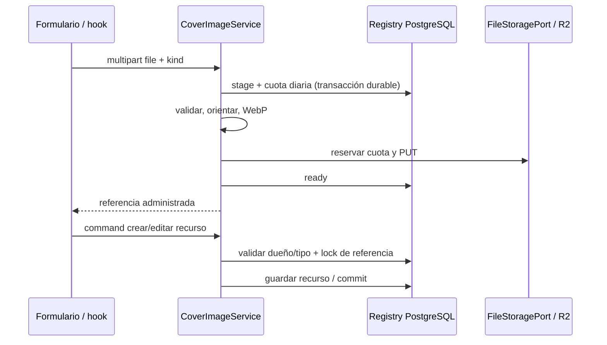

# Imágenes de usuarios: WebP y R2

## Capas y composición

`FileStoragePort` conserva los contratos de avatar y etiqueta. `R2FileStorageService` implementa nuevas escrituras WebP cuando `app.storage.provider=r2`; `R2StorageConfiguration` compone un cliente S3 compatible con R2 y un adapter AWS separado para las referencias antiguas. El proveedor predeterminado de los compose sigue siendo S3. Las credenciales R2 se reciben exclusivamente en backend, mediante el secreto runtime; nunca forman parte del bundle web/Expo.

`ImageOptimizationPort` separa procesamiento y almacenamiento. `WebpImageOptimizer` valida MIME real, hasta 8 MiB de entrada y 24 millones de píxeles antes de decodificar, aplica orientación EXIF, normaliza a sRGB/ARGB y conserva transparencia. Invoca `cwebp` por argumentos fijos, sin shell, con calidad 85, método 3, memoria reducida y `-metadata none`; la imagen reconstruida no copia metadata del original. GIF produce una foto del primer frame. El Dockerfile y CI instalan el encoder `webp`; el desarrollo local requiere `cwebp` en PATH o `app.uploads.webp-encoder` con su ruta.

| Uso | Lado máximo | Bytes máximos de salida |
|---|---:|---:|
| Avatar | 512 px | 128 KiB |
| Etiqueta | 1600 px | 512 KiB |
| Portada | 1600 px | 512 KiB |

No se agrandan originales. Dos trabajos concurrentes y diez segundos por encoder limitan recursos; saturación, fallo o ausencia del encoder devuelve un error de servicio disponible para reintento. Una salida que excede el límite se rechaza; no se genera una segunda variante automática. El procesamiento temporal del escáner conserva su contrato; identificar un vino existente no guarda su foto por esta implementación.

## Organización y entrega

| Contenido | Clave R2 | Entrega |
|---|---|---|
| Catálogo argentino | `wines/ar/{UUID}/{SHA}.webp` | Bucket compartido `vinnot-catalog-images`, Worker |
| Avatar | `uploads/{environment}/avatars/avatar_{owner}_{UUID}.r2.webp` | Worker, caché pública 60 s |
| Etiqueta aprobada/pública | `uploads/{environment}/wine-labels/wine_label_{UUID}.r2.webp` | Worker, caché pública 60 s |
| Etiqueta en cuarentena | `uploads/{environment}/quarantine/wine_label_{UUID}.r2.webp` | API administrativa autorizada, sin caché |
| Portada de evento | `uploads/{environment}/events/{UUID}.webp` | API con visibilidad de recurso, sin caché |
| Portada de ruta | `uploads/{environment}/wine-routes/{UUID}.webp` | API con visibilidad de recurso, sin caché |
| Placa o ilustración de redes | `uploads/{environment}/social/posts/{UUID}/{instagram\|tiktok}-NN-{hash}.jpg` o `…/hero-{hash}.png` | Worker, `image/jpeg` o `image/png`, caché inmutable de un año |

Los uploads usan buckets separados `vinnot-user-uploads-dev` y `vinnot-user-uploads-prod`; el catálogo mantiene una única copia y URLs iguales para ambas bases. R2 directo público/r2.dev permanecen deshabilitados. `wrangler.jsonc` sólo declara el catálogo; `wrangler.uploads.jsonc` añade los bindings `DEV_UPLOADS` y `PROD_UPLOADS` y es la configuración que se despliega (ver [Despliegue del Worker](catalog-images-r2.md#despliegue-del-worker)). El Worker admite sólo GET/HEAD/OPTIONS y formatos de clave explícitos; no expone escritura, listados, cuarentena ni portadas. No realiza transformaciones pagas.

La retirada de avatar/etiqueta borra el objeto mediante la cola existente; una copia pública ya cacheada puede persistir hasta 60 s. El catálogo usa TTL anual inmutable. Las portadas reciben `Cache-Control: no-store`, y mobile desactiva la caché de disco para `/uploads/covers/` y las nuevas URLs públicas R2 de usuarios. Las copias ya descargadas por dispositivos/versiones antiguas no se pueden retirar remotamente. El tráfico de portadas atraviesa la API para comprobar privacidad; el almacenamiento R2 no elimina ese tráfico/costo del backend.

## Subida y referencia de portada

`POST /uploads/covers` recibe multipart `file` y `kind=EVENT|WINE_ROUTE`. La identidad proviene del principal autenticado. Requiere permisos EVENT_CREATE/UPDATE/UPDATE_OWN o WINE_ROUTE_CREATE/UPDATE/UPDATE_OWN según tipo. Devuelve `id`, `imageUrl`, `width`, `height`, `size`; `imageUrl` es `/api/uploads/covers/{UUID}.webp`.

`CoverImageService` registra primero la intención durable y reserva la cuota diaria antes del procesamiento; luego optimiza, almacena bytes y marca `ready`. Sólo después entrega la referencia utilizable. Los commands propietarios validan tipo y dueño/staff; una referencia existente se retiene con bloqueo de fila. El lock se mantiene en la transacción del recurso y serializa contra la limpieza. No se descargan URLs externas suministradas por usuarios.

`GET /uploads/covers/{UUID}.webp` reevalúa acceso: dueño de una subida no asociada, staff, organizador/creador del recurso o lector público del recurso visible. Eventos son públicos después de publicación cuando su estado no es DRAFT; rutas sólo en PUBLISHED. Una portada no lista o inaccesible responde 404. El frontend usa un preview autenticado para borradores, sin enviar tokens a hosts externos. Tarjetas y detalles también resuelven portadas administradas por el hook de presentación y el servicio autenticado; las URLs antiguas conservan la entrega nativa sin esa consulta adicional. Los selectors muestran subida/error, conservan la referencia anterior tras fallo y bloquean guardar mientras sube. Cancelar/cerrar evita aplicar respuestas tardías.



[Ver diagrama de «Subida y referencia de portada» completo](https://images.vinnot.com/docs/diagrams/v1/es/infra-operations-user-images-r2-139abf986156.svg)

## Integridad, cuotas y recuperación

V27 añade `storage_operation_budgets`, `managed_cover_images` y `r2_avatar_inventory`. Reservas de operación/bytes y el inventario sobreviven al rollback de una operación de negocio. PUT usa `If-None-Match:*`; un reintento con la misma clave sólo se admite tras verificar bytes idénticos. El cliente usa direccionamiento por path y desactiva chunked encoding y checksums opcionales específicos de AWS para compatibilidad R2; no solicita cifrado AES256 exclusivo del adapter S3. No hay reintentos automáticos de SDK. Los timeouts son 3 s conexión, 10 s socket, 12 s intento y 15 s llamada.

Por entorno: 512 MiB de bytes reservados conservadoramente, 5000 escrituras/mes y 100000 lecturas API R2/mes. Copias de promoción y fallos ambiguos consumen reservas; borrar no devuelve saldo automáticamente. Avatares y portadas reservan además hasta 20 subidas por usuario/día UTC antes de procesar la imagen; portadas tienen un bucket HTTP independiente `media-upload` con los límites configurados para incorporaciones de vinos (por defecto 10/día), sin compartir sus contadores; etiquetas conservan sus cuotas del flujo de incorporación y el límite global. La contabilidad requiere PostgreSQL y corta nuevas operaciones si falla o se agota la asignación. Limpieza DELETE conserva capacidad independiente. Las placas e ilustraciones de redes no usan los 512 MiB: reservan su propio cupo mensual de bytes (`APP_STORAGE_R2_SOCIAL_MAX_MONTHLY_BYTES`, 1 GiB por defecto, como máximo 4 GiB) más una escritura del cupo mensual compartido, porque se reemplazan con cada edición del texto; cada objeto pesa hasta 5 MB y se escribe una sola vez. Las reemplazadas se borran con `social-media-cleanup` solo si ninguna publicación ni job pendiente las usa.

El presupuesto Cloudflare se evalúa agregado: catálogo, ambos entornos, migración, lecturas y Worker. Los contadores backend no cuentan lecturas públicas del Worker ni otros clientes. Workers Free tiene su propia cuota; la alerta USD 5 es un aviso, no un corte de facturación. No elevar límites, cambiar planes o activar transformaciones pagas sin volver a dimensionar el consumo.

`TransactionalFileStorageAdapter` conserva outbox para avatar/etiqueta. Portadas abandonadas y reemplazadas se reconcilian después de dos horas; `ManagedCoverMaintenance` agenda diariamente hasta 100 huérfanos, incluidos recursos eliminados por cascada. La limpieza bloquea la fila y vuelve a verificar referencias antes de borrar. Las URLs antiguas mantienen lectura/borrado a través del adapter S3; no se eliminan buckets/objetos históricos por activar R2.

## Activación y reversión

1. Crear cada bucket privado Standard y una credencial backend con acceso de objetos limitado a su bucket; guardar en el secreto runtime del entorno. No reutilizar el token temporal de migración.
2. Configurar `APP_STORAGE_R2_ACCOUNT_ID`, `APP_STORAGE_R2_ACCESS_KEY_ID`, `APP_STORAGE_R2_SECRET_ACCESS_KEY`, `APP_STORAGE_R2_BUCKET`; el compose fija environment, dominio público y cuotas. Mantener S3 existente para lectura histórica.
3. Aplicar V27 con el runner/roles de migración del entorno. Desplegar el candidato probado e instalar bindings del Worker con `wrangler.uploads.jsonc`; comprobar que todas las rutas privadas devuelven 404 en Worker.
4. Activar `APP_STORAGE_PROVIDER=r2` inicialmente en development. Verificar avatar, incorporación/etiqueta, evento/ruta privado y publicado, reemplazo, borrado y referencias históricas. Medir memoria/CPU del encoder en el host antes de promover.
5. La activación del proveedor es independiente de cambiar el catálogo: las mismas URLs del lote argentino se reutilizan sin otra carga.

Para detener nuevas escrituras, configurar `APP_STORAGE_R2_WRITES_ENABLED=false` y mantener el adapter R2 con sus bindings/credenciales: sigue leyendo las URLs existentes. Volver a S3 ciegamente puede perder lectura de cuarentena y portadas R2, aunque el Worker conserve avatares/etiquetas públicas. Una reversión de aplicación conserva V27 y exige versión compatible con ambos proveedores; nunca hacer downgrade destructivo ni borrar objetos como rollback.

Antes de migrar archivos históricos: inventario de referencias y efectos pendientes, backup/manifiesto privado, dry-run y actualización CAS por recurso, verificación de cuerpos/URLs y ventana de reversión. No copiar cuentas, medios privados o catálogo entre entornos. No retirar S3 hasta conciliar referencias y versiones instaladas. La promoción de una etiqueta antigua en cuarentena lee el original legado, lo optimiza y publica en R2; no vuelve a escribir su copia pública en S3.

### Migración acotada de uploads históricos

El CLI `user-media-release` del paquete `scripts/wine-images` procesa avatares propios y etiquetas públicas administradas. `plan` sólo lee DB/S3: guarda originales, WebP y un manifiesto con hashes en un directorio privado. Rechaza orígenes externos, catálogo, propietarios inconsistentes, más de 100 referencias, portadas legacy o cuarentenas que necesiten otro mapeo. La configuración privada contiene `database_url`, `aws_profile`, `r2_account`, `r2_access_key` y `r2_secret_key`; el perfil AWS resuelve credenciales temporales mediante AWS CLI.

```sh
user-media-release plan --environment development --config /private/dev-media.json --directory /private/dev-media-run
user-media-release stage --environment development --config /private/dev-media.json --directory /private/dev-media-run --manifest-sha SHA
user-media-release apply --environment development --config /private/dev-media.json --directory /private/dev-media-run --manifest-sha SHA
user-media-release rollback --environment development --config /private/dev-media.json --directory /private/dev-media-run --manifest-sha SHA
```

`stage` consume las mismas reservas durables conservadoras que el backend, escribe con `If-None-Match:*` y relee cada objeto para verificar contenido/MIME. Comprobar también las URLs públicas antes de `apply`. `apply` bloquea y compara cada referencia esperada: cualquier reemplazo/eliminación concurrente revierte todo el lote. Actualiza el inventario de avatares y la revisión del vino; una segunda ejecución coincidente cambia cero filas. `rollback` restaura sólo referencias que todavía coinciden con el resultado de ese manifiesto. Los originales S3 se conservan para las URLs antiguas y reversión; esta herramienta no borra objetos ni buckets. Respaldar el directorio fuera de `/tmp` antes de cerrar la operación. Usar un manifiesto y credenciales de destino propios por ambiente; no copiar medios entre ellos.

Las pruebas `test_user_media_postgres.py` requieren `USER_MEDIA_TEST_DATABASE_URL` apuntando a un PostgreSQL aislado llamado `vinnot`; crean y eliminan un esquema exclusivo. Cubren commit atómico, idempotencia, reversión, conflicto concurrente, integridad, efectos pendientes y cuotas. Nunca ejecutarlas contra development o producción.

### Aprobación y consultas opcionales de catálogo

Las tres consultas de candidatos de etiqueta del adapter de vinos usan transacciones de lectura independientes. Un timeout PostgreSQL revierte sólo esa consulta y permite continuar con candidatos válidos ya obtenidos, conservando la transacción y el bloqueo de aprobación. Si ninguna búsqueda produjo evidencia utilizable, se mantiene el error de indisponibilidad: no se interpreta el timeout como ausencia de duplicados. No cambia SQL, ranking ni filtros. La operación puede necesitar una conexión adicional temporal del pool; conservar los límites y timeouts existentes.

## Validación reproducible

`mvn verify` cubre `WebpImageOptimizerTest`, `RasterOrientationTest`, `R2FileStorageServiceTest`, `CoverImageServiceTest` y `ManagedImagesPostgresIntegrationTest` y `SessionAccessHttpPostgresIntegrationTest` con PostgreSQL real y seguridad HTTP en Testcontainers. `node --test infra/cloudflare/catalog-images/worker.test.mjs` verifica aislamiento, claves privadas, caché y métodos. Suites web/mobile incluyen servicios, transporte, edición cancelada y errores de subida; arquitectura, lint, tipos y documentación conservan sus gates existentes.

El catálogo argentino reutiliza una sola copia y las mismas URLs en ambas bases.
Su promoción productiva es una operación de mapeo separada del proveedor de
uploads, con snapshots, manifiesto, dry-run y journal según el
[runbook de catálogo](catalog-images-r2.md); no requiere otro build u OTA.

## Configuración activa, credenciales y comprobación

Los entornos usan buckets privados distintos para uploads, proveedor R2 y V27;
el catálogo conserva una única copia compartida. Los Compose mantienen S3 como
default de compatibilidad: activar R2 requiere configuración explícita de runtime.
Los originales S3 históricos se conservan para URLs antiguas y reversión.
Activar uploads de usuarios no aplica por sí solo el mapeo del catálogo argentino.

Las credenciales backend actuales limitan objetos a su bucket y vencen el
**3 de enero de 2027**. Rotarlas antes del vencimiento, actualizar el secreto,
materializar la configuración y verificar cada entorno. La alerta agregada de
USD 5 no es un corte de facturación; las cuotas y Workers Free son los controles
vigentes. No publicar valores en documentación, frontend o logs.

Para comprobar una entrega: revisión API/web y health, provider/encoder/V27,
lectura de una URL histórica y WebP nuevo, reemplazo/retirada, cuarentena y
visibilidad de portadas. Bearer vencido debe devolver 401; un borrador sin acceso,
404; dueño con sesión vigente, 200. Verificar el manifiesto y los bytes realmente
servidos por Expo para plataforma/canal/runtime y comparar con el export limpio.
Un merge, un bundle exportado o una OTA publicada no sustituyen estas lecturas.

La aceptación interactiva usa un cliente nativo compatible y verifica avatar,
etiqueta aprobada, portadas evento/ruta, reemplazo, retirada y fallback. Registrar
si fue emulador o dispositivo físico; no atribuir pruebas de OCR/IA paga a una
aceptación de presentación con fixtures. El SHA activo, grupos OTA, manifiestos,
cuentas descartables, backups y evidencia de cada corrida quedan en el archivo
operativo privado, fuera de Git. Conciliar y retirar fixtures al terminar.
