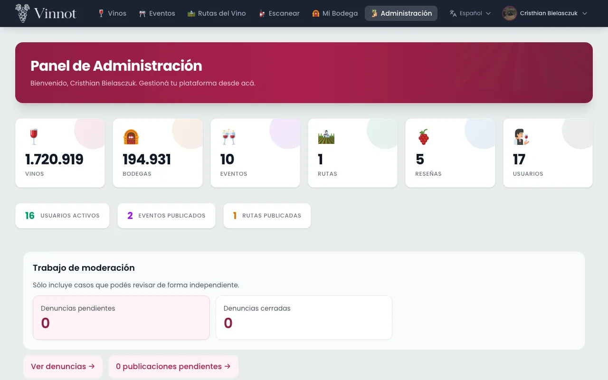
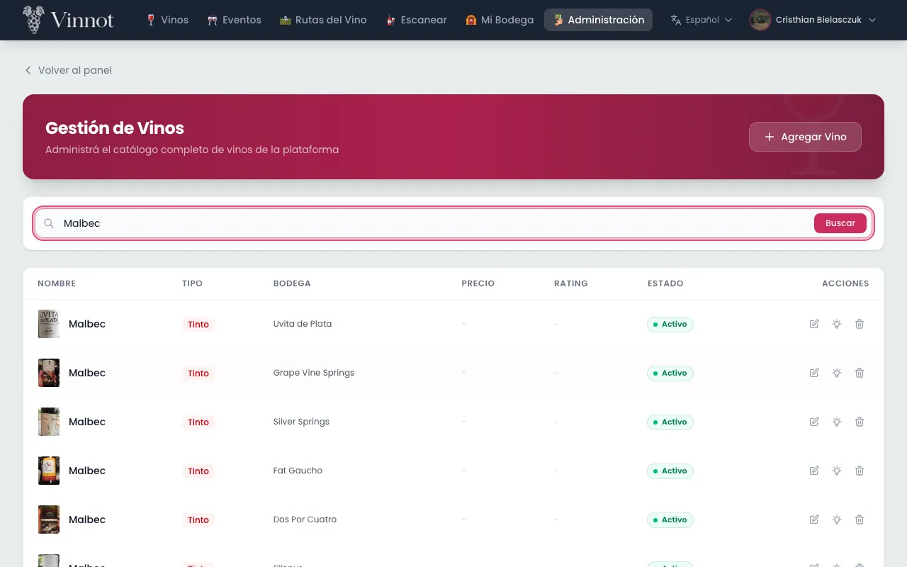
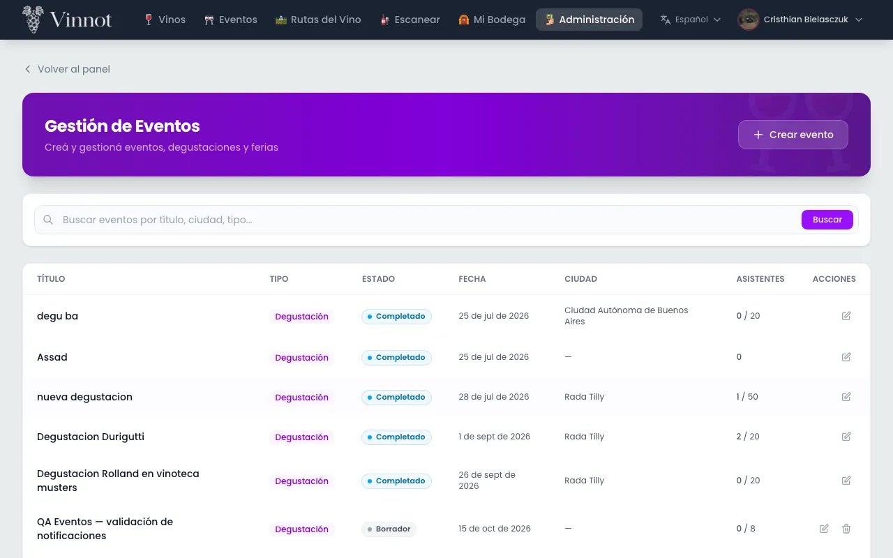
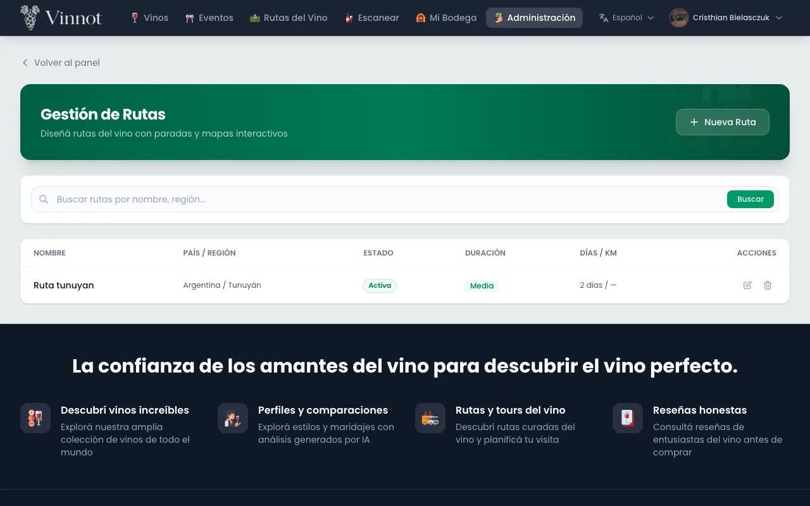
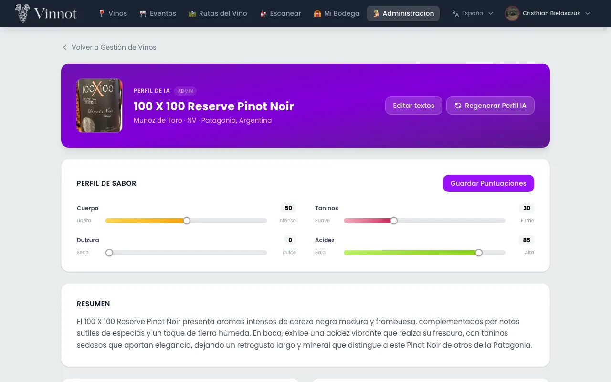
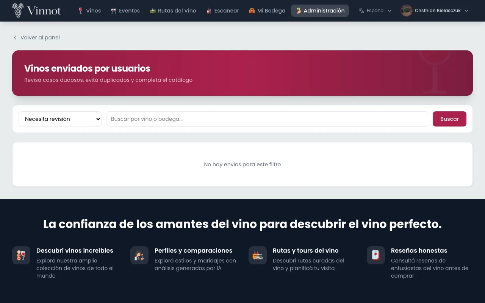
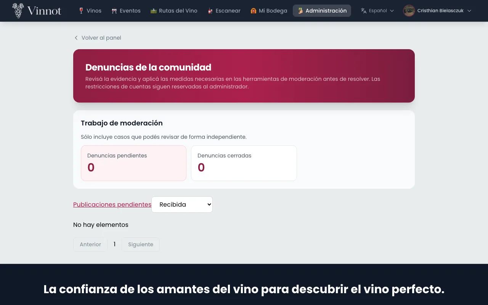
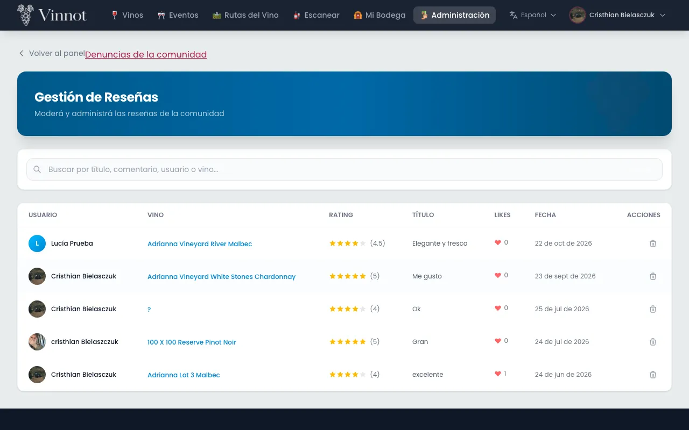
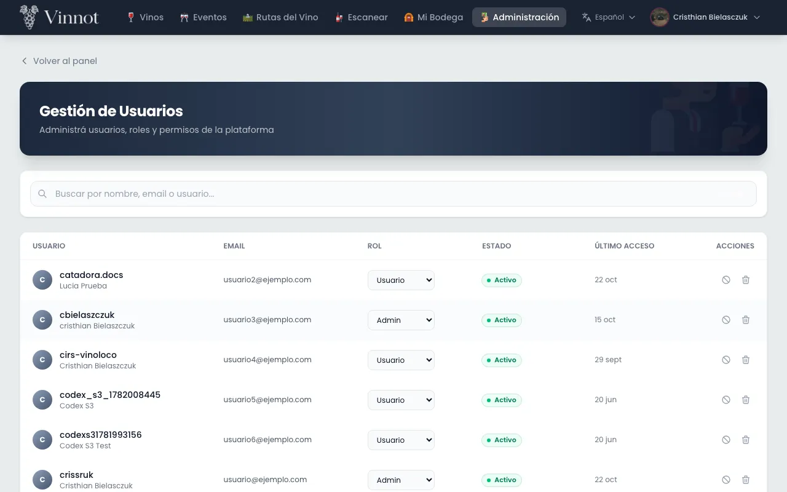
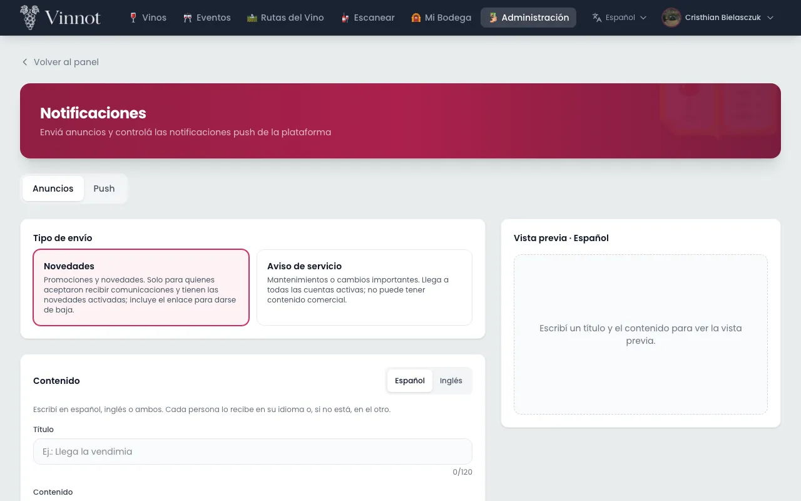

# Manual de administración y moderación

Este manual es para el equipo de Vinnot con rol de moderador o de administrador. Explica
cómo usar el panel de administración en la web (`/admin`) y la sección «Administración»
de la app: gestionar el catálogo, revisar lo que envía la comunidad y, en el caso de los
administradores, gestionar cuentas y comunicaciones.

Las secciones marcadas como **Solo administradores** no aparecen para los moderadores.

## Contenido

- [Roles y acceso](#roles-y-acceso)
- [Confirmar tu identidad](#confirmar-tu-identidad)
- [Panel](#panel)
- [Vinos](#vinos)
- [Bodegas](#bodegas)
- [Eventos](#eventos)
- [Rutas del vino](#rutas-del-vino)
- [Perfiles IA](#perfiles-ia)
- [Vinos propuestos](#vinos-propuestos)
- [Denuncias](#denuncias)
- [Publicaciones pendientes](#publicaciones-pendientes)
- [Reseñas](#reseñas)
- [Usuarios y roles](#usuarios-y-roles)
- [Suspender o reactivar cuentas](#suspender-o-reactivar-cuentas)
- [Anuncios](#anuncios)
- [Historial y métricas](#historial-y-métricas)
- [Control de push](#control-de-push)
- [Versiones de la app](#versiones-de-la-app)
- [Publicaciones sociales](#publicaciones-sociales)
- [Resumen para el equipo](#resumen-para-el-equipo)

## Roles y acceso

El panel admite dos roles del equipo. Cada acción vuelve a comprobar el rol, así que un
acceso que no ves tampoco funciona por otro camino.

| Puede… | Moderador | Administrador |
|---|---|---|
| Usar el panel y crear o editar vinos, bodegas, eventos y rutas | Sí | Sí |
| Editar o regenerar perfiles IA | Sí | Sí |
| Revisar vinos propuestos, denuncias, publicaciones y reseñas | Sí | Sí |
| Borrar vinos, bodegas y rutas, y cancelar eventos | No | Sí |
| Gestionar usuarios y roles, y suspender cuentas | No | Sí |
| Enviar anuncios, controlar los push y fijar la versión mínima de la app | No | Sí |

Para entrar, abre «Administración» en el menú de la web o en la app.

- Siempre queda al menos un administrador activo y sin suspender.
- Nadie puede quitarse su propio acceso de administración.

Más detalle: [Administración y moderación](../modules/admin/README.md).

## Confirmar tu identidad

**Solo administradores.** Antes de una acción sensible (borrar del catálogo o una reseña,
cancelar un evento, cambiar roles, suspender o eliminar cuentas, enviar anuncios o pruebas,
o cambiar los push o la versión mínima de la app),
Vinnot te pide confirmar que eres tú.

1. Inicia la acción como siempre.
2. Si no confirmaste tu identidad en los últimos 5 minutos, se abre el diálogo de confirmación.
3. Escribe tu «Contraseña de Vinnot» o, si tu cuenta usa Google o Apple, confirma con ese proveedor.
4. Pulsa «Confirmar y realizar acción». La acción pendiente se ejecuta una sola vez.

- La confirmación vale 5 minutos; durante ese tiempo no se vuelve a pedir.
- Si la contraseña es incorrecta, el diálogo sigue abierto y ofrece «Crear o recuperar mi contraseña».
- Si pulsas «Cancelar», sales o cambias de cuenta, la acción no se ejecuta.

Caso de uso: [UC-USR-12](../modules/users/use-cases/uc-usr-12-reauthenticate.md).

## Panel

El «Panel de administración» resume el estado de la plataforma y lleva a cada gestión.

1. Abre «Administración».
2. Consulta los totales de vinos, bodegas, eventos, rutas, reseñas y usuarios, con los usuarios activos, los eventos publicados y las rutas publicadas.
3. Entra a cada gestión desde las acciones rápidas. La primera, «Trabajo de moderación», abre las denuncias y las publicaciones pendientes.

- Los moderadores no ven el total de usuarios ni los accesos a usuarios y notificaciones.
- Si una consulta falla, el panel muestra un error con la opción de reintentar; nunca muestra cero pendientes por un error.

Caso de uso: [UC-ADM-01](../modules/admin/use-cases/uc-adm-01-dashboard.md).

## Vinos

En «Gestión de vinos» se crea y edita el catálogo de vinos.

1. Abre «Gestionar vinos». La lista incluye los vinos inactivos y permite buscar y paginar.
2. Pulsa «Agregar vino» o elige un vino para editarlo.
3. Completa las secciones. En la web son «Identidad», «Composición», «Descripción y foto», «Precios» y «Perfil de sabor»; en la app, «Datos generales», «Uvas y alérgenos», «Descripciones», «Imagen y precio» y «Perfil de sabor». Cada sección se abre y se cierra, y muestra un resumen de lo que cargaste.
4. En «Bodega», escribe para buscarla. Si no existe, elige la fila «+ Crear bodega» con el nombre que escribiste (en la app, «Crear bodega»), completa el país y, si quieres, la región, y pulsa «Crear y seleccionar» (en la app, «Crear y elegir»). La bodega nueva queda elegida.
5. En «Variedad de uva» (en la app, «Uvas»), busca y elige una o varias uvas. Si una no está en la lista, escríbela y elige «+ Otra» (en la app, «Otra»).
6. Para la foto, pulsa «Elegir foto»; en la web también puedes arrastrarla. Se sube apenas la eliges. Si la foto ya está publicada en internet, puedes pegar su dirección.
7. Marca «Destacado» y, al editar, «Activo».
8. Pulsa «Crear vino» o «Guardar cambios».

- Bodega, nombre y tipo son obligatorios.
- Si un dato falta o no es válido, el error aparece junto al campo y su sección se abre marcada.
- La foto pesa hasta 5 MB: en la web, JPEG, PNG, GIF o WebP; en la app, JPEG o PNG. Si no se puede subir, ves el error y la foto no cambia. Mientras se sube, no puedes guardar.
- Si cierras con cambios sin guardar, «¿Descartar los cambios?» te pide confirmación.
- Un vino inactivo no aparece en el catálogo público.
- Si vacías un campo opcional, ese dato se borra; los campos que no tocas conservan su valor.
- **Solo administradores:** borrar un vino pide confirmación y tu identidad. El vino se borra junto con sus reseñas, su presencia en las cavas y su perfil IA.

Caso de uso: [UC-ADM-02](../modules/admin/use-cases/uc-adm-02-manage-wines.md).

## Bodegas

En «Gestión de bodegas» se mantienen las bodegas, su ubicación y su contacto.

1. Abre «Gestionar bodegas» y busca la bodega.
2. Pulsa «Agregar Bodega» o elige una para editarla.
3. Completa las secciones «Identidad», «Ubicación», «Contacto» e «Imágenes»: nombre, año de fundación, descripciones en español e inglés, país, región, dirección, email, teléfono, sitio web, logo e imagen de portada.
4. En «Ubicación», escribe el nombre o la dirección y pulsa «Buscar en el mapa» (en la app, usa la búsqueda de «Ubicación en el mapa»), o marca el punto en el mapa. Latitud y longitud quedan en «Avanzado: coordenadas exactas» (en la app, «Avanzado»).
5. En «Logo» e «Imagen de portada», pulsa «Elegir foto». Cada imagen se sube apenas la eliges.
6. Pulsa «Crear Bodega» o «Guardar cambios».

- Nombre y país son obligatorios. Si un dato falta o no es válido, el error aparece junto al campo y su sección se abre marcada.
- Latitud y longitud se guardan o se borran juntas.
- En la app, si el teléfono es de Argentina, elige en «Tipo de línea» si es «Celular» o «Fijo». A un fijo no se le agrega el 9 de los celulares. Al editar, viene elegido «Fijo» si el número guardado no tiene el 9. En la web, el teléfono se escribe tal cual.
- Si cierras con cambios sin guardar, se te pide confirmación.
- **Solo administradores:** al borrar una bodega, sus vinos siguen en el catálogo sin bodega y la bodega se quita de las rutas.

Caso de uso: [UC-ADM-03](../modules/admin/use-cases/uc-adm-03-manage-wineries.md).

## Eventos

En «Gestión de eventos» el equipo crea y edita eventos con el mismo editor que usan los
organizadores.

1. Abre «Gestionar eventos» y busca por texto, tipo o ciudad.
2. Pulsa «Crear evento» o elige uno para editarlo.
3. Completa fechas, ubicación, precio, cupo, contacto, portada, inscripción y estado.
4. Guarda los cambios.

- Si no eliges organizador, el evento queda a nombre de quien lo crea.
- Algunos cambios de estado no están permitidos; en ese caso el editor muestra el error.

### Cancelar un evento

**Solo administradores.** Un evento nunca se borra: se cancela y conserva su historial.

1. En el evento, pulsa «Cancelar evento».
2. Elige el «Motivo de la cancelación»; «Circunstancias imprevistas» viene seleccionado.
3. Si elegiste «Otro motivo», aparece «Detalles adicionales (opcional)» para explicar la cancelación a quienes asisten.
4. Pulsa «Cancelar evento» y confirma tu identidad. «Mantener evento» cierra el diálogo sin cambios.

- Se cancelan las inscripciones activas y se avisa a quienes asisten y al organizador.
- Los pagos online se devuelven automáticamente.
- El estado del editor no ofrece «Cancelado»: un evento se cancela solo con la acción «Cancelar evento».

Caso de uso: [UC-ADM-04](../modules/admin/use-cases/uc-adm-04-manage-events.md).

## Rutas del vino

En «Gestión de rutas» se diseñan las rutas con sus paradas.

1. Abre «Gestionar rutas» y pulsa «Nueva ruta» o elige una para editarla.
2. Completa las secciones. En la web son «Datos», «Duración y distancia», «Paradas» e «Imagen de portada»; en la app, «Detalles», «Ubicación», «Paradas» y «Portada y mapa». Incluyen nombre, descripción, país, región, subregión, estado, duración, días, distancia y portada; en la app, también los «Tipos recomendados».
3. Para agregar una bodega como parada, búscala en «Agregar una bodega como parada» (en la app, «Buscar bodega»). Si no existe, elige la fila «+ Crear bodega» con el nombre que escribiste (en la app, «Crear bodega»), completa el país y, si quieres, la región: la bodega se crea y se agrega como parada.
4. Para un lugar que no es una bodega, completa «Agregar una parada manual» (en la app, «Agregar parada manual») con nombre, tipo, dirección y minutos, y pulsa «Agregar parada».
5. Ordena, quita o ajusta los minutos de cada parada. Usa «Corregir ubicación» si una parada no tiene coordenadas.
6. Elige el estado: «Borrador», «Activa» (publicada) o «Archivada».
7. Pulsa «Crear ruta» o «Guardar cambios».

- Las paradas se guardan como una lista completa: lo que ves al guardar reemplaza la lista anterior.
- Una ruta tiene hasta 100 paradas.
- En la web, la «Duración estimada (min)» sigue el total de minutos de las paradas hasta que escribes otro valor; «Usar el total de las paradas» vuelve a ese total. En la app, la duración que se guarda es el «Tiempo total» de las paradas.
- La distancia no se calcula: escribe la «Distancia total (km)».
- Si un dato falta o no es válido, el error aparece junto al campo y su sección se abre marcada. Si cierras con cambios sin guardar, se te pide confirmación.
- Para publicar hace falta al menos una parada; como borrador se puede guardar sin paradas.
- Corregir la ubicación de una parada no cambia la bodega vinculada.
- Solo las rutas publicadas se ven en Rutas del vino.
- **Solo administradores:** borrar una ruta la elimina con todas sus paradas.

Caso de uso: [UC-ADM-05](../modules/admin/use-cases/uc-adm-05-manage-routes.md).

## Perfiles IA

El perfil IA de un vino (en la app, «Perfil experto») se puede corregir a mano o generar de
nuevo.

1. Abre el vino en «Gestión de vinos» y, en la sección «Perfil de sabor», pulsa «Editar perfil IA completo» en la web o «Editar perfil experto completo» en la app. El botón aparece al editar un vino que ya existe.
2. Edita los textos, las listas y los puntajes del idioma activo.
3. Pulsa «Guardar todo el perfil».

- Editar no usa la IA: guarda exactamente lo que escribiste.
- Los puntajes van de 0 a 100 y el resumen es obligatorio.
- «Regenerar perfil IA» («Regenerar perfil experto» en la app) pide confirmación, vuelve a generar los dos idiomas y reemplaza las ediciones manuales.
- En la app, si sales con cambios sin guardar, se te pide confirmación.

Caso de uso: [UC-AI-03](../modules/ai/use-cases/uc-ai-03-edit-ai-profile.md).

## Vinos propuestos

Los usuarios proponen vinos que no encontraron en el catálogo. El equipo decide si se
publican.

1. Abre «Revisar vinos enviados» (en la app, «Vinos enviados por usuarios» en el panel; la pantalla se titula «Vinos enviados»). La lista empieza en los que tienen estado «Necesita revisión», de a 20.
2. Elige un envío para ver su detalle y la etiqueta enviada.
3. Revisa el «Control de catálogo»: cada bodega, país, región y uva figura como «Ya está en el catálogo» o como «Valor nuevo propuesto» (en la app, «ya está en el catálogo» o «valor nuevo propuesto»).
4. Elige la decisión: «Aprobar como vino nuevo», «Fusionar con vino existente», «Solicitar correcciones» o «Rechazar». En la web cada opción explica qué hace.
5. Si apruebas como nuevo, puedes corregir los datos antes de publicar (en la app, pulsa «Corregir datos del vino (opcional)»): nombre, bodega, tipo, añada, uvas, país, región y alcohol. La bodega se busca en el catálogo o se usa el nombre escrito como bodega nueva; el país y la región se eligen de una lista. Lo que no cambias se publica como lo envió el usuario.
6. Si fusionas, busca por nombre el «Vino existente» del catálogo y elígelo.
7. Elige el «Motivo» (en la app, «Motivo de la decisión») entre las opciones de esa decisión; la primera viene seleccionada. Si eliges «Otro», escribe el motivo.
8. Pulsa el botón de la decisión. En la web lleva el nombre de la decisión; en la app, «Aprobar y publicar», «Fusionar con el vino elegido», «Pedir correcciones» o «Rechazar propuesta».

- El motivo es obligatorio, hasta 500 caracteres, y lo recibe quien propuso el vino.
- Si otra persona ya decidió ese envío, la decisión no se aplica.
- Quien propuso recibe un correo con el resultado.

Caso de uso: [UC-ADM-06](../modules/admin/use-cases/uc-adm-06-review-wine-submissions.md). Circuito completo: [Vinos propuestos](../modules/wines/submissions.md).

## Denuncias

Las denuncias de la comunidad se revisan en «Denuncias de la comunidad», pestaña
«Denuncias».

1. Abre la lista y filtra por estado: «Recibida», «En revisión», «Resuelta» o «Desestimada».
2. Pulsa «Ver detalle» para leer la denuncia y su evidencia.
3. Pulsa «Tomar revisión»: la denuncia pasa a «En revisión» y queda asignada a ti.
4. En «Decisión» (en la app, «Qué hacés con la denuncia»), elige «Marcar resuelta» o «Desestimar» (en la app, «Resolver» o «Desestimar»).
5. Elige el «Motivo de la decisión» (en la app, «Decisión y medidas tomadas»); la primera opción viene seleccionada. Si eliges «Otro», escribe el «Detalle de la decisión».
6. Pulsa el botón de la decisión: «Marcar resuelta», «Desestimar» o «Retirar contenido y resolver».

- Si la denuncia es sobre una reseña o un comentario, también puedes elegir «Retirar contenido y resolver» (en la app, «Retirar el contenido»), con sus propios motivos. Pide confirmación, elimina el contenido y cierra la denuncia; el autor recibe el aviso con el motivo.
- El motivo es obligatorio, hasta 2000 caracteres. Una denuncia cerrada no se reabre.
- No ves las denuncias que hiciste ni las que tratan sobre tu contenido.
- Si otra persona ya tomó el caso, no puedes decidirlo.
- Quien denunció recibe el resultado. Las denuncias cerradas se eliminan a los 90 días.
- Las medidas sobre cuentas, como suspender, las toma un administrador.

Caso de uso: [UC-ADM-07](../modules/admin/use-cases/uc-adm-07-moderate-reports.md). Reglas de la comunidad: [Comunidad](../modules/community/README.md).

## Publicaciones pendientes

Las reseñas y los comentarios nuevos se publican al instante. Esta cola solo tiene
pendientes anteriores y ediciones que aún no se aprobaron.

1. Abre «Denuncias de la comunidad», pestaña «Publicaciones».
2. Revisa cada publicación pendiente.
3. Pulsa «Aprobar publicación», o «Rechazar publicación» y elige el «Motivo del rechazo»; «Lenguaje ofensivo» viene seleccionado.
4. Si eliges «Otro motivo», puedes agregar un «Detalle para el autor (opcional)».

- Los motivos son: lenguaje ofensivo, spam o promoción, no trata sobre el vino, datos personales y otro motivo.
- Si el contenido cambió desde que lo abriste, la decisión no se aplica y se carga la versión actual.
- No puedes decidir sobre tu propio contenido.
- El autor recibe la decisión por correo. Al aprobar se recalculan las estadísticas del vino.

Caso de uso: [UC-ADM-08](../modules/admin/use-cases/uc-adm-08-review-publications.md).

## Reseñas

En «Gestión de reseñas» se listan las reseñas y se eliminan las inapropiadas.

1. Abre «Gestión de reseñas» (en la app, «Moderar reseñas»).
2. Busca la reseña y abre su detalle.
3. Pulsa eliminar y confirma en «¿Eliminar reseña?».

- La eliminación es permanente y el autor recibe el aviso.
- Si eres administrador, también se pide tu identidad.
- Si la reseña llegó por una denuncia, retírala desde [Denuncias](#denuncias): así queda registrado el motivo.

Caso de uso: [UC-ADM-09](../modules/admin/use-cases/uc-adm-09-manage-reviews.md).

## Usuarios y roles

**Solo administradores.** En «Gestión de usuarios» se cambian roles y se eliminan cuentas.

1. Abre «Gestionar usuarios» y busca por nombre, correo o usuario.
2. Revisa los roles, la verificación y el estado de cada cuenta.
3. Elige el rol: usuario, moderador, partner o administrador.
4. En la web, revisa el cambio en «Cambiar rol» y pulsa «Cambiar rol»; en la app, pulsa «Guardar rol». Confirma tu identidad si se pide.

Para corregir el nombre de una cuenta, en la web pulsa el botón de editar datos de su fila y en la app abre la cuenta; edita «Nombre» y «Apellido» en «Datos de la cuenta» y pulsa «Guardar datos». Los dos nombres se guardan juntos, hasta 100 caracteres cada uno.

- La cuenta queda con el rol de usuario más el rol elegido.
- En la web, el rol no cambia hasta que confirmas; «Cancelar» lo deja como estaba.
- Cambiar el rol cierra todas las sesiones abiertas de esa cuenta.
- No puedes quitarte tu propio acceso de administración ni dejar la plataforma sin administradores activos.
- Para eliminar una cuenta, pulsa «Eliminar», confirma y confirma tu identidad.
- Cada cuenta muestra su sello y sus puntos ([Puntos y sellos](points-and-seals.mdx)); una cuenta suspendida o inactiva no muestra el sello. Eliminar una cuenta borra sus puntos.

Caso de uso: [UC-ADM-10](../modules/admin/use-cases/uc-adm-10-manage-users.md).

## Suspender o reactivar cuentas

**Solo administradores.** Suspender bloquea una cuenta que incumple las normas.

1. En «Gestión de usuarios», elige la cuenta y pulsa «Suspender».
2. Elige el motivo; «Spam» viene seleccionado.
3. Si eliges «Otro», puedes escribir un «Detalle (opcional)» de hasta 255 caracteres.
4. Confirma y confirma tu identidad.

Para reactivar, elige la cuenta suspendida y pulsa «Reactivar».

- Motivos: spam, acoso, fraude, suplantación de identidad, incumplimiento de términos y otro.
- El detalle se comparte con la persona suspendida.
- Al suspender se cierran las sesiones de la cuenta y deja de recibir push. La persona recibe un aviso por correo con el motivo, y otro al reactivarla.
- No puedes suspender tu propia cuenta ni al último administrador activo.
- Suspender no es lo mismo que el bloqueo entre usuarios de la comunidad.

### Suspensión automática

Vinnot suspende una cuenta por su cuenta cuando lee en un día mucho más catálogo del que
leería una persona, que es como se ve una copia masiva del catálogo. La cuenta aparece
suspendida con el motivo «TERMS_VIOLATION: Automatic suspension: daily catalog quota
exceeded» y la persona recibe el aviso habitual de suspensión. Las cuentas de
administrador y moderador nunca se suspenden así. Si fue un error, reactiva la cuenta como
de costumbre.

### Documentación de la API

La documentación de la API (Swagger) pide usuario y contraseña. Usa tu email y tu
contraseña de administrador. Solo las cuentas de administrador activas pueden abrirla.

Caso de uso: [UC-ADM-11](../modules/admin/use-cases/uc-adm-11-suspend-user.md).

## Anuncios

**Solo administradores.** Desde «Notificaciones», pestaña «Enviar anuncio», se envían
mensajes a un segmento de cuentas.

1. Elige el «Tipo de envío»: «Novedades» o «Aviso de servicio».
2. Escribe el título y el contenido en español, en inglés o en ambos. Usa la barra «Formato» para títulos, negrita, enlaces y botones.
3. En «Canal», elige «Email», «Notificación push» o ambos. Después elige el idioma, el país o la región y el rol. Para push, elige qué pantalla abre al tocarla.
4. Revisa el «Alcance», que se actualiza en vivo con la cantidad de cuentas por email y por notificación push.
5. Revisa la «Vista previa», generada con las plantillas reales. En la web, el email se ve como llega. En la app, el email se dibuja con el mismo formato en el idioma que estás revisando, y «Ver versión texto plano» muestra la versión de texto que también lleva el email.
6. Pulsa «Enviarme una prueba» para recibirla tú.
7. Pulsa «Enviar». En «¿Enviar el anuncio?» revisa el total de cuentas y cuántas lo reciben por email y por notificación push, pulsa «Sí, enviar» y confirma tu identidad.
8. Sigue el resultado en la pestaña «Historial y métricas». Lo explica [Historial y métricas](#historial-y-métricas).

- El título tiene hasta 120 caracteres en una línea; el contenido, hasta 5000. Los enlaces deben empezar con `https://`.
- Cada cuenta recibe el anuncio en su idioma, si está escrito.
- Solo llega a cuentas activas y sin suspender. Las novedades solo llegan a quien aceptó comunicaciones de marketing; el aviso de servicio llega a todo el segmento.
- Una misma cuenta puede recibirlo por los dos canales, así que el total puede ser menor que la suma.
- El envío sale en tandas durante los minutos siguientes. No se puede programar ni deshacer.
- Si ninguna cuenta coincide con el segmento y los canales, «Enviar» queda deshabilitado y junto al botón se explica por qué: amplía el segmento o suma un canal. En la app también se explica mientras se calcula el alcance o si no se pudo calcular. La prueba te llega igual.

Caso de uso: [UC-ADM-12](../modules/admin/use-cases/uc-adm-12-send-announcements.md).

## Historial y métricas

**Solo administradores.** Desde «Notificaciones», pestaña «Historial y métricas», se ve qué
pasó con cada anuncio y con los push de la plataforma.

1. En «Envíos» (en la app, «Anuncios enviados») están los últimos 20 anuncios y pruebas: quién los envió, a cuántas cuentas y si siguen saliendo («Enviando»). Las pruebas llevan la marca «Prueba».
2. Cada envío resume sus resultados por canal. En la web, «Email · Enviados … · Fallidos …» y «Push · Cuentas alcanzadas … · Abrieron …»; en la app, también los push fallidos.
3. Pulsa «Ver resultados» (en la app, «Ver métricas») para abrir el detalle. Muestra los números de los canales que usó el envío y se actualiza mientras sigue saliendo.
4. Consulta la «Entrega de push por tipo» (en la app, «Push por tipo») en el «Período» de hoy, 7 o 30 días. Incluye todos los push de la plataforma, no solo los anuncios.
5. Consulta «Engagement» (en la app, «Push de engagement»): por cada push de engagement, «Enviados», «Abiertos», «Apertura», «Bajas» y si está «Pausado». En la web tiene su propio período; en la app usa el mismo período que la tabla anterior.

Cómo leer el detalle de un anuncio (entre paréntesis, el nombre en la app):

- «Enviados» («Emails enviados»): emails que aceptó el proveedor de correo. Un rebote que llega después no se descuenta.
- «Fallidos» («Emails que no llegan»): la dirección estaba bloqueada por un rebote o una queja, o se agotaron los reintentos.
- «Cuentas alcanzadas» («Cuentas a las que se envió el push»): cuenta cuentas, no dispositivos. Una cuenta con dos teléfonos suma una vez.
- «Mensajes fallidos» («Push fallidos (mensajes)»): cuenta mensajes, uno por dispositivo, incluidos los que el servicio de push rechazó después. Un mismo push puede figurar como enviado y como fallido.
- «Abrieron» («Cuentas que abrieron el push»): cuentas que tocaron la notificación, según lo informa la app, así que puede quedar por debajo de lo real. La apertura es abrieron sobre cuentas alcanzadas.
- En una prueba escrita en los dos idiomas, cada idioma cuenta como un envío.
- Los números son aproximados: una entrega reintentada puede contarse dos veces.
- Los anuncios enviados antes de que existieran estos resultados muestran cero.

Casos de uso: [UC-ADM-12](../modules/admin/use-cases/uc-adm-12-send-announcements.md) y [UC-ADM-13](../modules/admin/use-cases/uc-adm-13-control-push.md).

## Control de push

**Solo administradores.** Desde «Notificaciones», pestaña «Ajustes de push», se enciende o
apaga cada tipo de notificación push.

1. Abre la pestaña «Ajustes de push». Verás el proveedor del servidor, los «Tipos de push» con su estado y los «Últimos cambios».
2. Enciende o apaga un tipo.
3. Si el tipo es transaccional, confirma en «¿Apagar …?» con «Apagar».
4. Confirma tu identidad.

- Lo que ya se envió se consulta en [Historial y métricas](#historial-y-métricas).
- Los push de un tipo apagado se descartan, no se postergan, y en las métricas se cuentan como «Apagados».
- Los tipos transaccionales son los que las personas no pueden apagar en sus preferencias.
- El proveedor se configura en el servidor y aquí solo se muestra.
- Un tipo de engagement «Pausado» está apagado, por un administrador o solo porque sus bajas superaron el límite. Vuelve a encenderlo en «Tipos de push».

Caso de uso: [UC-ADM-13](../modules/admin/use-cases/uc-adm-13-control-push.md).

## Versiones de la app

**Solo administradores.** Desde «Versiones de la app», en la web, se fija la versión mínima
de la app para iOS y para Android. Las versiones anteriores a la mínima no se pueden usar
hasta que se actualizan.

1. Espera a que App Store o Google Play aprueben y publiquen la versión nueva.
2. Abre «Versiones de la app» en el menú de administración de la web. Cada plataforma muestra su «Mínima» y quién la cambió y cuándo; debajo están los «Cambios recientes».
3. En «Versión mínima», escribe la versión con el formato mayor.menor.parche, por ejemplo `0.3.0`, y pulsa «Guardar».
4. Si la versión es más alta que la actual, confirma en «¿Subir la mínima de … a …?» con «Subir mínima».
5. Confirma tu identidad.

- Sube la mínima solo cuando la tienda ya publicó esa versión. Si la subes antes, la gente todavía no puede actualizar y la app queda bloqueada para ellos.
- Cada plataforma tiene su propia mínima: iOS y Android suelen publicarse en momentos distintos.
- «Quitar mínima» deja la plataforma en «Sin mínima: no se bloquea ninguna versión». Bajar o quitar la mínima no pide la confirmación de subida.
- Quien tiene una versión anterior ve «Actualizá Vinnot para continuar», que no se puede cerrar, y el botón «Actualizar» abre la tienda. El cambio rige la próxima vez que abre la app o vuelve a ella.
- Si la app no puede consultar la mínima, se usa normal.
- El procedimiento de publicación completo está en la [guía de distribución](../frontend-mobile/guides/distribution.md#forzar-la-actualización).

Caso de uso: [UC-ADM-15](../modules/admin/use-cases/uc-adm-15-minimum-app-version.md).

## Publicaciones sociales

**Solo administradores.** Desde «Publicaciones sociales», en la web, se revisan las
publicaciones para redes sociales que el agente de marketing planifica, escribe e ilustra.
Nada se publica sin aprobación: tuya, o automática en los pilares donde la enciendas. Cuando
la publicación automática está encendida en el servidor, una publicación aprobada sale sola a
su hora en Instagram, Facebook y Threads, y llega como borrador a TikTok; mientras esté apagada,
descarga las placas y súbelas a mano. La app muestra lo mismo, salvo conectar redes, que se
hace en la web.

1. Abre «Publicaciones sociales» en el menú de administración de la web. La cola de la izquierda muestra «Pendiente de aprobación»; las pestañas filtran por los demás estados: «Borrador», «Aprobada», «Rechazada», «Programada», «Publicada» y «Fallida».
2. Elige una publicación de la cola. Cada fila muestra la fecha y la hora del envío, el estado, el pilar de contenido y, si aplica, el día del vino.
3. Revisa «Placas»: las imágenes finales de la publicación, en orden (portada, una por placa del texto y cierre con el llamado a la acción y la línea legal).
   - Cambia el formato con «Instagram» (vertical 4:5, 1080x1350) o «TikTok» (pantalla completa 9:16, 1080x1920).
   - La etiqueta «Ilustración IA» indica que la portada usa una acuarela pintada para esta publicación; «Viñeta del pilar» indica que se usó el dibujo fijo del pilar y, debajo, el motivo (IA apagada o sin presupuesto, imagen sin fondo transparente, pedido fallido).
   - En «Descargar placas», cada número abre o descarga esa placa del formato elegido. Si el navegador la abre en una pestaña nueva, guárdala desde ahí.
   - Si la publicación todavía no tiene placas, se ve una vista previa de texto.
4. Revisa el texto de la publicación con su línea legal, los hashtags, el texto alternativo y el llamado a la acción.
5. Revisa «Generación»: el modelo y el proveedor, los intentos, la etiqueta «Simulado» cuando el texto salió del modo simulado y la verificación de datos. «Verificación: con observaciones» lista lo que la verificación puso en duda.
6. Aplica una de las acciones:
   - «Aprobar»: la publicación pasa a «Aprobada» y registra quién la aprobó y cuándo.
   - «Rechazar»: escribe un motivo (opcional) y pulsa «Confirmar rechazo»; pasa a «Rechazada».
   - «Editar»: corrige el gancho, las placas (de 3 a 7), el texto, los hashtags, el texto alternativo y el llamado a la acción, y pulsa «Guardar cambios». Una publicación aprobada vuelve a «Pendiente de aprobación».
   - «Regenerar»: la IA vuelve a escribir el texto de una publicación pendiente o rechazada, que vuelve a «Pendiente de aprobación».
   - «Nueva ilustración»: pinta otra portada y vuelve a generar las placas. La publicación conserva su estado: una aprobada sigue aprobada. No está disponible si la publicación no tiene texto, ya está programada o ya se publicó.
7. Pulsa «Planificar ahora» para llenar las próximas dos semanas sin esperar al lunes. El aviso muestra cuántas publicaciones se crearon y el período planificado.
8. Consulta «Días del vino»: la lista de la derecha muestra los días del vino de este mes y del que viene, con su prioridad («P1» es imprescindible).

### Publicaciones en las redes

1. Abre una publicación «Programada», «Publicada» o «Fallida». La sección «Publicaciones» muestra una fila por red (Instagram, Facebook, Threads, TikTok) con su estado: «En cola», «Publicando», «Publicada», «Borrador enviado» o «Fallida».
2. En una red publicada, «Ver en <red>» abre la publicación en la red. Debajo se ven la fecha, los intentos y las últimas métricas (vistas, alcance, me gusta, comentarios, guardados, compartidos y seguidores nuevos, según lo que dé cada red). «Todavía no hay métricas.» indica que la lectura diaria aún no pasó.
3. «Borrador enviado» en TikTok: abre la app de TikTok con la cuenta de la marca y termina de publicar el borrador desde tu bandeja de entrada. Recibes un correo y un push cada vez que llega uno.
4. Si una red quedó «Fallida», se ve el error (por ejemplo «la conexión con la red venció o fue revocada»). Resuelve la causa (reconecta la red, o pide una nueva ilustración si las placas fallaron) y pulsa «Reintentar» en esa red. La red vuelve a la cola y la publicación pasa a «Programada»; aparece «La publicación volvió a la cola.».
   - Si aparece «Esa publicación ya no está fallida.», otra persona ya la reintentó o terminó.
   - Si la publicación automática o esa red están apagadas en el servidor, el reintento no se acepta.

- Una publicación sale sola cuando está aprobada, llegó su hora y sus placas en español están listas. Cada red puede tener su propia hora el día de la publicación: por defecto TikTok publica a las 19:30 (hora de Argentina) y las demás redes a la hora de la publicación. La publicación se muestra «Programada» hasta que termina cada red. Se publica en español con las placas de Instagram (4:5) en Instagram, Facebook y Threads y las de TikTok (9:16) en TikTok.
- Desde que empieza a publicarse, la publicación ya no se puede editar, regenerar, rechazar ni pedir otra ilustración: las imágenes publicadas no cambian.
- Si las placas no están listas 6 horas después de la hora de la publicación, la publicación queda «Fallida» y recibes un correo. Una publicación aprobada más de 12 horas tarde ya no se publica.
- Un error pasajero de la red se reintenta solo, hasta 5 intentos. Si una red falla de forma definitiva, recibes un correo y un push con la red y el motivo.

### Cambiar la fecha y hora, o publicar ahora

Cada publicación muestra cuándo sale en cada red habilitada (por ejemplo, Instagram a las 12:30 y TikTok a las 19:30 del mismo día).

1. «Cambiar fecha y hora» está disponible mientras la publicación no empezó a publicarse («Borrador», «Pendiente de aprobación», «Aprobada» o «Rechazada»). Elige la fecha y la hora en hora de Argentina y confirma. La publicación conserva su estado: una aprobada sigue aprobada.
   - La hora tiene que ser futura.
   - Cada fecha tiene una sola publicación: si otra ya sale ese día, el cambio no se acepta. Cambiar solo la hora dentro del mismo día está bien.
   - Una publicación de día del vino menciona su día en el texto: si la mueves a otra fecha, revisa el texto (edítalo o regenéralo).
2. «Publicar ahora» está disponible en una publicación aprobada con las placas listas, mientras la publicación automática está encendida con al menos una red. Confirma y la publicación sale enseguida en cada red habilitada (también TikTok, sin esperar su hora de la noche). Queda «Programada» y la sección «Publicaciones» muestra cada red.
   - Si las placas no están listas, la publicación automática está apagada o la publicación cambió mientras tanto (por ejemplo, acababa de empezar a publicarse sola), la acción no se acepta y no cambia nada.

### Pilares de contenido

El panel «Pilares de contenido» lista los pilares con su peso, su rendimiento y dos interruptores.

1. «Activo» decide si el planificador usa el pilar. Apágalo para dejar de recibir publicaciones de ese pilar. No se puede apagar el último pilar activo que rota: aparece «No se puede desactivar: es el último pilar activo que rota en el planificador.». Apagar «Día del vino» deja de planificar días del vino.
2. «Aprobación automática» aprueba sola las publicaciones pendientes del pilar 24 horas antes de su turno, solo si las placas están listas y la verificación de datos pasó. Las demás siguen esperando tu revisión. Las aprobadas así muestran «Aprobado automáticamente el <fecha>». Está apagada en todos los pilares hasta que la enciendas, y el servidor también debe tenerla encendida.
3. «Rendimiento» muestra el factor con que el planificador multiplica el peso del pilar: más de 1 cuando sus publicaciones generan más interacciones por vista que el promedio de los últimos 90 días, menos de 1 cuando generan menos (entre 0,5 y 2). Es neutro (×1.00) hasta que el pilar tiene 3 publicaciones medidas.

### Redes conectadas

El panel «Redes conectadas» muestra cada red y su conexión.

1. Instagram y Facebook muestran «Configurada en el servidor» o «Sin configurar en el servidor»: se configuran con los secretos del servidor, no desde acá ([guía de configuración](../infra/guides/social-networks-setup.md)).
2. En Threads o TikTok, pulsa «Conectar», inicia sesión con la cuenta de la marca en la red y acepta los permisos. Al volver aparece «<red> quedó conectada.» con la cuenta y la fecha de vencimiento. Si algo falla, aparece «No se pudo conectar <red>. Probá de nuevo.».
3. Si la red muestra «No se pudo renovar el acceso: volvé a conectarla.», pulsa «Reconectar». También recibes un correo y un push cuando pasa.
4. «Desconectar» borra la conexión de Threads o TikTok; sus publicaciones fallan hasta conectarla de nuevo.
5. «Falta configurar la app de esta red en el servidor.» indica que faltan las credenciales de la app de esa red en el servidor.

- Los accesos de Threads y TikTok se renuevan solos antes de vencer.
- Si pasan más de 10 minutos entre «Conectar» y la vuelta, o el servidor se reinicia en el medio, la conexión falla: vuelve a intentarlo.

- La planificación automática corre los lunes a las 9:00 (hora de Argentina) y llena martes, miércoles y jueves a las 12:30, los días y la hora de mayor interacción. Un día del vino dentro de las dos semanas se publica ese mismo día a las 9:30; si cae martes, miércoles o jueves, ocupa el lugar de ese día.
- Nunca hay más de una publicación por día. Un día del vino en otro día es una publicación extra: los imprescindibles («P1») salen siempre y los demás solo mientras la semana tenga menos de 4 publicaciones. De dos días del vino en la misma fecha sale el de mayor prioridad.
- Planificar dos veces no crea publicaciones repetidas, y se respetan las publicaciones que moviste a otra fecha u hora: planificar de nuevo no agrega otra publicación ese día.
- La línea legal «Beber con moderación. Prohibida su venta a menores de 18 años.» siempre cierra el texto: si la borras al editar, se agrega sola.
- Límites del texto: gancho hasta 60 caracteres, título de placa hasta 40, texto de placa hasta 160, texto de la publicación hasta 600 (con la línea legal), texto alternativo hasta 200 y entre 5 y 10 hashtags, siempre con `#vinnot`.
- Una publicación en «Borrador» todavía no tiene texto: la generación está pendiente o falló y se reintenta sola cada 30 minutos. El detalle muestra el error.
- Si una acción ya no corresponde al estado actual (por ejemplo, aprobar algo que otra persona acaba de rechazar), aparece «La publicación cambió de estado y esta acción ya no se puede aplicar».
- Cuando la planificación deja publicaciones nuevas por aprobar, cada administrador recibe un correo con el enlace a la cola.
- Las placas se generan solas en segundo plano después de escribir, regenerar o editar el texto. Mientras tanto se ve «Generando las placas… Van a aparecer acá solas.» y la página se actualiza sola. Editar solo el texto de la publicación, los hashtags o el texto alternativo no cambia las placas.
- Si las placas fallan, se ve el motivo (por ejemplo, «el texto no entra. Acortá el texto.») y la sugerencia de pedir una nueva ilustración, que las vuelve a generar. Si el texto no entra, acórtalo antes con «Editar».

Casos de uso: [UC-MKT-01](../modules/marketing/use-cases/uc-mkt-01-plan-week.md) (planificar la semana), [UC-MKT-02](../modules/marketing/use-cases/uc-mkt-02-approve-post.md) (aprobar una publicación) [UC-MKT-03](../modules/marketing/use-cases/uc-mkt-03-wine-day-calendar.md) (calendario de días del vino), [UC-MKT-04](../modules/marketing/use-cases/uc-mkt-04-render-post-media.md) (ilustración y placas) [UC-MKT-05](../modules/marketing/use-cases/uc-mkt-05-new-illustration.md) (nueva ilustración), [UC-MKT-06](../modules/marketing/use-cases/uc-mkt-06-publish-post.md) (publicar en las redes), [UC-MKT-07](../modules/marketing/use-cases/uc-mkt-07-retry-publication.md) (reintentar una red), [UC-MKT-08](../modules/marketing/use-cases/uc-mkt-08-collect-metrics-weight-pillars.md) (métricas y rendimiento de los pilares), [UC-MKT-09](../modules/marketing/use-cases/uc-mkt-09-auto-approve-by-pillar.md) (aprobación automática por pilar), [UC-MKT-10](../modules/marketing/use-cases/uc-mkt-10-connect-network-account.md) (conectar una red), [UC-MKT-11](../modules/marketing/use-cases/uc-mkt-11-reschedule-post.md) (cambiar fecha y hora) y [UC-MKT-12](../modules/marketing/use-cases/uc-mkt-12-publish-post-now.md) (publicar ahora).

## Resumen para el equipo

No requiere ninguna acción. Cada 15 minutos, si hay trabajo nuevo, cada administrador y
moderador activo y sin suspender recibe un correo en español.

- El correo cuenta los vinos propuestos nuevos que esperan revisión y las denuncias nuevas abiertas, con enlaces a cada cola.
- Si hay un solo vino o una sola denuncia, el correo nombra el vino o el motivo.
- Si no hay nada nuevo, no se envía correo. Cada novedad se avisa una sola vez.
- Lo que llegó en los últimos minutos puede aparecer en el resumen siguiente.

Caso de uso: [UC-ADM-14](../modules/admin/use-cases/uc-adm-14-moderation-digest.md).
