# Manual de usuario de la app

Este manual explica cómo usar la app de Vinnot para descubrir vinos, escanear etiquetas, guardar tu cava, escribir reseñas, inscribirte en eventos y recorrer rutas del vino. La app es la misma en iOS y en Android: los pasos y los nombres de los botones coinciden en los dos sistemas.

Los nombres entre comillas («») son los textos que ves en la pantalla con la app en español. Si quieres cambiar el idioma, consulta [Tu cuenta](#tu-cuenta).

Las personas que organizan eventos y el equipo de Vinnot tienen sus propios manuales; este cubre lo que hace cualquier visitante o persona con cuenta.

## Contenido

- [Instalar la app y crear una cuenta](#instalar-la-app-y-crear-una-cuenta)
- [Actualizar la app](#actualizar-la-app)
- [Aceptar los términos](#aceptar-los-términos)
- [Permitir notificaciones](#permitir-notificaciones)
- [Moverte por la app](#moverte-por-la-app)
- [Escanear la etiqueta de un vino](#escanear-la-etiqueta-de-un-vino)
- [Buscar vinos a mano y proponer uno nuevo](#buscar-vinos-a-mano-y-proponer-uno-nuevo)
- [La ficha de un vino y de una bodega](#la-ficha-de-un-vino-y-de-una-bodega)
- [Escribir una reseña](#escribir-una-reseña)
- [Tu cava](#tu-cava)
- [Perfil IA y comparación](#perfil-ia-y-comparación)
- [Test de gustos](#test-de-gustos)
- [Eventos: inscribirte, pagar y ver tus entradas](#eventos-inscribirte-pagar-y-ver-tus-entradas)
- [Rutas del vino y mapas](#rutas-del-vino-y-mapas)
- [Compartir y abrir enlaces](#compartir-y-abrir-enlaces)
- [Elegir tus notificaciones](#elegir-tus-notificaciones)
- [Denunciar o bloquear](#denunciar-o-bloquear)
- [Tu cuenta](#tu-cuenta)
- [Ayuda y contacto](#ayuda-y-contacto)

## Instalar la app y crear una cuenta

Descarga la app desde tu tienda y crea una cuenta con tu email o con Google o Apple.

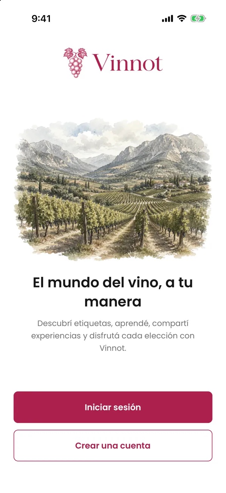

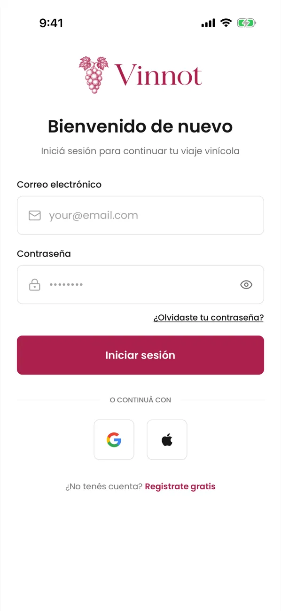

1. Instala Vinnot desde el [App Store](https://apps.apple.com/app/vinnot/id6817992780) o desde [Google Play](https://play.google.com/store/apps/details?id=com.vinnot.app).
2. Abre la app. Si no tienes sesión, verás la bienvenida con «Iniciar sesión» y «Crear una cuenta».
3. Elige «Crear una cuenta» y completa nombre de usuario, nombre, apellido, email, contraseña y su confirmación.
4. Marca la casilla de los términos y envía el formulario.
5. Abre el email de verificación que te enviamos y toca el enlace. Después, inicia sesión.

Para entrar con Google o Apple, toca su botón debajo de «o continuá con». Si es tu primera vez, la app te pregunta «¿Cómo querés que te conozcan?»: elige un nombre con «Usar este nombre» o toca «Ahora no» para conservar el nombre temporal.

Para iniciar sesión más adelante, usa tu email o tu nombre de usuario y tu contraseña. Si la olvidaste, toca «¿Olvidaste tu contraseña?», escribe tu email y sigue el enlace que te llega. Si el enlace ya se usó o venció, la app te lo avisa al abrirlo y te ofrece «Pedir un enlace nuevo».

> - El nombre de usuario tiene de 3 a 40 caracteres: letras, números, punto, guion o guion bajo.
> - La contraseña necesita al menos 8 caracteres con mayúscula, minúscula y número.
> - Registrarte no inicia la sesión: primero hay que verificar el email. El enlace vale 24 horas; si venció, pide otro desde la misma pantalla.
> - Apple aparece solo en iOS; en Android está Google.
> - La app recuerda tu sesión. Al abrirla otra vez entras directo al inicio.

Casos de uso: [UC-USR-21](../modules/users/use-cases/uc-usr-21-welcome.md), [UC-USR-01](../modules/users/use-cases/uc-usr-01-sign-up.md), [UC-USR-02](../modules/users/use-cases/uc-usr-02-verify-email.md), [UC-USR-03](../modules/users/use-cases/uc-usr-03-sign-in.md), [UC-USR-04](../modules/users/use-cases/uc-usr-04-social-sign-in.md), [UC-USR-05](../modules/users/use-cases/uc-usr-05-complete-profile.md), [UC-USR-06](../modules/users/use-cases/uc-usr-06-restore-session.md), [UC-USR-09](../modules/users/use-cases/uc-usr-09-request-password-recovery.md), [UC-USR-10](../modules/users/use-cases/uc-usr-10-reset-password.md).

## Actualizar la app

Cuando tu versión de la app ya no es compatible, al abrirla ves «Actualizá Vinnot para continuar» en lugar de la app.

1. Toca «Actualizar». Se abre la ficha de Vinnot en el App Store o en Google Play.
2. Instala la actualización y vuelve a abrir la app.

> - Esta pantalla no se puede cerrar: la app vuelve a funcionar al instalar la versión nueva.
> - Si la app no puede comprobar la versión, por ejemplo sin conexión, se abre igual.

Caso de uso: [UC-ADM-15](../modules/admin/use-cases/uc-adm-15-minimum-app-version.md).

## Aceptar los términos

Antes de usar las partes privadas de la app tienes que aceptar la versión vigente de los términos.

1. Al registrarte con email, marca la casilla de los términos en el mismo formulario. Puedes desplegar el texto antes de aceptarlo.
2. Si entraste con Google o Apple, o si los términos cambiaron, la app muestra «Antes de continuar».
3. Marca la casilla y toca «Aceptar y continuar».

Si prefieres no aceptar todavía, toca «Ahora no · cerrar sesión». La próxima vez que entres la app te lo vuelve a preguntar.

> - Cuando se publica una versión nueva, tienes 30 días para aceptarla y mientras tanto sigues usando la app.
> - Si la app no puede comprobar tu estado, muestra «No pudimos verificar tu acuerdo» con la opción de volver a cargar.
> - Si el teléfono no tiene internet, muestra «Sin conexión» con una ilustración y «Reintentar».
> - La ayuda, el contacto y la información legal se abren sin aceptar los términos.

Casos de uso: [UC-LEG-02](../modules/legal/use-cases/uc-leg-02-accept-at-sign-up.md), [UC-LEG-03](../modules/legal/use-cases/uc-leg-03-check-acceptance.md), [UC-LEG-04](../modules/legal/use-cases/uc-leg-04-accept-current-version.md), [UC-LEG-05](../modules/legal/use-cases/uc-leg-05-decline-and-sign-out.md).

## Permitir notificaciones

Las notificaciones push te avisan de tus entradas, cambios en eventos, vinos y rutas elegidos para ti y actividad en tus reseñas. Vienen activadas en tu cuenta; el permiso del teléfono decide si llegan.

1. La primera vez que abres la app en un teléfono aparece «Activá las notificaciones». Toca «Activar»: el teléfono te pregunta si permites notificaciones.
2. Toca «Permitir» en el aviso del teléfono. Si tienes sesión, la app registra el teléfono para tu cuenta.
3. Si tocas «Ahora no», la app no vuelve a preguntar hasta la próxima vez que la abras desde cero.

> - Mientras las notificaciones estén apagadas y tengas sesión, cada vez que abras la app desde cero aparece «Activá las notificaciones». Toca «Activar», o «Ahora no». Si tocaste «No permitir» en el aviso del teléfono, solo se pueden activar desde Ajustes: «Abrir ajustes» te lleva directo. Al volver a la app desde segundo plano no aparece.
> - Si rechazas el permiso, el teléfono deja de recibir push de tu cuenta.
> - Después de confirmar una entrada, si todavía no respondiste el permiso, aparece «Recibí avisos de tus eventos».
> - En Android, los ajustes del teléfono muestran un canal por tipo de aviso («Entradas y cuenta», «Comunidad», «Recomendaciones», «Eventos cerca tuyo», «Recordatorios» y «Novedades»), así puedes silenciar solo uno.
> - En iOS no recibirás push sin este permiso.
> - Al tocar una notificación, la app abre la sección relacionada: una entrada, un evento, un vino, una ruta o una bodega. Si no tienes sesión, la abre después de que inicies sesión.
> - Los avisos que pueden esperar no se envían entre las 22 y las 8 de tu zona horaria: llegan a partir de las 8.

Casos de uso: [UC-NOT-03](../modules/notifications/use-cases/uc-not-03-allow-push.md), [UC-NOT-04](../modules/notifications/use-cases/uc-not-04-register-device.md), [UC-NOT-05](../modules/notifications/use-cases/uc-not-05-receive-push.md).

## Moverte por la app

La barra inferior tiene cinco pestañas: «Inicio», «Vinos», «Eventos», «Rutas» y «Perfil».

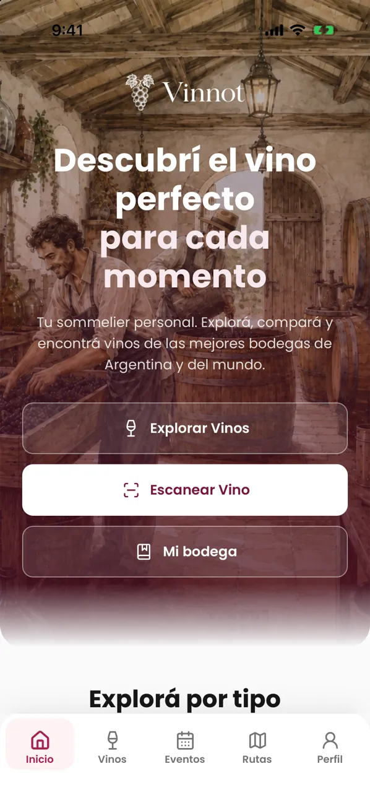

1. En «Inicio» tienes accesos rápidos a «Vinos», «Eventos», «Rutas del vino», «Escanear» y «Mi bodega».
2. Toca una cepa de «Variedades de uva populares» para ver sus vinos. Cada cepa se pinta con el color de su vino.
3. En «Todo lo que necesitás para descubrir vinos», cada tarjeta abre su sección: «Vinos», el escáner, «Eventos» o «Rutas».
4. Más abajo verás «Vinos destacados», «Eventos cercanos» y «Rutas del vino». Toca cualquier tarjeta para abrirla.
5. Desliza hacia abajo para recargar el inicio.

> - «Eventos cercanos» solo aparece si permitiste el acceso a tu ubicación.
> - Si vuelves a tocar «Vinos» mientras ves un vino, regresas al catálogo.
> - Si «Vinos destacados», «Eventos cercanos» o «Rutas del vino» no pueden cargarse, esa sección muestra el motivo y «Reintentar» en lugar de verse vacía.

Casos de uso: [UC-USR-22](../modules/users/use-cases/uc-usr-22-home.md), [UC-USR-23](../modules/users/use-cases/uc-usr-23-navigate.md).

## Escanear la etiqueta de un vino

El escáner reconoce un vino a partir de una foto de su etiqueta. Necesitas sesión iniciada.

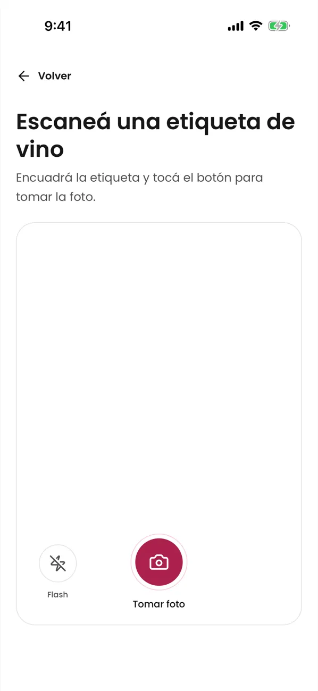

1. Toca «Escanear» en el inicio o «Escanear etiqueta» en «Vinos».
2. Permite el acceso a la cámara.
3. Encuadra la etiqueta dentro del marco y toca «Tomar foto». Si hace falta, usa «Flash». Si el código de barras de la botella está a la vista, la app también lo lee y muestra «Leímos el código de barras»; ayuda a encontrar el vino.
4. Espera mientras la app muestra «Analizando...».
5. Revisa el resultado:
   - «¡Vino encontrado!»: toca «Ver detalles» para abrir su ficha.
   - «Posibles coincidencias»: elige el vino que corresponde.
   - Sin coincidencias: busca a mano o propón el vino (ver la sección siguiente).
   - Si el vino correcto no está entre los resultados, toca «Escanear la contraetiqueta», gira la botella y saca una foto de la contraetiqueta. La app suma lo que lee a la foto del frente y vuelve a buscar. Se ofrece una vez por escaneo.
6. Si el vino no es el tuyo, toca «No es mi vino». Para empezar otra vez, toca «Escanear otro vino».

> - Si la foto quedó oscura, con reflejos, desenfocada o muy chica, la app te lo indica y te pide otra toma.
> - Si el análisis tarda demasiado, la app conserva la foto y te deja reintentar o buscar el vino por su nombre.
> - Los mensajes del escáner, y de un vino abierto desde él, aparecen encima de la pantalla del escáner.
> - Puedes escanear hasta 30 etiquetas por hora. Si llegas al límite, la app te lo dice y te sugiere esperar unos minutos o buscar el vino por su nombre.
> - Si la foto no es JPG o PNG de hasta 8 MB, tiene demasiado texto o el servidor está ocupado, la app te explica qué pasó y conserva la foto.
> - Cuando abres o agregas un vino desde el resultado, o propones el vino, la app le avisa a Vinnot si el escaneo acertó. Ocurre en segundo plano, una sola vez por escaneo, y nunca te interrumpe. Si eliges un vino distinto de una coincidencia exacta, el equipo de moderación revisa ambos vinos; el catálogo nunca cambia automáticamente.
> - Si la etiqueta muestra la añada, al agregar el vino a tu cava desde el escaneo «Añada» ya viene completa. Puedes cambiarla, y los vinos que ya están en tu cava conservan su añada.
> - Si el vino reconocido no tenía imagen, al abrirlo con «Ver detalles» tu foto pasa a ser su imagen. Nunca reemplaza una imagen existente y elegir una sugerencia no cambia la foto de ningún vino.

Casos de uso: [UC-WIN-05](../modules/wines/use-cases/uc-win-05-scan-label.md), [UC-WIN-08](../modules/wines/use-cases/uc-win-08-attach-label-photo.md).

## Buscar vinos a mano y proponer uno nuevo

Puedes buscar en el catálogo con texto y filtros y, si un vino no está, proponerlo con la foto de su etiqueta.

### Buscar en el catálogo

1. Abre «Vinos».
2. Escribe en «Buscar por nombre de vino o bodega...». La búsqueda empieza con 2 caracteres.
3. Usa «Filtrar» para elegir tipo, uva, país o región.
4. Desliza hasta el final de la lista para cargar más vinos.
5. Cada tarjeta muestra cuántas reseñas tiene, por ejemplo «(5) reseñas». Toca el número subrayado o la palabra «reseñas» para abrir el vino directamente en sus reseñas.

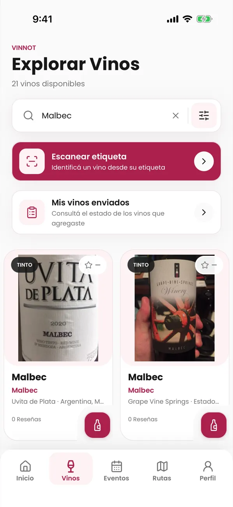

> - La primera vez, la app propone el país de tu ubicación. Si limpias los filtros, no lo vuelve a proponer.
> - Al cambiar el país se borra la región elegida.
> - Solo se pueden recorrer los primeros 500 resultados; afina la búsqueda si no encuentras el vino.
> - Debajo del título, la app dice cuántos vinos hay. Por debajo de 500 muestra el número exacto; desde 500 dice «Miles de vinos para descubrir» sin filtros, «Más de 500 vinos de Argentina» si solo filtras por país, o «Más de 500 vinos coinciden con tu búsqueda». Mientras carga dice «Buscando vinos…».

### Agregar un vino que no encontraste

1. Si la búsqueda no encuentra nada, verás «No se encontraron vinos». Toca «Agregá tu vino». Si tenías filtros, «Limpiar» los quita.
2. El escáner se abre con el título «Agregá tu vino». Saca una foto de la etiqueta.
3. Si el vino ya está en Vinnot, la app te lo muestra. Si no, se abre el formulario para proponerlo, con el nombre que buscaste ya escrito cuando la etiqueta no lo trae.
4. Revisa los datos y toca «Enviar para validar».

Si no tienes el vino a mano, toca «Cargar sin foto» debajo de «¿No tenés el vino a mano?» y completa los datos: solo el nombre y la bodega son obligatorios. Sin foto, el vino no se publica al momento: un administrador lo revisa antes y la propuesta queda «En revisión». Si el vino ya estaba en Vinnot, la propuesta te lleva al vino existente.

### Buscar desde el escáner y proponer un vino

1. En el escáner, toca «Buscar» y escribe al menos 2 caracteres del nombre del vino o de la bodega.
2. Si aparece tu vino, tócalo para abrir su ficha.
3. Si no aparece, toca «¿No encontrás tu vino? Agregar vino».
4. Revisa los datos detectados. Solo «Nombre del vino» y «Bodega» son obligatorios; puedes sumar tipo, añada, uvas, país, región, alcohol y notas.
5. Toca «Enviar para validar».

Para seguir tus propuestas, abre Perfil → «Mis vinos enviados». Cada una muestra su estado: «Procesando», «Publicado», «Vino existente», «En revisión», «Requiere correcciones» o «Rechazado».

> - Si todas las comprobaciones son seguras, el vino se publica al momento. Si hay dudas, queda «En revisión» para el equipo.
> - Si el vino ya existía, la propuesta te lleva al vino existente.
> - Al enviarla, un mensaje en tu idioma te dice qué pasó: publicado, ya estaba en el catálogo, en revisión, requiere correcciones o rechazado.
> - Puedes proponer hasta 10 vinos por día. Cada cambio de estado te llega por email.

Casos de uso: [UC-WIN-01](../modules/wines/use-cases/uc-win-01-search-catalog.md), [UC-WIN-02](../modules/wines/use-cases/uc-win-02-page-catalog.md), [UC-WIN-06](../modules/wines/use-cases/uc-win-06-manual-search-from-scan.md), [UC-WIN-07](../modules/wines/use-cases/uc-win-07-submit-wine.md), [UC-WIN-09](../modules/wines/use-cases/uc-win-09-track-submissions.md), [UC-WRY-03](../modules/wineries/use-cases/uc-wry-03-countries-and-regions.md).

## La ficha de un vino y de una bodega

La ficha reúne los datos del vino y su perfil IA en dos pestañas: «Info» y «Perfil». Las reseñas cierran «Info»: desliza hasta el final para leerlas.

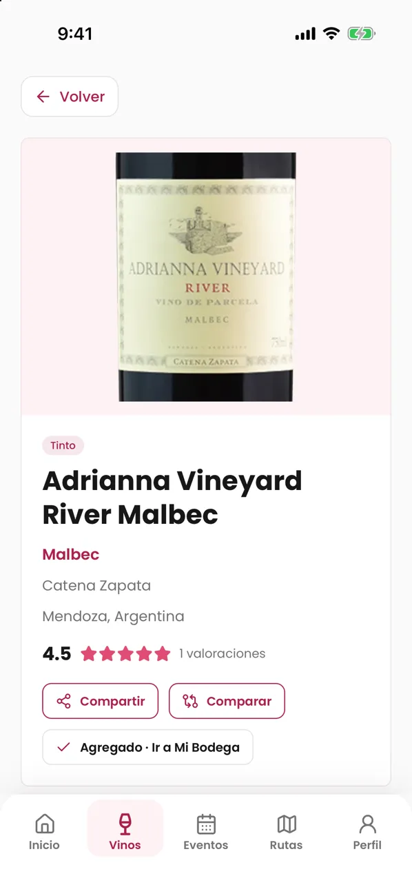

1. Abre un vino desde el catálogo, el inicio, el escáner o tu cava.
2. En «Info» verás descripción, bodega, región, uvas, alcohol, valoración y el «Perfil de sabor».
3. Desde la ficha puedes «Comparar», «Compartir» y «Agregar a Bodega».
4. Toca la bodega para abrir su ficha: logo, ubicación, año de fundación, descripción, contacto, un mapa y la grilla «Vinos de esta bodega».

> - Si falta un dato, la ficha no muestra ese bloque.
> - Si falta la imagen, se muestra una imagen por defecto.
> - Si la ficha de un vino o de una bodega no puede cargarse (sin conexión o por un error del servidor), muestra el motivo con «Reintentar» y «Volver». Solo un vino o una bodega que ya no existe muestra «no encontrado».
> - Si abriste una bodega desde un enlace compartido, «Volver» te lleva a la lista de bodegas.

Casos de uso: [UC-WIN-03](../modules/wines/use-cases/uc-win-03-view-wine-detail.md), [UC-WRY-01](../modules/wineries/use-cases/uc-wry-01-view-winery.md), [UC-WRY-02](../modules/wineries/use-cases/uc-wry-02-search-wineries.md).

## Escribir una reseña

Una reseña es tu opinión pública sobre un vino: un puntaje de 0.1 a 5.0 en copas, la añada que probaste, un título y un comentario.

1. Abre el vino y toca «Escribir reseña», arriba o al final de «Info», donde están las reseñas. El formulario sube desde abajo en un panel; deslízalo hacia abajo o toca «Volver» para cerrarlo, y lo que escribiste se guarda para la próxima vez. Si tocas «Cancelar» después de cambiar algo, pregunta «¿Descartar los cambios?»: «Seguir editando» vuelve al formulario y «Descartar» lo borra. Mientras la reseña se envía, el panel queda abierto.
2. Al abrir el formulario, la botella se descorcha sola al lado de las copas; debajo hay una barra con una copita y «Deslizá la botella o la barra para puntuar». En tus primeras tres reseñas, después del descorche, una botella translúcida muestra el gesto. Arrastra la botella hacia las copas o desliza la barra para elegir de 0.1 a 5.0, o toca una copa: las dos se mueven juntas y cada número entero queda debajo de su copa; la botella se levanta y sirve; mientras subes, las copas se llenan y la botella se vacía, y mientras bajas, pasa al revés. Con 5.0 la botella vuelve a su lugar, vacía. Solo la calificación es obligatoria, marcada con (*); también puedes sumar «Añada», «Título» y «Comentario».
   - En «Añada» escribe el año o toca uno de los años sugeridos. Si el vino tiene añada en el catálogo, aparece primero con «del catálogo». Para cambiarla, toca la × de la píldora.
3. Toca «Enviar reseña». La reseña se publica al instante.

Para editarla, toca «Editar» en tu reseña: se abre el mismo panel con tu reseña; cambia lo que quieras y toca «Guardar». Para borrarla, toca «Eliminar» y confirma.

Para dar like, toca el pulgar de una reseña; vuelve a tocarlo para quitarlo. Para comentar, toca el globo de comentarios, escribe en «Escribí un comentario...» y toca «Enviar».

> - Puedes escribir una sola reseña por vino. Si ya la escribiste, verás «Ya compartiste tu reseña para este vino.».
> - La añada se muestra en la reseña como una píldora, por ejemplo «Añada 2018».
> - Junto al nombre de cada autor aparece su sello. Tu reseña suma puntos para tu sello: ver [Puntos y sellos](points-and-seals.mdx).
> - Publicar una reseña agrega el vino a tu cava con el mismo puntaje. Si escribiste un comentario, pasa a ser las notas de la cava; sin comentario, tus notas privadas se conservan. Si elegiste una añada, también pasa a la cava; sin añada, la de tu cava se conserva.
> - Borrar la reseña no quita el vino de tu cava.
> - Los comentarios tienen hasta 2000 caracteres, se publican al instante y no se editan; puedes eliminar los tuyos.
> - La app muestra las reseñas de a 10: usa «Anterior» y «Siguiente» para recorrerlas y, si hay más de una, elige «Más recientes» o «Más valoradas».
> - Una reseña o un comentario sin enviar se conserva mientras la app siga abierta: puedes cambiar de pestaña, cerrar los comentarios o salir del vino y volver. Se borra al publicar, al cancelar una edición y al cerrar sesión.
> - Al eliminar una reseña o un comentario ves una confirmación, o un mensaje si falló. Mientras se guarda un «me gusta», el botón no se puede volver a tocar.
> - Si las reseñas o los comentarios no pueden cargarse, toca «Reintentar»; igual puedes escribir tu reseña.

Casos de uso: [UC-REV-01](../modules/reviews/use-cases/uc-rev-01-read-reviews.md), [UC-REV-02](../modules/reviews/use-cases/uc-rev-02-publish-review.md), [UC-REV-03](../modules/reviews/use-cases/uc-rev-03-edit-review.md), [UC-REV-04](../modules/reviews/use-cases/uc-rev-04-delete-review.md), [UC-REV-05](../modules/reviews/use-cases/uc-rev-05-like-review.md), [UC-REV-06](../modules/reviews/use-cases/uc-rev-06-review-comments.md).

## Tu cava

«Mi Bodega» es tu colección personal: guarda cada vino una vez con tu puntaje, la añada que probaste, tus notas privadas y el precio que pagaste.

### Ver tu cava

1. Abre «Mi bodega» desde el inicio, la tarjeta de la cava en tu perfil o la ficha de un vino.
2. Arriba verás la portada de la cava con «Agregar vino» y tres datos: «Vinos», «Promedio» (con una copa) y «Regiones» distintas. Debajo, una barra muestra la mezcla de tipos de vino con su leyenda.
3. Busca con «Buscar en tu bodega...» o filtra entre «Todos», «Calificados» y «Con notas».
4. Desliza hacia abajo para recargar la lista.

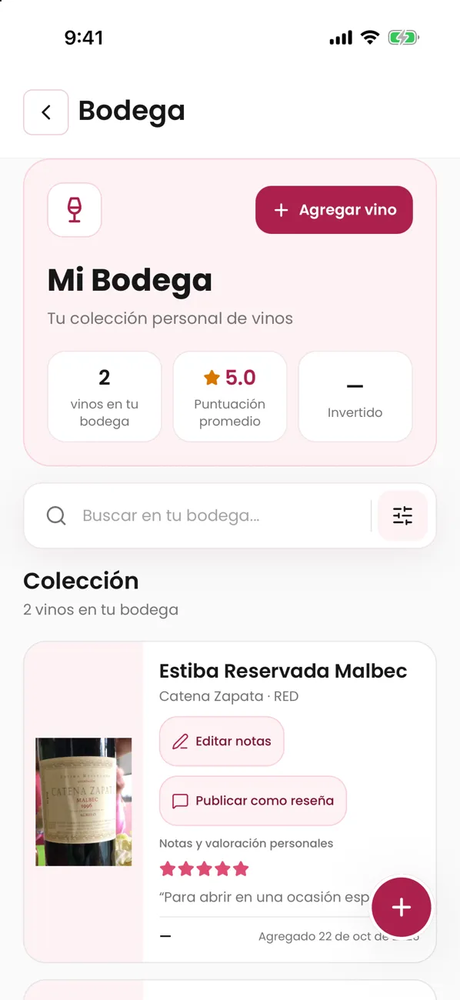

### Agregar, editar y quitar vinos

1. Para agregar, toca «Agregar a Bodega» en la ficha del vino, o «Agregar vino» en la cava y busca el vino. Los vinos que ya están en tu cava aparecen con «Ya está en tu bodega» y no se pueden elegir.
2. Si quieres, carga «Puntuación», «Añada», «Notas personales» y «Precio pagado», y toca «Guardar». La añada aparece en la fila del vino como «Añada 2018».
   - Escribe el «Precio pagado» como se escriben los números en el idioma de la app: en español «1.500,50», en inglés «1,500.50». Si la app no puede leer el precio, el campo te lo indica y no se guarda nada.
3. Cada vino tiene un botón «⋯» a la derecha. Abre «Editar notas», «Ver reseña» (o «Publicar como reseña»), «Abrir vino» y «Eliminar».
4. Para cambiar esos datos, elige «Editar notas» en ese menú.
5. Para quitar un vino, elige «Eliminar» en el menú o desliza su fila, y confirma «¿Eliminar de tu bodega?».

### Publicar tu nota como reseña

1. En un vino de tu cava, abre el menú «⋯» y elige «Publicar como reseña».
2. Revisa el borrador con tu puntaje, tu añada y tus notas, y confirma.

> - Tus notas son privadas hasta que las publicas como reseña.
> - Si ya tienes una reseña de ese vino, la app te ofrece «Abrir vino» para editarla; tu nota no la reemplaza sola.
> - Quitar un vino de la cava no borra el vino del catálogo ni tu reseña.
> - Los importes se muestran en pesos argentinos. La app no suma lo que pagaste: el precio se ve en cada vino.
> - Las puntuaciones se muestran en copas que se llenan según la fracción, con la copa y el color del vino según el tipo de vino. Un 3.6 son tres copas llenas, 0.6 de la cuarta y una vacía.

Casos de uso: [UC-CEL-01](../modules/cellar/use-cases/uc-cel-01-view-cellar.md), [UC-CEL-02](../modules/cellar/use-cases/uc-cel-02-add-wine.md), [UC-CEL-03](../modules/cellar/use-cases/uc-cel-03-edit-entry.md), [UC-CEL-04](../modules/cellar/use-cases/uc-cel-04-remove-entry.md), [UC-CEL-05](../modules/cellar/use-cases/uc-cel-05-publish-note-as-review.md).

## Perfil IA y comparación

El perfil IA es un análisis de sommelier generado con inteligencia artificial. La comparación enfrenta dos vinos y te da una recomendación.

### Ver o generar el perfil

1. Abre el vino. En la tarjeta «Sommelier exclusivo», toca «Ver perfil».
2. Verás resumen, análisis visual, aromas, boca, sabores, maridajes, servicio, ocasiones y vinos similares. La pestaña «Perfil» de la ficha muestra las mismas secciones.
3. Si el vino todavía no tiene perfil, el botón dice «Generar perfil»: tócalo y espera unos segundos.
4. Si el perfil no puede cargarse, toca «Reintentar». «Generar perfil» solo aparece cuando el vino no tiene perfil.

### Comparar dos vinos

1. Toca «Comparar» en la ficha de un vino.
2. Elige el «Vino A» y el «Vino B» con el buscador.
3. Toca «Comparar».
4. Lee el resumen, las diferencias, las similitudes, la tabla de atributos, para qué conviene cada vino y la recomendación.

> - Abrir un perfil nunca lo genera: generar es siempre una acción tuya.
> - El perfil y la comparación están en español e inglés.
> - Si el servicio no responde, la app conserva tu selección y te deja reintentar.
> - Si falla la generación de un perfil, un mensaje explica por qué: el servicio tardó demasiado, pediste demasiados seguidos o no hay conexión.
> - Tienes hasta 20 generaciones de perfil y 20 comparaciones por hora.
> - Para comparar tienes que elegir dos vinos distintos.

Casos de uso: [UC-AI-01](../modules/ai/use-cases/uc-ai-01-view-ai-profile.md), [UC-AI-02](../modules/ai/use-cases/uc-ai-02-compare-wines.md).

## Test de gustos

El test de gustos son cinco preguntas ilustradas que arman un primer perfil de gustos mientras todavía no valoraste vinos.

1. La app te lo ofrece una vez después de iniciar sesión. También puedes abrirlo cuando quieras desde tu perfil público: «Hacé tu test de gustos», o «Repetir el test» si ya lo hiciste.
2. Toca la opción que más te guste en cada pregunta: un día de lluvia, tu fruta favorita, un postre, una cena especial y el aroma que más te gusta. La app pasa sola a la siguiente; con la flecha vuelves a la anterior y tu respuesta sigue marcada.
3. Después de la quinta respuesta verás «Definiendo tu perfil de gustos»: una pluma dibuja tus elecciones en un cuaderno de cata, una copa se llena de vino y un pincel da forma a tu rueda de sabores alrededor de una copa de vino. Luego llegas a tu perfil público con el resultado.

> - Toca «Saltear» en cualquier pregunta si prefieres no hacerlo: la app no vuelve a ofrecértelo, y puedes hacerlo más tarde desde tu perfil.
> - Si sales mientras repites el test, tus respuestas anteriores se conservan.
> - Tu tarjeta de gustos indica «Según tu test de gustos» mientras el perfil se apoya en el test. La rueda de sabores aparece cuando valoras 5 vinos; hasta entonces, en su lugar ves la rueda bloqueada con un candado.
> - La rueda de sabores es una flor de pétalos de acuarela, uno por cada uva, estilo o región; cuanto mejor lo puntuaste, más largo el pétalo. Muestra una cosa por vez: «Uvas» (al abrir), «Estilos» o «Regiones». Toca un pétalo, o su nombre debajo, para resaltarlo: en el centro ves qué es, su puntaje promedio y cuántos vinos valoraste. Tócalo de nuevo para soltarlo. Las uvas tintas van en tonos granate y violeta, las blancas en dorados y verdes, y las rosadas en rosas.
> - Si no se pueden guardar las respuestas, toca «Reintentar»: no hace falta responder de nuevo.

### Ajustar tu paladar

Puedes afinar a mano la estructura de tu paladar (acidez, cuerpo, taninos y dulzor) desde tu perfil público.

1. En la tarjeta «Tu paladar», toca «Ajustar» junto a «Estructura».
2. Arrastra cada barra, o toca un punto de la barra, para llenarla o vaciarla según tu gusto. La palabra de nivel cambia mientras la mueves.
3. Toca «Guardar» para guardar los cambios, o «Cancelar» para dejar todo como estaba.

> - Solo se guardan las barras que cambiaste. Un rasgo que todavía no tenía datos empieza en el medio.
> - Los rasgos que ajustaste muestran la etiqueta «Ajustado» y tienen prioridad sobre lo que calcula Vinnot con tus valoraciones y tu test.
> - «Volver a lo calculado», en el modo de ajuste, borra todos tus ajustes.
> - Con un lector de pantalla, desliza hacia arriba o hacia abajo sobre cada barra para subirla o bajarla de a 5.
> - Solo tú ves «Ajustar»; quienes visitan tu perfil ven el resultado.

## Eventos: inscribirte, pagar y ver tus entradas

En «Eventos» encuentras catas, ferias, recorridos y otras experiencias. Puedes inscribirte, pagar con Mercado Pago y consultar tus entradas.

### Encontrar un evento

1. Abre «Eventos». Si compartiste tu ubicación, verás primero los «Eventos cercanos» y después el resto.
2. Busca por nombre o ciudad, filtra por tipo o país, o usa «Buscar por zona» para elegir otro lugar. El mapa se centra en tu ubicación, o en la zona que buscaste, con un zoom de unos 30 km.
3. Toca un evento para ver imagen, descripción, fecha, lugar, organizador, precio y cupos.
4. Desde el detalle puedes «Abrir en Maps», «Compartir» o denunciar el evento.

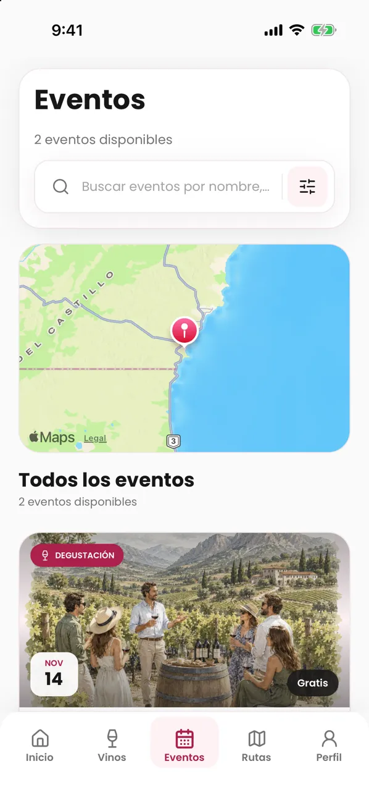

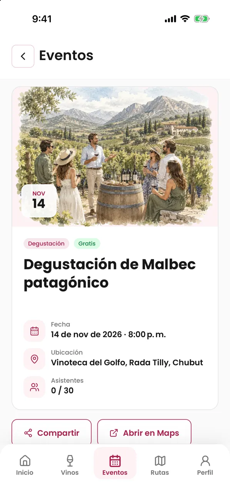

### Inscribirte

1. En el detalle, toca «Inscribirme». Si no tienes sesión, la app te pide iniciarla y vuelve al evento.
2. Elige la «Cantidad de asistentes» y carga tu «Celular de contacto» con + y el código de país.
3. Si quieres, marca «Guardar este teléfono para próximas reservas».
4. Envía la inscripción. El botón dice «Confirmar inscripción», «Enviar solicitud» o «Continuar al pago», según el tipo de evento.
5. Revisa el estado de «Tu inscripción»: «Confirmada», «Solicitada», «En lista de espera», «Esperando tu confirmación» o «Pendiente de pago». Si el organizador cargó su contacto, ahí también verás «Contactar al organizador».

### Pagar con Mercado Pago

1. En un evento pago, toca «Continuar al pago» o, más tarde, «Pagar con Mercado Pago» en el detalle.
2. Completa el pago en Mercado Pago.
3. Al terminar vuelves a la app, que muestra el recibo con el estado del pago. Mientras «Actualizar estado» lo vuelve a consultar, el botón muestra que está trabajando.

### Confirmar o cancelar

- Si el evento pide confirmar la asistencia, toca «Confirmar asistencia» antes de la fecha que indica «Reserva válida hasta».
- Para cancelar, toca «Cancelar inscripción» y confirma.

### Ver tus entradas

1. Abre Perfil → «Mis entradas».
2. Toca «Ver entrada» para ver fecha, personas, lugar, pago, contacto del organizador y la «Referencia».

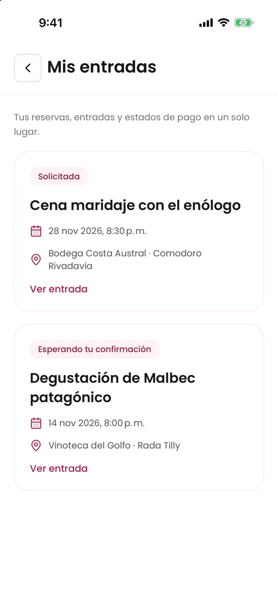

> - Tienes una sola inscripción activa por evento, de 1 a 20 entradas dentro del máximo del evento.
> - Si no hay cupo, quedas en lista de espera; no subes solo cuando se libera un lugar.
> - Volver de Mercado Pago no confirma el pago: se confirma cuando Vinnot lo verifica. Si el recibo dice que está pendiente, no vuelvas a pagar.
> - Una inscripción ya pagada en línea no se cancela desde la app: contacta al organizador para cancelarla y pedir la devolución.
> - Si el organizador cancela el evento, tu entrada lo indica y los pagos en línea se devuelven.
> - La referencia de 12 caracteres identifica tu entrada; no hay código QR.

Casos de uso: [UC-EVT-01](../modules/events/use-cases/uc-evt-01-discover-events.md), [UC-EVT-02](../modules/events/use-cases/uc-evt-02-view-event.md), [UC-EVT-03](../modules/events/use-cases/uc-evt-03-register-for-event.md), [UC-EVT-04](../modules/events/use-cases/uc-evt-04-confirm-attendance.md), [UC-EVT-05](../modules/events/use-cases/uc-evt-05-cancel-registration.md), [UC-EVT-06](../modules/events/use-cases/uc-evt-06-my-tickets.md), [UC-PAY-01](../modules/payments/use-cases/uc-pay-01-pay-registration.md), [UC-PAY-02](../modules/payments/use-cases/uc-pay-02-checkout-return.md).

## Rutas del vino y mapas

Las rutas del vino son recorridos con paradas en bodegas, restaurantes, miradores y alojamientos.

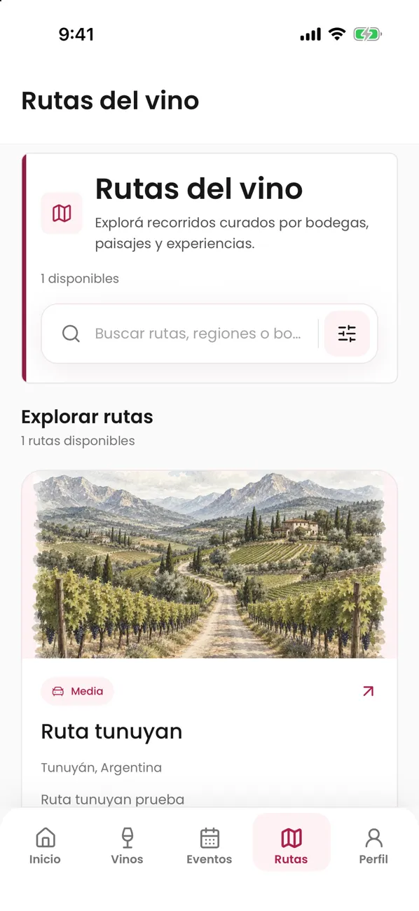

1. Abre «Rutas». Cada tarjeta muestra país, región, largo, paradas, distancia y duración.
2. Busca con «Buscar rutas, regiones o bodegas...» o filtra por largo, país o región. Desliza hasta el final para cargar más rutas.
3. Toca una ruta para ver su portada, «Sobre esta ruta», la «Información rápida» y las «Paradas de la ruta».
4. Toca una parada para ver su descripción, dirección y contactos, o toca «Abrir en Maps» para llegar a ella.
5. En el «Mapa de la ruta», toca «Iniciar recorrido» para abrir Google Maps con todas las paradas en orden.

> - El largo («Corta», «Media», «Larga») indica la extensión del recorrido, no su dificultad física. Si la ruta no lo tiene, no se muestra.
> - El tiempo del recorrido se muestra en horas y minutos; si la ruta solo se estima en días, se muestra en días.
> - Vinnot no sigue tu ubicación ni guarda tu recorrido.
> - Desde el detalle también puedes «Compartir» o denunciar la ruta.

Casos de uso: [UC-RTE-01](../modules/wine-routes/use-cases/uc-rte-01-browse-routes.md), [UC-RTE-02](../modules/wine-routes/use-cases/uc-rte-02-view-route.md), [UC-RTE-03](../modules/wine-routes/use-cases/uc-rte-03-navigate-stops.md), [UC-RTE-04](../modules/wine-routes/use-cases/uc-rte-04-share-or-report-route.md).

## Compartir y abrir enlaces

Puedes compartir un vino, un evento o una ruta con un enlace público de Vinnot.

1. En el detalle, toca «Compartir».
2. Elige la aplicación o el contacto en la hoja de compartir del teléfono.

Cuando alguien abre el enlace:

1. Si tiene la app instalada, el enlace abre directamente el vino, el evento o la ruta.
2. Si no la tiene, ve una vista previa con «Ya tengo la app · Abrir en Vinnot», «Continuar en la web» y los botones de descarga.

> - El enlace solo lleva el contenido, nunca tus datos.
> - Si instalas la app desde la vista previa, vuelve a abrir el enlace después de instalarla.
> - Si el contenido pide sesión, la app te la pide y después te lleva al contenido.
> - Un enlace a algo que ya no es público muestra que no está disponible.
> - «Compartir» solo aparece en lo que tiene página pública: un evento ya publicado que no es borrador y una ruta publicada.

Casos de uso: [UC-SHR-01](../modules/sharing/use-cases/uc-shr-01-share-content.md), [UC-SHR-02](../modules/sharing/use-cases/uc-shr-02-open-shared-link.md), [UC-SHR-03](../modules/sharing/use-cases/uc-shr-03-open-in-app-or-web.md), [UC-USR-07](../modules/users/use-cases/uc-usr-07-resume-protected-destination.md).

## Elegir tus notificaciones

Decides qué avisos recibes por «Correo» y por «App» en cada categoría.

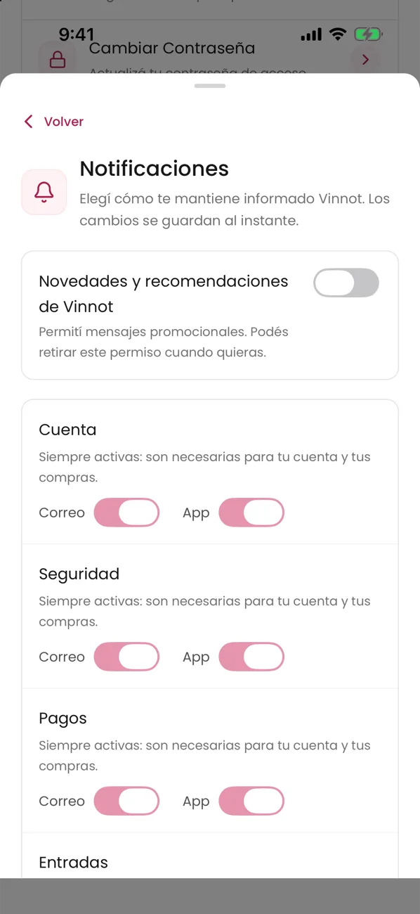

1. Abre Perfil → «Notificaciones».
2. Activa o desactiva cada canal. Los cambios se guardan al instante. Cada categoría muestra solo los canales que usa.
3. Si desactivas «Novedades y recomendaciones de Vinnot», dejas de recibir «Recomendaciones» y «Newsletter». «Recordatorios» avisa sobre vinos que miraste, tu bodega y tus eventos.
4. En «Tu zona», toca «Usar mi ubicación aproximada» o «Buscar una región o ciudad» para recibir avisos de «Eventos cerca tuyo». Toca «Dejar de recibir» para quitarla.

> - «Cuenta», «Seguridad», «Pagos» y «Entradas» están siempre activas.
> - Las demás categorías vienen activadas.
> - La zona se guarda redondeada; Vinnot no guarda tu ubicación exacta.
> - Si el teléfono no tiene permiso, la hoja ofrece «Permitir notificaciones» o «Abrir ajustes».
> - Los correos promocionales incluyen un enlace para darte de baja.

Casos de uso: [UC-NOT-01](../modules/notifications/use-cases/uc-not-01-manage-preferences.md), [UC-EVT-07](../modules/events/use-cases/uc-evt-07-event-area.md), [UC-NOT-06](../modules/notifications/use-cases/uc-not-06-receive-email.md).

## Denunciar o bloquear

Si algo incumple las normas de la comunidad, puedes denunciarlo. Si no quieres interactuar con alguien, puedes bloquearlo.

### Denunciar

1. En una reseña o un comentario, toca los tres puntos arriba a la derecha y elige «Denunciar contenido» o «Denunciar usuario». En un evento o una ruta, toca «Denunciar contenido».
2. Elige un «Motivo»: «Spam», «Acoso», «Odio o discriminación», «Contenido sexual», «Violencia o amenazas», «Privacidad», «Información engañosa» u «Otro».
3. Si quieres, agrega una descripción de hasta 2000 caracteres. Con «Otro» es obligatoria.
4. Toca «Enviar denuncia». Verás «Denuncia registrada».

### Bloquear

1. En una reseña o un comentario, toca los tres puntos arriba a la derecha y elige «Bloquear usuario».
2. Lee el aviso y confirma.

### Seguir tus denuncias y bloqueos

1. Abre Perfil → «Comunidad y seguridad».
2. Revisa «Mis denuncias» con su estado («Recibida», «En revisión», «Resuelta» o «Desestimada») y «Usuarios bloqueados».
3. Cada denuncia muestra un número corto. Toca el ícono de copiar junto a él para copiar el número completo y compartirlo con soporte.
4. Toca «Desbloquear» para quitar un bloqueo.

> - Tu identidad y el detalle de la denuncia solo los ve el equipo de moderación.
> - No puedes denunciar tu propio contenido. Puedes enviar hasta 10 denuncias por día. Si algo falla, la app te dice por qué: límite alcanzado, demasiados envíos seguidos o contenido que ya no está disponible.
> - El bloqueo oculta reseñas, comentarios y perfiles entre las dos cuentas e impide likes y comentarios nuevos. Los eventos y las rutas siguen visibles.
> - Las denuncias cerradas desaparecen de la lista a los 90 días.
> - Para pedir que se revise una decisión, escribe por Contacto con la referencia de la denuncia.

Casos de uso: [UC-COM-01](../modules/community/use-cases/uc-com-01-report-content.md), [UC-COM-02](../modules/community/use-cases/uc-com-02-block-user.md), [UC-COM-03](../modules/community/use-cases/uc-com-03-my-community.md).

## Tu cuenta

Desde «Perfil» ves tus estadísticas y gestionas tus datos, tu seguridad y tu sesión.

### Perfil y datos

1. Abre «Perfil». Debajo del encabezado verás tus «Estadísticas», como tus reseñas y los vinos de tu cava. Después, «Accesos rápidos» te lleva a «Mi Bodega», «Mis entradas», «Mi perfil público», «Mis vinos enviados» y «Comunidad y seguridad». Más abajo, «Ajustes» reúne la foto, la contraseña, la cuenta, las notificaciones y el idioma.
   - En el encabezado ves tu sello, tus puntos y una barra hacia el siguiente sello. Toca el sello para abrir «Tus puntos» ([Puntos y sellos](points-and-seals.mdx)).
2. Toca «Editar perfil», arriba de todo, para cambiar usuario, nombre, apellido o teléfono.
3. Toca «Cambiar foto» y elige «Tomar foto» o «Elegir de galería».
4. Toca «Idioma de la aplicación» y elige «Español» o «Inglés».

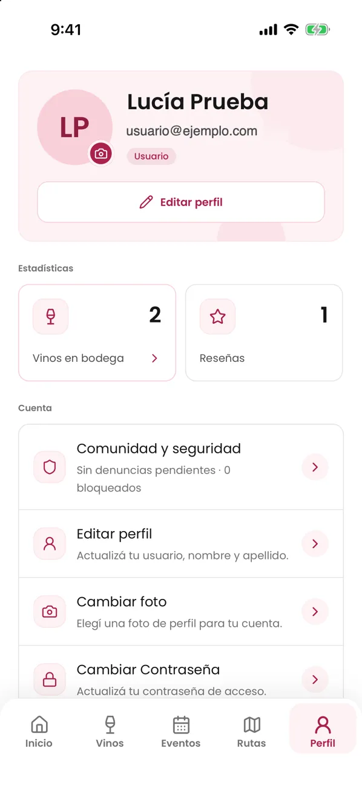

### Contraseña y email

1. Toca «Cambiar contraseña» y completa la actual, la nueva y su confirmación.
2. Si creaste la cuenta con Google o Apple y todavía no tienes contraseña, verás «Crear contraseña»: te llega un enlace por email para definirla. Si tu cuenta ya tiene contraseña, puedes cambiarla aunque también entres con Google o Apple.
3. Para cambiar el email, abre «Cuenta y seguridad», escribe el «Nuevo email» y toca «Enviar confirmación». Confirma desde el enlace que llega al correo nuevo.

### Desactivar, eliminar y cerrar sesión

1. En «Cuenta y seguridad», toca «Desactivar cuenta» y confirma. Al volver a iniciar sesión, la app te ofrece «Reactivar cuenta».
2. Para borrarla, toca «Eliminar cuenta permanentemente» y escribe exactamente «acepto borrar cuenta».
3. Para salir, toca «Cerrar sesión» al final del perfil.

> - Algunas acciones sensibles muestran «Confirmá tu identidad»: confirma con tu contraseña o con Google o Apple.
> - El teléfono es privado y debe incluir + y el código de país.
> - El email actual sigue activo hasta que confirmas el nuevo.
> - Desactivar es reversible y no borra datos. Eliminar es definitivo; si usas Apple, te pide una última autorización.
> - El idioma también define el idioma de tus notificaciones.

Casos de uso: [UC-USR-13](../modules/users/use-cases/uc-usr-13-view-profile.md), [UC-USR-14](../modules/users/use-cases/uc-usr-14-edit-profile.md), [UC-USR-15](../modules/users/use-cases/uc-usr-15-change-avatar.md), [UC-USR-16](../modules/users/use-cases/uc-usr-16-change-password.md), [UC-USR-17](../modules/users/use-cases/uc-usr-17-request-email-change.md), [UC-USR-12](../modules/users/use-cases/uc-usr-12-reauthenticate.md), [UC-USR-18](../modules/users/use-cases/uc-usr-18-deactivate-account.md), [UC-USR-19](../modules/users/use-cases/uc-usr-19-delete-account.md), [UC-USR-20](../modules/users/use-cases/uc-usr-20-change-language.md), [UC-USR-08](../modules/users/use-cases/uc-usr-08-sign-out.md).

## Ayuda y contacto

La app incluye ayuda, un formulario de contacto y los documentos legales.

### Ayuda y documentos legales

1. Abre Perfil → «Ayuda y soporte» y busca tu duda en las preguntas frecuentes.
2. Abre Perfil → «Privacidad» para ver el centro legal: términos, privacidad, normas de la comunidad, moderación, pagos y cancelaciones, y más.

### Escribir al equipo

1. Abre «Contacto» desde la ayuda o el centro legal.
2. Completa «Nombre», «Correo», el «Tema» («Soporte», «Privacidad», «Reportar», «Revisar una decisión», «Colaboración» o «General») y el «Mensaje».
3. Toca «Enviar consulta».
4. Guarda la referencia que aparece en «Consulta recibida. Referencia:». Además recibes un acuse por email con esa referencia.

> - No escribas contraseñas ni datos de tarjeta en el mensaje.
> - Si el envío falla, el formulario conserva lo que escribiste para reintentar.
> - Cuando algo falla, la app muestra una pantalla con el motivo (sin conexión, demora, servicio no disponible) y una acción para reintentar o volver al inicio.

Casos de uso: [UC-SUP-01](../modules/support/use-cases/uc-sup-01-read-public-information.md), [UC-SUP-02](../modules/support/use-cases/uc-sup-02-contact-support.md), [UC-SUP-03](../modules/support/use-cases/uc-sup-03-service-states.md), [UC-LEG-01](../modules/legal/use-cases/uc-leg-01-legal-centre.md).
