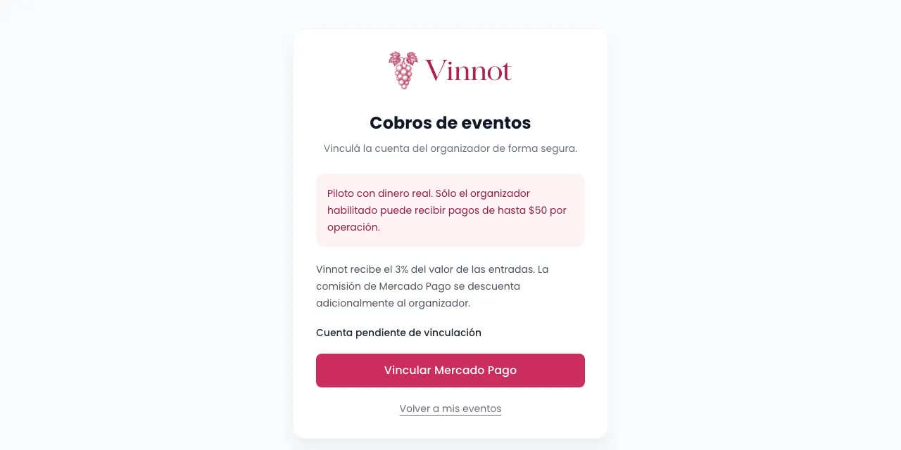
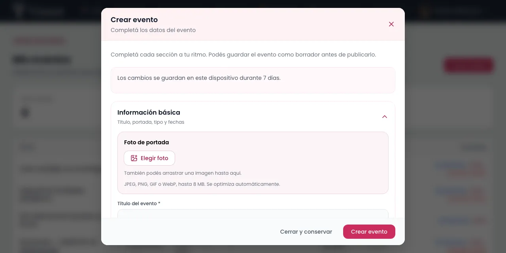
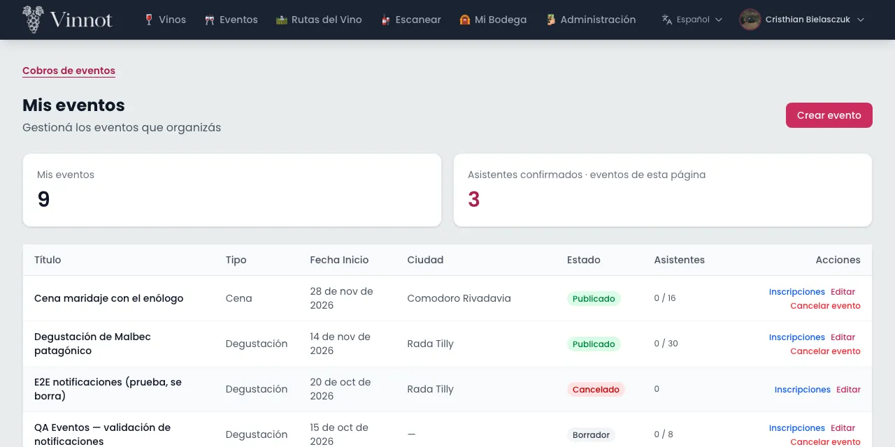
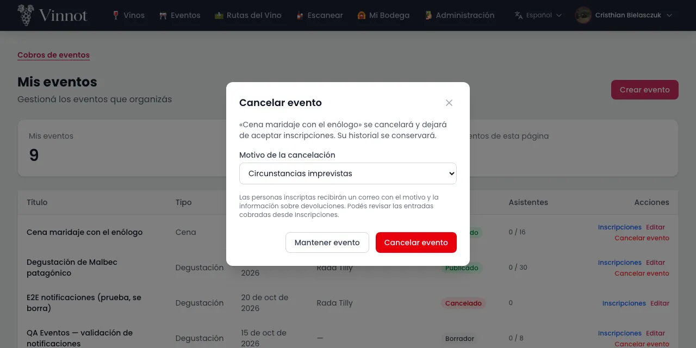
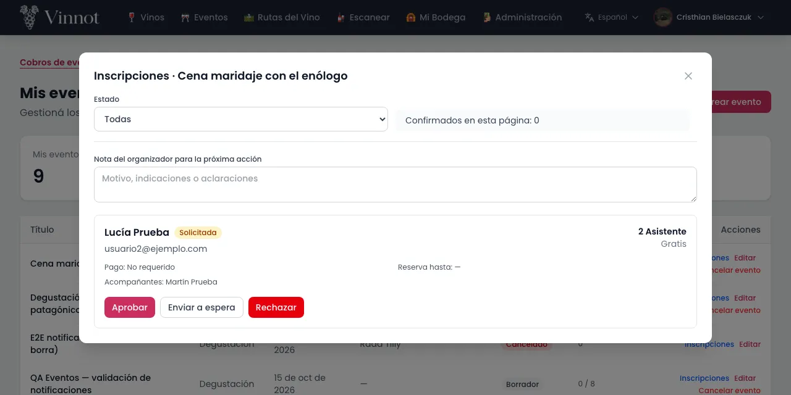

# Manual de partner

Este manual es para quienes organizan eventos en Vinnot con el rol de partner.
Explica cómo publicar y gestionar tus propios eventos, cobrar las inscripciones con
Mercado Pago, revisar a quienes se inscriben y devolver pagos, tanto en la web como en
la app. Los nombres de botones y pantallas aparecen tal como los muestra Vinnot.

## Contenido

- [Cómo obtener el rol de partner](#cómo-obtener-el-rol-de-partner)
- [Vincular tu cuenta de Mercado Pago](#vincular-tu-cuenta-de-mercado-pago)
- [Crear un evento](#crear-un-evento)
- [Editar un evento y cambiar su estado](#editar-un-evento-y-cambiar-su-estado)
- [Cancelar un evento](#cancelar-un-evento)
- [Revisar las inscripciones](#revisar-las-inscripciones)
- [Devoluciones](#devoluciones)
- [Avisos que recibes](#avisos-que-recibes)

## Cómo obtener el rol de partner

El rol de partner te da acceso a «Mis eventos», donde gestionas los eventos que
organizas. No existe un formulario de solicitud: el rol lo asigna un administrador.

1. Pide el rol al equipo de Vinnot, indicando el correo de tu cuenta.
2. Espera a que un administrador te asigne el rol.
3. Abre «Mis eventos»:
   - En la web, desde el menú de tu cuenta en la cabecera.
   - En la app, desde tu perfil, en «Panel partner».

Notas:

- «Mis eventos» muestra solo los eventos que tú organizas, con su fecha, estado e inscripciones.
- Si no tienes el rol, la sección no aparece.

Caso de uso relacionado: [Ver mis eventos](../modules/partner/use-cases/uc-par-01-list-own-events.md).

## Vincular tu cuenta de Mercado Pago

Para publicar eventos pagos necesitas vincular tu cuenta de Mercado Pago. Los cobros
de las entradas se acreditan en esa cuenta.

1. Abre la vinculación:
   - En la web, entra en «Mis eventos» y elige «Cobros de eventos». También puedes usar el enlace «Vincular mi Mercado Pago» de la sección «Inscripción» del editor, que abre esa página en otra pestaña.
   - En la app, abre el editor de un evento, elige «Pago online con Mercado Pago» en la sección «Inscripción» y toca «Vincular mi Mercado Pago».
2. En la web, elige «Vincular Mercado Pago».
3. Inicia sesión en Mercado Pago y autoriza a Vinnot.
4. Al volver a Vinnot, la vinculación se completa sola:
   - En la web, la página muestra «Cuenta vinculada satisfactoriamente».
   - Si empezaste en la app, elige «Volver a la app de Vinnot»; el editor vuelve a consultar la vinculación y muestra la cuenta vinculada.

Notas:

- Vinnot recibe un porcentaje del valor de las entradas; hoy es el 3 %. La página «Cobros de eventos» y el editor de eventos muestran el porcentaje vigente. Una venta mantiene la comisión con la que se hizo. La comisión de Mercado Pago también se descuenta de lo que cobras.
- Debes vincular tu propia cuenta de organizador, no la cuenta de la plataforma Vinnot.
- La autorización vence a los pocos minutos. Si ves que la vinculación venció o ya fue utilizada, empieza de nuevo desde Vinnot.
- No se puede desvincular una cuenta, solo volver a vincularla con «Vincular otra cuenta». Si tu cuenta ya tiene operaciones, puedes reconectar la misma cuenta; para cambiarla por otra, contacta a soporte.
- Puedes guardar un evento pago como borrador sin cuenta vinculada, pero no publicarlo.

Caso de uso relacionado: [Vincular la cuenta de Mercado Pago](../modules/payments/use-cases/uc-pay-03-link-payment-account.md).

## Crear un evento

El editor te guía por secciones para cargar el evento. Puedes guardarlo como borrador
y publicarlo más tarde.

1. En «Mis eventos», elige «Crear evento».
2. Completa «Información básica»: título, portada, tipo, fechas y estado.
3. En «Ubicación», busca el lugar o marca el punto en el mapa.
4. En «Contacto», indica cómo pueden comunicarse contigo.
5. En «Inscripción», elige el tipo de inscripción:
   - «Gratis»: elige la aprobación, manual por ti o automática según la disponibilidad, y si quien asiste debe confirmar su lugar.
   - «Pago online con Mercado Pago»: indica el precio en pesos argentinos (ARS). Quien se inscribe paga en Mercado Pago y su entrada se confirma sola cuando se verifica el cobro.
6. Completa el cupo, el cierre de inscripción, el máximo de entradas por inscripción y la duración de la reserva temporal.
7. Elige «Crear evento». Si algún dato no es válido, el editor abre la sección con el error.

Notas:

- Si dejas el cupo vacío, el evento no tiene límite de asistentes.
- Cada inscripción puede pedir entre 1 y 20 entradas.
- El cierre de inscripción no puede ser posterior al inicio del evento.
- La reserva temporal dura entre 5 minutos y 7 días: es el tiempo que tiene una persona para pagar o confirmar su lugar.
- La aprobación y la confirmación de quien asiste solo se configuran en eventos gratis.
- El editor guarda lo que escribes en tu dispositivo durante 7 días. Si lo cierras con «Cerrar y conservar», al volver puedes elegir «Retomar borrador» o «Descartar borrador».
- Un evento pago solo se publica con la cuenta de Mercado Pago vinculada.

Caso de uso relacionado: [Crear un evento](../modules/partner/use-cases/uc-par-02-create-event.md).

## Editar un evento y cambiar su estado

Puedes corregir los datos de tus eventos y publicarlos, volverlos a borrador o marcarlos
como completados.

1. En «Mis eventos», busca el evento:
   - En la web, elige «Editar» en su fila.
   - En la app, toca «Editar evento» en su tarjeta.
2. Cambia los datos que necesites.
3. Para cambiar el estado, usa el campo «Estado» de «Información básica»:
   - «Borrador»: el evento no se muestra al público.
   - «Publicado»: el evento aparece en Vinnot y acepta inscripciones.
   - «Completado»: el evento ya terminó.
4. Elige «Guardar cambios».

Notas:

- El campo «Estado» no ofrece «Cancelado». Para cancelar un evento, usa la acción «Cancelar evento» (ver la sección siguiente), que avisa a las personas inscriptas y devuelve los pagos.
- «Agotado» lo pone el sistema cuando se llena el cupo y lo quita cuando se libera un lugar; no se elige. En la web, un evento agotado aparece como «Publicado» en el editor; guardar otros cambios no le quita el estado agotado.
- Un evento cancelado ya no cambia de estado.
- Un evento completado puede volver a «Publicado» o «Borrador», pero no se puede cancelar.
- Si vacías un campo opcional, como el teléfono o el sitio web, y guardas, ese dato se borra; los campos que no tocas conservan su valor.
- Solo puedes editar tus propios eventos.

Caso de uso relacionado: [Editar un evento y cambiar su estado](../modules/partner/use-cases/uc-par-03-edit-event.md).

## Cancelar un evento

Cancelar detiene las inscripciones, avisa a las personas inscriptas y devuelve los
pagos online. El evento no se borra: conserva su historial con el estado «Cancelado».

1. En «Mis eventos», busca el evento y elige «Cancelar evento».
2. Revisa el motivo de la cancelación. Viene elegido «Circunstancias imprevistas»; cámbialo si otro motivo describe mejor la situación.
3. Si eliges «Otro motivo», puedes agregar «Detalles adicionales (opcional)», de hasta 280 caracteres.
4. Confirma con «Cancelar evento». Si te arrepientes, elige «Mantener evento».

Notas:

- Las personas inscriptas reciben un correo con el motivo y la información sobre las devoluciones.
- Los pagos online acreditados se devuelven automáticamente; no tienes que pedirlos uno por uno. Puedes seguir su estado en «Inscripciones».
- Un evento completado no se puede cancelar.
- La cancelación no se puede deshacer y el evento no se puede volver a publicar; el diálogo te lo recuerda antes de confirmar.

Caso de uso relacionado: [Cancelar un evento](../modules/partner/use-cases/uc-par-04-cancel-event.md).

## Revisar las inscripciones

Desde el gestor de inscripciones decides quién asiste a tu evento y sigues el estado de
cada pago.

1. En «Mis eventos», busca el evento:
   - En la web, elige «Inscripciones» en su fila.
   - En la app, toca «Gestionar inscripciones» en su tarjeta.
2. Filtra por estado, por ejemplo «Solicitada», «En espera» o «Confirmada», o elige «Todas».
3. Elige la acción para la inscripción. Vinnot te pide confirmar cada una:
   - «Aprobar»: en un evento gratis la confirma, o la deja esperando la confirmación de quien asiste si el evento la pide. En un evento pago la deja «Pendiente de pago». La confirmación tiene una nota opcional para esa persona.
   - «Enviar a espera»: la deja en lista de espera.
   - «Rechazar»: la rechaza.
4. Al enviar a espera o rechazar, elige el motivo que verá esa persona (en la web, «Motivo para» y su nombre). Viene elegido «Sin motivo»; las otras opciones son, por ejemplo, «No quedan lugares disponibles» o «El cupo está completo por ahora». Si eliges «Otro», puedes escribir la nota.

Notas:

- Solo ves las acciones posibles para el estado de cada inscripción.
- Una inscripción confirmada o terminada no se puede rechazar.
- La lista de espera no avanza sola cuando se libera un lugar: tú decides a quién aprobar.
- No acreditas pagos a mano: solo Mercado Pago confirma un pago.
- Si una persona no paga o no confirma antes de que venza su reserva, la inscripción vence y libera el cupo.
- El motivo o la nota solo van a la persona que estás revisando. Con «Sin motivo», no se le envía ninguno. Si la acción falla, lo que elegiste se conserva para reintentar.

Caso de uso relacionado: [Revisar las inscripciones](../modules/partner/use-cases/uc-par-05-review-registrations.md).

## Devoluciones

Puedes devolver el pago de una inscripción de un evento pago. La devolución es siempre
por el total y cancela esa inscripción.

1. Abre las inscripciones del evento (ver la sección anterior).
2. Busca la inscripción y elige «Devolver pago».
3. Revisa el importe y confirma. La inscripción se cancela y su lugar queda libre.
4. Vinnot muestra «Devolución solicitada» mientras Mercado Pago la procesa. En la app, toca «Actualizar pagos» para ver el último estado.

Notas:

- Solo se devuelven pagos acreditados que no tengan otra devolución ni estén en revisión.
- No hay devoluciones parciales.
- Si una persona con una entrada paga confirmada quiere cancelar, la cancelación la haces tú con una devolución.
- Al cancelar un evento, los pagos online se devuelven solos.
- Si Mercado Pago rechaza una devolución (por ejemplo, porque el saldo de tu cuenta no alcanza), el dinero no se mueve: recibes un correo con el motivo y la inscripción muestra el rechazo. Resuelve la causa y elige «Reintentar devolución»; Vinnot no la vuelve a enviar sola. Mientras tanto, la persona la sigue viendo como pendiente.

Caso de uso relacionado: [Devolver el pago de una inscripción](../modules/payments/use-cases/uc-pay-04-refund-registration.md).

## Avisos que recibes

Vinnot te avisa de la actividad de tus eventos y de tu cuenta de cobro.

- **Un correo por cada inscripción nueva** en tus eventos.
- **Un push de resumen por evento**, más o menos cada 15 minutos, con las inscripciones confirmadas, solicitadas y canceladas. Al tocarlo se abren tus eventos.
- **Un aviso al vincular tu cuenta de Mercado Pago.**
- **Un aviso si tienes que reconectar Mercado Pago**, por ejemplo cuando la autorización venció. Vuelve a vincular la cuenta como se explica en [Vincular tu cuenta de Mercado Pago](#vincular-tu-cuenta-de-mercado-pago).

Notas:

- Si cancelas un evento, su resumen pendiente se descarta.
- Los push siguen tus preferencias de notificaciones y el horario de descanso.

Caso de uso relacionado: [Avisar al organizador de las inscripciones](../modules/partner/use-cases/uc-par-06-organizer-notices.md).
