# Manual de usuario web

Este manual explica cómo usar el sitio web de Vinnot ([vinnot.com](https://vinnot.com)) para descubrir vinos, bodegas, eventos y rutas del vino, guardar tus vinos en tu cava, escribir reseñas y gestionar tu cuenta. Está ordenado desde la primera visita hasta la administración de la cuenta. Quienes organizan eventos y el equipo de Vinnot tienen sus propios manuales.

## Contenido

- Primera visita: qué puedes ver sin cuenta
- Crear una cuenta e iniciar sesión
- Recuperar la contraseña
- Aceptar los términos
- Test de gustos
- Moverte por el sitio
- Buscar vinos
- Ver un vino y su bodega
- Escribir una reseña
- Dar like, comentar y editar reseñas
- Guardar vinos en tu cava
- Perfil IA y comparación de vinos
- Escanear etiquetas
- Descubrir eventos
- Inscribirte en un evento y pagar
- Ver tus entradas
- Recorrer una ruta del vino
- Compartir
- Elegir tus notificaciones
- Denunciar o bloquear
- Tu cuenta: datos, contraseña, idioma, desactivar o eliminar
- Ayuda y contacto
- Documentos legales
- Cuando algo falla

## Primera visita: qué puedes ver sin cuenta

Sin iniciar sesión puedes ver el inicio, «Sobre nosotros», «Ayuda», «Contacto» y los documentos legales. El catálogo de vinos, los eventos, las rutas, la cava y el resto de las funciones necesitan una cuenta.

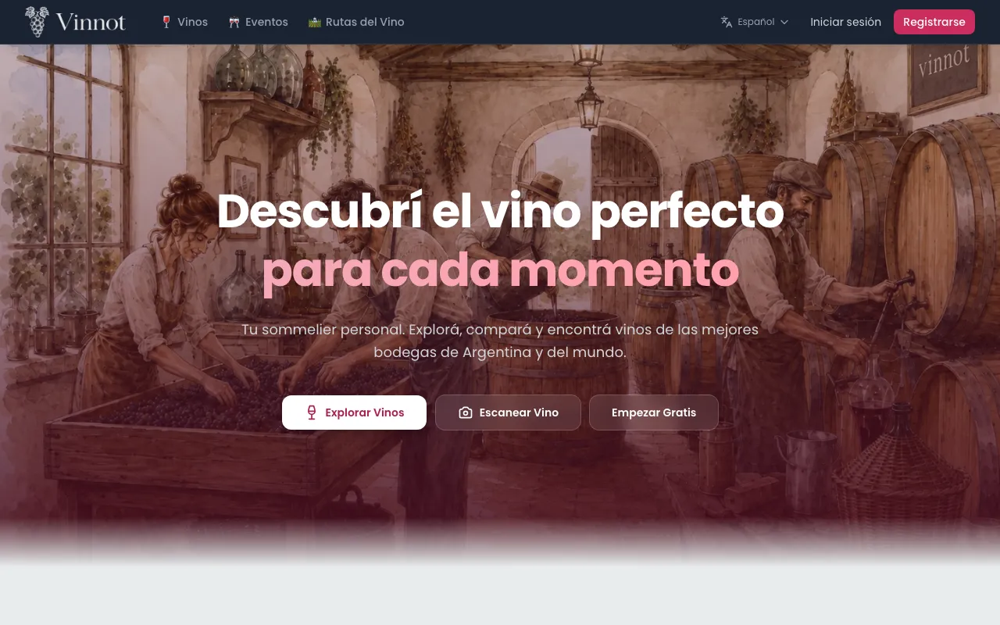

1. Abre [vinnot.com](https://vinnot.com).
2. Explora el inicio: tipos de vino, variedades de uva populares, eventos y rutas.
3. Si eliges una función que necesita sesión, el sitio te lleva a «Iniciar sesión» y, después de entrar, te devuelve a la página que habías elegido.

[UC-USR-22](../modules/users/use-cases/uc-usr-22-home.md) · [UC-USR-07](../modules/users/use-cases/uc-usr-07-resume-protected-destination.md) · [UC-SUP-01](../modules/support/use-cases/uc-sup-01-read-public-information.md)

## Crear una cuenta e iniciar sesión

Puedes registrarte con tu correo y una contraseña, o entrar con Google o Apple.

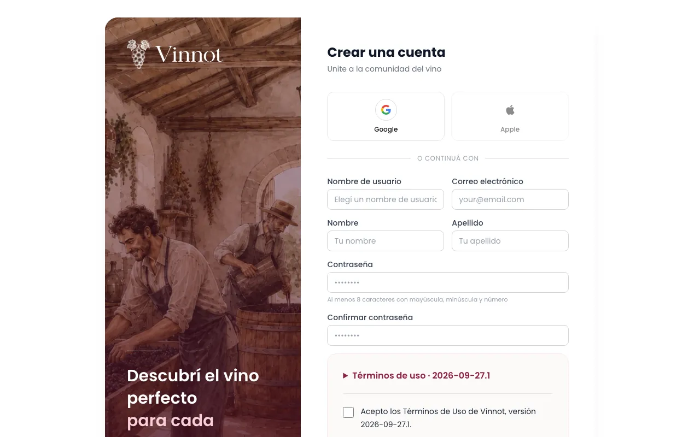

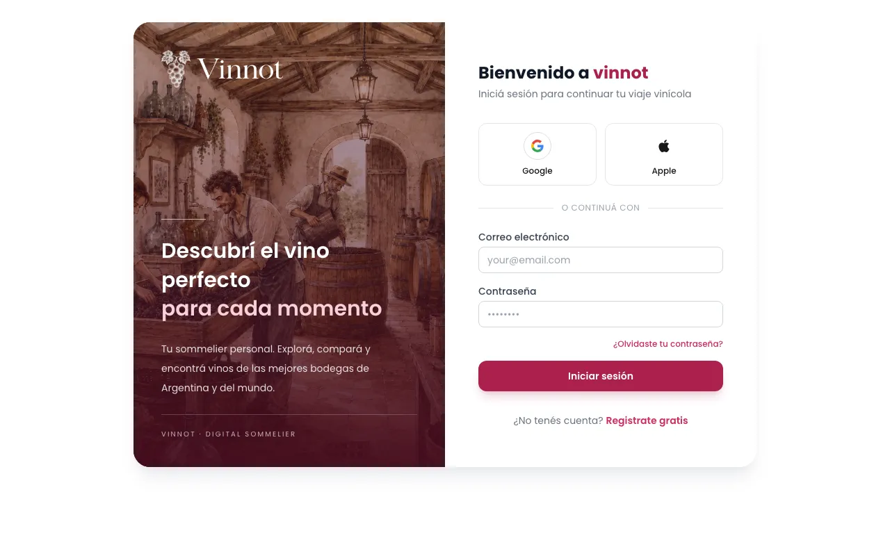

**Registrarte con correo**

1. Elige «Registrarse» en la cabecera.
2. Completa nombre de usuario, correo electrónico, nombre, apellido, contraseña y su confirmación.
3. Despliega y lee los términos si quieres, y marca la casilla de aceptación.
4. Pulsa «Crear cuenta».
5. Abre el enlace que llega a tu correo para verificar la cuenta. Si no llegó o venció, elige «Reenviar correo de verificación».

**Iniciar sesión**

1. Elige «Iniciar sesión».
2. Ingresa tu correo y tu contraseña, o elige continuar con Google o Apple.
3. Si es tu primera vez con Google o Apple, elige un nombre de usuario con «Usar este nombre» o conserva el temporal con «Omitir por ahora».

Notas:

- El nombre de usuario tiene entre 3 y 40 caracteres: letras, números, punto, guion y guion bajo, y empieza y termina con letra o número.
- La contraseña tiene al menos 8 caracteres, con una mayúscula, una minúscula y un número.
- Registrarte no inicia la sesión: primero debes verificar tu correo. El enlace de verificación dura 24 horas y sirve una sola vez.
- Si la cuenta está desactivada, el sitio te pregunta «¿Querés reactivar tu cuenta?» al intentar entrar. Elige «Reactivar cuenta» para recuperar tu perfil y tus datos, o «Cancelar» para no entrar.
- «Iniciar sesión» y «Registrarse» en la cabecera o en el menú te devuelven a la página en la que estabas una vez que entras.
- Para salir, abre el menú de tu perfil y elige «Cerrar sesión».

[UC-USR-01](../modules/users/use-cases/uc-usr-01-sign-up.md) · [UC-USR-02](../modules/users/use-cases/uc-usr-02-verify-email.md) · [UC-USR-03](../modules/users/use-cases/uc-usr-03-sign-in.md) · [UC-USR-04](../modules/users/use-cases/uc-usr-04-social-sign-in.md) · [UC-USR-05](../modules/users/use-cases/uc-usr-05-complete-profile.md) · [UC-USR-06](../modules/users/use-cases/uc-usr-06-restore-session.md) · [UC-USR-08](../modules/users/use-cases/uc-usr-08-sign-out.md)

## Recuperar la contraseña

Si olvidaste tu contraseña, puedes pedir un enlace para elegir una nueva.

1. En «Iniciar sesión», elige «¿Olvidaste tu contraseña?».
2. Ingresa tu correo y pulsa «Enviar enlace de recuperación».
3. Abre el enlace que llega a tu correo.
4. Escribe la contraseña nueva, confírmala y pulsa «Cambiar contraseña».

Notas:

- El sitio muestra la misma confirmación exista o no una cuenta con ese correo.
- El enlace dura 60 minutos y sirve una sola vez. Si venció, elige «Solicitar un nuevo enlace».
- Al cambiar la contraseña se cierran las sesiones abiertas en otros dispositivos.

[UC-USR-09](../modules/users/use-cases/uc-usr-09-request-password-recovery.md) · [UC-USR-10](../modules/users/use-cases/uc-usr-10-reset-password.md)

## Aceptar los términos

Para usar las partes privadas del sitio debes aceptar la versión vigente de los términos. Al registrarte con correo ya los aceptas; si entraste con Google o Apple, o si los términos cambiaron, el sitio te los pide al entrar.

1. En la pantalla «Antes de continuar», despliega el texto si quieres leerlo.
2. Marca la casilla.
3. Pulsa «Aceptar y continuar».

Notas:

- Si prefieres no aceptar ahora, elige «Ahora no · cerrar sesión». No se guarda ninguna decisión y la próxima vez se vuelve a preguntar.
- Cuando se publica una versión nueva, tienes 30 días de aviso para seguir usando el sitio antes de tener que aceptarla.
- El centro legal y «Contacto» siguen disponibles sin aceptar.

[UC-LEG-02](../modules/legal/use-cases/uc-leg-02-accept-at-sign-up.md) · [UC-LEG-03](../modules/legal/use-cases/uc-leg-03-check-acceptance.md) · [UC-LEG-04](../modules/legal/use-cases/uc-leg-04-accept-current-version.md) · [UC-LEG-05](../modules/legal/use-cases/uc-leg-05-decline-and-sign-out.md)

## Test de gustos

El test de gustos son cinco preguntas ilustradas que arman un primer perfil de gustos, aunque todavía no hayas calificado vinos. Después de iniciar sesión, si aún no lo hiciste y tienes menos de 5 vinos calificados, el sitio te lleva al test una sola vez.

1. Elige en cada pregunta la tarjeta que más te tiente. La opción se resalta y el test pasa solo a la siguiente pregunta.
2. Si quieres cambiar una respuesta, pulsa «Anterior»: tu elección sigue marcada.
3. Al responder la quinta pregunta, espera unos trece segundos mientras «Definiendo tu perfil de gustos» muestra, con calma, cómo una pluma dibuja tus elecciones en una libreta de cata, una copa se llena de vino, un pincel mezcla los colores en una paleta y da forma a tu rueda de gustos («Dando forma a tu perfil de gustos»).
4. Se abre tu perfil público con la tarjeta «Perfil de gustos» y la nota «Según tu test de gustos».

Notas:

- «Saltear» está en cada pregunta. Si lo salteas, el sitio no vuelve a ofrecértelo y regresas a la página en la que estabas.
- Puedes hacerlo o repetirlo cuando quieras desde tu perfil público, con «Hacé tu test de gustos» o «Repetir el test». Al repetirlo, «Saltear» sale sin borrar tus respuestas anteriores.
- Tus respuestas no se muestran a nadie. A medida que calificas vinos, tus calificaciones reemplazan lo que vino del test; la rueda de gustos aparece al calificar 5 vinos.
- Si no se puede guardar el test, pulsa «Reintentar»: tus respuestas se conservan.

Para leer la rueda de gustos, elige arriba «Uvas», «Estilos» o «Regiones»: la rueda muestra un solo tipo por vez, como una flor de pétalos en acuarela: cuanto más largo el pétalo, más alto tu puntaje promedio. Toca un pétalo, en la rueda o en la lista, para ver en el centro qué es, su puntaje promedio y cuántos vinos calificaste; vuelve a tocarlo para quitar el resaltado. En «Uvas», el color dice si la uva es de tintos, blancos o rosados.

Para afinar tu paladar a tu manera, ajusta la estructura de tu perfil de gustos:

1. Abre tu perfil público y, en la tarjeta «Perfil de gustos», pulsa «Ajustar» junto a «Estructura».
2. Arrastra el marcador de cada barra (Acidez, Cuerpo, Taninos y Dulzor), o toca la barra, para llenarla o vaciarla. Con el teclado, las flechas la mueven de a poco e Inicio y Fin la llevan a los extremos. La palabra de nivel cambia mientras la mueves.
3. Pulsa «Guardar». Solo se guardan las barras que cambiaste, y cada una muestra la etiqueta «Ajustado». «Cancelar» deja todo como estaba.

Notas:

- Lo que ajustas a mano prevalece sobre lo que calculan tus calificaciones y el test.
- Para volver a los valores calculados, pulsa «Ajustar» y luego «Volver a lo calculado».
- Una barra sin datos empieza en el medio y solo se guarda si la mueves.
- Solo tú ves estos controles; quienes visitan tu perfil ven el resultado.

## Moverte por el sitio

La cabecera, el menú y el pie dan acceso a todas las secciones.

1. Usa la cabecera para ir a «Vinos», «Eventos», «Rutas del vino» y «Escanear».
2. Abre el menú de tu perfil para ir a «Mi perfil», «Mis entradas» y «Mi Bodega», o para «Cerrar sesión».
3. Usa el pie para «Sobre nosotros», «Contacto», «Ayuda», «Legal» y los demás documentos legales.
4. En el teléfono, abre el botón de menú arriba a la izquierda. El menú se abre sobre la página; ciérralo con su botón de cerrar o con la tecla Escape, y el foco vuelve al botón de menú.

[UC-USR-23](../modules/users/use-cases/uc-usr-23-navigate.md)

## Buscar vinos

El catálogo reúne los vinos publicados en Vinnot. Puedes buscarlos por texto y filtrarlos.

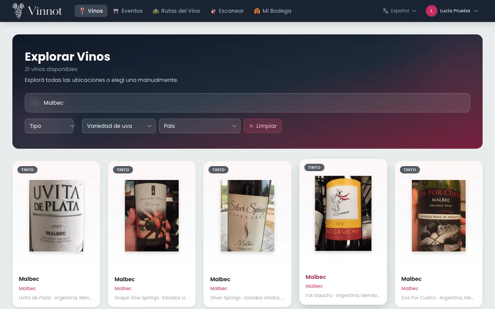

1. Elige «Vinos».
2. La primera vez, si lo permites, el sitio propone el país de tu ubicación. Puedes cambiarlo o quitarlo.
3. Escribe el nombre de un vino o de una bodega.
4. Filtra por tipo, variedad de uva, país o región.
5. Recorre los resultados con «Anterior» y «Siguiente».

Notas:

- La búsqueda empieza a partir de 2 caracteres y busca por nombre del vino y de la bodega.
- Al cambiar el país se borra la región elegida. «Limpiar» quita todos los filtros.
- Cada página muestra 20 vinos y solo se pueden recorrer los primeros 500 resultados; si no encuentras lo que buscas, afina la búsqueda.

[UC-WIN-01](../modules/wines/use-cases/uc-win-01-search-catalog.md) · [UC-WIN-02](../modules/wines/use-cases/uc-win-02-page-catalog.md) · [UC-WRY-03](../modules/wineries/use-cases/uc-wry-03-countries-and-regions.md)

## Ver un vino y su bodega

La ficha de un vino muestra su información, su perfil de sabor y sus reseñas, y desde ahí llegas a la bodega.

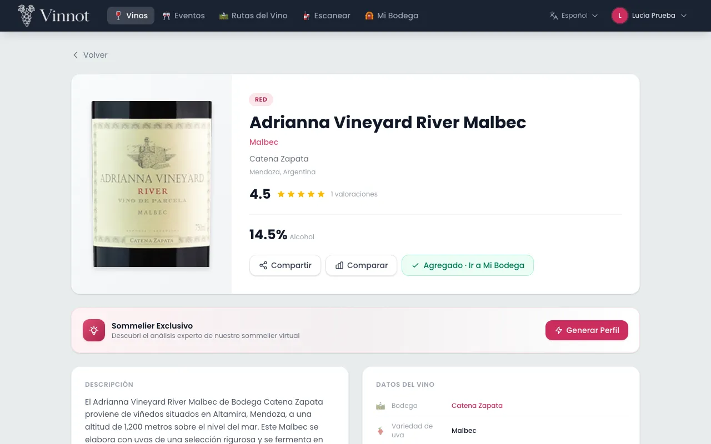

1. Abre un vino desde el catálogo, el inicio u otra sección.
2. Revisa la descripción, la bodega y el origen, las uvas, el alcohol, la valoración y el «Perfil de sabor».
3. Desde la ficha puedes ir a la bodega, «Comparar», «Compartir» o «Agregar a Bodega».
4. En la ficha de la bodega verás su logo, ubicación en un mapa, año de fundación, descripción, contacto y «Vinos de esta bodega».

Notas:

- Si falta un dato, ese bloque no se muestra.
- La ficha de la bodega lista sus vinos activos de a 20.
- Si el vino o la bodega no se pueden cargar, por ejemplo sin conexión, la página lo explica y ofrece «Reintentar». Un vino o una bodega que ya no existe muestra que no se encontró, con un enlace al catálogo de vinos.
- «Volver» regresa a la página anterior. Si abriste la página directamente, por ejemplo desde un enlace compartido, te lleva al listado: el catálogo para vinos y bodegas, los eventos para un evento y las rutas del vino para una ruta.

[UC-WIN-03](../modules/wines/use-cases/uc-win-03-view-wine-detail.md) · [UC-WRY-01](../modules/wineries/use-cases/uc-wry-01-view-winery.md)

## Escribir una reseña

Una reseña comparte tu opinión sobre un vino con la comunidad.

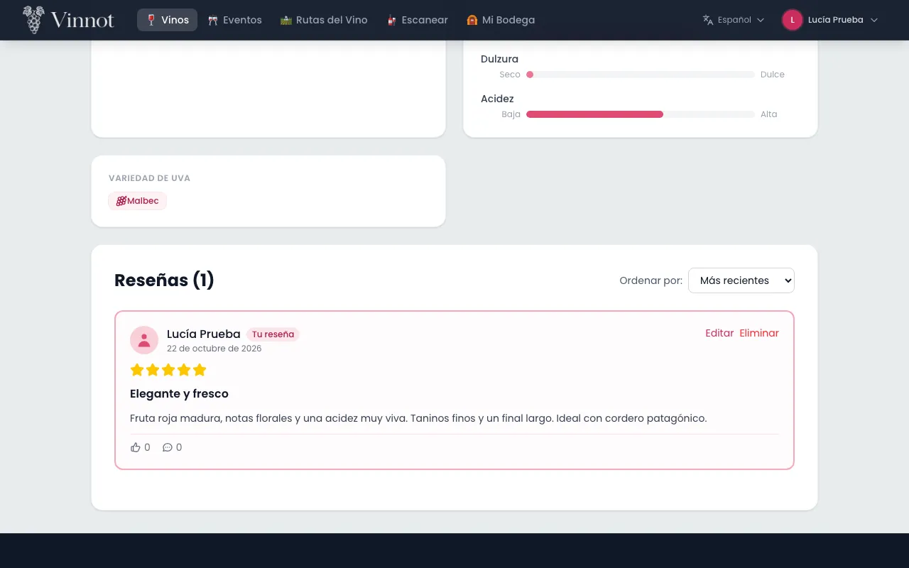

1. En la ficha del vino, elige «Escribir reseña».
2. Elige un puntaje de 0.1 a 5.0, el único campo obligatorio (*): al abrir el formulario la botella se descorcha sola al lado de las copas, con una barra con una copita, el puntaje y «Deslizá la botella o la barra para puntuar» debajo, y en tus primeras tres reseñas, después del descorche, una botella translúcida muestra el gesto; arrástrala hacia las copas, desliza la barra o pulsa una copa, y sirve. Cada número entero queda debajo de su copa. Con 5.0 vuelve a su lugar, vacía. Con el teclado, las flechas cambian 0.1, Re Pág y Av Pág cambian 0.5, e Inicio y Fin llevan al mínimo y al máximo.
3. Elige, si quieres, la añada que probaste en «Añada». Primero aparece la añada de la etiqueta del vino; si escribes el año, la lista salta a él.
4. Agrega, si quieres, un título y un comentario.
5. Pulsa «Enviar reseña».

Notas:

- Puedes escribir una sola reseña por vino. Si ya tienes una, verás «Tu reseña» en lugar del formulario.
- La reseña se publica al instante. La moderación actúa después, a partir de denuncias.
- El título admite hasta 255 caracteres.
- La añada que elijas se muestra en tu reseña como una píldora, por ejemplo «Añada 2018». Es la añada que probaste y puede ser distinta de la añada de la etiqueta del vino.
- Al publicarla, el vino se agrega a tu cava con tu puntaje. Si escribiste un comentario, pasa a ser las notas de la cava; sin comentario, tus notas privadas se conservan. Si elegiste una añada, tu nota de la cava también la toma; sin añada, se conserva la de la cava.
- Las reseñas se pueden ordenar por «Más recientes» o «Más valoradas» y se muestran de a 20.
- Sin cuenta puedes leer las reseñas; elige «Iniciá sesión para escribir una reseña» y vuelves al mismo vino después de entrar.
- Si las reseñas no se pueden cargar, la sección ofrece «Reintentar» en lugar de decir que no hay reseñas.

[UC-REV-01](../modules/reviews/use-cases/uc-rev-01-read-reviews.md) · [UC-REV-02](../modules/reviews/use-cases/uc-rev-02-publish-review.md)

## Dar like, comentar y editar reseñas

Puedes reaccionar a las reseñas de otras personas y mantener al día la tuya.

1. Toca el like de una reseña para darlo; vuelve a tocarlo para quitarlo.
2. Abre los comentarios de una reseña, escribe tu comentario y pulsa «Enviar».
3. Para cambiar tu reseña, elige «Editar», modifica el puntaje, la añada, el título o el comentario y pulsa «Guardar cambios». Elegir «Sin añada» quita la añada.
4. Para borrar tu reseña o tu comentario, elige «Eliminar» y confirma.

Notas:

- Puedes dar un like por reseña, también a la tuya. Quien escribió la reseña recibe los likes en un resumen.
- Los comentarios admiten hasta 2000 caracteres, se publican al instante y no se pueden editar.
- Editar tu reseña actualiza también tu cava. Eliminarla borra sus comentarios y likes, pero no quita el vino de tu cava.

[UC-REV-03](../modules/reviews/use-cases/uc-rev-03-edit-review.md) · [UC-REV-04](../modules/reviews/use-cases/uc-rev-04-delete-review.md) · [UC-REV-05](../modules/reviews/use-cases/uc-rev-05-like-review.md) · [UC-REV-06](../modules/reviews/use-cases/uc-rev-06-review-comments.md)

## Guardar vinos en tu cava

Tu cava («Mi Bodega») es tu colección personal: guarda cada vino una vez, con tu puntaje, tus notas privadas y el precio que pagaste.

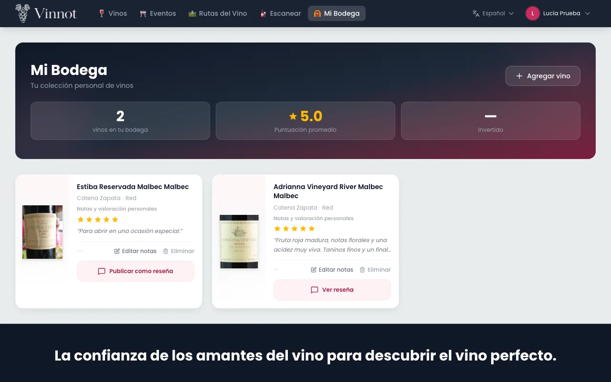

1. En la ficha del vino, elige «Agregar a Bodega».
2. Carga, si quieres, un puntaje de 0.1 a 5.0, la añada que probaste, notas y el precio de compra.
3. Confirma con «Agregar vino». Verás «Agregaste el vino a tu bodega».
4. Abre «Mi Bodega» desde el menú para ver tus vinos y el resumen: «Vinos», «Promedio», «Regiones» y la mezcla de tipos. El precio de compra se ve en cada vino.
5. Para cambiar tus datos, elige «Editar notas» en un vino. «Sin añada» quita la añada.
6. Para quitar un vino, elige «Eliminar» y confirma. Verás «Quitaste el vino de tu bodega».
7. Para compartir tu nota, elige «Publicar como reseña», revisa el borrador y confirma. El borrador empieza con tu puntaje, tu añada y tus notas.

Notas:

- Si el vino ya está en tu cava, la ficha muestra «Agregado · Ir a Mi Bodega».
- Las notas de la cava son privadas hasta que las publicas como reseña. Si ya tienes una reseña de ese vino, se abre esa reseña en lugar de crear otra.
- Quitar un vino de la cava no borra tu reseña.
- La añada que probaste se muestra en el vino como una píldora, por ejemplo «Añada 2018».
- Los importes se muestran en pesos argentinos. Las notas admiten hasta 10000 caracteres.
- Los diálogos «Editar notas» y «Publicar como reseña» no se cierran al hacer clic fuera. Si los cierras con cambios sin guardar, el sitio pregunta si quieres descartarlos; mientras se guarda no se pueden cerrar. En pantallas bajas, el diálogo de edición se desplaza por dentro para que «Guardar» siga a mano.

[UC-CEL-01](../modules/cellar/use-cases/uc-cel-01-view-cellar.md) · [UC-CEL-02](../modules/cellar/use-cases/uc-cel-02-add-wine.md) · [UC-CEL-03](../modules/cellar/use-cases/uc-cel-03-edit-entry.md) · [UC-CEL-04](../modules/cellar/use-cases/uc-cel-04-remove-entry.md) · [UC-CEL-05](../modules/cellar/use-cases/uc-cel-05-publish-note-as-review.md)

## Perfil IA y comparación de vinos

El perfil de sommelier describe un vino en detalle y la comparación enfrenta dos vinos. Ambos se generan con inteligencia artificial.

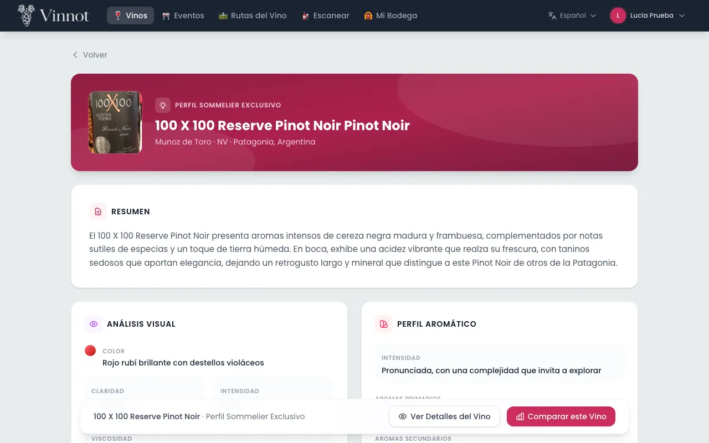

**Ver o generar el perfil IA**

1. En la ficha del vino, busca la tarjeta «Sommelier exclusivo».
2. Elige «Ver perfil» si ya existe, o «Generar perfil» si todavía no.
3. Lee el resumen, el análisis visual, los aromas, la boca, los sabores, los maridajes, el servicio, las ocasiones y los vinos similares.

**Comparar dos vinos**

1. Elige «Comparar» en la ficha de un vino, o «Comparar este vino» en su perfil IA.
2. Busca y elige el segundo vino. Puedes usar «Intercambiar» o «Limpiar todo».
3. Cuando hay dos vinos elegidos, el sitio muestra el resumen, las diferencias clave, las similitudes, la tabla de atributos, para qué conviene cada uno y la recomendación.

Notas:

- Leer un perfil nunca genera uno nuevo; generar es una acción explícita.
- Mientras se escribe un perfil o una comparación, una escena en acuarela muestra cada paso: se abre la botella, se sirve el vino, suben los aromas y se escriben las notas.
- Los perfiles y las comparaciones existen en español e inglés.
- Puedes generar hasta 20 perfiles y hacer hasta 20 comparaciones por hora. Si la IA no está disponible, conservas la selección y puedes reintentar más tarde.
- Elige dos vinos distintos para comparar.

[UC-AI-01](../modules/ai/use-cases/uc-ai-01-view-ai-profile.md) · [UC-AI-02](../modules/ai/use-cases/uc-ai-02-compare-wines.md)

## Escanear etiquetas

El escaneo de etiquetas está disponible en la app de Vinnot, no en la web.

1. Elige «Escanear» en la cabecera.
2. El sitio muestra cómo descargar la app para escanear con la cámara del teléfono.

[UC-WIN-04](../modules/wines/use-cases/uc-win-04-scan-invitation.md)

## Descubrir eventos

La sección de eventos muestra degustaciones, ferias, cenas y otras actividades vigentes.

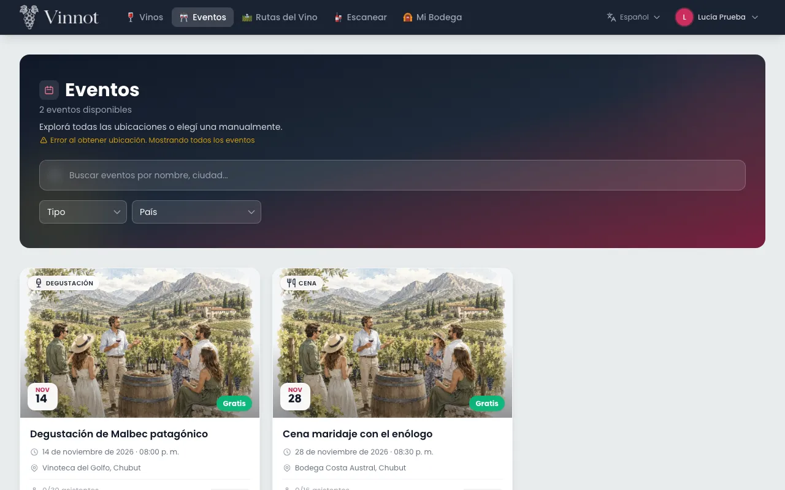

1. Elige «Eventos».
2. Si compartes tu ubicación, primero verás los eventos a menos de 100 km y después los demás.
3. Filtra por texto, tipo, país o región.
4. Abre un evento para ver imagen, descripción, fecha, lugar, organizador, precio y cupos.
5. Desde el detalle puedes elegir «Abrir en Maps», contactar al organizador, «Compartir» o denunciar el evento.

Notas:

- Solo se listan eventos publicados o agotados que todavía no terminaron.
- La búsqueda, los filtros y la página quedan en la dirección de la página, así que al volver de un evento regresas al mismo listado.
- Un evento cancelado o terminado sigue visible desde sus enlaces, con su estado y sin inscripción.

[UC-EVT-01](../modules/events/use-cases/uc-evt-01-discover-events.md) · [UC-EVT-02](../modules/events/use-cases/uc-evt-02-view-event.md)

## Inscribirte en un evento y pagar

Puedes reservar lugar en un evento y, si es pago, pagarlo con Mercado Pago.

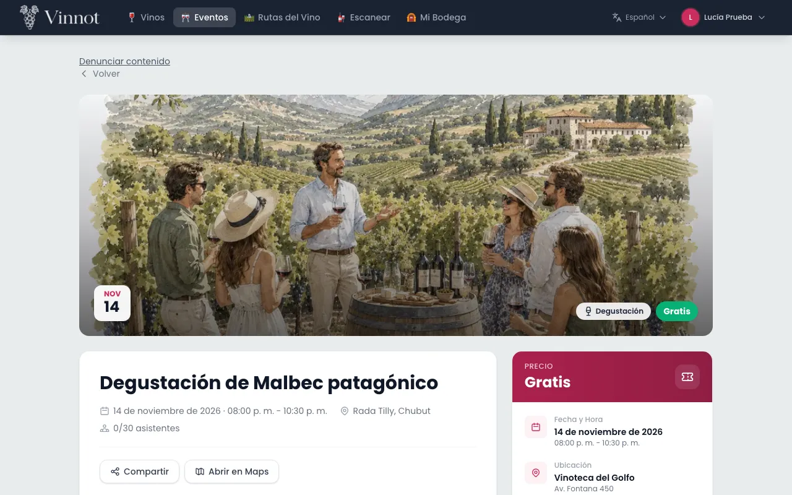

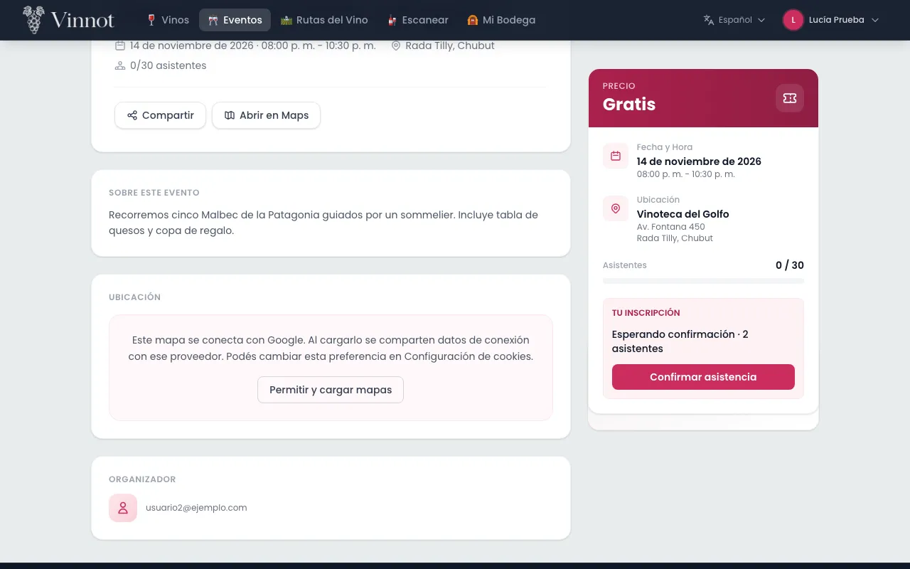

1. En el detalle del evento, elige «Inscribirme».
2. Indica la «Cantidad de asistentes» y tu celular de contacto. Tu nombre y correo salen de tu cuenta.
3. Si quieres, marca «Guardar este teléfono para próximas reservas».
4. Revisa el total y las condiciones, y confirma:
   - «Confirmar inscripción» en un evento gratuito con aprobación automática.
   - «Enviar solicitud» si el organizador aprueba cada inscripción.
   - «Continuar al pago» en un evento pago.
5. En un evento pago, completa el pago en Mercado Pago. Al volver, el sitio muestra el estado del pago y un enlace a «Mis entradas».
6. Si el evento pide confirmar asistencia, vuelve al evento y elige «Confirmar asistencia» antes de la fecha indicada.

Notas:

- El estado de tu inscripción puede ser «Solicitada», «Pendiente de pago», «Esperando tu confirmación», «Confirmada», «En lista de espera», «Rechazada», «Cancelada» o «Vencida».
- Tienes una sola inscripción activa por evento. Cada solicitud admite hasta el máximo del evento (6 entradas por defecto, nunca más de 20).
- El cupo queda reservado por un tiempo limitado mientras pagas o confirmas; si vence, se libera.
- Si no hay cupo, quedas en lista de espera; no pasas a confirmada automáticamente cuando se libera un lugar.
- Volver de Mercado Pago no confirma el pago: Vinnot lo verifica con Mercado Pago y la página se actualiza sola mientras está pendiente. Si el pago quedó pendiente, puedes retomarlo con «Pagar con Mercado Pago» en el evento.
- Los pagos son en pesos argentinos. Las devoluciones son totales y las realiza el organizador; si el evento se cancela, los pagos en línea se devuelven sin que tengas que pedirlo.
- Para cancelar tu inscripción, elige «Cancelar inscripción» en «Tu inscripción» y confirma. Una inscripción ya pagada en línea no se cancela desde aquí: pídeselo al organizador.
- Si cierras el diálogo de inscripción después de cambiar la cantidad de asistentes o el teléfono, el sitio pregunta antes de descartar los cambios. No se cierra mientras se envía la inscripción.

[UC-EVT-03](../modules/events/use-cases/uc-evt-03-register-for-event.md) · [UC-EVT-04](../modules/events/use-cases/uc-evt-04-confirm-attendance.md) · [UC-EVT-05](../modules/events/use-cases/uc-evt-05-cancel-registration.md) · [UC-PAY-01](../modules/payments/use-cases/uc-pay-01-pay-registration.md) · [UC-PAY-02](../modules/payments/use-cases/uc-pay-02-checkout-return.md) · [UC-PAY-04](../modules/payments/use-cases/uc-pay-04-refund-registration.md)

## Ver tus entradas

«Mis entradas» reúne todas tus inscripciones, sus estados y sus pagos.

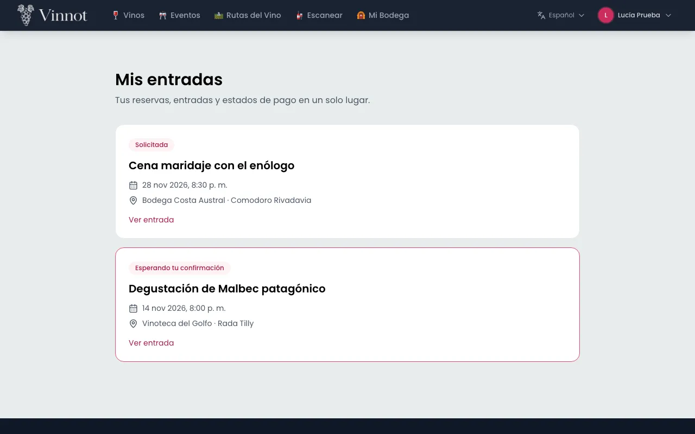

1. Abre el menú de tu perfil y elige «Mis entradas».
2. Revisa la lista, de la más reciente a la más antigua.
3. Elige «Ver entrada» para ver fecha y horario, personas, ubicación, pago, contacto del organizador y la «Referencia».
4. Usa «Actualizar estado» para ver el estado más reciente.

Notas:

- La referencia de 12 caracteres identifica tu entrada. No hay código QR.
- Si el evento se canceló, la entrada lo indica.
- La página del listado queda en la dirección de la página, así que al volver de una entrada regresas a la misma página.

[UC-EVT-06](../modules/events/use-cases/uc-evt-06-my-tickets.md)

## Recorrer una ruta del vino

Las rutas del vino proponen un recorrido por bodegas y otras paradas.

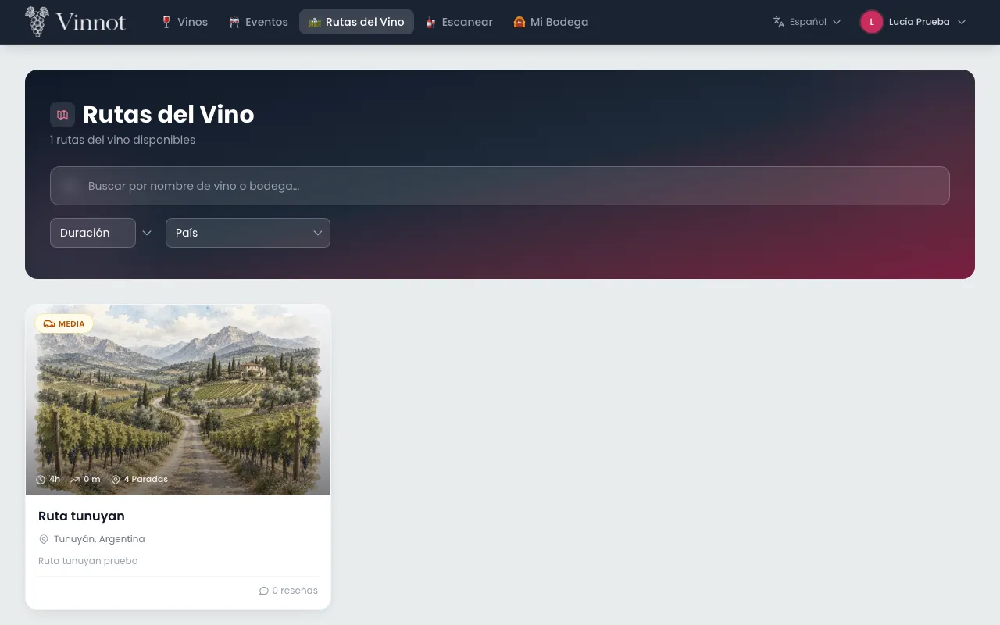

1. Elige «Rutas del vino».
2. Filtra por texto, duración (corta, media o larga), país o región.
3. Abre una ruta para ver portada, descripción, distancia, duración y tipos de vino recomendados.
4. Revisa las «Paradas de la ruta» y expande cada una para ver su descripción, dirección y contactos.
5. Abre una parada en Google Maps, o elige «Iniciar ruta» para navegar el recorrido completo en auto.

Notas:

- Los filtros se aplican sobre todas las rutas publicadas, así que el total y las páginas coinciden con los resultados. La búsqueda, los filtros y la página quedan en la dirección de la página, así que al volver de una ruta regresas al mismo listado.
- La duración corta, media o larga es una categoría de largo del recorrido, no de dificultad. Si la ruta no la tiene, no se muestra.
- El tiempo del recorrido se muestra en horas y minutos; si la ruta solo se estima en días, se muestra en días.
- Vinnot no sigue tu ubicación ni registra tu recorrido.

[UC-RTE-01](../modules/wine-routes/use-cases/uc-rte-01-browse-routes.md) · [UC-RTE-02](../modules/wine-routes/use-cases/uc-rte-02-view-route.md) · [UC-RTE-03](../modules/wine-routes/use-cases/uc-rte-03-navigate-stops.md) · [UC-RTE-04](../modules/wine-routes/use-cases/uc-rte-04-share-or-report-route.md)

## Compartir

Puedes compartir un vino, un evento o una ruta con un enlace público.

1. En el detalle, elige «Compartir».
2. Elige dónde compartirlo en la hoja de tu navegador. Si el navegador no permite compartir, el enlace se copia.
3. Quien recibe el enlace ve una vista previa sin iniciar sesión, con «Abrir en Vinnot», «Continuar en la web» y las descargas de la app.

Notas:

- El enlace no incluye datos tuyos.
- Para ver el contenido completo hay que iniciar sesión; después se abre el contenido compartido.
- Si el contenido ya no es público, la vista previa indica que el enlace no está disponible.
- «Compartir» solo aparece en lo que tiene página pública: un evento ya publicado que no es borrador y una ruta publicada.

[UC-SHR-01](../modules/sharing/use-cases/uc-shr-01-share-content.md) · [UC-SHR-02](../modules/sharing/use-cases/uc-shr-02-open-shared-link.md) · [UC-SHR-03](../modules/sharing/use-cases/uc-shr-03-open-in-app-or-web.md)

## Elegir tus notificaciones

Puedes elegir qué avisos recibir por correo y en la app, y en qué zona quieres enterarte de eventos nuevos.

1. Abre «Mi perfil» y elige la pestaña «Notificaciones».
2. Para cada categoría, enciende o apaga «Correo» y «App». Si una categoría no usa un canal, en su lugar ves «—».
3. Si desactivas «Novedades y recomendaciones de Vinnot», dejas de recibir recomendaciones y novedades.
4. En «Tu zona», elige una región para enterarte de eventos nuevos ahí. Elige «Dejar de recibir» para quitarla.

**Darte de baja desde un correo**

1. En un correo promocional, elige el enlace para darte de baja.
2. En la página que se abre, pulsa «Darme de baja».
3. Si quieres revisar el resto, elige «Gestionar preferencias de notificaciones».

Notas:

- «Cuenta», «Seguridad», «Pagos» y «Entradas» son obligatorias y siempre se envían.
- Todas vienen encendidas. Si desactivas «Novedades y recomendaciones de Vinnot», dejas de recibir «Recomendaciones» y «Newsletter».
- «Recordatorios» avisa sobre vinos que miraste, tu bodega y tus eventos.
- Las sugerencias y recordatorios en la app llegan como mucho dos veces por semana y nunca entre las 22:00 y las 09:00 de tu zona horaria.
- Los correos llegan en el idioma de tu cuenta.
- La ubicación aproximada para eventos cercanos se define desde la app.

[UC-NOT-01](../modules/notifications/use-cases/uc-not-01-manage-preferences.md) · [UC-NOT-02](../modules/notifications/use-cases/uc-not-02-unsubscribe.md) · [UC-NOT-06](../modules/notifications/use-cases/uc-not-06-receive-email.md) · [UC-EVT-07](../modules/events/use-cases/uc-evt-07-event-area.md)

## Denunciar o bloquear

Si algo no respeta las normas de la comunidad, puedes denunciarlo. Si no quieres interactuar con alguien, puedes bloquearlo.

**Denunciar**

1. En una reseña o un comentario, abre el menú de tres puntos arriba a la derecha y elige «Denunciar contenido» o «Denunciar usuario». En un evento o una ruta, elige «Denunciar contenido». Desde el menú, el formulario de denuncia se abre en un diálogo.
2. Elige un motivo: «Spam», «Acoso», «Odio o discriminación», «Contenido sexual», «Violencia o amenazas», «Privacidad», «Información engañosa» u «Otro».
3. Agrega una descripción si quieres. Con «Otro» es obligatoria.
4. Pulsa «Enviar denuncia». Verás el comprobante de la denuncia.

**Bloquear y desbloquear**

1. En una reseña o un comentario, abre el menú de tres puntos arriba a la derecha, elige «Bloquear usuario» y confirma.
2. Para ver tus denuncias y bloqueos, abre «Tu actividad de comunidad» desde «Mi perfil».
3. En «Usuarios bloqueados», elige «Desbloquear» para quitar un bloqueo.

Notas:

- No puedes denunciar tu propio contenido. Si ya tienes una denuncia abierta sobre el mismo contenido, recibes el mismo comprobante.
- Puedes enviar hasta 10 denuncias en 24 horas. La descripción admite hasta 2000 caracteres. Si una denuncia o un bloqueo falla, el sitio te dice por qué: límite diario, demasiadas solicitudes seguidas, contenido propio o contenido que ya no está disponible.
- El equipo de Vinnot revisa cada denuncia; no hay sanciones automáticas por cantidad de denuncias.
- El bloqueo vale en ambos sentidos: oculta reseñas, comentarios y perfiles, e impide likes y comentarios entre las dos cuentas. Eventos y rutas siguen visibles.
- Las denuncias cerradas desaparecen de tu actividad 90 días después de cerrarse. Para pedir que se revise una decisión, escribe desde «Contacto» con la referencia del caso.

[UC-COM-01](../modules/community/use-cases/uc-com-01-report-content.md) · [UC-COM-02](../modules/community/use-cases/uc-com-02-block-user.md) · [UC-COM-03](../modules/community/use-cases/uc-com-03-my-community.md)

## Tu cuenta: datos, contraseña, idioma, desactivar o eliminar

Desde «Mi perfil» gestionas tus datos, tu seguridad y tu cuenta.

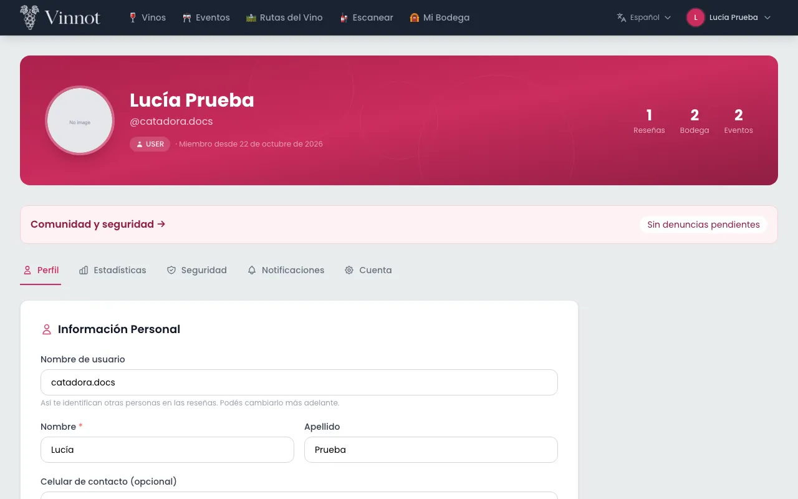

**Datos y avatar**

1. Abre «Mi perfil» desde el menú.
2. En la pestaña «Perfil», cambia nombre de usuario, nombre, apellido o celular y pulsa «Guardar cambios».
3. Para cambiar tu foto, elige «Cambiar» sobre el avatar y sube una imagen de hasta 5 MB.
4. En «Estadísticas» ves tus reseñas, tu puntuación promedio, tus vinos en la cava y tus inscripciones a eventos.
5. Arriba del perfil ves tu sello, tus puntos y una barra hacia el siguiente sello. Pulsa el sello para abrir «Tus puntos» ([Puntos y sellos](points-and-seals.mdx)).

**Contraseña**

1. En la pestaña «Seguridad», ingresa la contraseña actual, la nueva y su confirmación.
2. Pulsa «Cambiar contraseña».
3. Si creaste la cuenta con Google o Apple y todavía no tienes contraseña, la pestaña muestra «Enviar enlace para crear contraseña»: te llega un enlace por correo para definirla. Si tu cuenta ya tiene contraseña, puedes cambiarla aunque también entres con Google o Apple.

**Correo electrónico**

1. En la pestaña «Cuenta», elige «Cambiar email» e ingresa el nuevo.
2. Pulsa «Enviar confirmación» y confirma tu identidad.
3. Abre el enlace que llega al correo nuevo. Hasta entonces sigue vigente el anterior.

**Idioma**

1. Usa el selector de idioma de la cabecera y elige «Español» o «English».
2. Los textos de la interfaz, los mensajes de los formularios y los nombres de países cambian al idioma elegido. Los nombres de vinos, bodegas y lo que escriben los usuarios no se traducen.

**Desactivar o eliminar la cuenta**

1. En la pestaña «Cuenta», ve a «Zona de peligro».
2. Elige «Desactivar cuenta» y confirma, o «Eliminar cuenta permanentemente».
3. Para eliminarla, escribe la frase exacta «acepto borrar cuenta» y confirma tu identidad.

Notas:

- El celular debe incluir `+` y el código de país. Es privado: no aparece en tu perfil público.
- Al cambiar la contraseña o el correo se cierran tus otras sesiones y recibes un aviso por correo. El enlace de cambio de correo dura 60 minutos.
- Para acciones sensibles, como cambiar el correo o eliminar la cuenta, aparece «Confirmá tu identidad»: usa tu contraseña o tu cuenta de Google y pulsa «Confirmar y realizar acción».
- El idioma elegido se guarda en tu cuenta y es el que usan tus notificaciones. Los textos escritos por usuarios no se traducen.
- Desactivar es reversible y no borra tus datos; para reactivar la cuenta, vuelve a iniciar sesión y elige «Reactivar cuenta». Eliminar es definitivo y borra tu cuenta y tus datos.

[UC-USR-13](../modules/users/use-cases/uc-usr-13-view-profile.md) · [UC-USR-14](../modules/users/use-cases/uc-usr-14-edit-profile.md) · [UC-USR-15](../modules/users/use-cases/uc-usr-15-change-avatar.md) · [UC-USR-16](../modules/users/use-cases/uc-usr-16-change-password.md) · [UC-USR-17](../modules/users/use-cases/uc-usr-17-request-email-change.md) · [UC-USR-11](../modules/users/use-cases/uc-usr-11-confirm-email-change.md) · [UC-USR-12](../modules/users/use-cases/uc-usr-12-reauthenticate.md) · [UC-USR-20](../modules/users/use-cases/uc-usr-20-change-language.md) · [UC-USR-18](../modules/users/use-cases/uc-usr-18-deactivate-account.md) · [UC-USR-19](../modules/users/use-cases/uc-usr-19-delete-account.md)

## Ayuda y contacto

La ayuda responde las preguntas frecuentes y «Contacto» te permite escribir al equipo de Vinnot.

1. Elige «Ayuda» en el pie, o «Consultar preguntas frecuentes» en «Contacto».
2. Escribe en el buscador para filtrar las preguntas.
3. Si no encuentras la respuesta, abre «Contacto».
4. Completa nombre, correo, tema y mensaje. Los temas son «Soporte», «Privacidad», «Reportar contenido», «Revisar una decisión», «Colaboración» y «Consulta general».
5. Pulsa «Enviar consulta». Verás una referencia que empieza con `VIN-`; puedes copiarla con «Copiar referencia».

Notas:

- No hace falta iniciar sesión. Con sesión, se usa el correo de tu cuenta.
- No incluyas contraseñas, datos de tarjetas ni códigos de verificación.
- El mensaje admite hasta 4000 caracteres. Recibes un acuse por correo con la referencia, como máximo uno por día.
- Si el envío falla, el formulario conserva lo que escribiste para que reintentes.

[UC-SUP-01](../modules/support/use-cases/uc-sup-01-read-public-information.md) · [UC-SUP-02](../modules/support/use-cases/uc-sup-02-contact-support.md)

## Documentos legales

El centro legal reúne los documentos que rigen el uso de Vinnot.

1. Elige «Legal» en el pie.
2. Abre el documento que necesites: términos, privacidad, normas de la comunidad, moderación, confianza y seguridad, cómo se ordena la información, pagos y cancelaciones, y almacenamiento y permisos.
3. Para revisar las cookies, elige «Configuración de cookies» en el pie.

Notas:

- El centro legal no necesita sesión. Leer un documento no registra ninguna aceptación.

[UC-LEG-01](../modules/legal/use-cases/uc-leg-01-legal-centre.md)

## Cuando algo falla

Si una página no puede mostrar su contenido, el sitio explica qué pasó y qué puedes hacer.

1. Lee el mensaje: sesión vencida, sin permiso, no encontrado, demasiados pedidos, servicio no disponible, demora, sin conexión o error del servidor.
2. Usa la acción que se ofrece, como «Reintentar» o volver al inicio.

Notas:

- Un error nunca se muestra como una lista vacía: si ves «sin resultados», la consulta funcionó.
- Los mensajes de error están en tu idioma y nunca muestran texto técnico del servidor.

[UC-SUP-03](../modules/support/use-cases/uc-sup-03-service-states.md)
