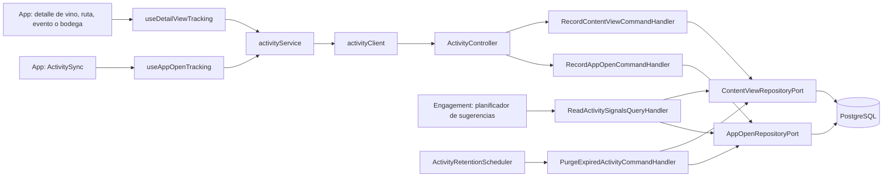

# Arquitectura

Cómo está construido el módulo en cada capa. El backend sigue el flujo hexagonal
`controller → puerto de entrada → handler → dominio → puerto de salida → adaptador`;
la app sigue `pantalla → hook → servicio → cliente API → transporte HTTP`. La web no
envía señales.

## Flujo de una señal

[Ver diagrama de «Flujo de una señal» completo](https://images.vinnot.com/docs/diagrams/v1/es/modules-activity-architecture-4d23935e01a3.svg)

## Backend

### Alcance

El paquete [`activity`](../../../../backend/src/main/java/com/vinnot/activity/) guarda
señales de uso, las pasa por lotes al planificador de sugerencias y las borra a los 180
días. No decide qué sugerir: eso es del módulo de engagement, descrito en
[`UC-NOT-07`](../notifications/use-cases/uc-not-07-receive-suggestions.md). Los push
abiertos se guardan en [Notificaciones](../notifications/README.md).

### Capas

| Responsabilidad | Implementación |
|---|---|
| HTTP | [`ActivityController`](../../../../backend/src/main/java/com/vinnot/activity/infrastructure/web/ActivityController.java) bajo `/users/me/activity`; valida `kind` con un patrón y `id` como UUID |
| Escrituras | [`RecordContentViewCommandHandler`](../../../../backend/src/main/java/com/vinnot/activity/application/command/handler/RecordContentViewCommandHandler.java) y [`RecordAppOpenCommandHandler`](../../../../backend/src/main/java/com/vinnot/activity/application/command/handler/RecordAppOpenCommandHandler.java) |
| Lecturas | [`ReadActivitySignalsQueryHandler`](../../../../backend/src/main/java/com/vinnot/activity/application/query/handler/ReadActivitySignalsQueryHandler.java): ritmos, vistas por usuario y lo más visto, con un número fijo de consultas por página |
| Retención | [`PurgeExpiredActivityCommandHandler`](../../../../backend/src/main/java/com/vinnot/activity/application/command/handler/PurgeExpiredActivityCommandHandler.java) y [`ActivityRetentionScheduler`](../../../../backend/src/main/java/com/vinnot/activity/infrastructure/scheduling/ActivityRetentionScheduler.java) |
| Dominio | [`ContentKind`](../../../../backend/src/main/java/com/vinnot/activity/domain/model/ContentKind.java), [`OpenHourHistogram`](../../../../backend/src/main/java/com/vinnot/activity/domain/model/OpenHourHistogram.java), [`ActivityRhythm`](../../../../backend/src/main/java/com/vinnot/activity/domain/model/ActivityRhythm.java) y [`ViewedContent`](../../../../backend/src/main/java/com/vinnot/activity/domain/model/ViewedContent.java), sin dependencias de framework |
| Puertos de salida | [`ContentViewRepositoryPort`](../../../../backend/src/main/java/com/vinnot/activity/application/port/out/ContentViewRepositoryPort.java) y [`AppOpenRepositoryPort`](../../../../backend/src/main/java/com/vinnot/activity/application/port/out/AppOpenRepositoryPort.java) |
| Persistencia | [`JdbcContentViewRepository`](../../../../backend/src/main/java/com/vinnot/activity/infrastructure/persistence/JdbcContentViewRepository.java) y [`JdbcAppOpenRepository`](../../../../backend/src/main/java/com/vinnot/activity/infrastructure/persistence/JdbcAppOpenRepository.java), con SQL nativo |
| Consumidores | El módulo de engagement usa `ReadActivitySignalsUseCase` en [`EngagementPageService`](../../../../backend/src/main/java/com/vinnot/engagement/application/service/EngagementPageService.java), [`EngagementAdmissionService`](../../../../backend/src/main/java/com/vinnot/engagement/application/service/EngagementAdmissionService.java), [`ViewedNotRatedSource`](../../../../backend/src/main/java/com/vinnot/engagement/infrastructure/candidate/ViewedNotRatedSource.java) y [`WinbackSource`](../../../../backend/src/main/java/com/vinnot/engagement/infrastructure/candidate/WinbackSource.java) |

### Datos

[`V66__engagement_signals.sql`](../../../../backend/src/main/resources/db/migration/V66__engagement_signals.sql)
crea las tablas. Todas tienen `user_id` con borrado en cascada.

| Tabla | Contenido |
|---|---|
| `content_views` | Una fila por (`user_id`, `kind`, `entity_id`, `view_day`) con la cantidad de vistas |
| `app_opens` | Una fila por apertura registrada (`user_id`, `opened_at`) |
| `user_activity` | La última actividad de cada persona |
| `push_opens` | Un push abierto por (`user_id`, `ref`); lo escribe y lo purga Notificaciones |

### Configuración

Cada clave tiene un valor por defecto en el código y en
[`application.yml`](../../../../backend/src/main/resources/application.yml).

| Clave | Por defecto | Uso |
|---|---|---|
| `app.activity.app-open-gap` | `30m` | Separación mínima entre aperturas registradas |
| `app.activity.usual-hour-window` | `30d` | Ventana para calcular la hora habitual |
| `app.activity.retention` | `180d` | Antigüedad a partir de la cual se borran vistas, aperturas y última actividad |
| `app.activity.push-open-retention` | `180d` | Retención de los push abiertos |
| `app.activity.purge-batch-size` | `5000` | Filas por lote de borrado |
| `app.activity.retention-delay-ms` | `86400000` | Intervalo entre purgas (un día) |
| `app.activity.retention-enabled` | `true` | Apaga la tarea de purga si es `false` |

Un valor no positivo de separación, ventana, retención o lote hace fallar el arranque.

### Errores esperables

Un `kind` fuera de `WINE|ROUTE|EVENT|WINERY` o un `id` que no es UUID responden `400`
antes de llegar al caso de uso. Sin sesión, los endpoints responden `401`
([`SecurityConfig`](../../../../backend/src/main/java/com/vinnot/shared/infrastructure/config/SecurityConfig.java)).
Una apertura limitada por la separación mínima responde igual `204`.

## App

| Pieza | Qué hace |
|---|---|
| [`useDetailViewTracking.ts`](../../../../frontend-mobile/src/presentation/hooks/useDetailViewTracking.ts) | Registra una vista por montaje del detalle con sesión e id; lo usan la ficha del vino y los view models de [rutas](../../../../frontend-mobile/src/presentation/features/wineRoute/useWineRouteDetailViewModel.ts), [eventos](../../../../frontend-mobile/src/presentation/features/event/useEventDetailViewModel.ts) y [bodegas](../../../../frontend-mobile/src/presentation/features/winery/useWineryDetailViewModel.ts) |
| [`ActivitySync.tsx`](../../../../frontend-mobile/src/presentation/navigation/ActivitySync.tsx) y [`useAppOpenTracking.ts`](../../../../frontend-mobile/src/presentation/hooks/useAppOpenTracking.ts) | Informan el arranque y cada regreso al frente; al cerrar sesión olvidan la última apertura |
| [`activity.service.ts`](../../../../frontend-mobile/src/application/services/activity.service.ts) | No espera la respuesta, aplica los 30 minutos entre aperturas, reintenta una apertura fallida y solo registra los fallos en desarrollo |
| [`activity.ts`](../../../../frontend-mobile/src/domain/activity/activity.ts) | Tipos de detalle y regla de los 30 minutos, sin dependencias de React |
| [`activity.client.ts`](../../../../frontend-mobile/src/infrastructure/api/clients/activity.client.ts) | `POST /users/me/activity/views` y `POST /users/me/activity/app-open` |

## Referencias

- [README del módulo](README.md), con los endpoints y las reglas de negocio.
- [`UC-NOT-07` · Recibir sugerencias personalizadas](../notifications/use-cases/uc-not-07-receive-suggestions.md).
- [Modelo de datos](../../backend/data/database-model.md).
