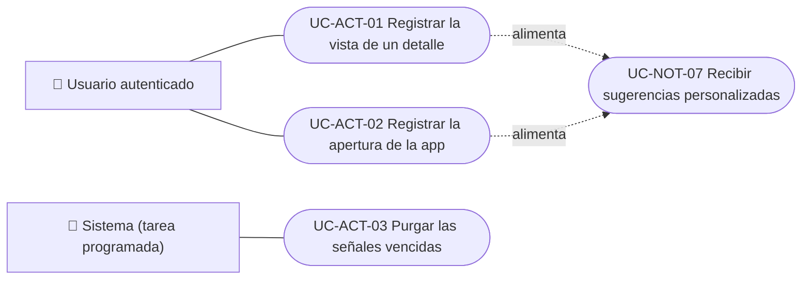

# Casos de uso

Casos de uso del módulo de actividad: registrar las vistas de detalles y las aperturas de la app, y purgar las señales vencidas. La lectura de las señales para elegir sugerencias es parte de [`UC-NOT-07`](../../notifications/use-cases/uc-not-07-receive-suggestions.md), del módulo de notificaciones. Cada caso vale para las plataformas indicadas.

| ID | Caso de uso | Plataformas | Actores |
|---|---|---|---|
| `UC-ACT-01` | [Registrar la vista de un detalle](uc-act-01-record-detail-view.md) | APK | Usuario autenticado |
| `UC-ACT-02` | [Registrar la apertura de la app](uc-act-02-record-app-open.md) | APK | Usuario autenticado |
| `UC-ACT-03` | [Purgar las señales vencidas](uc-act-03-purge-expired-signals.md) | Solo backend | Sistema (tarea programada) |

## Actores y casos de uso

[Ver diagrama de «Actores y casos de uso» completo](https://images.vinnot.com/docs/diagrams/v1/es/modules-activity-use-cases-readme-15808033a520.svg)

## Equivalencia con Lucidchart

| ID | IDs en Lucidchart |
|---|---|
| `UC-ACT-01` | Ninguno |
| `UC-ACT-02` | Ninguno |
| `UC-ACT-03` | Ninguno |
