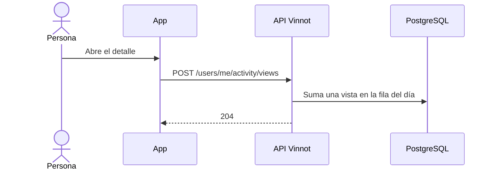

# UC-ACT-01 · Registrar la vista de un detalle

| Campo | Valor |
|---|---|
| ID | `UC-ACT-01` |
| Módulo | [Actividad](../README.md) |
| Plataformas | APK |
| Actores | Usuario autenticado |
| IDs en Lucidchart | Ninguno |
| Requisitos | [`RF-APK-ACT-01`](../requirements.md), [`RF-APK-ACT-02`](../requirements.md) |
| Casos de prueba | [`CP-ACT-01`](../testing.md), [`CP-ACT-02`](../testing.md), [`CP-ACT-03`](../testing.md), [`CP-ACT-04`](../testing.md), [`CP-ACT-05`](../testing.md), [`CP-ACT-06`](../testing.md) |

## Precondiciones

- La persona tiene sesión iniciada en la app.

## Postcondiciones

- La vista queda sumada en la fila de esa persona, ese contenido y ese día UTC.

## Flujo principal

1. La persona abre el detalle de un vino, una ruta, un evento o una bodega.
2. La pantalla llama a `useDetailViewTracking` con el tipo y el id del contenido.
3. `activityService.recordView` envía `POST /users/me/activity/views` con `{kind, id}` sin esperar la respuesta.
4. La API valida el tipo y el UUID y `RecordContentViewCommandHandler` suma una vista en la fila de ese día UTC.
5. La API responde 204.

## Flujos alternativos

- 1a. No hay sesión o falta el id del contenido: la app no envía nada.
- 3a. El pedido falla: la app lo descarta y solo lo registra en desarrollo; la pantalla sigue igual.
- 4a. El tipo no es `WINE`, `ROUTE`, `EVENT` ni `WINERY`, o el id no es un UUID: la API responde 400 sin llegar al caso de uso.
- 4b. El pedido llega sin sesión: la API responde 401 y no guarda nada.
- 4c. La cuenta ya no existe: la señal se ignora sin error.

## Reglas de negocio

- Una fila por usuario, contenido y día UTC; las vistas repetidas suman `views`, así el crecimiento queda acotado.
- No se consulta el contenido por cada vista: un id que no existe se guarda y nunca coincide con contenido real.
- La web no envía señales.
- Las señales no se muestran a otras personas ni se comparten con terceros.

## Secuencia de una vista

[Ver diagrama de «Secuencia de una vista» completo](https://images.vinnot.com/docs/diagrams/v1/es/modules-activity-use-cases-uc-act-01-record-detail-view-2b407ab13fa5.svg)

## Código

| Capa | Ubicación |
|---|---|
| Endpoints | `POST /users/me/activity/views` |
| Backend | [`ActivityController.java`](../../../../../backend/src/main/java/com/vinnot/activity/infrastructure/web/ActivityController.java), [`RecordContentViewCommandHandler.java`](../../../../../backend/src/main/java/com/vinnot/activity/application/command/handler/RecordContentViewCommandHandler.java), [`ContentKind.java`](../../../../../backend/src/main/java/com/vinnot/activity/domain/model/ContentKind.java), [`JdbcContentViewRepository.java`](../../../../../backend/src/main/java/com/vinnot/activity/infrastructure/persistence/JdbcContentViewRepository.java) |
| App | [`useDetailViewTracking.ts`](../../../../../frontend-mobile/src/presentation/hooks/useDetailViewTracking.ts), [`activity.service.ts`](../../../../../frontend-mobile/src/application/services/activity.service.ts), [`activity.client.ts`](../../../../../frontend-mobile/src/infrastructure/api/clients/activity.client.ts), [`activity.ts`](../../../../../frontend-mobile/src/domain/activity/activity.ts) |

## Tests automáticos

- Backend:
  - [`ActivityControllerTest.java`](../../../../../backend/src/test/java/com/vinnot/activity/infrastructure/web/ActivityControllerTest.java): `recordsAViewOfEachKindOfDetailForTheSignedInUser`, `rejectsAnUnknownKindOrAMissingOrMalformedIdBeforeReachingTheUseCase`
  - [`EngagementSignalEndpointsSecurityTest.java`](../../../../../backend/src/test/java/com/vinnot/activity/infrastructure/web/EngagementSignalEndpointsSecurityTest.java): `rejectsAnonymousRequestsWithoutRecordingAnything`, `acceptsASignedInUser`
  - [`RecordContentViewCommandHandlerTest.java`](../../../../../backend/src/test/java/com/vinnot/activity/application/command/handler/RecordContentViewCommandHandlerTest.java): `recordsOneViewOfTheContentAtTheCurrentTime`, `aViewNeedsItsUserKindAndContent`
  - [`JdbcActivityPostgresIntegrationTest.java`](../../../../../backend/src/test/java/com/vinnot/activity/infrastructure/persistence/JdbcActivityPostgresIntegrationTest.java): `repeatedViewsOfOneDetailOnOneDayShareARowAndAnotherDayAddsOne`, `signalsOfAnAccountThatNoLongerExistsAreIgnored`
- App:
  - [`useDetailViewTracking.test.ts`](../../../../../frontend-mobile/src/presentation/hooks/useDetailViewTracking.test.ts): `records one view per detail screen mount of a signed-in member`, `records nothing without an id or while signed out`
  - [`activity.service.test.ts`](../../../../../frontend-mobile/src/application/services/activity.service.test.ts): `records a detail view without waiting for the server`, `never records a view without an id`, `swallows a failed view and only logs it in development`
  - [`activity.client.test.ts`](../../../../../frontend-mobile/src/infrastructure/api/clients/activity.client.test.ts): `records a detail view`
  - [`activity.test.ts`](../../../../../frontend-mobile/src/domain/activity/activity.test.ts): `knows the detail screens whose views are signals`
