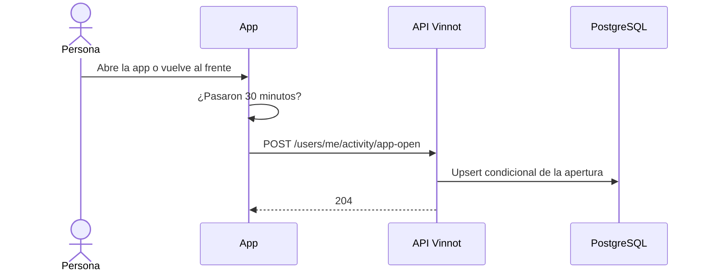

# UC-ACT-02 · Registrar la apertura de la app

| Campo | Valor |
|---|---|
| ID | `UC-ACT-02` |
| Módulo | [Actividad](../README.md) |
| Plataformas | APK |
| Actores | Usuario autenticado |
| IDs en Lucidchart | Ninguno |
| Requisitos | [`RF-APK-ACT-03`](../requirements.md), [`RF-APK-ACT-04`](../requirements.md) |
| Casos de prueba | [`CP-ACT-07`](../testing.md), [`CP-ACT-08`](../testing.md), [`CP-ACT-09`](../testing.md), [`CP-ACT-10`](../testing.md), [`CP-ACT-11`](../testing.md) |

## Precondiciones

- La persona tiene sesión iniciada en la app.

## Postcondiciones

- La apertura queda guardada y la última actividad de la persona, actualizada.

## Flujo principal

1. La persona abre la app o la vuelve a traer al frente.
2. `ActivitySync`, montado en `RootNavigator`, usa `useAppOpenTracking`, que avisa en el arranque y en cada regreso al frente.
3. `activityService.recordAppOpen` envía `POST /users/me/activity/app-open` si no informó otra apertura en los últimos 30 minutos.
4. `RecordAppOpenCommandHandler` guarda la apertura y mueve la última actividad con un upsert condicional que deja como mucho una apertura cada 30 minutos (`app.activity.app-open-gap`).
5. La API responde 204.

## Flujos alternativos

- 3a. La app ya informó una apertura hace menos de 30 minutos: la app no envía nada.
- 4a. Llega otra apertura dentro de los 30 minutos, incluso al mismo tiempo: la API responde 204 sin guardar otra apertura.
- 3b. El pedido falla: la próxima apertura se vuelve a informar sin esperar 30 minutos.
- 1a. La persona cierra sesión: la app deja de escuchar y olvida la última apertura, así el próximo ingreso cuenta enseguida.

## Reglas de negocio

- Como mucho una apertura registrada cada 30 minutos, en la app y en el backend.
- La hora habitual es la hora del día, en `users.timezone`, con más aperturas de los últimos 30 días; un empate elige la más temprana ([`OpenHourHistogram`](../../../../../backend/src/main/java/com/vinnot/activity/domain/model/OpenHourHistogram.java)). La usa [`UC-NOT-07`](../../notifications/use-cases/uc-not-07-receive-suggestions.md).
- Abrir un push también cuenta como apertura de la app; ese registro vive en [Notificaciones](../../notifications/README.md).

## Secuencia de una apertura

[Ver diagrama de «Secuencia de una apertura» completo](https://images.vinnot.com/docs/diagrams/v1/es/modules-activity-use-cases-uc-act-02-record-app-open-9448f6710dd5.svg)

## Código

| Capa | Ubicación |
|---|---|
| Endpoints | `POST /users/me/activity/app-open` |
| Backend | [`ActivityController.java`](../../../../../backend/src/main/java/com/vinnot/activity/infrastructure/web/ActivityController.java), [`RecordAppOpenCommandHandler.java`](../../../../../backend/src/main/java/com/vinnot/activity/application/command/handler/RecordAppOpenCommandHandler.java), [`JdbcAppOpenRepository.java`](../../../../../backend/src/main/java/com/vinnot/activity/infrastructure/persistence/JdbcAppOpenRepository.java) |
| App | [`ActivitySync.tsx`](../../../../../frontend-mobile/src/presentation/navigation/ActivitySync.tsx), [`useAppOpenTracking.ts`](../../../../../frontend-mobile/src/presentation/hooks/useAppOpenTracking.ts), [`activity.service.ts`](../../../../../frontend-mobile/src/application/services/activity.service.ts), [`activity.client.ts`](../../../../../frontend-mobile/src/infrastructure/api/clients/activity.client.ts) |

## Tests automáticos

- Backend:
  - [`ActivityControllerTest.java`](../../../../../backend/src/test/java/com/vinnot/activity/infrastructure/web/ActivityControllerTest.java): `anAppOpenIsAcceptedWhetherItWasRecordedOrThrottled`
  - [`EngagementSignalEndpointsSecurityTest.java`](../../../../../backend/src/test/java/com/vinnot/activity/infrastructure/web/EngagementSignalEndpointsSecurityTest.java): `rejectsAnonymousRequestsWithoutRecordingAnything`
  - [`RecordAppOpenCommandHandlerTest.java`](../../../../../backend/src/test/java/com/vinnot/activity/application/command/handler/RecordAppOpenCommandHandlerTest.java): `recordsTheOpenUnlessOneWasRecordedWithinTheGap`, `theGapMustBePositive`
  - [`JdbcActivityPostgresIntegrationTest.java`](../../../../../backend/src/test/java/com/vinnot/activity/infrastructure/persistence/JdbcActivityPostgresIntegrationTest.java): `anOpenIsRecordedAtMostOncePerGapAndMovesLastActive`, `openHoursAreCountedInTheUsersTimeZoneSinceAnInstant`
- App:
  - [`useAppOpenTracking.test.ts`](../../../../../frontend-mobile/src/presentation/hooks/useAppOpenTracking.test.ts): `records nothing while signed out`, `records the cold start of a signed-in member and every return to the foreground (the service throttles)`, `stops listening and forgets the last open on sign-out`
  - [`activity.service.test.ts`](../../../../../frontend-mobile/src/application/services/activity.service.test.ts): `records an app open at most once every 30 minutes`, `a failed app open is retried on the next open instead of waiting 30 minutes`, `forgets the last app open on sign-out, so the next sign-in counts at once`
  - [`activity.client.test.ts`](../../../../../frontend-mobile/src/infrastructure/api/clients/activity.client.test.ts): `records an app open with an empty body`
  - [`activity.test.ts`](../../../../../frontend-mobile/src/domain/activity/activity.test.ts): `records an app open at most once every 30 minutes`
