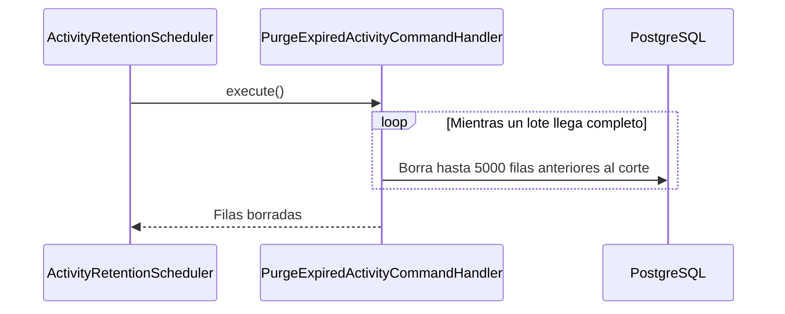

# UC-ACT-03 · Purgar las señales vencidas

| Campo | Valor |
|---|---|
| ID | `UC-ACT-03` |
| Módulo | [Actividad](../README.md) |
| Plataformas | Solo backend |
| Actores | Sistema (tarea programada) |
| IDs en Lucidchart | Ninguno |
| Requisitos | — |
| Casos de prueba | [`CP-ACT-12`](../testing.md), [`CP-ACT-13`](../testing.md), [`CP-ACT-14`](../testing.md), [`CP-ACT-15`](../testing.md) |

## Precondiciones

- La purga está activa (`app.activity.retention-enabled`, activa por defecto).

## Postcondiciones

- No quedan vistas, aperturas ni última actividad anteriores a 180 días.

## Flujo principal

1. Una vez por día (`app.activity.retention-delay-ms`; la primera corrida a los 10 minutos del arranque), `ActivityRetentionScheduler` llama a `PurgeExpiredActivityUseCase`.
2. `PurgeExpiredActivityCommandHandler` calcula el corte: ahora menos 180 días (`app.activity.retention`).
3. Borra vistas, aperturas y última actividad anteriores al corte en lotes de 5000 (`app.activity.purge-batch-size`), hasta que un lote llega incompleto.
4. Si borró filas, registra la cantidad en el log.

## Flujos alternativos

- 3a. No hay señales vencidas: no borra nada ni escribe en el log.
- 2a. La retención o el tamaño del lote no son positivos: el backend no arranca: la configuración se rechaza al crear el handler.
- 1a. Se elimina una cuenta: sus señales se borran en cascada sin esperar la purga.

## Reglas de negocio

- La retención es de 180 días para las vistas, las aperturas y la última actividad.
- Los push abiertos tienen su propia retención de 180 días (`app.activity.push-open-retention`), que purga [Notificaciones](../../notifications/README.md).
- Los borrados van por lotes para no bloquear tablas grandes.

## Secuencia de la purga

[Ver diagrama de «Secuencia de la purga» completo](https://images.vinnot.com/docs/diagrams/v1/es/modules-activity-use-cases-uc-act-03-purge-expired-signals-31fe9037ad53.svg)

## Código

| Capa | Ubicación |
|---|---|
| Backend | [`ActivityRetentionScheduler.java`](../../../../../backend/src/main/java/com/vinnot/activity/infrastructure/scheduling/ActivityRetentionScheduler.java), [`PurgeExpiredActivityCommandHandler.java`](../../../../../backend/src/main/java/com/vinnot/activity/application/command/handler/PurgeExpiredActivityCommandHandler.java), [`JdbcContentViewRepository.java`](../../../../../backend/src/main/java/com/vinnot/activity/infrastructure/persistence/JdbcContentViewRepository.java), [`JdbcAppOpenRepository.java`](../../../../../backend/src/main/java/com/vinnot/activity/infrastructure/persistence/JdbcAppOpenRepository.java) |
| Datos | [`V66__engagement_signals.sql`](../../../../../backend/src/main/resources/db/migration/V66__engagement_signals.sql) |

## Tests automáticos

- Backend:
  - [`PurgeExpiredActivityCommandHandlerTest.java`](../../../../../backend/src/test/java/com/vinnot/activity/application/command/handler/PurgeExpiredActivityCommandHandlerTest.java): `deletesSignalsOlderThanTheRetentionInBatchesUntilNoneAreLeft`, `theRetentionAndBatchMustBePositive`
  - [`ActivityRetentionSchedulerTest.java`](../../../../../backend/src/test/java/com/vinnot/activity/infrastructure/scheduling/ActivityRetentionSchedulerTest.java): `runsThePurgeOnEveryTick`
  - [`JdbcActivityPostgresIntegrationTest.java`](../../../../../backend/src/test/java/com/vinnot/activity/infrastructure/persistence/JdbcActivityPostgresIntegrationTest.java): `purgesSignalsOlderThanTheCutoffInBatches`, `deletingTheAccountDeletesItsSignals`
