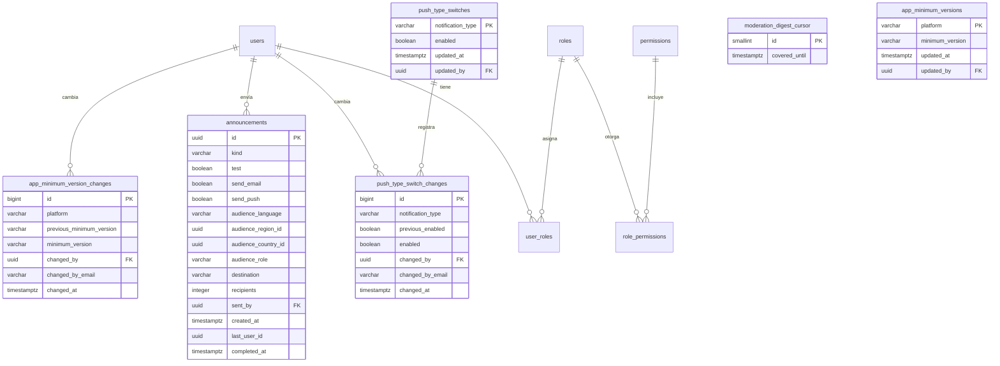

# Administración y moderación

El panel del equipo de Vinnot. Los administradores y moderadores gestionan el catálogo
(vinos, bodegas, eventos y rutas), revisan los vinos propuestos, las denuncias, las
publicaciones pendientes y las reseñas, y reciben un resumen del trabajo nuevo. Solo los
administradores gestionan usuarios y roles, suspenden cuentas, envían anuncios, controlan
los push, fijan la versión mínima de la app y borran contenido del catálogo.

- Código del módulo: `ADM`.
- Backend: paquete [`admin`](../../../../backend/src/main/java/com/vinnot/admin/), que compone las vistas del equipo y delega cada cambio en el módulo dueño del dato.
- [Casos de uso](use-cases/README.md) · [Requisitos](requirements.md) ·
  [Arquitectura](architecture.md) · [Pruebas](testing.md)

## Actores

| Actor | Qué hace en este módulo |
|---|---|
| Moderador | Usa el panel, gestiona el catálogo sin borrar y revisa vinos propuestos, denuncias, publicaciones y reseñas |
| Administrador | Todo lo anterior, más borrar del catálogo, gestionar usuarios, enviar anuncios, controlar los push y fijar la versión mínima de la app |
| Visitante o usuario autenticado | Su app consulta la versión mínima y, si quedó vieja, solo muestra la pantalla para actualizarla |
| Sistema (tareas programadas) | Envía el resumen de trabajo nuevo al equipo y entrega los anuncios por tandas |

## Reglas de negocio

| Regla | Detalle | Dónde |
|---|---|---|
| Acceso | `/admin/**` admite administradores y moderadores; usuarios, notificaciones y versiones de la app, solo administradores | [`SecurityConfig.java`](../../../../backend/src/main/java/com/vinnot/shared/infrastructure/config/SecurityConfig.java) |
| Confirmar identidad | Un administrador confirma su identidad (contraseña, o Google o Apple) para borrar, cambiar usuarios, tocar notificaciones o cambiar la versión mínima de la app; la confirmación vale 5 minutos | [`AdminSensitiveActionInterceptor.java`](../../../../backend/src/main/java/com/vinnot/admin/infrastructure/web/AdminSensitiveActionInterceptor.java) |
| Último administrador | Nadie se quita su propio acceso de administración y siempre queda un administrador activo y sin suspender | [`AdminUserSafety.java`](../../../../backend/src/main/java/com/vinnot/user/application/service/AdminUserSafety.java) |
| Un rol | Cambiar el rol deja la cuenta con usuario más el rol elegido y cierra sus sesiones | [`AssignRoleCommandHandler.java`](../../../../backend/src/main/java/com/vinnot/user/application/command/handler/AssignRoleCommandHandler.java) |
| Suspensión | Motivo predefinido; el detalle solo con «Otro» y hasta 255 caracteres; olvida los teléfonos para push y avisa con el motivo | [`BanUserCommandHandler.java`](../../../../backend/src/main/java/com/vinnot/user/application/command/handler/BanUserCommandHandler.java) |
| Borrado de catálogo | Vinos, bodegas y rutas se borran; los eventos solo se cancelan | [`EventAdminController.java`](../../../../backend/src/main/java/com/vinnot/admin/infrastructure/web/controller/EventAdminController.java) |
| Vaciar campos | Un campo opcional vaciado se borra explícitamente; uno que no se envía conserva su valor | [`FieldUpdates.java`](../../../../backend/src/main/java/com/vinnot/shared/application/command/FieldUpdates.java) |
| Denuncias | Quien revisa no ve sus denuncias ni las de su contenido; cerrar exige texto y no se reabre | [`CommunityReport.java`](../../../../backend/src/main/java/com/vinnot/community/domain/model/CommunityReport.java) |
| Publicaciones | Rechazar pide un motivo predefinido; la decisión aplica sobre la revisión vista | [`ReviewPublication.java`](../../../../backend/src/main/java/com/vinnot/review/domain/model/ReviewPublication.java) |
| Anuncios | Solo a cuentas activas y sin suspender; las novedades omiten a quien retiró el consentimiento de marketing o las apagó; un reintento no envía dos veces | [`JdbcAnnouncementAudience.java`](../../../../backend/src/main/java/com/vinnot/notification/infrastructure/persistence/JdbcAnnouncementAudience.java) |
| Push por tipo | Un tipo apagado descarta sus push; apagar uno transaccional pide confirmación | [`PushAdministrationService.java`](../../../../backend/src/main/java/com/vinnot/notification/application/service/PushAdministrationService.java) |
| Versión mínima de la app | Una por plataforma (iOS y Android), `mayor.menor.parche` comparada número por número; una versión menor ve solo la pantalla de actualización; sin mínima o si la consulta falla, la app se usa normal | [`AppVersionAdministrationService.java`](../../../../backend/src/main/java/com/vinnot/admin/application/service/AppVersionAdministrationService.java) |
| Resumen al equipo | Cada 15 minutos, si hay vinos propuestos o denuncias nuevas, un correo a cada administrador y moderador activo y sin suspender | [`SendModerationDigestService.java`](../../../../backend/src/main/java/com/vinnot/admin/application/service/SendModerationDigestService.java) |

## Dónde vive

| Parte | Ubicación |
|---|---|
| API | Controladores `/admin` en [`admin/infrastructure/web/controller`](../../../../backend/src/main/java/com/vinnot/admin/infrastructure/web/controller/), denuncias y publicaciones en `community` y `review`, anuncios y push en `notification` |
| Web | `/admin`, `/admin/wines`, `/admin/wineries`, `/admin/events`, `/admin/routes`, `/admin/wine-submissions`, `/admin/publications`, `/admin/community`, `/admin/reviews`, `/admin/users`, `/admin/notifications` y `/admin/app-versions` en [`pages/admin`](../../../../frontend-react/src/presentation/pages/admin/) y [`pages/community`](../../../../frontend-react/src/presentation/pages/community/) |
| App | `frontend-mobile/app/(app)/admin/`, con las pantallas en [`features/admin`](../../../../frontend-mobile/src/presentation/features/admin/) y [`features/community`](../../../../frontend-mobile/src/presentation/features/community/); la comprobación de la versión mínima en [`features/appUpdate`](../../../../frontend-mobile/src/presentation/features/appUpdate/) |

## Datos

El catálogo, las denuncias, las publicaciones y los vinos propuestos viven en las tablas de
sus módulos. Este módulo usa los roles y el estado de las cuentas (`users.active`,
`users.locked` y `users.lock_reason`, ampliada en `V57`), y tiene sus propias tablas:
`V54` crea la marca del resumen al equipo, `V59` los interruptores de push y sus
resultados, `V60` los anuncios y `V69` las versiones mínimas de la app y sus cambios.

[Ver diagrama de «Administración y moderación · Datos» completo](https://images.vinnot.com/docs/diagrams/v1/es/modules-admin-readme-0144087552f0.svg)

`moderation_digest_cursor` tiene una sola fila y su marca nunca retrocede. Los anuncios,
los cambios de interruptor y los de versión mínima guardan el correo de quien los hizo, así el registro sobrevive
aunque se borre la cuenta. `push_delivery_outcomes` cuenta los resultados de push por tipo
y día para las métricas.
