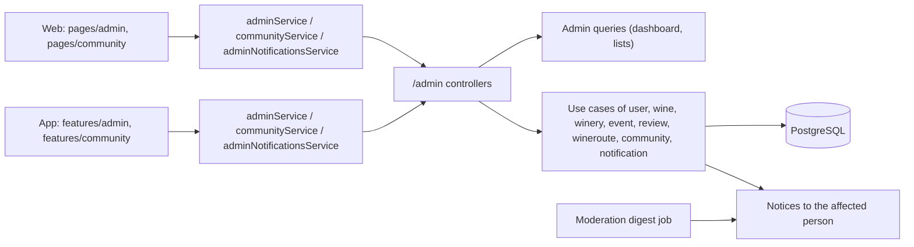
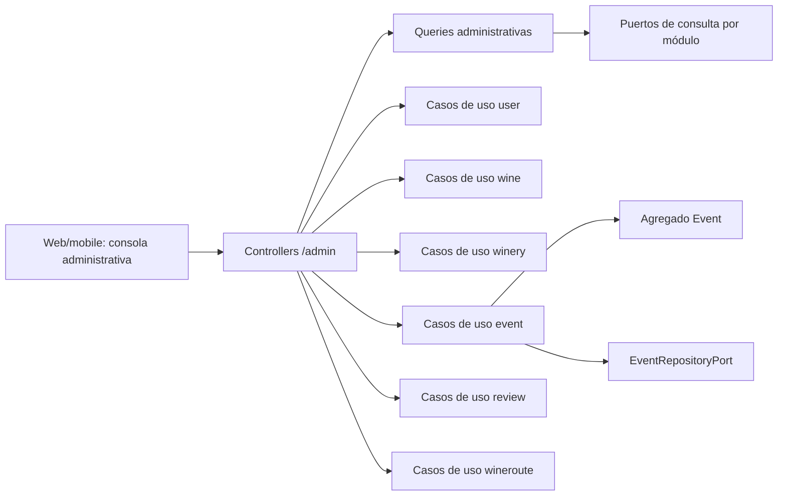
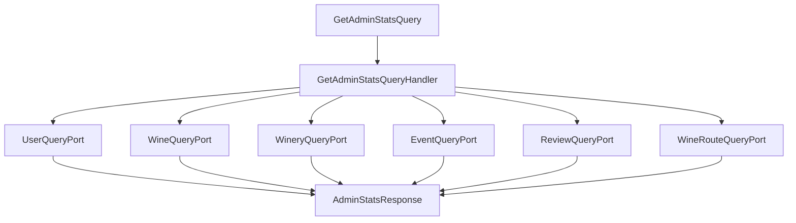
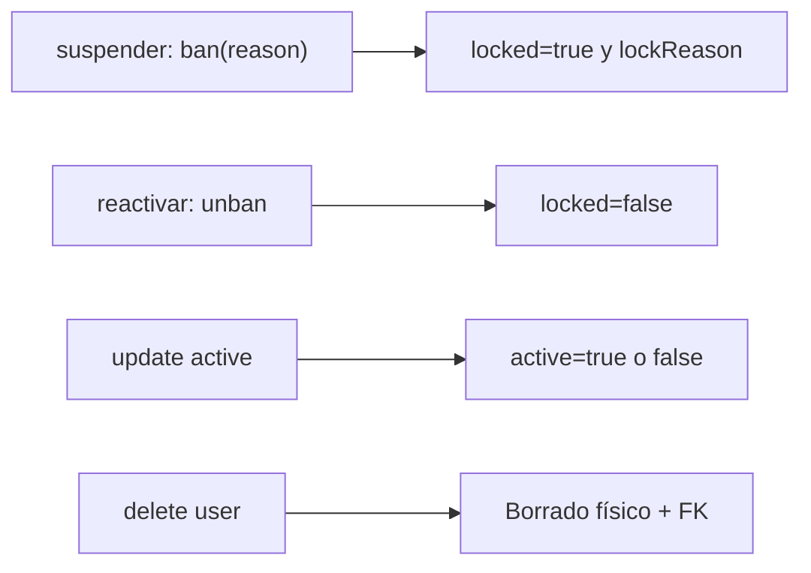
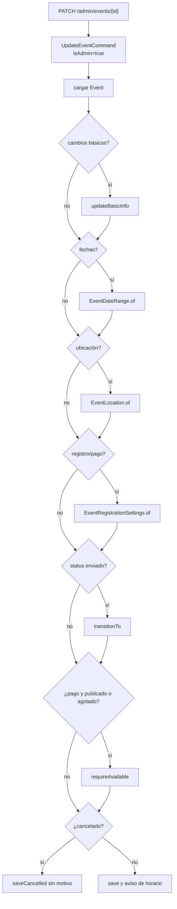
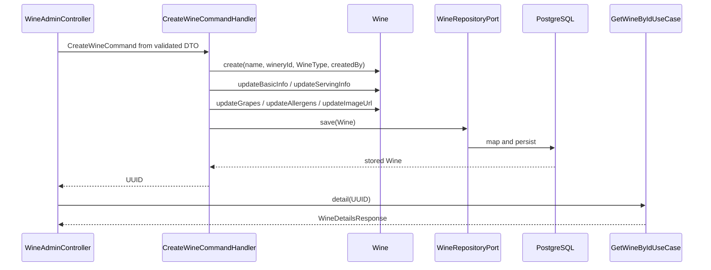
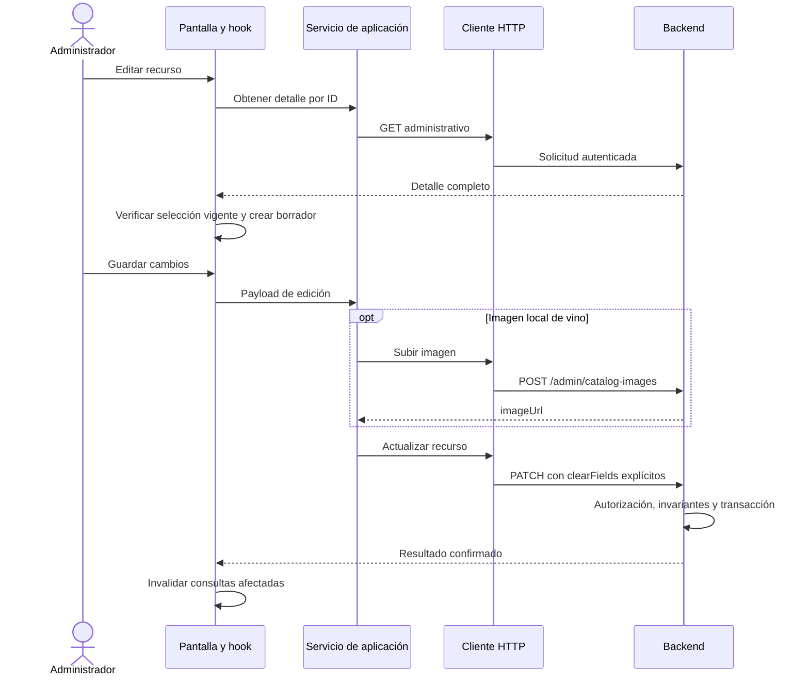

# Arquitectura

Cómo está construido el módulo en cada capa. El paquete `admin` no es un dominio aparte:
lee y compone las vistas del equipo, y cada cambio lo ejecutan los casos de uso del módulo
dueño del dato. La web y la app siguen `pantalla → hook → servicio → cliente API →
transporte HTTP`. La moderación de comunidad está en [Comunidad](../community/architecture.md#backend),
los vinos propuestos en [Vinos propuestos](../wines/submissions.md) y los anuncios en
[Notificaciones](../notifications/architecture.md#backend).

[Ver diagrama de «Arquitectura» completo](https://images.vinnot.com/docs/diagrams/v1/es/modules-admin-architecture-c07a7006328e.svg)

## Backend

Las consultas de listado y detalle de bodegas devuelven `winesCount` calculado sobre los vinos activos relacionados por `winery_id`. No utilizan el contador histórico importado de la bodega. El listado agrupa los totales de los IDs de la página en una consulta adicional, sin cargar vinos ni ejecutar consultas por fila; una bodega sin vinos activos devuelve cero. Cada fila del listado incluye además `establishedYear` (null si no se conoce), que la tabla de administración muestra como año de fundación. Los formularios de bodega de administración en web y mobile aceptan el sitio web con o sin `https://`, agregan el esquema cuando falta y rechazan un texto que no sea una dirección web. El teléfono admite solo dígitos, espacios, `+`, paréntesis y guiones, de modo que los formatos locales importados como `(0261) 412-3456` siguen siendo válidos.

### Propósito y límites

La administración de Vinnot no constituye un dominio paralelo. El paquete
`admin` actúa como una **fachada de lectura y composición** para las vistas
operativas, mientras que las mutaciones se ejecutan mediante los casos de uso
del módulo propietario de cada agregado:

- usuarios y roles pertenecen a `user`;
- vinos pertenecen a `wine`;
- bodegas pertenecen a `winery`;
- eventos e inscripciones pertenecen a `event`;
- reseñas pertenecen a `review`;
- rutas enoturísticas pertenecen a `wineroute`;
- submissions de vinos pertenecen al subdominio de submissions dentro de
  `wine`.

La única configuración que `admin` posee es la versión mínima admitida de la app
móvil por plataforma; véase [Versiones mínimas de la app](#versiones-mínimas-de-la-app).

[Ver diagrama de «Propósito y límites» completo](https://images.vinnot.com/docs/diagrams/v1/es/modules-admin-architecture-43184e8903dc.svg)

Esta separación evita dos errores frecuentes:

1. duplicar lógica de negocio dentro de controllers administrativos;
2. permitir que una vista operativa escriba directamente mediante JPA.

### Autorización efectiva

Los controllers de catálogo y moderación bajo `/admin/**` admiten
`ADMIN` y `MODERATOR`. Los métodos de eliminación de catálogo,
`/admin/users/**`, `/admin/notifications/**` y `/admin/app-versions/**` exigen `ADMIN`. `SecurityConfig` protege el prefijo y
restringe usuarios antes de la regla general como defensa en profundidad. El principal autenticado es el UUID del
usuario y las authorities se derivan de sus roles y permisos.

#### Reautenticación para acciones sensibles

`AdminSensitiveActionInterceptor` exige una confirmación de identidad reciente
cuando el principal tiene `ROLE_ADMIN` y la solicitud es:

- cualquier método distinto de `GET`, `HEAD` u `OPTIONS` sobre `/admin/users/**`;
- cualquier método distinto de `GET`, `HEAD` u `OPTIONS` sobre
  `/admin/notifications/**` (interruptores de push, pruebas y envíos de anuncios),
  salvo `POST /admin/notifications/announcements/preview`;
- cualquier método distinto de `GET`, `HEAD` u `OPTIONS` sobre
  `/admin/app-versions/**` (fijar o borrar una versión mínima de la app);
- cualquier `DELETE` sobre `/admin/**`;
- `DELETE` sobre `/wines/{id}`, `/events/{id}`, `/wine-routes/{id}` o `/wineries/{id}`.

El cliente llama primero a `POST /auth/reauthenticate` (solo ADMIN) con
`{password}` (máximo 128 caracteres) o, si la cuenta usa Google o Apple, con el token
de ese proveedor. `ReauthenticateCommandHandler`
rechaza cuentas inactivas, bloqueadas, sin verificar o sin rol ADMIN y contraseñas
incorrectas con `AUTH_FAILED` (HTTP 401). Si tiene éxito devuelve `{proof}` con
`Cache-Control: no-store`. `SignedReauthenticationProofAdapter` firma la prueba
con una clave de propósito separado; es válida durante 5 minutos y está ligada al
usuario y al header `Authorization` actual, por lo que no puede reutilizarse con
otra sesión. El cliente la envía en el header `X-Admin-Reauthentication`. Una
prueba ausente, vencida o que no coincide produce `REAUTHENTICATION_REQUIRED`, que
`GlobalExceptionHandler` mapea a HTTP 403.

#### Alcance del rol administrativo

| Capacidad | ADMIN | MODERATOR |
|---|---|---|
| Dashboard y lectura de catálogo | Sí | Sí |
| Crear/editar vinos, bodegas, eventos y rutas, incluidos sus estados | Sí | Sí |
| Imágenes y perfiles IA (authority WINE_UPDATE) | Sí | Sí |
| Moderar reseñas, incluida eliminación, y decidir propuestas | Sí | Sí |
| Eliminar vinos, bodegas, eventos o rutas mediante DELETE | Sí | No |
| Gestionar usuarios, roles, suspensiones y reactivaciones | Sí | No |
| Ver y cambiar las versiones mínimas de la app | Sí | No |

La visibilidad de un enlace no concede permisos: la autorización efectiva se
aplica en el backend. USER y PARTNER no acceden a la consola administrativa.

### Dashboard administrativo

`GET /admin/stats` ejecuta `GetAdminStatsQueryHandler` dentro de una transacción
read-only. El handler compone seis puertos de salida específicos y devuelve:

- cantidad total de usuarios;
- cantidad total de vinos;
- cantidad total de bodegas;
- cantidad total de eventos;
- cantidad total de reseñas;
- cantidad total de rutas;
- usuarios activos;
- eventos publicados;
- rutas publicadas.

La consulta es un fan-in de contadores y no carga agregados completos. Cada
adapter mantiene el conocimiento de cómo contar su propio módulo. La respuesta
reúne los conteos de esos puertos dentro de una transacción read-only.

[Ver diagrama de «Dashboard administrativo» completo](https://images.vinnot.com/docs/diagrams/v1/es/modules-admin-architecture-5b15f51c1603.svg)

### Usuarios

#### Consultas

La lista administrativa admite `search`, `page` y `size`. La respuesta usa
`PageResult<UserAdminResponse>` y expone datos operativos, roles, estado y
fechas necesarios para gestión, más `avatarUrl`: la foto de perfil como URL
absoluta o `null` sin foto (#541, la misma resolución que el resto de la API,
ver [Valor guardado y URL que recibe el cliente](../users/architecture.md#valor-guardado-y-url-que-recibe-el-cliente)).
`GET /admin/reviews` también entrega la foto de quien reseñó como URL absoluta.
El detalle valida existencia antes de proyectar.
El listado envía `page` y `size` a su query; no utiliza la política del catálogo público de vinos.

#### Actualización

`PATCH /admin/users/{id}` delega en `UpdateUserAdminUseCase`. Los campos
actualizables son nombre, apellido y estado activo. Las invariantes del agregado
siguen aplicándose; el controller no muta entidades ni conoce JPA.

#### Roles

`POST /admin/users/{id}/assign-role` normaliza el valor a mayúsculas y lo
convierte con `Role.valueOf`. Luego invoca `user.addRole`, lo que preserva la
semántica aditiva: no reemplaza silenciosamente el conjunto completo.

La conversión utiliza `Role.valueOf`; los valores admitidos del enum son
`USER`, `ADMIN`, `MODERATOR` y `PARTNER`.

El selector administrativo utiliza `PUT /admin/users/{id}/role` para reemplazar
roles: mantiene `USER` y agrega el rol seleccionado. Ambos endpoints aceptan el
nombre de dominio o su forma `ROLE_*`; valores inválidos producen error controlado.

`AdminUserSafety` impide al actor retirarse acceso por democión
(ambos endpoints transmiten el actor autenticado; `POST assign-role` solo agrega roles,
por lo que nunca retira `ADMIN`), suspensión, desactivación o eliminación, y protege al último administrador activo y
desbloqueado. El adapter bloquea la fila del rol ADMIN antes de leer los IDs
administrativos activos, serializando estas decisiones dentro de la transacción.
No se basa en un contador leído sin bloqueo.

#### Suspensión y reactivación

La suspensión de una cuenta ([UC-ADM-11](use-cases/uc-adm-11-suspend-user.md))
usa `POST /admin/users/{id}/ban` (`BanUserCommandHandler`), que suspende al
usuario con `User.lock` y olvida sus
dispositivos push (`ManagePushDevicesUseCase.forgetUser`, como la desactivación
administrativa y la propia), así una cuenta suspendida no recibe más pushes. El cuerpo
lleva un `reasonCode` predefinido (`SPAM`, `HARASSMENT`, `FRAUD`, `IMPERSONATION`,
`TERMS_VIOLATION`, `OTHER`) y un detalle opcional `reason` (hasta 255 caracteres);
un código desconocido falla con `INVALID_SUSPENSION_REASON`, y una solicitud sin
código se trata como `OTHER` con su detalle interno. `lockReason` guarda `CODE` o
`CODE: detalle`. Web y mobile ofrecen los motivos como chips de un toque con spam
preseleccionado, y muestran el campo de detalle solo con Otro; la acción se
llama Suspender. Reactivar usa `POST /admin/users/{id}/unban`
(`UnbanUserCommandHandler`), que levanta la suspensión con `User.unlock`. La
persona recibe un correo al ser suspendida (con el motivo, y el detalle solo con
`OTHER`), al reactivarse una cuenta suspendida, en un cambio de rol y en una
eliminación ([notificaciones](../notifications/architecture.md)). La suspensión se evalúa durante autenticaciones
posteriores y en cada solicitud autenticada por JWT mediante `AccountAccessPort`.

[Ver diagrama de «Suspensión y reactivación» completo](https://images.vinnot.com/docs/diagrams/v1/es/modules-admin-architecture-b6ec35dd026e.svg)

`active` y `locked` son flags independientes, no estados de un enum.

#### Eliminación administrativa

`DELETE /admin/users/{id}` carga el usuario, aplica las protecciones del actor y del último administrador y elimina por repositorio. A
diferencia de la eliminación propia, este handler no contiene el flujo especial
de revocación Apple ni la misma semántica de desactivación. Las claves foráneas de Flyway definen las cascadas y referencias que se ponen en NULL.

### Vinos y bodegas

Los controllers administrativos son adapters de los casos de uso descritos en:

- [Gestión de vinos](#gestión-de-vinos);
- [Bodegas y regiones](../wineries/architecture.md).

La administración de vinos soporta listado, detalle, creación, actualización,
eliminación, alternancia de destacado y alternancia de activo. La bodega soporta
listado, detalle, creación, actualización y eliminación. En ambos casos:

- la request HTTP se transforma en command/query;
- el handler resuelve relaciones por puertos;
- el dominio valida invariantes;
- el adapter de persistencia mapea dominio y JPA;
- el controller devuelve el DTO de aplicación o `MutationResponse`.

No debe introducirse un `AdminWineRepository` para escribir en vinos: la
propiedad de las reglas permanece en `wine`.

### Eventos

El administrador puede listar y filtrar por texto, tipo y ciudad; leer detalle;
crear; actualizar parcialmente; publicar; cancelar; y ejecutar el endpoint
presentado como delete. Ese último endpoint cancela el agregado en lugar de
borrar la fila: cancela las inscripciones activas, avisa a quienes asisten y al
organizador, y conserva las filas para la trazabilidad.

Al crear, el organizador se resuelve así:

1. usar `organizerId` explícito de la request si existe;
2. en caso contrario, usar el principal administrador;
3. dejar que el caso de uso rechace una ausencia no válida.

Las fechas aceptan el formato flexible centralizado en `DateTimeUtils`. Un
update combina campos enviados con valores existentes, reconstruye value
objects (`EventDateRange`, `EventLocation`, `EventRegistrationSettings`) y
aplica transiciones de estado mediante el agregado.

[Ver diagrama de «Eventos» completo](https://images.vinnot.com/docs/diagrams/v1/es/modules-admin-architecture-c28428778e3e.svg)

El ciclo completo de descubrimiento, cupos, aprobación, pago y asistencia se
documenta en [Eventos e inscripciones](../events/architecture.md#backend).

### Reseñas

La administración lista, busca, consulta detalle y elimina. La eliminación
reutiliza `DeleteReviewUseCase` con `isAdmin=true`, por lo que omite el requisito
de autoría sin duplicar la lógica de encontrar y retirar la reseña. Ese endpoint elimina; la aprobación o rechazo previo usa la cola separada
`/admin/review-publications`. Las denuncias se atienden en `/admin/community/reports`.
Los estados y permisos están en [comunidad](../community/architecture.md).

La búsqueda administrativa proyecta autor, vino, rating, contenido y metadata
operativa mediante un puerto de consulta. Las reglas de creación, edición,
likes y agregados están en [Reseñas e interacción](../reviews/architecture.md).

### Rutas enoturísticas

La administración lista, obtiene detalle, crea, actualiza, publica, archiva y
elimina. Las paradas se agregan, editan, quitan y ordenan enviando la lista completa
en `PATCH /admin/routes/{id}`: cada parada se recrea y se recalculan duración y
distancia. Igual que en otros módulos, el controller delega en
input ports de `wineroute`; no escribe colecciones de stops directamente.

Las transiciones y el orden de las paradas se documentan en
[Rutas enoturísticas](../wine-routes/architecture.md).

### Versiones mínimas de la app

La administración fija, por plataforma de tienda, la versión más vieja de la app
móvil que todavía se puede usar. La app la lee al abrirse y al volver al primer
plano; una versión anterior muestra una pantalla de actualización obligatoria que
bloquea el uso. Un mínimo se sube solo después de que la tienda haya aprobado y
publicado esa versión.

| Regla | Comportamiento |
|---|---|
| Plataformas | `IOS` y `ANDROID`, siempre en ese orden |
| Formato | `major.minor.patch`, tres enteros de 0 a 9999, por ejemplo `0.3.0`; cualquier otro valor responde 400 `INVALID_APP_VERSION` |
| Sin mínimo | `null` (o una plataforma nunca configurada) no bloquea ninguna versión |
| Orden | numérico, parte por parte: `0.10.0` es más nueva que `0.9.9` |
| Auditoría | cada cambio real guarda la plataforma, el valor anterior y el nuevo, el email del administrador y la fecha; guardar el mismo valor no registra nada |
| Concurrencia | los cambios de una plataforma se serializan sobre su fila |

| Endpoint | Acceso | Caso de uso |
|---|---|---|
| `GET /admin/app-versions` | `ADMIN` | `ManageAppVersionsUseCase.settings()`: las dos plataformas con `minimumVersion`, `updatedAt` y `updatedBy` (email), más los 20 cambios más recientes, del más nuevo al más viejo |
| `PUT /admin/app-versions/{platform}` `{minimumVersion}` | `ADMIN` y `X-Admin-Reauthentication` | `ManageAppVersionsUseCase.setMinimumVersion(...)`; una plataforma desconocida responde 400 `NOT_AN_APP_PLATFORM` |
| `GET /app-versions/minimum` | Público, no lo bloquean términos pendientes | `GetMinimumAppVersionsUseCase`: `{ios, android}`, cada uno una versión o `null` |

Flujo de dependencias:

`AppVersionAdminController` / `AppVersionPolicyController` → `ManageAppVersionsUseCase` / `GetMinimumAppVersionsUseCase` → `AppVersionAdministrationService` / `MinimumAppVersionsService` → `AppVersion`, `AppPlatform` (dominio) → `AppMinimumVersionPort` → `JdbcAppMinimumVersions` → `app_minimum_versions` y `app_minimum_version_changes` (V69).

`AppVersionAdministrationService` obtiene el email del administrador con
`UserQueryPort` (`ADMIN_NOT_FOUND` si la cuenta ya no existe) y toma la hora de un
`Clock` inyectado. La política pública se lee de la base en cada pedido, así que un
cambio aplica sin desplegar. Las tablas se describen en el
[modelo de datos](../../backend/data/database-model.md).

### Consistencia y transacciones

- los handlers de mutación son transaccionales;
- `SearchAdminEventsQueryHandler`, `GetAdminStatsQueryHandler`,
  `SearchAdminReviewsQueryHandler`, `GetAdminReviewByIdQueryHandler`,
  `GetAdminUserByIdQueryHandler` y `SearchAdminUsersQueryHandler` declaran
  `@Transactional(readOnly = true)`; los demás handlers no quedan cubiertos por
  esa afirmación sin su propia anotación;
- el ownership se verifica después de cargar el agregado y antes de mutarlo;
- publicar, cancelar y actualizar usan métodos del dominio;
- los controllers no abren transacciones;
- las lecturas de dashboard son consistentes por consulta, pero no constituyen
  un snapshot materializado entre todas las tablas bajo concurrencia intensa.

### Estrategia de pruebas

#### Dominio

- transiciones válidas e inválidas de eventos;
- actualización de fechas, ubicación, capacidad y settings;
- suspensión/reactivación y roles de usuario;
- publicación/archivo de rutas;
- autoría y eliminación de reseñas.

#### Aplicación

- cada query handler administrativo con mocks de sus puertos;
- dashboard con todos los contadores y orden correcto;
- not-found en detalle;
- filtros y paginación normalizados;
- mutaciones admin con `isAdmin=true`;
- cancelación semántica en lugar de delete físico.

#### Web y seguridad

- `/admin/**` sin token: `401`;
- USER/PARTNER: `403` en administración; MODERATOR: acceso a catálogo y moderación,
  `403` en usuarios y borrados exclusivos de ADMIN;
- admin válido: status y contrato esperados;
- validación de requests y fechas inválidas;
- serialización estable de `PageResult`, responses y errores.

#### Persistencia

- búsqueda por texto con datos reales PostgreSQL;
- conteos de dashboard;
- filtros combinados de evento;
- integridad al eliminar usuarios;
- concurrencia sobre transiciones sensibles.

#### Archivos fuente de referencia

- `admin/infrastructure/web/controller/*AdminController.java`;
- `admin/application/query/handler/*QueryHandler.java`;
- `admin/application/port/out/*QueryPort.java`;
- `event/application/command/handler/UpdateEventCommandHandler.java`;
- `event/application/command/handler/CancelEventCommandHandler.java`;
- `user/application/command/handler/*User*CommandHandler.java`;
- `admin/application/service/AppVersionAdministrationService.java` y `MinimumAppVersionsService.java`;
- `admin/infrastructure/persistence/adapter/JdbcAppMinimumVersions.java`;
- `shared/infrastructure/config/SecurityConfig.java`.

### Gestión de vinos

#### Alcance y acceso

WineAdminController bajo /admin/wines es un adapter del módulo admin. Reutiliza los puertos de entrada de wine y no mantiene otro agregado ni otra tabla. La superficie admite ROLE_ADMIN y ROLE_MODERATOR para lectura, alta y edición; DELETE exige ROLE_ADMIN. WineWriteController expone operaciones equivalentes bajo /wines con autoridades WINE_CREATE, WINE_UPDATE y WINE_DELETE.

| Operación | Contrato administrativo |
|---|---|
| GET /admin/wines | consulta administrativa paginada; incluye vinos inactivos |
| GET /admin/wines/{id} | detalle por UUID |
| POST /admin/wines | crea y luego consulta detalle; HTTP 201 |
| PATCH /admin/wines/{id} | aplica UpdateWineCommand y luego consulta detalle |
| DELETE /admin/wines/{id} | borrado físico y MutationResponse |
| POST /admin/wines/{id}/toggle-featured | alternar destacado |
| POST /admin/wines/{id}/toggle-active | alternar activo |

WineWriteController bajo /wines expone POST /wines (WINE_CREATE), PATCH /wines/{id} (WINE_UPDATE), DELETE /wines/{id} (WINE_DELETE) y PATCH /wines/{id}/toggle-featured (WINE_UPDATE). Esta última aplica ToggleWineFeaturedCommand y devuelve HTTP 204 sin cuerpo, a diferencia del POST administrativo, que devuelve el detalle.

Un ADMIN debe enviar el header `X-Admin-Reauthentication` en DELETE /admin/wines/{id} y DELETE /wines/{id}; ver [Reautenticación para acciones sensibles](architecture.md#reautenticación-para-acciones-sensibles).

#### Alta: secuencia y validaciones

[Ver diagrama de «Alta: secuencia y validaciones» completo](https://images.vinnot.com/docs/diagrams/v1/es/modules-admin-architecture-e0eef1838ce6.svg)

CreateWineCommandHandler tiene un WineRepositoryPort. Convierte wineType con WineType.valueOf, crea el agregado, aplica ServingTemperature y PriceRange, completa campos y alterna featured si se solicita. Las invariantes proceden de esos modelos y del request validado; las referencias persistentes se resuelven en el adapter y las constraints de PostgreSQL.

Este camino no ejecuta reconocimiento ni moderación de etiqueta. La deduplicación por identidad comercial y su lock pertenecen a submissions, no a una llamada implícita del CRUD administrativo. createdBy es un campo del command: el controller administrativo lo obtiene del principal autenticado; no confía en un actor enviado en el body. La creación admite descripciones ES/EN, flags y puntuaciones sensoriales opcionales de 0 a 100.

#### Edición y semántica de campos

UpdateWineCommandHandler carga por UUID o lanza EntityNotFoundException. Aplica métodos de dominio, guarda y retorna void; el controller obtiene otra proyección de detalle. La semántica no se deduce sólo del verbo PATCH: depende del método invocado y de cómo el DTO representa null.

| Grupo | Tratamiento del handler |
|---|---|
| name, vintage, style, descriptionEs, descriptionEn | `updateBasicInfo` y `replaceDescriptions`, conservando valores omitidos |
| alcohol, serving temperature, price range | `updateServingInfo` con value objects que combinan cambios y valores actuales |
| grapes, allergens, imageUrl | actualiza campos presentes; arrays vacíos vacían la colección |
| wineryId, wineType | aplica sólo si no es null |
| isFeatured, isActive | cambia flags cuando el command los incluye |
| taste scores | si llega alguno, combina valores presentes con los existentes |

`FieldUpdates` define la semántica: campo omitido o null sin marcador conserva el valor; `clearFields` elimina sólo campos opcionales permitidos. Enviar un valor no nulo junto a su marcador de borrado produce `CONFLICTING_FIELD_UPDATE`; borrar campos requeridos/desconocidos produce `INVALID_CLEAR_FIELDS`. Los ceros se conservan. `grapes: []` y `allergens: []` vacían colecciones. Los flags activo/destacado tienen además operaciones dedicadas.

#### Imágenes y persistencia

`POST /admin/catalog-images` recibe `{dataUrl}` JPEG/PNG autenticado como ADMIN o MODERATOR. El adapter valida base64, firma/MIME, tamaño y dimensiones antes de decodificar; re-encodea JPEG de hasta 1600 px sin metadata y delega en `StoreCatalogImageUseCase` y `FileStoragePort`. Devuelve `{imageUrl}`. Este upload de catálogo no exige las comprobaciones de legibilidad OCR del escaneo. El servicio frontend sube primero la imagen y luego envía la URL en el CRUD. Guardar el vino y subir el archivo son operaciones separadas, no una transacción distribuida.

Los handlers de escritura son transaccionales. WinePersistenceAdapter mapea dominio/JPA y resuelve referencias. DeleteWineCommandHandler carga el vino y llama delete; el adapter ejecuta deleteById. Las FK de Flyway determinan CASCADE, SET NULL o rechazo por referencia. DeleteWineCommand contiene wineId; no representa un evento de auditoría de actor/motivo.

#### Visibilidad, errores y observación

Activar/desactivar afecta consultas que filtran is_active. El listado admin envía `includeInactive=true` mediante `SearchWinesQuery` hasta `searchAdvanced`, de modo que el listado, los filtros sin texto y todos los niveles de texto (prefijo, contención, fuzzy) también devuelven vinos inactivos y vinos de bodegas inactivas; así se encuentra y reactiva un vino desactivado. Sin texto ni filtros, esa página combina dos lecturas ordenadas por nombre: los vinos activos por `idx_wines_active_name_page` y los inactivos por el índice parcial `idx_wines_inactive_name_page` (V61), y corta la ventana pedida sobre el resultado combinado. El catálogo público siempre pasa `false`. El detalle por UUID usa findById y no replica ese filtro. Featured controla selección promocional, no autorización. Los errores de dominio/validación se mapean a 400, entidad ausente a 404 e integridad a 409 mediante GlobalExceptionHandler. Un error enum no debe describirse como validación de dominio si lo produce valueOf. La correlación HTTP está a cargo del filtro compartido.

#### Pruebas y referencias

Cubrir construcción de value objects, semántica de campos presentes/null, flags, DTO-command, autoridad administrativa y formas de respuesta. Persistencia requiere pruebas de referencias/FK y borrado; no reutilizar como prueba de CRUD un test de deduplicación de submissions.

Fuentes bajo `backend/src/main/java/com/vinnot/`:

- `admin/infrastructure/web/controller/WineAdminController.java`.
- `wine/infrastructure/web/controller/WineWriteController.java`.
- `wine/application/command/handler/CreateWineCommandHandler.java`, `UpdateWineCommandHandler.java`, `DeleteWineCommandHandler.java`.
- `wine/domain/model/Wine.java`, `wine/infrastructure/persistence/adapter/WinePersistenceAdapter.java`.

[API](../../backend/architecture/api.md) · [Submissions](../wines/submissions.md) · [Uploads](../../backend/use-cases/uploads-and-reference-data.md) · [Datos](../../backend/data/database-model.md).

## Web

Las bodegas muestran el total de vinos activos calculado por el backend. La moderación de propuestas muestra «Enviado por» con `@nombredeusuario` tanto en la lista como en el detalle; si la cuenta ya no está disponible se informa «Usuario no disponible», sin mostrar un UUID o correo como sustituto.

### Superficie y autorización

| Área | Acceso de presentación | Responsabilidad |
|---|---|---|
| Administración general | ADMIN o MODERATOR | Dashboard y gestión de catálogo, eventos, rutas y reseñas |
| Usuarios | ADMIN | Roles, suspensión/reactivación y eliminación |
| Notificaciones | ADMIN | Anuncios, interruptores de push y métricas de push |
| Eliminación de catálogo | ADMIN | DELETE de vinos, bodegas, eventos y rutas |
| Moderación de submissions | ADMIN o MODERATOR | Decisión sobre envíos |
| Mis submissions | Consulta del usuario disponible en mobile | Estado de sus envíos |

Los guards son filtros de navegación. Cada endpoint backend vuelve a validar
roles y propiedad; un permiso del layout no concede todas las operaciones.

### Gestión de recursos

Cada listado mantiene búsqueda, página, selección y formulario.
Vinos relacionan bodega, tipo, uvas y referencias geográficas; bodegas exponen
identidad y ubicación; rutas gestionan paradas ordenadas; eventos incorporan
configuración de inscripción. La edición de perfiles IA tiene una vista
administrativa distinta de la generación de usuario.

Las reseñas se moderan por ID. Usuarios tienen acciones específicas de rol,
suspensión y eliminación: no son un update genérico del perfil del usuario actual.
La validación del formulario permite feedback temprano; relaciones y conflictos
persistentes se resuelven en backend.

Los ViewModels `useAdmin*ViewModel` coordinan listados, modal/draft y mutations.
Los hooks usan claves administrativas y públicas separadas; las mutaciones
invalidan ambas familias según la entidad modificada, además de estadísticas
en altas y eliminaciones.

### Edición segura y actualización de vistas

Antes de editar vino, bodega, evento o ruta se consulta su detalle por ID. El
resumen paginado no se usa como sustituto de un detalle que falló. Las respuestas
de una selección anterior se descartan si se cierra o cambia el editor.

Los adaptadores convierten campos opcionales explícitamente vacíos en
`clearFields`; los campos omitidos se conservan en backend. Cero, `false` y
arrays vacíos son valores intencionales. Las coordenadas se limpian como pareja.
Las puntuaciones sensoriales usan enteros de 0 a 100; ausencia no equivale a 50.
Una ruta vacía puede guardarse como borrador, pero no publicarse.

La geocodificación modifica únicamente el borrador de la parada. No actualiza la
bodega seleccionada ni persiste cambios al cancelar. Una respuesta tardía no se
aplica a otra parada que haya ocupado su posición.

Las imágenes de vino seleccionadas como data URL se suben mediante
`POST /admin/catalog-images` antes de guardar el catálogo. El servicio recibe
una URL, y sólo esa referencia se envía en el CRUD. Un fallo de upload impide el
guardado. Storage y persistencia del vino son operaciones separadas.

[Ver diagrama de «Edición segura y actualización de vistas» completo](https://images.vinnot.com/docs/diagrams/v1/es/modules-admin-architecture-f1474e99614b.svg)

Las mutaciones refrescan admin y las familias públicas afectadas: vinos,
bodegas, rutas, eventos, cava o usuario según la operación. Un error de consulta
se presenta con reintento, separado de una lista legítimamente vacía.

### Usuarios

El selector de rol usa `PUT /admin/users/{id}/role`: reemplaza los roles por
`USER` y el rol seleccionado. No utiliza la asignación aditiva histórica.
El servidor rechaza cambios que retiren acceso al propio administrador o al
último administrador activo y desbloqueado. Suspensión, eliminación y cambios de
rol se reflejan en la validación de las solicitudes autenticadas posteriores.

### Notificaciones

`/admin/notifications` (solo ADMIN, también como acción rápida del dashboard)
tiene tres pestañas (#490), todas montadas, así el borrador sobrevive al cambio de
pestaña. **Enviar anuncio**: quien administra elige novedades o aviso de
servicio con un toque, escribe título y contenido por idioma (un punto marca los
escritos) con una barra que inserta el formato (título, negrita, enlace, botón) y
elige el canal («Email», «Notificación push» o ambos), idioma, país y región, rol y,
para push, la pantalla que abre. La
vista previa renderiza el idioma actual en el backend: el email dentro de un
`iframe` aislado (sin scripts ni acceso a la página) y el push como lo muestra un
teléfono. El alcance se actualiza al cambiar el segmento. "Enviarme una prueba" y
"Enviar" quedan deshabilitados mostrando lo primero que falta; con alcance cero,
junto al botón se explica que ninguna cuenta coincide. El envío pide
confirmación con el total de cuentas y cuántas reciben por email y por push, y la
confirmación de identidad vale 5
minutos y cubre la prueba y el envío. Un país solo ya acota la audiencia a quienes tienen
su región de "eventos cerca" en ese país; una región la acota más. Cada envío
confirmado lleva un id de solicitud que un reintento del mismo borrador reutiliza,
así una solicitud repetida nunca envía dos veces. Si no se puede leer el alcance,
el recuadro lo dice con un botón para reintentar y el envío queda deshabilitado.
**Historial y métricas**: el historial (los últimos 20 envíos y pruebas) muestra
quién envió qué, cuándo, a cuántas cuentas, si las tandas siguen saliendo y los
resultados por canal de cada uno (`stats`: emails enviados y fallidos, cuentas
alcanzadas por push, mensajes push fallidos y aperturas), y se actualiza solo
mientras un envío se está entregando. «Ver resultados» abre
`AnnouncementDetailDialog`, que lee `GET /admin/notifications/announcements/{id}`,
vuelve a leerlo cada 10 segundos mientras el envío sigue saliendo y ante un 404
dice que el envío ya no está disponible. El detalle muestra solo los canales que
usó el envío, con una pista por número que dice qué cuenta (cuentas o mensajes,
aperturas según las informa la app, un rebote posterior no se descuenta, una
prueba en dos idiomas cuenta un envío por idioma). Debajo están los resultados de
push por tipo de hoy, 7 o 30 días y **Engagement** (#405, solo lectura): por tipo
de push de engagement, enviados, abiertos, tasa de apertura (vacía sin envíos),
bajas y si está pausado, con su propio período
(`GET /admin/notifications/push/engagement`). **Ajustes de push**: el proveedor
del servidor (solo lectura) y un interruptor por tipo de push (apagar uno
transaccional pide confirmación) con los últimos cambios. Una sola instancia de
`usePushControlsViewModel` alimenta las dos pestañas con datos de push, así un
interruptor nunca se ve distinto en una y otra.

Capas: `AdminNotificationsPage` → `useAnnouncementComposerViewModel` /
`useAdminNotificationsHistoryViewModel` / `usePushControlsViewModel` → hooks de
consulta `useAdminNotifications` → `adminNotificationsService` (DTO ↔ dominio;
solo se envían los idiomas escritos) → `adminNotificationsClient`. Las reglas del
borrador, las ediciones de la barra, los resultados por tipo y los de cada anuncio
viven en `domain/admin/announcement.ts`, `announcementFormat.ts`,
`pushAdministration.ts` y `announcementStats.ts`.

### Revisión administrativa web

El panel inicia en `NEEDS_REVIEW`, usa páginas de veinte elementos y aplica
búsqueda al confirmar el filtro. Seleccionar un envío reinicia decisión,
motivo, vino destino y overrides de catálogo. El detalle consulta por ID.

| Decisión | Datos de UI |
|---|---|
| APPROVE_NEW | Motivo y correcciones de catálogo opcionales |
| MERGE_EXISTING | Motivo e ID del vino destino |
| REJECT | Motivo |
| REQUEST_CORRECTIONS | Motivo |

El detalle muestra bodega, país, región y cada uva como entrada existente del
catálogo o como valor nuevo propuesto (`submissionCatalogValues`, el mismo
contrato en web y mobile).

La UI exige motivo no vacío; merge exige destino. No realiza la deduplicación
definitiva localmente. Si hay imagen disponible, el servicio descarga un blob
autorizado y la vista crea una object URL; el efecto la revoca al cambiar/cerrar.

La previsualización distingue carga, imagen ausente y fallo recuperable. Un fallo
de descarga o decodificación del navegador muestra un error con reintento, sin
perder motivo, decisión ni correcciones del formulario. Reintentar descarga un
blob nuevo y libera la URL anterior. Respuestas tardías de otra selección no
publican una imagen ni un error en la selección actual; cerrar/reabrir no reutiliza
una URL revocada. Esta recuperación pertenece a `useAdminSubmissionImage`.

Tras una decisión exitosa se cierra el detalle y se invalidan submissions,
admin wines, stats y catálogo público de vinos/bodegas. Timestamps y administrador de la decisión se registran
en backend; no son valores editables que el navegador declare por su cuenta.

### Fallos y pruebas

Un rechazo de permisos o un conflicto mantiene la operación sin confirmar; el
cierre manual del modal no implica persistencia.

Los tests de servicios validan payloads y mapping; hooks y ViewModels comprueban
invalidación y precondiciones de decisión en los casos cubiertos.
El circuito se representa en [procesos](../../frontend-web/diagrams/product-processes.md).
El contrato persistente está en
[submissions backend](../wines/submissions.md).

### Evidencia

- [frontend-react/src/application/services/admin.service.ts ](../../../../frontend-react/src/application/services/admin.service.ts)
- [frontend-react/src/presentation/pages/admin/useAdminWineSubmissionsViewModel.ts ](../../../../frontend-react/src/presentation/pages/admin/useAdminWineSubmissionsViewModel.ts)

## App

Las bodegas muestran el total de vinos activos calculado por el backend. La moderación de propuestas muestra «Enviado por» con `@nombredeusuario` tanto en la lista como en el detalle; si la cuenta ya no está disponible se informa «Usuario no disponible», sin mostrar un UUID o correo como sustituto.

### Superficie y autorización

| Área | Acceso de presentación | Responsabilidad |
|---|---|---|
| Administración general | ADMIN o MODERATOR | Dashboard y gestión de catálogo, eventos, rutas y reseñas |
| Usuarios | ADMIN | Roles, suspensión/reactivación y eliminación |
| Notificaciones | ADMIN | Anuncios, interruptores y métricas de push |
| Eliminación de catálogo | ADMIN | DELETE de vinos, bodegas, eventos y rutas |
| Moderación de submissions | ADMIN o MODERATOR | Decisión sobre envíos |
| Mis submissions | Circuito mobile de usuario | Estado de sus envíos |

Los guards son filtros de navegación. Cada endpoint backend vuelve a validar
roles y propiedad; un permiso del layout no concede todas las operaciones.

### Gestión de recursos

Cada listado mantiene búsqueda, página, selección y formulario.
Vinos relacionan bodega, tipo, uvas y referencias geográficas; bodegas exponen
identidad y ubicación; rutas gestionan paradas ordenadas; eventos incorporan
configuración de inscripción. La edición de perfiles IA tiene una vista
administrativa distinta de la generación de usuario.

Las reseñas se moderan por ID. Usuarios tienen acciones específicas de rol,
suspensión y eliminación: no son un update genérico del perfil del usuario actual.
La validación del formulario permite feedback temprano; relaciones y conflictos
persistentes se resuelven en backend.

Los route shells y componentes de `presentation/features/admin` consumen
hooks de `queries/admin`; éstos despachan operaciones `admin.*` a servicios.
Las mutaciones invalidan `Admin` y las familias públicas relacionadas.

### Edición segura y actualización de vistas

Antes de editar vino, bodega, evento o ruta se consulta su detalle por ID. El
resumen paginado no se usa como sustituto de un detalle que falló. Las respuestas
de una selección anterior se descartan si se cierra o cambia el editor.

Los adaptadores convierten campos opcionales explícitamente vacíos en
`clearFields`; los campos omitidos se conservan en backend. Cero, `false` y
arrays vacíos son valores intencionales. Las coordenadas se limpian como pareja.
Las puntuaciones sensoriales usan enteros de 0 a 100; ausencia no equivale a 50.
Una ruta vacía puede guardarse como borrador, pero no publicarse.

La geocodificación modifica únicamente el borrador de la parada. No actualiza la
bodega seleccionada ni persiste cambios al cancelar. Una respuesta tardía no se
aplica a otra parada que haya ocupado su posición.

Las imágenes de vino seleccionadas como data URL se suben mediante
`POST /admin/catalog-images` antes de guardar el catálogo. El servicio recibe
una URL, y sólo esa referencia se envía en el CRUD. Un fallo de upload impide el
guardado. Storage y persistencia del vino son operaciones separadas.

[Ver diagrama de «Edición segura y actualización de vistas» completo](https://images.vinnot.com/docs/diagrams/v1/es/modules-admin-architecture-f1474e99614b.svg)

Las mutaciones refrescan admin y las familias públicas afectadas: vinos,
bodegas, rutas, eventos, cava o usuario según la operación. Un error de consulta
se presenta con reintento, separado de una lista legítimamente vacía.

### Usuarios

El selector de rol usa `PUT /admin/users/{id}/role`: reemplaza los roles por
`USER` y el rol seleccionado. No utiliza la asignación aditiva histórica.
El servidor rechaza cambios que retiren acceso al propio administrador o al
último administrador activo y desbloqueado. Suspensión, eliminación y cambios de
rol se reflejan en la validación de las solicitudes autenticadas posteriores.

### Revisión administrativa nativa

El panel inicia en `NEEDS_REVIEW`, usa páginas de veinte elementos y aplica
búsqueda al confirmar el filtro. Seleccionar un envío reinicia decisión,
motivo, vino destino y overrides de catálogo. El detalle consulta por ID.

| Decisión | Datos de UI |
|---|---|
| APPROVE_NEW | Motivo y correcciones de catálogo opcionales |
| MERGE_EXISTING | Motivo e ID del vino destino |
| REJECT | Motivo |
| REQUEST_CORRECTIONS | Motivo |

El detalle muestra bodega, país, región y cada uva como entrada existente del
catálogo o como valor nuevo propuesto (`submissionCatalogValues`, el mismo
contrato en web y mobile).

La UI exige motivo no vacío; merge exige destino. No realiza la deduplicación
definitiva localmente. Si hay imagen disponible, el cliente descarga bytes por
HTTP autenticado y entrega una data URI a la vista nativa, sin exponer el token
en una URL de imagen.

Tras una decisión exitosa se cierra el detalle y se invalidan submissions,
admin wines, stats y catálogo público de vinos/bodegas. Timestamps y administrador de la decisión se registran
en backend; no son valores editables que el navegador declare por su cuenta.

### Notificaciones

`/(app)/admin/notifications` (#327) lleva a la app la sección web de #310. Es la
acción rápida «Notificaciones» del dashboard, visible solo para administradores,
y la pantalla está detrás de un `RoleGuard` de ADMIN. Tiene las mismas tres
pestañas que la web (#490): «Enviar anuncio», «Historial y métricas» y «Ajustes de
push». Las tres quedan montadas, así que cambiar de pestaña nunca descarta el
borrador.

**Enviar anuncio.** El tipo (novedades o aviso de servicio) se elige con un toque. El
título (una línea, hasta 120 caracteres) y el contenido (hasta 5000) se escriben
por idioma; un punto marca los idiomas escritos y solo esos se envían. Una barra
inserta el mismo formato de texto que la web (`## título`, `**negrita**`,
`[texto](https://…)` y una línea `[[Botón]](https://…)`) en la selección del
contenido. Canal («Email», «Notificación push» o ambos), idioma, rol, país, región
y, para push, la pantalla que abre se eligen con chips o un selector; el alcance
se actualiza al cambiar el segmento. El envío queda deshabilitado mientras se
calcula el alcance, si falló o si es cero, y encima de los botones se explica cuál de
los tres casos es. La vista previa viene de
`POST /admin/notifications/announcements/preview`: el push como lo muestra un
teléfono, el asunto y el email dibujado con vistas nativas
(`AnnouncementEmailPreview`). La app no tiene web view y sumar una exigiría un
build nativo, así que no muestra el HTML del backend: `domain/admin/announcementBody.ts`
es un port en TypeScript de `AnnouncementBody.java` que lee el contenido igual que
el backend (`## título`, `**negrita**`, `[texto](https://…)`, `[[Botón]](https://…)`), y la vista
arma el email como `branded-message.html`: marca, banner, el asunto como título, el
saludo que el backend puso en el texto plano, los bloques y el pie del tipo, con
los textos en el idioma que se revisa y no en el de la app. Los enlaces se muestran
pero no se abren. «Ver versión texto plano» despliega el texto plano (`text`), que
también se muestra solo si el contenido no se puede leer. «Enviarme una prueba» y
«Enviar» quedan deshabilitados mostrando lo primero que falta; «Enviar» pide
confirmación con el total de cuentas y cuántas reciben por email y por push, y
reintentar el mismo borrador reutiliza su `requestId`, así que un pedido repetido
nunca envía dos veces.

**Historial y métricas.** El historial lista los últimos 20 envíos y pruebas con
el resumen por canal (emails enviados y fallidos; cuentas alcanzadas, aperturas y
mensajes fallidos de push), y se actualiza cada 10 segundos mientras un envío sigue
saliendo. Tocar un envío abre `AnnouncementDetailSheet`, que vuelve a leer
`GET /admin/notifications/announcements/{id}` cada vez que se abre, muestra solo
los números de los canales usados con una pista por número y, ante un 404, dice
que el anuncio ya no está en el historial. Debajo, un solo período (hoy, 7 o 30
días) rige los resultados por tipo de todos los push, en una tarjeta por tipo, y el
engagement por tipo (`GET /admin/notifications/push/engagement`, nuevo en la app
con #490): enviados, abiertos, apertura, bajas y si está pausado.

**Ajustes de push.** El proveedor del servidor (solo lectura) y un interruptor por
tipo de push (apagar uno transaccional pide confirmación) con los últimos cambios.

Interruptores, pruebas y envíos necesitan una confirmación de identidad
reciente: el transporte HTTP compartido maneja `REAUTHENTICATION_REQUIRED` y
reintenta una vez, y los diálogos de confirmación alojan el pedido dentro de su
propio modal. Cada rechazo de `/admin/notifications/**` (por ejemplo
`ANNOUNCEMENT_TEST_UNREACHABLE`, `ANNOUNCEMENT_AUDIENCE_EMPTY`,
`INVALID_ANNOUNCEMENT_LINK` o `NOT_A_PUSH_TYPE`) muestra su propio mensaje en
es-AR/en-US; cualquier otro recibe uno genérico.

Capas: `AdminNotificationsScreen` → `useAnnouncementComposerViewModel` /
`useNotificationHistoryViewModel` / `usePushControlsViewModel` → hooks de
`useAdminNotifications` → operaciones
`admin.notifications.*` → `adminNotificationsService` (DTO ↔ dominio, solo se
envían los idiomas escritos y se descarta la vista HTML) →
`adminNotificationsClient`. Las reglas del borrador, las ediciones de la barra,
la lectura del contenido para la vista previa, los resultados por tipo y por
anuncio y los códigos de error conocidos viven en
`domain/admin/announcement.ts`, `announcementFormat.ts`, `announcementBody.ts`,
`pushAdministration.ts`, `announcementStats.ts` y `adminNotificationErrors.ts`. No se
agregó ninguna dependencia ni módulo nativo, así que la sección se publica por OTA.

### Fallos y pruebas

Un rechazo de permisos o un conflicto mantiene la operación sin confirmar; el
cierre manual del modal no implica persistencia.

Los tests de servicios validan payloads y mapping; hooks y ViewModels comprueban
invalidación y precondiciones de decisión en los casos cubiertos.
El circuito se representa en [procesos](../../frontend-mobile/diagrams/product-processes.md).
El contrato persistente está en
[submissions backend](../wines/submissions.md).

### Evidencia

- [frontend-mobile/src/application/services/admin.service.ts ](../../../../frontend-mobile/src/application/services/admin.service.ts)
- [frontend-mobile/src/presentation/features/admin/useAdminSubmissionsViewModel.ts ](../../../../frontend-mobile/src/presentation/features/admin/useAdminSubmissionsViewModel.ts)
- [frontend-mobile/src/presentation/features/admin/AdminNotificationsScreen.tsx ](../../../../frontend-mobile/src/presentation/features/admin/AdminNotificationsScreen.tsx)
- [frontend-mobile/src/application/services/adminNotifications.service.ts ](../../../../frontend-mobile/src/application/services/adminNotifications.service.ts)

### Paneles de comunidad y decisiones

Las rutas admin de dashboard y reseñas son shells que delegan a pantallas de
`presentation/features/admin`. Denuncias y publicaciones ofrecen navegación por
pestañas, listas compactas y detalle en `AdminDetailSheet`. La cola vacía muestra
un estado útil sin paginación. Los estados de denuncia filtran desde página cero;
la evidencia privada se abre en el detalle. Las propuestas usan el mismo shell
de detalle y agrupan la decisión, el motivo y correcciones opcionales del vino.

Los ViewModels de comunidad conservan motivo ante fallos, bloquean envíos
duplicados y sólo cierran tras éxito confirmado. Recargar un conflicto cierra
la selección para volver a abrir la revisión actual; no cambia silenciosamente
el token esperado. La última decisión de una página vuelve a la anterior cuando
corresponde. Los hooks usan `currentData` para no mostrar casos de otro filtro
durante la carga. Resolver/desestimar exige motivo; retirar contenido pide una
confirmación destructiva. Un caso asignado a otro revisor no habilita decisiones.
Las nuevas reseñas y los comentarios nuevos no requieren este panel; solo los
pendientes anteriores. No se añade autorización por ocultar o mostrar un botón.

Las pendientes y denuncias se muestran primero en el dashboard, antes de las estadísticas del catálogo.

La suspensión de usuarios también usa `AdminDetailSheet`: el scroll ajusta sus insets al teclado en iOS y el contenedor evita el teclado en Android. El motivo se conserva si falla el envío; los controles y el cierre se deshabilitan durante la mutación. Suspender pide un motivo predefinido con spam preseleccionado; rechazar una publicación también pide motivo.

El borrado de una reseña desde el detalle pide confirmación dentro del mismo
`AdminDetailSheet`, sin presentar un `Alert` nativo sobre el modal. Cancelar no
envía ninguna solicitud. Durante DELETE se bloquean envíos duplicados y cierre;
una respuesta exitosa cierra el detalle y actualiza las consultas, y un error
conserva la selección y permite reintentar. El icono de la lista mantiene su
confirmación nativa. Ambas entradas usan la misma mutación `admin.review.delete`.
