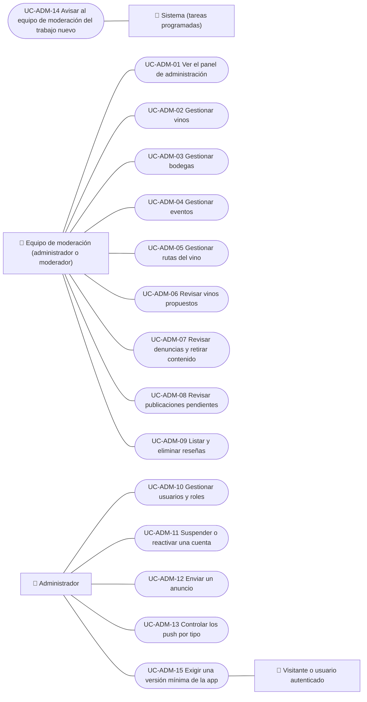

# Casos de uso

Casos de uso del equipo de Vinnot: el panel, la gestión del catálogo (vinos, bodegas, eventos y rutas), la revisión de vinos propuestos, denuncias, publicaciones y reseñas, la gestión de usuarios, los anuncios, el control de los push, el resumen de trabajo para el equipo de moderación y la versión mínima de la app. Cada caso vale para las plataformas indicadas.

| ID | Caso de uso | Plataformas | Actores |
|---|---|---|---|
| `UC-ADM-01` | [Ver el panel de administración](uc-adm-01-dashboard.md) | Web, APK | Equipo de moderación (administrador o moderador) |
| `UC-ADM-02` | [Gestionar vinos](uc-adm-02-manage-wines.md) | Web, APK | Equipo de moderación (administrador o moderador) |
| `UC-ADM-03` | [Gestionar bodegas](uc-adm-03-manage-wineries.md) | Web, APK | Equipo de moderación (administrador o moderador) |
| `UC-ADM-04` | [Gestionar eventos](uc-adm-04-manage-events.md) | Web, APK | Equipo de moderación (administrador o moderador) |
| `UC-ADM-05` | [Gestionar rutas del vino](uc-adm-05-manage-routes.md) | Web, APK | Equipo de moderación (administrador o moderador) |
| `UC-ADM-06` | [Revisar vinos propuestos](uc-adm-06-review-wine-submissions.md) | Web, APK | Equipo de moderación (administrador o moderador) |
| `UC-ADM-07` | [Revisar denuncias y retirar contenido](uc-adm-07-moderate-reports.md) | Web, APK | Equipo de moderación (administrador o moderador) |
| `UC-ADM-08` | [Revisar publicaciones pendientes](uc-adm-08-review-publications.md) | Web, APK | Equipo de moderación (administrador o moderador) |
| `UC-ADM-09` | [Listar y eliminar reseñas](uc-adm-09-manage-reviews.md) | Web, APK | Equipo de moderación (administrador o moderador) |
| `UC-ADM-10` | [Gestionar usuarios y roles](uc-adm-10-manage-users.md) | Web, APK | Administrador |
| `UC-ADM-11` | [Suspender o reactivar una cuenta](uc-adm-11-suspend-user.md) | Web, APK | Administrador |
| `UC-ADM-12` | [Enviar un anuncio](uc-adm-12-send-announcements.md) | Web, APK | Administrador |
| `UC-ADM-13` | [Controlar los push por tipo](uc-adm-13-control-push.md) | Web, APK | Administrador |
| `UC-ADM-14` | [Avisar al equipo de moderación del trabajo nuevo](uc-adm-14-moderation-digest.md) | Solo backend | Sistema (tareas programadas) |
| `UC-ADM-15` | [Exigir una versión mínima de la app](uc-adm-15-minimum-app-version.md) | Web, APK | Administrador, Visitante o usuario autenticado |

## Diagrama de casos de uso

[Ver diagrama de «Casos de uso · Diagrama de casos de uso» completo](https://images.vinnot.com/docs/diagrams/v1/es/modules-admin-use-cases-readme-5cdfb59e54e3.svg)

## Equivalencia con Lucidchart

| ID | IDs en Lucidchart |
|---|---|
| `UC-ADM-01` | [WEB UC-ADM-01](https://lucid.app/lucidchart/9f11a16b-bb5a-42fc-a9e8-0852b17bd241/edit), [APK UC-ADM-01](https://lucid.app/lucidchart/e095dd25-e8ac-41ba-bf5b-396e1055f217/edit) |
| `UC-ADM-02` | [WEB UC-ADM-02](https://lucid.app/lucidchart/9f11a16b-bb5a-42fc-a9e8-0852b17bd241/edit), [APK UC-ADM-02](https://lucid.app/lucidchart/e095dd25-e8ac-41ba-bf5b-396e1055f217/edit) |
| `UC-ADM-03` | [WEB UC-ADM-03](https://lucid.app/lucidchart/9f11a16b-bb5a-42fc-a9e8-0852b17bd241/edit), [APK UC-ADM-03](https://lucid.app/lucidchart/e095dd25-e8ac-41ba-bf5b-396e1055f217/edit) |
| `UC-ADM-04` | [WEB UC-ADM-04](https://lucid.app/lucidchart/9f11a16b-bb5a-42fc-a9e8-0852b17bd241/edit), [APK UC-ADM-04](https://lucid.app/lucidchart/e095dd25-e8ac-41ba-bf5b-396e1055f217/edit) |
| `UC-ADM-05` | [WEB UC-ADM-05](https://lucid.app/lucidchart/9f11a16b-bb5a-42fc-a9e8-0852b17bd241/edit), [APK UC-ADM-05](https://lucid.app/lucidchart/e095dd25-e8ac-41ba-bf5b-396e1055f217/edit) |
| `UC-ADM-06` | [WEB UC-MOD-05](https://lucid.app/lucidchart/9f11a16b-bb5a-42fc-a9e8-0852b17bd241/edit), [APK UC-MOD-04](https://lucid.app/lucidchart/e095dd25-e8ac-41ba-bf5b-396e1055f217/edit) |
| `UC-ADM-07` | [WEB UC-MOD-02](https://lucid.app/lucidchart/9f11a16b-bb5a-42fc-a9e8-0852b17bd241/edit), [WEB UC-MOD-03](https://lucid.app/lucidchart/9f11a16b-bb5a-42fc-a9e8-0852b17bd241/edit), [APK UC-MOD-01](https://lucid.app/lucidchart/e095dd25-e8ac-41ba-bf5b-396e1055f217/edit) |
| `UC-ADM-08` | [WEB UC-MOD-01](https://lucid.app/lucidchart/9f11a16b-bb5a-42fc-a9e8-0852b17bd241/edit), [APK UC-MOD-02](https://lucid.app/lucidchart/e095dd25-e8ac-41ba-bf5b-396e1055f217/edit) |
| `UC-ADM-09` | [WEB UC-MOD-04](https://lucid.app/lucidchart/9f11a16b-bb5a-42fc-a9e8-0852b17bd241/edit), [APK UC-MOD-03](https://lucid.app/lucidchart/e095dd25-e8ac-41ba-bf5b-396e1055f217/edit) |
| `UC-ADM-10` | [WEB UC-USR-01](https://lucid.app/lucidchart/9f11a16b-bb5a-42fc-a9e8-0852b17bd241/edit), [WEB UC-USR-02](https://lucid.app/lucidchart/9f11a16b-bb5a-42fc-a9e8-0852b17bd241/edit), [WEB UC-USR-04](https://lucid.app/lucidchart/9f11a16b-bb5a-42fc-a9e8-0852b17bd241/edit), [WEB UC-AUTH-12](https://lucid.app/lucidchart/9f11a16b-bb5a-42fc-a9e8-0852b17bd241/edit), [APK UC-ADM-06](https://lucid.app/lucidchart/e095dd25-e8ac-41ba-bf5b-396e1055f217/edit) |
| `UC-ADM-11` | [WEB UC-USR-03](https://lucid.app/lucidchart/9f11a16b-bb5a-42fc-a9e8-0852b17bd241/edit), [APK UC-ADM-06](https://lucid.app/lucidchart/e095dd25-e8ac-41ba-bf5b-396e1055f217/edit) |
| `UC-ADM-12` | [APK UC-ADM-07](https://lucid.app/lucidchart/e095dd25-e8ac-41ba-bf5b-396e1055f217/edit) |
| `UC-ADM-13` | [APK UC-ADM-08](https://lucid.app/lucidchart/e095dd25-e8ac-41ba-bf5b-396e1055f217/edit) |
| `UC-ADM-14` | Ninguno |
| `UC-ADM-15` | Ninguno |
