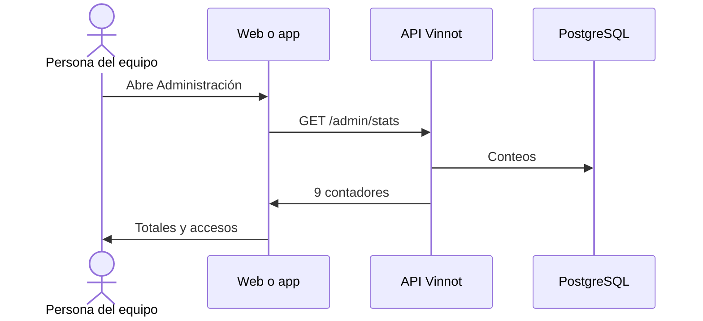

# UC-ADM-01 · Ver el panel de administración

| Campo | Valor |
|---|---|
| ID | `UC-ADM-01` |
| Módulo | [Administración y moderación](../README.md) |
| Plataformas | Web, APK |
| Actores | Equipo de moderación (administrador o moderador) |
| IDs en Lucidchart | [WEB UC-ADM-01](https://lucid.app/lucidchart/9f11a16b-bb5a-42fc-a9e8-0852b17bd241/edit), [APK UC-ADM-01](https://lucid.app/lucidchart/e095dd25-e8ac-41ba-bf5b-396e1055f217/edit) |
| Requisitos | [`RF-WEB-ADM-01`](../requirements.md), [`RF-WEB-ADM-02`](../requirements.md), [`RF-APK-ADM-01`](../requirements.md), [`RF-APK-ADM-02`](../requirements.md) |
| Casos de prueba | [`CP-ADM-01`](../testing.md), [`CP-ADM-02`](../testing.md), [`CP-ADM-03`](../testing.md) |

## Precondiciones

- La persona es administradora o moderadora.

## Postcondiciones

- La persona ve el estado del sistema y entra a cada gestión.

## Flujo principal

1. La persona abre «Administración».
2. El cliente pide `GET /admin/stats`.
3. Muestra los totales de vinos, bodegas, eventos, rutas, reseñas y usuarios, con usuarios activos, eventos publicados y rutas publicadas, y después las acciones rápidas. La primera, «Trabajo de moderación», abre `/admin/community` con las denuncias y publicaciones pendientes.
4. La persona entra a una gestión desde los accesos directos.

## Flujos alternativos

- 3a. La persona es moderadora: no ve el total de usuarios ni los accesos a usuarios y notificaciones.
- 2a. Una consulta falla: se muestra el error con reintento, nunca cero pendientes.

## Reglas de negocio

- Los contadores salen de consultas del backend, no del cliente.
- El panel es un acceso: cada gestión vuelve a validar el rol en el backend.

## Diagrama

[Ver diagrama de «UC-ADM-01 · Ver el panel de administración» completo](https://images.vinnot.com/docs/diagrams/v1/es/modules-admin-use-cases-uc-adm-01-dashboard-68ef71bbaa9d.svg)

Diagrama de componentes en Lucidchart: [WEB UC-ADM-01](https://lucid.app/lucidchart/9f11a16b-bb5a-42fc-a9e8-0852b17bd241/edit), [APK UC-ADM-01](https://lucid.app/lucidchart/e095dd25-e8ac-41ba-bf5b-396e1055f217/edit).

## Código

| Capa | Ubicación |
|---|---|
| Endpoints | `GET /admin/stats` |
| Backend | [`AdminDashboardController.java`](../../../../../backend/src/main/java/com/vinnot/admin/infrastructure/web/controller/AdminDashboardController.java), [`GetAdminStatsQueryHandler.java`](../../../../../backend/src/main/java/com/vinnot/admin/application/query/handler/GetAdminStatsQueryHandler.java) |
| Web | [`AdminDashboardPage.tsx`](../../../../../frontend-react/src/presentation/pages/admin/AdminDashboardPage.tsx), [`useAdminStats.ts`](../../../../../frontend-react/src/presentation/hooks/queries/admin/useAdminStats.ts), [`admin.service.ts`](../../../../../frontend-react/src/application/services/admin.service.ts) |
| App | `frontend-mobile/app/(app)/admin/index.tsx`, [`AdminDashboardScreen.tsx`](../../../../../frontend-mobile/src/presentation/features/admin/AdminDashboardScreen.tsx), [`admin.service.ts`](../../../../../frontend-mobile/src/application/services/admin.service.ts) |

## Tests automáticos

- Backend: [`AdminRoleAccessTest.java`](../../../../../backend/src/test/java/com/vinnot/admin/infrastructure/web/controller/AdminRoleAccessTest.java)
- Web: Ninguno
- App: [`AdminDashboardScreen.test.tsx`](../../../../../frontend-mobile/src/presentation/features/admin/AdminDashboardScreen.test.tsx), [`admin.service.test.ts`](../../../../../frontend-mobile/src/application/services/admin.service.test.ts)
