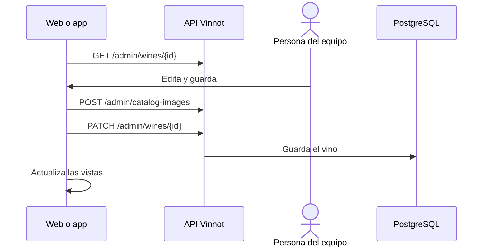

# UC-ADM-02 · Gestionar vinos

| Campo | Valor |
|---|---|
| ID | `UC-ADM-02` |
| Módulo | [Administración y moderación](../README.md) |
| Plataformas | Web, APK |
| Actores | Equipo de moderación (administrador o moderador) |
| IDs en Lucidchart | [WEB UC-ADM-02](https://lucid.app/lucidchart/9f11a16b-bb5a-42fc-a9e8-0852b17bd241/edit), [APK UC-ADM-02](https://lucid.app/lucidchart/e095dd25-e8ac-41ba-bf5b-396e1055f217/edit) |
| Requisitos | [`RF-WEB-ADM-03`](../requirements.md), [`RF-WEB-ADM-04`](../requirements.md), [`RF-WEB-ADM-05`](../requirements.md), [`RF-WEB-ADM-06`](../requirements.md), [`RF-WEB-ADM-07`](../requirements.md), [`RF-WEB-ADM-08`](../requirements.md), [`RF-APK-ADM-03`](../requirements.md), [`RF-APK-ADM-04`](../requirements.md), [`RF-APK-ADM-05`](../requirements.md), [`RF-APK-ADM-06`](../requirements.md), [`RF-APK-ADM-07`](../requirements.md), [`RF-APK-ADM-08`](../requirements.md) |
| Casos de prueba | [`CP-ADM-04`](../testing.md), [`CP-ADM-05`](../testing.md), [`CP-ADM-06`](../testing.md), [`CP-ADM-07`](../testing.md) |

## Precondiciones

- La persona es administradora o moderadora.

## Postcondiciones

- El vino quedó creado, editado o borrado, y las vistas afectadas se actualizaron.

## Flujo principal

1. La persona abre «Vinos»; la lista incluye los inactivos y permite buscar y paginar.
2. Elige crear o editar; para editar, el cliente carga el detalle por ID.
3. Completa bodega, nombre, tipo, añada, uvas, descripciones en español e inglés, alcohol, precios, temperatura, imagen y puntajes sensoriales, y marca si está activo o destacado.
4. Si eligió una imagen nueva, el cliente la sube con `POST /admin/catalog-images` y usa la URL devuelta.
5. El cliente envía `POST /admin/wines` o `PATCH /admin/wines/{id}` y, si sale bien, actualiza listas, detalle y estadísticas.

## Flujos alternativos

- 2a. La persona elige borrar y confirma un aviso que explica que el borrado es permanente e incluye sus reseñas, su perfil de IA y las entradas en Mi Bodega: el cliente envía `DELETE /admin/wines/{id}` y el vino se borra con sus reseñas, su cava y su perfil IA.
- 4a. La subida de la imagen falla: no se guarda el vino.
- 5a. Un dato no es válido, como un puntaje mayor a 100 o un precio negativo: la API responde 400.

## Reglas de negocio

- Bodega, nombre y tipo son obligatorios al crear.
- Un vino inactivo no aparece en el catálogo público.
- Un campo opcional vaciado se envía como borrado explícito; un campo que no se envía conserva su valor.
- Solo un administrador borra, con confirmación y con la identidad confirmada en los últimos 5 minutos ([UC-USR-12](../../users/use-cases/uc-usr-12-reauthenticate.md)).
- La edición del perfil IA está en [Perfiles y comparaciones IA](../../ai/README.md).

## Diagrama

[Ver diagrama de «UC-ADM-02 · Gestionar vinos» completo](https://images.vinnot.com/docs/diagrams/v1/es/modules-admin-use-cases-uc-adm-02-manage-wines-50656b56d557.svg)

Diagrama de componentes en Lucidchart: [WEB UC-ADM-02](https://lucid.app/lucidchart/9f11a16b-bb5a-42fc-a9e8-0852b17bd241/edit), [APK UC-ADM-02](https://lucid.app/lucidchart/e095dd25-e8ac-41ba-bf5b-396e1055f217/edit).

## Código

| Capa | Ubicación |
|---|---|
| Endpoints | `GET /admin/wines`, `GET /admin/wines/{id}`, `POST /admin/wines`, `PATCH /admin/wines/{id}`, `DELETE /admin/wines/{id}`, `POST /admin/catalog-images` |
| Backend | [`WineAdminController.java`](../../../../../backend/src/main/java/com/vinnot/admin/infrastructure/web/controller/WineAdminController.java), [`UpdateWineCommandHandler.java`](../../../../../backend/src/main/java/com/vinnot/wine/application/command/handler/UpdateWineCommandHandler.java), [`CatalogImageAdminController.java`](../../../../../backend/src/main/java/com/vinnot/admin/infrastructure/web/controller/CatalogImageAdminController.java), [`FieldUpdates.java`](../../../../../backend/src/main/java/com/vinnot/shared/application/command/FieldUpdates.java) |
| Web | [`AdminWinesPage.tsx`](../../../../../frontend-react/src/presentation/pages/admin/AdminWinesPage.tsx), [`useAdminWinesViewModel.ts`](../../../../../frontend-react/src/presentation/pages/admin/useAdminWinesViewModel.ts), [`useAdminWineMutations.ts`](../../../../../frontend-react/src/presentation/hooks/queries/admin/useAdminWineMutations.ts), [`patchRequest.ts`](../../../../../frontend-react/src/infrastructure/api/clients/patchRequest.ts), [`admin.service.ts`](../../../../../frontend-react/src/application/services/admin.service.ts), [`admin.client.ts`](../../../../../frontend-react/src/infrastructure/api/clients/admin.client.ts) |
| App | `frontend-mobile/app/(app)/admin/wines.tsx`, [`AdminWinesScreen.tsx`](../../../../../frontend-mobile/src/presentation/features/admin/AdminWinesScreen.tsx), [`AdminWineSheet.tsx`](../../../../../frontend-mobile/src/presentation/features/admin/AdminWineSheet.tsx), [`useAdminDetailEditor.ts`](../../../../../frontend-mobile/src/presentation/hooks/queries/admin/useAdminDetailEditor.ts), [`admin.service.ts`](../../../../../frontend-mobile/src/application/services/admin.service.ts), [`admin.client.ts`](../../../../../frontend-mobile/src/infrastructure/api/clients/admin.client.ts) |

## Tests automáticos

- Backend: [`WineCatalogMutationHandlersTest.java`](../../../../../backend/src/test/java/com/vinnot/wine/application/command/handler/WineCatalogMutationHandlersTest.java), [`AdminWineUpdateRegressionTest.java`](../../../../../backend/src/test/java/com/vinnot/wine/application/command/handler/AdminWineUpdateRegressionTest.java), [`AdminCatalogQueryHandlersTest.java`](../../../../../backend/src/test/java/com/vinnot/admin/application/query/handler/AdminCatalogQueryHandlersTest.java), [`FieldUpdatesTest.java`](../../../../../backend/src/test/java/com/vinnot/shared/application/command/FieldUpdatesTest.java), [`AdminSensitiveActionInterceptorTest.java`](../../../../../backend/src/test/java/com/vinnot/admin/infrastructure/web/AdminSensitiveActionInterceptorTest.java)
- Web: [`useAdminWinesViewModel.test.tsx`](../../../../../frontend-react/src/presentation/pages/admin/useAdminWinesViewModel.test.tsx), [`AdminDeleteConfirm.test.tsx`](../../../../../frontend-react/src/presentation/components/features/admin/AdminDeleteConfirm.test.tsx), [`AdminDeleteConfirm.copy.test.tsx`](../../../../../frontend-react/src/presentation/components/features/admin/AdminDeleteConfirm.copy.test.tsx), [`admin.service.test.ts`](../../../../../frontend-react/src/application/services/admin.service.test.ts), [`admin.client.test.ts`](../../../../../frontend-react/src/infrastructure/api/clients/admin.client.test.ts)
- App: [`adminWinesRoute.test.tsx`](../../../../../frontend-mobile/src/presentation/features/admin/__tests__/adminWinesRoute.test.tsx), [`useAdminDetailEditor.test.ts`](../../../../../frontend-mobile/src/presentation/hooks/queries/admin/useAdminDetailEditor.test.ts), [`admin.client.test.ts`](../../../../../frontend-mobile/src/infrastructure/api/clients/admin.client.test.ts), [`catalogAdminCopy.test.ts`](../../../../../frontend-mobile/src/shared/i18n/catalogAdminCopy.test.ts)
