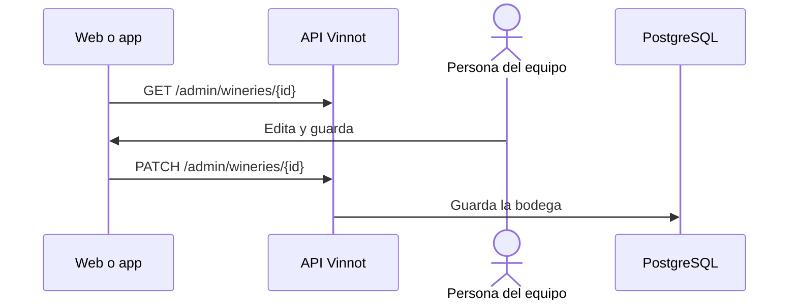

# UC-ADM-03 · Gestionar bodegas

| Campo | Valor |
|---|---|
| ID | `UC-ADM-03` |
| Módulo | [Administración y moderación](../README.md) |
| Plataformas | Web, APK |
| Actores | Equipo de moderación (administrador o moderador) |
| IDs en Lucidchart | [WEB UC-ADM-03](https://lucid.app/lucidchart/9f11a16b-bb5a-42fc-a9e8-0852b17bd241/edit), [APK UC-ADM-03](https://lucid.app/lucidchart/e095dd25-e8ac-41ba-bf5b-396e1055f217/edit) |
| Requisitos | [`RF-WEB-ADM-09`](../requirements.md), [`RF-APK-ADM-09`](../requirements.md) |
| Casos de prueba | [`CP-ADM-08`](../testing.md), [`CP-ADM-09`](../testing.md), [`CP-ADM-10`](../testing.md) |

## Precondiciones

- La persona es administradora o moderadora.

## Postcondiciones

- La bodega quedó creada, editada o borrada.

## Flujo principal

1. La persona abre «Bodegas» y busca.
2. Elige crear o editar; para editar, el cliente carga el detalle por ID.
3. Completa nombre, país, región, descripción, imagen, contacto, dirección y coordenadas.
4. El cliente envía `POST /admin/wineries` o `PATCH /admin/wineries/{id}`.

## Flujos alternativos

- 2a. La persona elige borrar y confirma un aviso que explica que sus vinos siguen en el catálogo sin bodega: la bodega se borra, sus vinos siguen existiendo sin bodega y se quita de las rutas.
- 4a. Solo se envía la latitud o la longitud: la API responde 400.

## Reglas de negocio

- Nombre y país son obligatorios.
- Las coordenadas se guardan o se borran juntas.
- Un campo opcional vaciado se envía como borrado explícito; un campo que no se envía conserva su valor.
- Solo un administrador borra, con confirmación y con la identidad confirmada en los últimos 5 minutos ([UC-USR-12](../../users/use-cases/uc-usr-12-reauthenticate.md)).

## Diagrama

[Ver diagrama de «UC-ADM-03 · Gestionar bodegas» completo](https://images.vinnot.com/docs/diagrams/v1/es/modules-admin-use-cases-uc-adm-03-manage-wineries-634b75492288.svg)

Diagrama de componentes en Lucidchart: [WEB UC-ADM-03](https://lucid.app/lucidchart/9f11a16b-bb5a-42fc-a9e8-0852b17bd241/edit), [APK UC-ADM-03](https://lucid.app/lucidchart/e095dd25-e8ac-41ba-bf5b-396e1055f217/edit).

## Código

| Capa | Ubicación |
|---|---|
| Endpoints | `GET /admin/wineries`, `GET /admin/wineries/{id}`, `POST /admin/wineries`, `PATCH /admin/wineries/{id}`, `DELETE /admin/wineries/{id}` |
| Backend | [`WineryAdminController.java`](../../../../../backend/src/main/java/com/vinnot/admin/infrastructure/web/controller/WineryAdminController.java), [`CreateWineryCommandHandler.java`](../../../../../backend/src/main/java/com/vinnot/winery/application/command/handler/CreateWineryCommandHandler.java), [`UpdateWineryCommandHandler.java`](../../../../../backend/src/main/java/com/vinnot/winery/application/command/handler/UpdateWineryCommandHandler.java) |
| Web | [`AdminWineriesPage.tsx`](../../../../../frontend-react/src/presentation/pages/admin/AdminWineriesPage.tsx), [`useAdminWineriesViewModel.ts`](../../../../../frontend-react/src/presentation/pages/admin/useAdminWineriesViewModel.ts), [`useAdminWineryMutations.ts`](../../../../../frontend-react/src/presentation/hooks/queries/admin/useAdminWineryMutations.ts), [`admin.service.ts`](../../../../../frontend-react/src/application/services/admin.service.ts), [`admin.client.ts`](../../../../../frontend-react/src/infrastructure/api/clients/admin.client.ts) |
| App | `frontend-mobile/app/(app)/admin/wineries.tsx`, [`AdminWineriesScreen.tsx`](../../../../../frontend-mobile/src/presentation/features/admin/AdminWineriesScreen.tsx), [`AdminWinerySheet.tsx`](../../../../../frontend-mobile/src/presentation/features/admin/AdminWinerySheet.tsx), [`admin.service.ts`](../../../../../frontend-mobile/src/application/services/admin.service.ts), [`admin.client.ts`](../../../../../frontend-mobile/src/infrastructure/api/clients/admin.client.ts) |

## Tests automáticos

- Backend: [`CreateWineryAdminRequestTest.java`](../../../../../backend/src/test/java/com/vinnot/admin/infrastructure/web/request/CreateWineryAdminRequestTest.java), [`UpdateWineryCommandHandlerTest.java`](../../../../../backend/src/test/java/com/vinnot/winery/application/command/handler/UpdateWineryCommandHandlerTest.java), [`DeleteWineryCommandHandlerTest.java`](../../../../../backend/src/test/java/com/vinnot/winery/application/command/handler/DeleteWineryCommandHandlerTest.java)
- Web: [`AdminWineriesPage.form.test.tsx`](../../../../../frontend-react/src/presentation/pages/admin/__tests__/AdminWineriesPage.form.test.tsx), [`adminWineryForm.test.ts`](../../../../../frontend-react/src/domain/admin/adminWineryForm.test.ts), [`AdminDeleteConfirm.copy.test.tsx`](../../../../../frontend-react/src/presentation/components/features/admin/AdminDeleteConfirm.copy.test.tsx)
- App: [`adminListRoutes.test.tsx`](../../../../../frontend-mobile/src/presentation/features/admin/__tests__/adminListRoutes.test.tsx), [`catalogAdminCopy.test.ts`](../../../../../frontend-mobile/src/shared/i18n/catalogAdminCopy.test.ts)
