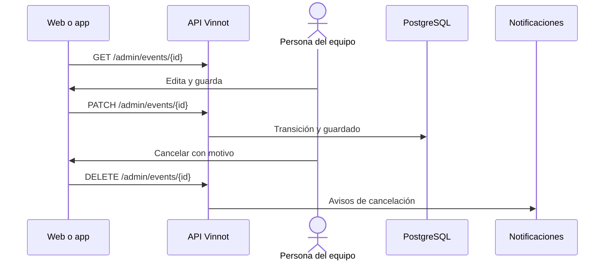

# UC-ADM-04 · Gestionar eventos

| Campo | Valor |
|---|---|
| ID | `UC-ADM-04` |
| Módulo | [Administración y moderación](../README.md) |
| Plataformas | Web, APK |
| Actores | Equipo de moderación (administrador o moderador) |
| IDs en Lucidchart | [WEB UC-ADM-04](https://lucid.app/lucidchart/9f11a16b-bb5a-42fc-a9e8-0852b17bd241/edit), [APK UC-ADM-04](https://lucid.app/lucidchart/e095dd25-e8ac-41ba-bf5b-396e1055f217/edit) |
| Requisitos | [`RF-WEB-ADM-10`](../requirements.md), [`RF-WEB-ADM-11`](../requirements.md), [`RF-WEB-ADM-12`](../requirements.md), [`RF-APK-ADM-10`](../requirements.md), [`RF-APK-ADM-11`](../requirements.md), [`RF-APK-ADM-12`](../requirements.md) |
| Casos de prueba | [`CP-ADM-11`](../testing.md), [`CP-ADM-12`](../testing.md), [`CP-ADM-13`](../testing.md), [`CP-ADM-14`](../testing.md), [`CP-ADM-56`](../testing.md) |

## Precondiciones

- La persona es administradora o moderadora.

## Postcondiciones

- El evento quedó creado, editado o cancelado.

## Flujo principal

1. La persona abre «Eventos» y busca por texto, tipo o ciudad.
2. Elige crear o editar; para editar, el cliente carga el detalle por ID.
3. Completa el mismo editor que usan los organizadores, con fechas, ubicación, precio, cupo, contacto, portada e inscripción, y el estado: borrador, publicado o completado. El editor no ofrece «Cancelado».
4. El cliente envía `POST /admin/events` o `PATCH /admin/events/{id}`, con el estado solo si cambió, y la API aplica la transición de estado.

## Flujos alternativos

- 2a. Un administrador elige cancelar el evento: el diálogo avisa que cancelar es definitivo y que los pagos online se devuelven automáticamente por Mercado Pago; confirma el motivo («Circunstancias imprevistas» viene seleccionado) y el cliente envía `DELETE /admin/events/{id}` con el motivo.
- 2b. Al cancelar, el evento no se borra: se cancelan las inscripciones activas, se avisa a quienes asisten y al organizador, y los pagos online se devuelven.
- 4a. La transición no está permitida: la API responde 400.
- 4b. La solicitud pide pasar el evento a cancelado: la API responde 400 `USE_CANCEL_ENDPOINT`.

## Reglas de negocio

- Si no se elige organizador, el evento queda a nombre de quien lo crea.
- Las reglas del evento, sus estados y el cobro online son los de [Eventos](../../events/README.md) y [Partners](../../partner/README.md).
- Motivos de cancelación: circunstancias imprevistas, conflicto de agenda, lugar no disponible, poca inscripción, clima, salud y seguridad, y otro.
- Un campo opcional vaciado se envía como borrado explícito; un campo que no se envía conserva su valor.
- Un evento agotado se edita como publicado; reenviar el estado actual no es un cambio de estado.

## Diagrama

[Ver diagrama de «UC-ADM-04 · Gestionar eventos» completo](https://images.vinnot.com/docs/diagrams/v1/es/modules-admin-use-cases-uc-adm-04-manage-events-583384a6dcac.svg)

Diagrama de componentes en Lucidchart: [WEB UC-ADM-04](https://lucid.app/lucidchart/9f11a16b-bb5a-42fc-a9e8-0852b17bd241/edit), [APK UC-ADM-04](https://lucid.app/lucidchart/e095dd25-e8ac-41ba-bf5b-396e1055f217/edit).

## Código

| Capa | Ubicación |
|---|---|
| Endpoints | `GET /admin/events`, `GET /admin/events/{id}`, `POST /admin/events`, `PATCH /admin/events/{id}`, `DELETE /admin/events/{id}` |
| Backend | [`EventAdminController.java`](../../../../../backend/src/main/java/com/vinnot/admin/infrastructure/web/controller/EventAdminController.java), [`UpdateEventCommandHandler.java`](../../../../../backend/src/main/java/com/vinnot/event/application/command/handler/UpdateEventCommandHandler.java), [`EventCancellationService.java`](../../../../../backend/src/main/java/com/vinnot/event/application/service/EventCancellationService.java) |
| Web | [`AdminEventsPage.tsx`](../../../../../frontend-react/src/presentation/pages/admin/AdminEventsPage.tsx), [`useAdminEventsViewModel.ts`](../../../../../frontend-react/src/presentation/pages/admin/useAdminEventsViewModel.ts), [`useAdminEventMutations.ts`](../../../../../frontend-react/src/presentation/hooks/queries/admin/useAdminEventMutations.ts), [`EventFormModal.tsx`](../../../../../frontend-react/src/presentation/components/features/event/EventFormModal.tsx), [`CancelEventDialog.tsx`](../../../../../frontend-react/src/presentation/components/features/event/CancelEventDialog.tsx), [`admin.service.ts`](../../../../../frontend-react/src/application/services/admin.service.ts), [`admin.client.ts`](../../../../../frontend-react/src/infrastructure/api/clients/admin.client.ts) |
| App | `frontend-mobile/app/(app)/admin/events.tsx`, [`AdminEventsScreen.tsx`](../../../../../frontend-mobile/src/presentation/features/admin/AdminEventsScreen.tsx), [`AdminEventSheet.tsx`](../../../../../frontend-mobile/src/presentation/features/admin/AdminEventSheet.tsx), [`CancelEventSheet.tsx`](../../../../../frontend-mobile/src/presentation/features/event/CancelEventSheet.tsx), [`admin.service.ts`](../../../../../frontend-mobile/src/application/services/admin.service.ts), [`admin.client.ts`](../../../../../frontend-mobile/src/infrastructure/api/clients/admin.client.ts) |

## Tests automáticos

- Backend: [`UpdateEventCommandHandlerTest.java`](../../../../../backend/src/test/java/com/vinnot/event/application/command/handler/UpdateEventCommandHandlerTest.java), [`EventStatusTransitionTest.java`](../../../../../backend/src/test/java/com/vinnot/event/domain/model/EventStatusTransitionTest.java), [`CancelEventRequestTest.java`](../../../../../backend/src/test/java/com/vinnot/event/infrastructure/web/request/CancelEventRequestTest.java)
- Web: [`useAdminEventsViewModel.test.tsx`](../../../../../frontend-react/src/presentation/pages/admin/useAdminEventsViewModel.test.tsx), [`eventEditor.test.ts`](../../../../../frontend-react/src/domain/event/eventEditor.test.ts), [`useAdminEventMutations.test.tsx`](../../../../../frontend-react/src/presentation/hooks/queries/admin/useAdminEventMutations.test.tsx)
- App: [`CancelEventSheet.test.tsx`](../../../../../frontend-mobile/src/presentation/features/event/CancelEventSheet.test.tsx), [`useEventEditor.test.ts`](../../../../../frontend-mobile/src/presentation/features/event/useEventEditor.test.ts)
